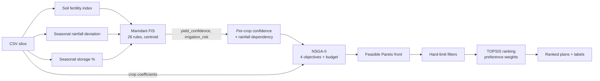

# Algorithms

Every algorithm in the system, as implemented (not as described in the paper). Code references are to `agrooptimize-backend/app/`. Scoring formulas used only by the UI (radar, dashboard KPIs) are in [SCORING_AND_RANKING.md](SCORING_AND_RANKING.md).



---

## 1. Soil fertility index (`data/preprocessing.py::compute_soil_fertility_index`)

```
ph_score  = clamp(100 − 40·|pH − 6.5|, 0, 100)          # 100 at pH 6.5, 0 at pH 4.0 / 9.0
oc_score  = clamp(100 · OC% / 1.0, 0, 100)               # saturates at 1.0 % organic carbon
npk_score = mean(S(N), S(P), S(K)),  S: Low→30, Medium→60, High→90 (unknown→50)
index     = 0.3·ph_score + 0.3·oc_score + 0.4·npk_score  ∈ [0, 100], rounded to 2 dp
```

* **Why:** collapses five soil attributes into one fuzzy input so the rule base stays 3-dimensional.
* **Arbitrary constants:** 6.5 optimum and slope 40 (pH), 1.0 % OC saturation, 30/60/90 status scores, 0.3/0.3/0.4 weights. Documented as modelling choices, no citation.
* **Observed range in data:** 61.0 – 77.4 (all slices fall in fuzzy sets *medium*/*good*; *poor* is never exercised by real data).
* **Alternatives:** a published Soil Quality Index (e.g. Andrews et al. scoring functions), or feeding N/P/K status to the FIS directly.

## 2. Mamdani fuzzy inference (`fuzzy/engine.py`)

### 2.1 Variables and membership functions (all triangular, `skfuzzy.trimf`)

| Variable | Universe (step 1) | Set: [a, b, c] |
|---|---|---|
| **rainfall_dev** (input, %) | −60 … 60 | deficit [−60, −60, −5] · normal [−15, 0, 15] · surplus [5, 60, 60] |
| **water_storage** (input, %) | 0 … 100 | low [0, 0, 35] · medium [20, 50, 75] · high [60, 100, 100] |
| **soil_fert** (input, index) | 0 … 100 | poor [0, 0, 40] · medium [25, 50, 75] · good [60, 100, 100] |
| **yield_conf** (output, %) | 0 … 100 | low [0, 0, 45] · medium [30, 55, 75] · high [65, 100, 100] |
| **irrigation_risk** (output, %) | 0 … 100 | low [0, 0, 35] · medium [25, 50, 75] · high [60, 100, 100] |

Inputs are clipped to the universe before inference (`np.clip`). Shoulder sets ([a, a, c]) behave as left/right-open. Note gaps: `rainfall_dev` between −15 and −5 belongs only to deficit/normal partially; there is no point with zero total membership.

### 2.2 Rule base (26 rules, `_build_system`)

AND = `min`, rule aggregation = `max`, implication = `min` (scikit-fuzzy defaults).

| # | IF | THEN yield_conf | THEN irrigation_risk |
|---|---|---|---|
| 1 | rain deficit ∧ water low | low | high |
| 2 | rain deficit ∧ water medium | medium | medium |
| 3 | rain deficit ∧ water high | medium | medium |
| 4 | rain normal ∧ water low | medium | medium |
| 5 | rain normal ∧ water medium | high | low |
| 6 | rain normal ∧ water high | high | low |
| 7 | rain surplus ∧ water low | medium | low |
| 8 | rain surplus ∧ water medium | high | low |
| 9 | rain surplus ∧ water high | high | low |
| 10 | soil good | high | – |
| 11 | soil poor | low | – |
| 12 | soil medium ∧ rain normal | medium | – |
| 13 | water high ∧ soil good | high | – |
| 14 | water low ∧ soil poor | low | high |
| 15 | deficit ∧ water low ∧ soil poor | low | high |
| 16 | surplus ∧ water high ∧ soil poor | medium | – |
| 17 | water high ∧ soil poor | – | low |
| 18 | water low ∧ soil medium | – | high |
| 19 | deficit ∧ water medium ∧ soil good | medium | – |
| 20 | deficit ∧ soil poor | low | high |
| 21 | normal ∧ water high ∧ soil good | high | low |
| 22 | normal ∧ water medium ∧ soil medium | medium | medium |
| 23 | surplus ∧ water medium ∧ soil medium | medium | – |
| 24 | deficit ∧ water high ∧ soil medium | medium | low |
| 25 | surplus ∧ water high ∧ soil good | high | low |
| 26 | deficit ∧ water medium ∧ soil poor | low | high |

Rule-base properties worth knowing for the viva:

* **Rules do not "cap" or "override".** Mamdani max-aggregation only ever *adds* consequent mass. Rule 5 (normal ∧ medium → high) and rule 22 (… ∧ soil medium → medium) both fire and the centroid lands between the sets. A rule can pull the centroid toward its consequent; it cannot stop another rule from firing.
* **Six rules are provably inert** (corrected from five; rule 13 was missed — see [FUZZY_SYSTEM_ANALYSIS.md](FUZZY_SYSTEM_ANALYSIS.md) §4, where `app/fuzzy/audit.py` now computes this and the tests check it). If rule B has the same consequent as rule A and a strictly more specific antecedent, B's firing strength (a `min` over more terms) is never larger than A's, so it never changes the aggregated output. Measured by deleting each rule and re-evaluating a 21×21×21 input grid (9,261 points):

  | Rule removed | Max change in yield_conf | Max change in irrigation_risk | Subsumed by |
  |---|---|---|---|
  | 13 | 0 | 0 | 10 |
  | 15 | 0 | 0 | 1 (and 14, 20) |
  | 19 | 0 | 0 | 2 |
  | 21 | 0 | 0 | 6 |
  | 25 | 0 | 0 | 9 |
  | 26 | 0 | 0 | 20 |
  | 22 / 24 | 0 | 22.6 / 15.7 pts | yield part subsumed by 12 / 3; risk part active |
  | 16, 17, 18, 20, 23 | up to 19.7 pts | up to 52.1 pts | active |

  The code comment on rule 19 ("caps it at medium") therefore does not describe its behaviour; with rule 10 (soil good → high) also firing, rule 19 contributes nothing. Effective rule count: **20**, not 26 (TODO T-5).
* **Incompleteness for `irrigation_risk`.** Only water/rain rules (1–9, 14, 15, 17, 18, 20–22, 24–26) set it; soil-only situations leave it to the rain×water grid, which is complete (all 9 combinations), so an output always exists.
* **Observed output range** on the real data (60 location-season-years): yield_confidence 0.547–0.883, irrigation_risk 0.117–0.500. Low water and poor soil sets are never activated by the dataset.

### 2.3 Defuzzification
Centroid (scikit-fuzzy default) on each output universe, divided by 100 → `[0, 1]`. If `compute()` raises (no rule fired – cannot happen after clipping, but guarded) the engine returns 0.5/0.5. Dominant linguistic labels (`rainfall_label`, …) are the set with maximum membership at the clipped input.

### 2.4 Per-crop adjustment (`crop_yield_confidence`)
```
factor  = {Very Low: 0.1, Low: 0.3, Medium: 0.6, High: 1.0}[Rainfall_Dependency]   (unknown → 0.5)
penalty = irrigation_risk · factor · 0.4
crop_confidence = clip(yield_confidence · (1 − penalty), 0, 1)
```
Maximum penalty 40 % (constant 0.4 is arbitrary). This is the **only** channel through which fuzzy logic influences optimisation.

### 2.5 Why Mamdani / alternatives
* **Chosen because:** the paper specifies a Mamdani FIS; rules are human-readable, linguistic outputs can be plotted.
* **Sugeno/TSK** would give smoother, faster, differentiable outputs and allow data-driven tuning (ANFIS) once real outcome data exist.
* **Type-2 fuzzy** would model uncertainty in the membership functions themselves – more defensible for "uncertainty" claims.
* **Probabilistic scenarios** (the paper's "probability theory") – sampling rainfall/storage from historical distributions and optimising expected value or CVaR – would make uncertainty affect the *shape* of the trade-off, which the current design cannot (see §4.6).

---

## 3. Optimisation problem (`optimization/problem.py`)

### 3.1 Decision variables (chromosome length 3n, n = candidate crops, 2–5 in practice)

| Block | Genes | Bounds | Meaning |
|---|---|---|---|
| Allocation | x₀…x_{n−1} | [1e−4, 1] | Share of land; normalised to sum 1 at evaluation and by repair |
| Irrigation | x_n…x_{2n−1} | [0.7, 1.3] | Multiplier on net irrigation need |
| Fertiliser | x_{2n}…x_{3n−1} | [0.7, 1.3] | Multiplier on the NPK dose |

Lower bound 1e−4 means **every candidate crop always receives a non-zero area**; plans therefore always contain all n crops (UI hides shares < 1 %).

### 3.2 Objectives (vectorised over the population), with aᵢ = share·total_land_ha

| | Formula | Direction |
|---|---|---|
| f1 yield (t) | Σ aᵢ · Yieldᵢ/1000 · crop_confidenceᵢ | maximise (stored as −f1) |
| f2 cost (₹) | Σ aᵢ · [ fertᵢ·(Nᵢ·12.87 + Pᵢ·58.70 + Kᵢ·56.67) + Pesticideᵢ + Labourᵢ·319 ] | minimise |
| f3 water (L) | Σ aᵢ · irrᵢ · max(WaterReqᵢ − effective_rain, 0) · 10 000 | minimise |
| f4 env. impact | √( L · C ), L = Σ aᵢ·fertᵢ·Nᵢ ,  C = Σ aᵢ·[fertᵢ·(Nᵢ+Pᵢ+Kᵢ)·0.15 + irrᵢ·WaterReqᵢ·0.01] | minimise |

Constraint (only when `budget_rs` is given): g = f2 − budget ≤ 0.

Properties that matter (verified numerically, see [RESEARCH_REVIEW.md](RESEARCH_REVIEW.md) §4):

1. **Multipliers never improve any objective.** Yield does not depend on `irr` or `fert`; cost, water and impact increase with them. Any multiplier above 0.7 is dominated, so NSGA-II drives them to 0.7: in the final fronts 74–99 % of fertiliser genes and 52–100 % of irrigation genes are < 0.72. The "irrigation/fertiliser optimisation" is effectively inert.
2. **f1–f3 are linear in area** once multipliers sit at their lower bound; the front is a trade-off between crops' per-hectare coefficient vectors. Yield is heavily dominated by sugarcane/tapioca/banana/coconut tonnage.
3. **f4 uses gross `Water_Req_mm`** in the carbon term but f3 uses *net* irrigation – inconsistent treatment of pumping.
4. **f2 excludes water/energy, seed, machinery, land rent.** `WATER_COST_RS_PER_MM_PER_HA` exists in config but is deliberately unwired.
5. Yield–cost correlation across the returned fronts is 0.85–1.00 for 3–5-crop problems; for 2-crop Summer problems it is −1 (no trade-off between yield and cost).

### 3.3 Constraint handling
pymoo's constraint-domination: a feasible solution beats an infeasible one; between infeasible solutions the smaller violation wins. Infeasible final solutions are flagged `feasible=False` by `extract_pareto_plans` and dropped by the callers. An infeasible budget therefore yields an empty plan list (HTTP 200) rather than an error.

---

## 4. NSGA-II (`optimization/nsga2_runner.py`, `operators.py`)

### 4.1 Configuration

| Component | Implementation | Value |
|---|---|---|
| Population | `pop_size` | 80 (`/api/farm-plans`), 100 (dashboard endpoints), 24 in fast tests |
| Generations | termination `("n_gen", n)` | 200 (fast tests 15) |
| Initial sampling | pymoo `FloatRandomSampling` | uniform in bounds, then repaired |
| Parent selection | pymoo default binary tournament | compares by constraint violation, then Pareto dominance, then crowding distance |
| Crossover | custom `SinglePointCrossover` | pymoo decides per mating with p = 0.85; cut point uniform in 1…3n−1; tails swapped |
| Mutation | custom `GaussianMutation` | every gene independently with p = 0.12; δ ~ N(0, 0.12·(xu−xl)); clip to bounds |
| Repair | custom `AllocationRepair` | allocation block clipped ≥0, all-zero rows → uniform, renormalised to sum 1; all genes clipped to bounds |
| Survival | pymoo `RankAndCrowding` | fast non-dominated sort, then crowding distance |
| Duplicates | `eliminate_duplicates=True` | identical offspring discarded |
| Seed | `config.NSGA2_SEED = 42` | `np.random.seed(seed)` for custom operators **and** `seed=` for pymoo's own generator |

**Reproducibility and thread safety.** Two RNG streams are involved: pymoo's seeded `Generator` (sampling, selection, crossover yes/no) and NumPy's *global* RNG (cut points, mutation). Because the global RNG is process-wide, concurrent requests used to interfere: measured on the original code, 20 of 40 concurrent runs produced a different front than the same seed run alone. Since 2026-09-29 each run holds `_NSGA2_RUN_LOCK`; the measurement is 0 of 40, and `tests/test_hardening.py::test_concurrent_runs_match_serial_runs` guards it. A cleaner long-term fix is to pass pymoo's `random_state` into the operators (would change outputs, so not done).

### 4.2 Why single-point crossover and Gaussian mutation
Chosen to match the paper literally. For real-coded chromosomes, SBX + polynomial mutation (pymoo defaults) are the standard choice; single-point crossover on a block-structured chromosome mostly swaps whole multiplier blocks and cuts the allocation block at one place, which limits recombination of allocation patterns.

### 4.3 Output decoding
`extract_pareto_plans` decodes every individual of `result.X` (pymoo returns the non-dominated set of the final population): allocation renormalised, area = share × land, objectives rounded (yield 3 dp, cost 2 dp, water 1 dp, impact 3 dp).

### 4.4 Convergence history and hypervolume (`extract_convergence_history`)
When `track_history=True` pymoo deep-copies the algorithm each generation. For each generation: best and mean of each raw objective over the surviving population, and hypervolume:
```
lo, hi = min/max of F over ALL generations of this run
F_norm = clip((F − lo) / (hi − lo), 0, 1.5)
HV     = pymoo HV(ref_point = [1.1, 1.1, 1.1, 1.1])(F_norm)
```
Consequences: HV is **run-relative** (normalised by that run's own extremes), so values are not comparable between runs, districts or the fuzzy/non-fuzzy variants. Typical run: HV 0.26 → 0.81 (Salem Kharif, pop 100).

### 4.5 Why NSGA-II / alternatives
* **Chosen because:** the paper specifies it; widely taught; returns a spread Pareto set in one run.
* **Caveat:** with 4 objectives NSGA-II's crowding distance loses selection pressure (many-objective regime); **NSGA-III** or **MOEA/D** are designed for ≥4 objectives.
* **Exact alternative:** because f1–f3 are linear in the land shares, an ε-constraint method with an LP solver would give the exact trade-off curve and a proof of optimality; the square-root in f4 is the only non-linearity (it could be linearised by optimising L and C separately). This is the strongest comparison baseline for the report.
* **Performance:** a full run takes ≈0.3 s (pop 80, 200 generations) without history and ≈0.8 s with history.

### 4.6 How much does fuzzy logic change the optimum?
Fuzzy confidence multiplies each crop's yield by a constant. It rescales f1 per crop but does not touch f2–f4. `GET /api/compare-fuzzy` therefore shows identical min-cost, min-water and min-impact values for the fuzzy and non-fuzzy runs; only best-yield differs (e.g. Salem Kharif 13.96 vs 26.96 t/ha). The crop *ranking* by yield can change when dependencies differ, which is the genuine effect to report.

---

## 5. Decision stage (`decision/ranking.py`)

### 5.1 Hard-limit filters (`filter_plans`)
Keep plans with cost ≤ `max_cost_rs`, water ≤ `max_water_liters`, yield ≥ `min_yield_tonnes`, impact ≤ `max_env_impact` (each optional). Applied after NSGA-II, so an over-restrictive filter can return 0 plans.

### 5.2 TOPSIS (`rank_plans`)
```
for each objective j: n_ij = (v_ij − min_j)/(max_j − min_j)      (0.5 if constant)
                      flipped to 1 − n_ij for cost, water, env     → higher is better
M_ij  = w_j · n_ij
A⁺_j  = max_i M_ij,  A⁻_j = min_i M_ij
d⁺_i  = ‖M_i − A⁺‖₂,  d⁻_i = ‖M_i − A⁻‖₂
C_i   = d⁻_i / (d⁺_i + d⁻_i)       (0.5 if both 0)
rank by C_i descending, keep top 50 (plan_service) or 100 (dashboard)
```
Differences from classical TOPSIS (Hwang & Yoon, 1981): min–max instead of vector normalisation, which makes the ideal/anti-ideal exactly 1·w and 0·w per criterion. Weights per preference:

| Preference | yield | cost | water | env |
|---|---|---|---|---|
| balanced | 0.300 | 0.233 | 0.233 | 0.233 |
| max_yield | 0.55 | 0.15 | 0.15 | 0.15 |
| min_cost | 0.15 | 0.55 | 0.15 | 0.15 |
| min_water | 0.15 | 0.15 | 0.55 | 0.15 |
| min_env_impact | 0.15 | 0.15 | 0.15 | 0.55 |

The "balanced" 0.30 was tuned empirically (documented in `ranking.py`) because cost, water and impact are strongly correlated with yield. Alternatives: knee-point selection (no weights), VIKOR (explicit compromise), PROMETHEE II (pairwise outranking), AHP-derived weights elicited from farmers.

### 5.3 Per-plan labels
* **`normalized_scores`** – the flipped min–max values above (0–1, higher = better).
* **`confidence_label`** – land-weighted crop confidence Σ shareᵢ·crop_confidenceᵢ bucketed ≥0.66 High, ≥0.33 Moderate, else Low. With the observed confidence range (≈0.44–0.88) "Low" never occurs.
* **`trade_off_summary`** – raw (un-flipped) min–max position of each objective bucketed at 0.33/0.66 → "High yield, Moderate cost, …" so "High cost" always means expensive.
* **`allocation_percent`** – largest-remainder rounding so the displayed shares sum to exactly 100.00.

---

## 6. Other derived computations (summary; details in [SCORING_AND_RANKING.md](SCORING_AND_RANKING.md))

| Computation | Where | Essence |
|---|---|---|
| Plans A/B/C | `dashboard_service.get_comparison` | #1 of TOPSIS balanced / max_yield / min_cost over one front |
| Radar scores | `_radar_scores` | min–max over the 3 compared plans ×100; risk = (1−irrigation_risk)·100; market = (1−mean dependency factor)·100 |
| Fuzzy vs non-fuzzy | `get_fuzzy_comparison` | two NSGA-II runs (`use_fuzzy` True/False), per-ha best/min summaries |
| Dashboard KPIs | `get_dashboard` | mean yield, year-over-year %, fertility index, irrigation share of demand, rule-based actions |
| Current season | `_current_season` | today's month → first season in `SEASON_MONTH_MAP` containing it (Feb/Mar → Rabi) |
| History rows | `get_history` | per saved run: top plan yield/cost ÷ its area |
