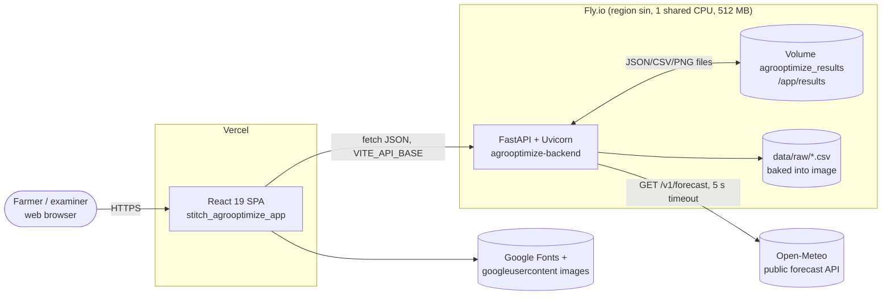
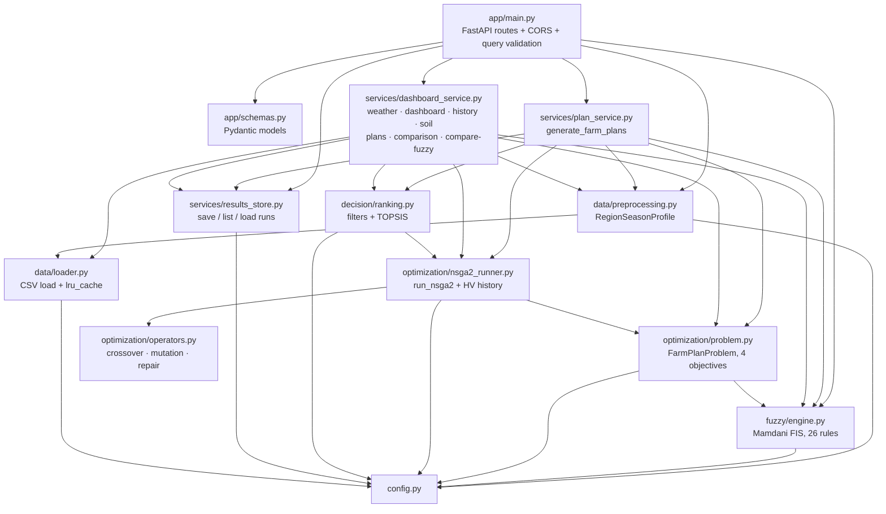
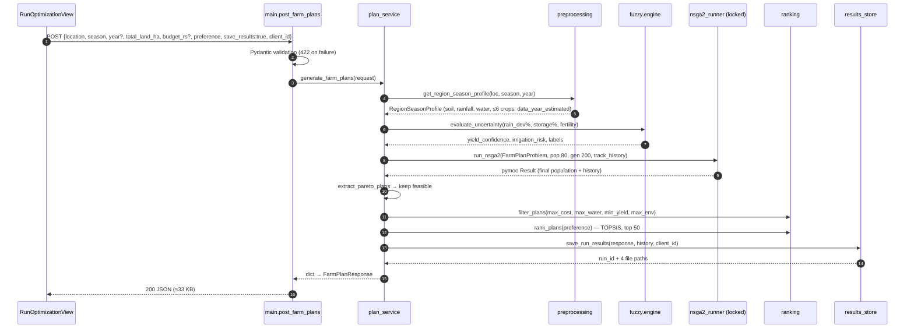
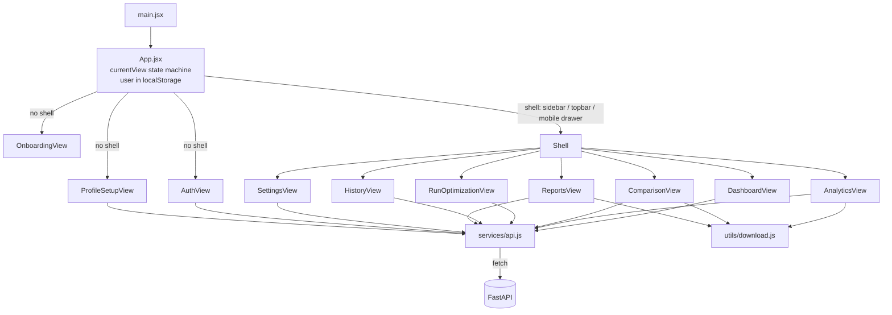

# Architecture

AgroOptimize is a two-tier web application: a **React SPA** (`stitch_agrooptimize_app/`) talking JSON over HTTPS to a **stateless FastAPI service** (`agrooptimize-backend/`) that runs a data → fuzzy → NSGA-II → TOPSIS pipeline over 16 CSV files. There is **no database** and **no server-side user model**: user profiles live in browser `localStorage`, saved optimisation runs live as files on a disk volume.

## 1. System context

## 2. Backend module structure

Design properties:

* **Layered and acyclic.** Data → fuzzy → optimisation → decision → services → HTTP. Lower layers never import upward (`ranking.py` imports only the `FarmPlan` dataclass from the runner).
* **Two orchestrators.** `plan_service.generate_farm_plans` serves `POST /api/farm-plans` and the CLI (≤50 plans, persistence, filters, user preference). `dashboard_service._run_dashboard_pareto_front` serves the dashboard endpoints (population 100, up to 100 plans, no persistence, memoised). They deliberately share the same lower-level modules.
* **Deferred imports in `main.py`.** Route handlers import services inside the function body; it only affects import order, not behaviour.

## 3. Request lifecycle – `POST /api/farm-plans`

Errors: `ValueError` anywhere in stages 1–4 (unknown location, no data for the year/season, <2 candidate crops) → HTTP 400. Pydantic → 422.

## 4. Frontend architecture

* **No router library.** Navigation is `setCurrentView(id)`; the current view name is persisted to `localStorage['agro_currentView']`, so a reload returns to the same page but browser Back/Forward and deep links do not work.
* **No global store.** `App` owns `user`, `currentView`, layout and language; each view fetches its own data in `useEffect` with a `cancelled` flag to ignore late responses.
* **Guard:** any shell view without a valid district on file bounces to profile setup/onboarding.

## 5. Data at rest

| Store | Where | Content | Lifetime |
|---|---|---|---|
| CSV dataset | Docker image `/app/data/raw` | 761 rows over 16 files | Immutable per deploy |
| Loader cache | Process memory (`lru_cache`) | 4 concatenated DataFrames | Process lifetime |
| Dashboard front cache | Process memory (`lru_cache(32)`) | Pareto fronts per (district, season, year, land, budget, history flag) | Process lifetime |
| Saved runs | `/app/results` (Fly volume) | `<run_id>.json` (+ CSV, convergence CSV/PNG) | Unbounded – never pruned |
| Run summary cache | Process memory | Parsed summaries keyed by file mtime/size | Process lifetime |
| User profile | Browser `localStorage['agro_user']` | name, phone, email, district, land size, crop, avatar (data-URL) | Until logout / site-data clear |
| Demo credential | `localStorage['agro_register_password_sha256']` | SHA-256 of password | Same |
| Client id | `localStorage['agro_client_id']` | random UUID, scopes History | Same |

## 6. Deployment topology

| Component | Platform | Config file | Notes |
|---|---|---|---|
| Frontend | Vercel (project `agrooptimize`) | `vercel.json`, `.env.production` | Static build; `VITE_API_BASE` baked in at build time |
| Backend | Fly.io app `agrooptimize-backend` | `fly.toml`, `Dockerfile` | `min_machines_running = 1`, health check `GET /health` every 15 s, `CORS_ALLOW_ORIGINS=https://agrooptimize.vercel.app` |
| Backend (alt.) | Render.com | `render.yaml` | Free plan, no persistent disk → saved runs lost on restart |
| CI | GitHub Actions | `.github/workflows/deploy-backend.yml` | On push to `main` touching `agrooptimize-backend/**`: `pytest` job, then `flyctl deploy` (deploy now `needs: test`) |

## 7. Concurrency model

Uvicorn runs one worker process. FastAPI runs the synchronous route handlers in a thread pool (default 40 threads). All optimisation runs go through `nsga2_runner._NSGA2_RUN_LOCK`, so at most **one NSGA-II run executes at a time**; others queue. This is required for correctness because the custom operators use NumPy's global RNG (see [PERFORMANCE_REVIEW.md](PERFORMANCE_REVIEW.md) §2 and [CHANGELOG.md](CHANGELOG.md)). Horizontal scaling = more Fly machines (each with its own lock and caches); saved runs would then need shared storage, because a Fly volume attaches to one machine.

## 8. Architectural decisions and trade-offs

| Decision | Rationale | Cost / risk |
|---|---|---|
| Files instead of a database | Explicit project requirement: runs must be inspectable, attachable to reports, versionable | No querying, no multi-machine sharing, no retention policy |
| No server-side accounts; `client_id` scoping | Scope of a final-year project | Not a security boundary (anyone who knows a `client_id` sees that history) |
| pymoo for NSGA-II mechanics, custom operators | Correct non-dominated sort/crowding from a vetted library; operators match the paper's text | Custom operators use the global NumPy RNG → needs the lock |
| scikit-fuzzy `ControlSystem` | Readable Mamdani rule syntax | ~600 ms first-call build; per-call simulation object allocation |
| Two orchestration paths (`plan_service` vs `dashboard_service`) | Dashboard needs 100 plans and no persistence without altering the tested path | Duplicated pipeline wiring (TD-4) |
| State-machine navigation instead of react-router | Simplicity | No URLs per page, no Back button, no deep links |
