# AgroOptimize — Complete Project Documentation (single file)

All 28 handbook documents combined and grouped into 6 parts. Cross-references point to the section of the same name below.

## Table of Contents

- **Part 1 — Overview**
  - [PROJECT_KNOWLEDGE](#doc-project-knowledge)
  - [README_UPDATED](#doc-readme-updated)
  - [FOLDER_STRUCTURE](#doc-folder-structure)
- **Part 2 — Architecture & Code**
  - [ARCHITECTURE](#doc-architecture)
  - [BACKEND](#doc-backend)
  - [FRONTEND](#doc-frontend)
  - [API_REFERENCE](#doc-api-reference)
  - [CONFIGURATION](#doc-configuration)
  - [DEPENDENCIES](#doc-dependencies)
- **Part 3 — Data**
  - [DATASETS](#doc-datasets)
  - [DATA_VALIDATION](#doc-data-validation)
- **Part 4 — Algorithms, Explainability & Pipelines**
  - [ALGORITHMS](#doc-algorithms)
  - [EXPLAINABILITY](#doc-explainability)
  - [SCORING_AND_RANKING](#doc-scoring-and-ranking)
  - [OPTIMIZATION_PIPELINE](#doc-optimization-pipeline)
  - [DATA_FLOW](#doc-data-flow)
  - [USER_FLOW](#doc-user-flow)
  - [REPORT_PIPELINE](#doc-report-pipeline)
  - [HISTORY_PIPELINE](#doc-history-pipeline)
- **Part 5 — Reviews**
  - [PROJECT_REVIEW](#doc-project-review)
  - [RESEARCH_REVIEW](#doc-research-review)
  - [PERFORMANCE_REVIEW](#doc-performance-review)
  - [SECURITY_REVIEW](#doc-security-review)
  - [UI_UX_REVIEW](#doc-ui-ux-review)
- **Part 6 — Changes & Roadmap**
  - [IMPROVEMENT_LOG](#doc-improvement-log)
  - [CHANGELOG](#doc-changelog)
  - [TECHNICAL_DEBT](#doc-technical-debt)
  - [TODO](#doc-todo)

---

# Part 1 — Overview

<a id="doc-project-knowledge"></a>

## AgroOptimize – Project Knowledge Handbook

Self-contained handbook. If you read only one file, read this one; it links to the detailed documents. State as of **2026-09-29** (after the audit described in [IMPROVEMENT_LOG.md](#doc-improvement-log)).

---

### 1. What the project is

AgroOptimize is a final-year project (Team 52, Amrita Vishwa Vidyapeetham, 23CSE498 Phase II; guide Dr. G. Jeyakumar; students VVS Vamsi, Vennela Harshini, Garudammagari Sreenithya, Gaddam Jahnavi). It is a web-based **decision-support system that recommends how a farmer should split land among candidate crops** (and how intensively to irrigate and fertilise each) for a chosen location, season and year, balancing four objectives:

1. maximise expected yield (tonnes),
2. minimise production cost (₹: fertiliser + pesticide + labour),
3. minimise irrigation water (litres),
4. minimise an environmental-impact index (nitrogen-leaching × carbon proxy).

Uncertainty about rainfall, water storage and soil is handled by a **Mamdani fuzzy inference system**, whose outputs reduce each crop's expected yield. **NSGA-II** finds the Pareto set of trade-off plans; **TOPSIS** ranks them by the farmer's stated preference. The team's paper (`reference_docs/Reference_Paper_AgroOptimize.pdf`) describes the method; the implementation differs from it in several places (§11).

Coverage: Coimbatore, Erode, Salem, Pollachi (Tamil Nadu); seasons Kharif, Rabi, Summer; years 2020–2023 (baseline) + 2024 (estimated).

### 2. Components and where they live

| Component | Path | Tech |
|---|---|---|
| Backend API + pipeline | `agrooptimize-backend/` (git repo, branch `main`) | Python 3.11, FastAPI, pandas, scikit-fuzzy, pymoo, matplotlib |
| Frontend | `frontend/` in the git repo (local working copy: `stitch_agrooptimize_app/`) | React 19, Vite 8, Tailwind 4, hand-drawn SVG charts |
| Dataset | `agrooptimize-backend/data/raw/*.csv` | 16 CSVs |
| Saved runs | `agrooptimize-backend/results/` (Fly volume in prod) | JSON/CSV/PNG |
| Deploy | Fly.io (backend), Vercel (frontend), GitHub Actions | Docker |
| Stale copies | `datasets/`, `AgroOptimize_Updated.zip` | ignore |

Full map: [FOLDER_STRUCTURE.md](#doc-folder-structure). Architecture diagrams: [ARCHITECTURE.md](#doc-architecture).

### 3. The dataset in one page ([DATASETS.md](#doc-datasets), [DATA_VALIDATION.md](#doc-data-validation))

| File kind | Grain | Key columns used |
|---|---|---|
| crop | location × year × season × crop (205 rows) | Yield_Kg_Ha, Water_Req_mm, Fertilizer_N/P/K_Kg_Ha, Pesticide_Cost_Rs_Ha, Labor_Days_Ha, Revenue_Rs_Lakh (ranking), Rainfall_Dependency |
| land | location × year × season (60) | Avg_Soil_pH, Organic_Carbon_Percent, N/P/K_Status, Irrigated/Agricultural ha |
| rainfall | location × year × month (240) | Monthly_Rainfall_mm, Deviation_Percent, temps, humidity |
| water_availability | location × year × month (240) | Storage_Percent, Groundwater_Status, Irrigation_Water_MCM, Total_Demand_MCM |

2–5 crops per location/season (Summer always 2). Clean (no nulls/duplicates) and internally consistent, **but**: 2024 rows are synthetic (2023 carried forward or ×1.03) and 2024 is the default year; storage % identical every year; yields flat 2020–23; pH/OC rise linearly; rainfall normals are flat per meteorological season (monthly deviations −93 % … +340 %); provenance of 2020–23 is "course-provided". The API/UI now flag estimated years (`data_year_estimated`).

### 4. The pipeline ([ALGORITHMS.md](#doc-algorithms), [OPTIMIZATION_PIPELINE.md](#doc-optimization-pipeline))

**Stage 1 – profile** (`app/data/preprocessing.py`). For (location, season, year): soil fertility index `0.3·pH_score + 0.3·OC_score + 0.4·NPK_score` (0–100); mean seasonal rainfall deviation % and storage % over the season's months (Kharif Jun–Sep, Rabi Oct–Mar same calendar year, Summer Feb–May); effective rainfall = mean monthly rain × months × 0.7; candidate crops = top-N (6) by historical revenue.

**Stage 2 – fuzzy** (`app/fuzzy/engine.py`). Inputs: rainfall deviation [−60, 60] %, storage [0, 100] %, fertility [0, 100]; three triangular sets each (deficit/normal/surplus; low/medium/high; poor/medium/good). Outputs yield_confidence and irrigation_risk (low/medium/high on 0–100, centroid ÷ 100). 26 rules (9-rule rain×water grid, 5 soil interactions, 12 three-way extensions); min/max Mamdani; **5 rules (15, 19, 21, 25, 26) provably have no effect**. Per crop: `confidence = yield_confidence × (1 − irrigation_risk × dep × 0.4)`, dep ∈ {0.1, 0.3, 0.6, 1.0} for Very Low…High rainfall dependency. Observed on real data: yield_confidence 0.55–0.88, irrigation_risk 0.12–0.50.

**Stage 3 – NSGA-II** (`app/optimization/`). Chromosome = n land shares ∈ [1e−4, 1] (renormalised to sum 1) + n irrigation multipliers ∈ [0.7, 1.3] + n fertiliser multipliers ∈ [0.7, 1.3]. Objectives with area aᵢ:
- f1 = −Σ aᵢ·Yieldᵢ/1000·confᵢ
- f2 = Σ aᵢ·(fertᵢ·(12.87·N + 58.70·P + 56.67·K) + pesticide + 319·labour_days)
- f3 = Σ aᵢ·irrᵢ·max(WaterReqᵢ − effective_rain, 0)·10 000
- f4 = √(Σaᵢ·fertᵢ·Nᵢ × Σaᵢ·[0.15·fertᵢ·(N+P+K)ᵢ + 0.01·irrᵢ·WaterReqᵢ])
- optional constraint f2 ≤ budget.

pymoo NSGA2 with random uniform sampling, binary tournament, custom single-point crossover (p 0.85), custom per-gene Gaussian mutation (p 0.12, σ = 0.12 × range), repair (renormalise shares, clip), rank-and-crowding survival, duplicate elimination; population 80 (farm-plans) or 100 (dashboard), 200 generations, seed 42; ≈0.3 s per run. Runs are serialised by a lock because the custom operators use NumPy's global RNG (concurrency previously broke reproducibility). Optional per-generation history → run-normalised 4-D hypervolume (ref point 1.1).

**Stage 4 – decision** (`app/decision/ranking.py`). Optional hard filters, then TOPSIS on min–max normalised objectives (cost/water/impact flipped) with preference weights (balanced 0.30/0.233/0.233/0.233; the other four put 0.55 on their objective); closeness = d⁻/(d⁺+d⁻); top 50. Each plan gets normalised scores, a confidence label (land-weighted crop confidence ≥0.66 High, ≥0.33 Moderate), and a relative trade-off sentence.

**Stage 5 – persist** (`app/services/results_store.py`). `<location>_<season>_<year>_<UTC timestamp>[-n]` → JSON (atomic), plans CSV, convergence CSV and PNG.

#### Known model behaviour you must understand
- **Multipliers are inert**: yield does not depend on irrigation or fertiliser, so NSGA-II pushes them to 0.7 (74–99 % of fertiliser genes, 52–100 % of irrigation genes).
- **Yield is tonnage summed across crops**, dominated by sugarcane/tapioca/banana/coconut.
- **Fuzzy only rescales yield**; the fuzzy vs non-fuzzy study shows identical min-cost/min-water/min-impact.
- Yield correlates 0.85–1.0 with cost in 3–5-crop problems; 2-crop Summer problems have no yield–cost trade-off.

### 5. Backend API ([API_REFERENCE.md](#doc-api-reference))

| Endpoint | What |
|---|---|
| `GET /health` | `{"status":"ok"}` |
| `GET /api/catalog` | locations, seasons, years (2020–2024), crops per season |
| `GET /api/region-profile?location&season&year` | stages 1–2 only |
| `POST /api/farm-plans` | full pipeline; body `FarmPlanRequest` (location, season, year?, total_land_ha>0, budget_rs?, preference, filters, pop_size 8–300, n_gen 5–500, save_results, client_id) |
| `GET /api/results`, `/api/results/{run_id}` | saved runs (client ids redacted in the list) |
| `GET /api/weather/{district}` | Open-Meteo live, CSV fallback |
| `GET /api/dashboard/{district}?client_id` | KPIs, actions, crop revenue split, provenance |
| `GET /api/history/{district}?client_id` | this browser's saved runs, newest first |
| `GET /api/soil-profile/{district}` | soil snapshot |
| `GET /api/plans/{district}?total_land_ha&budget_rs` | ≤100 per-hectare plans + hypervolume history (memoised) |
| `GET /api/comparison/{district}` | Plans A (balanced), B (max yield), C (min cost) + 6-axis radar (memoised) |
| `GET /api/compare-fuzzy/{district}` | fuzzy vs non-fuzzy summary |

Errors: 400 pipeline `ValueError` (core), 404 unknown district/run, 422 validation, 503 optimisation failure. Dashboard endpoints use the **current calendar season**, **latest year**, **5 ha** unless told otherwise.

### 6. Frontend ([FRONTEND.md](#doc-frontend), [USER_FLOW.md](#doc-user-flow))

Single-page app with a `currentView` state machine (no router). Flow: Onboarding → Register/Login (**demo, device-local**: password stored as SHA-256 in localStorage, OTP shown on screen) → Profile setup (district, season, crop, land) → shell with Home, Analytics, Comparison, Run Optimization, History, Reports, Settings. User profile and a random `client_id` live in localStorage; `client_id` scopes History.

- **Home**: KPI cards (active plans, district-average yield + trend, irrigation share of demand, soil fertility), estimated-data banner, recommended actions from soil N/P/K and storage, weather (live/fallback), crop revenue split.
- **Analytics**: scatter of all Pareto plans (₹/ha vs t/ha), cost/yield/water sliders, cheapest compliant plan, hypervolume chart, fuzzy vs non-fuzzy table, CSV export.
- **Comparison**: plans A/B/C table (t/ha, ₹/ha, impact/ha, water label), radar, weight sliders (a second, frontend-only recommender), crop allocations, CSV export.
- **Run Optimization**: the only action that saves a personalised run (animated ≈5.7 s progress over a ≈0.3 s request).
- **History / Reports**: saved runs; downloadable plain-text decision report and clipboard summary.

### 7. Scores and labels ([SCORING_AND_RANKING.md](#doc-scoring-and-ranking))
Radar axes: yield/cost_eff/water/land = min–max over the three compared plans ×100; risk = (1 − irrigation_risk)×100 (same for all plans); market = (1 − mean rainfall-dependency factor)×100 (no market data). Dashboard: estimated_yield = mean Yield_Kg_Ha of all crops/1000; yield_trend = year-over-year % (+3.0 % for 2024 is the estimation factor); water_utilization = Σ irrigation / Σ demand; soil status 70/45 thresholds. "Recommended" means different things on different pages (TOPSIS, cheapest compliant, weighted radar badge).

### 7b. Explainability
Any recommended plan can be explained via `GET /api/results/{run_id}/explanation` or `GET /api/comparison/{district}/explanation`: reasons, objective balance (goodness, weights, share of gap to the TOPSIS ideal), trade-offs vs the best plan per objective, constraint checks, benefits, risks, historical context from observed years, a confidence % (unweighted mean of climate/soil, data quality, convergence, constraints, historical consistency, weather consistency, ranking robustness), insights, and a pipeline trace with fired fuzzy rules. All derived from pipeline values and CSVs; profit from the unvalidated MSP column is shown for reference only. See [EXPLAINABILITY.md](#doc-explainability).

### 8. Configuration ([CONFIGURATION.md](#doc-configuration), [DEPENDENCIES.md](#doc-dependencies))
Everything in `app/config.py`. Sourced constants: fertiliser ₹12.87/kg N, ₹58.70/kg P₂O₅, ₹56.67/kg K₂O (from bag prices); labour ₹319/day (MGNREGA TN 2024-25). Assumptions: rainfall utilisation 0.7, carbon proxies 0.15/0.01, dependency factors, multiplier bounds 0.7–1.3, all fuzzy breakpoints, TOPSIS weights. Paper-given: 200 generations, p_c 0.85, p_m 0.12. Env vars actually read: `CORS_ALLOW_ORIGINS` (backend), `VITE_API_BASE` (frontend build).

### 9. Quality status
- Tests: 205 backend (pytest), 0 frontend. Lint clean. Build green.
- Security ([SECURITY_REVIEW.md](#doc-security-review)): no auth by design; client-id leak, path validation, plaintext password, run-id overwrite fixed; rate limiting, retention, non-root container open.
- Performance ([PERFORMANCE_REVIEW.md](#doc-performance-review)): sub-second; memoised dashboard fronts; open: weather caching, lock contention for large requests, unbounded results.
- UX ([UI_UX_REVIEW.md](#doc-ui-ux-review)): honest states; alert stubs replaced with real exports; open: routing, accessibility, i18n, personalisation of Analytics.
- Debt ([TECHNICAL_DEBT.md](#doc-technical-debt)), remaining work ([TODO.md](#doc-todo)).

### 10. Research standing ([RESEARCH_REVIEW.md](#doc-research-review))
Strong engineering; the research case needs (a) settled data provenance, (b) input-response functions so the multipliers matter, (c) a profit or nutrition objective instead of summed tonnes, (d) uncertainty that shapes the trade-off rather than only scaling yield, (e) multi-seed statistics and baselines (NSGA-III, ε-constraint LP). The honest viva answers are listed in RESEARCH_REVIEW §10.

### 11. Paper vs implementation (short)
Implemented as stated: NSGA-II with 200 generations, single-point crossover 0.85, Gaussian mutation 0.12, four objectives, Mamdani engine, ranked plans with trade-off text and preference filters, web interface. Different or missing: trapezoidal MFs / 5-set soil moisture, probability-weighted scenarios, fertiliser type and harvest timing genes, per-plot assignment, [0,1] scaling inside optimisation, robustness confidence intervals, parallel-coordinates chart, printable PDF report with irrigation schedule; the paper's result tables are not reproducible from the current code/data; reference [2] conflicts with the repo's verified literature survey.

### 12. Glossary

| Term | Meaning here |
|---|---|
| Kharif / Rabi / Summer | Indian cropping seasons (monsoon / winter / pre-monsoon) |
| Candidate crops | crops on record for the slice, top-N by district revenue |
| Plan | land shares + multipliers for the candidate crops, with four objective values |
| Pareto front | set of plans none of which is better on all four objectives than another |
| Hypervolume | volume of normalised objective space dominated by the population, vs ref point 1.1 |
| TOPSIS closeness | relative distance to the ideal vs anti-ideal plan (0–1, higher better) |
| Yield confidence | fuzzy estimate (0–1) of how much of book yield is realised this season |
| Irrigation risk | fuzzy estimate (0–1) of extra irrigation pressure |
| `client_id` | random per-browser id that scopes History |
| `data_year_estimated` | the resolved year's rows are estimates (2024) |

### 13. How to verify anything in this handbook
```bash
cd agrooptimize-backend && python3 -m pytest -q              # 205 passing
python3 run_demo.py --location Salem --season Kharif --land 5 # stage-by-stage printout
uvicorn app.main:app --port 8000 && open http://localhost:8000/docs
```

<a id="doc-readme-updated"></a>

## AgroOptimize

**A fuzzy-evolutionary decision-support system for crop planning under uncertainty** – four Tamil Nadu locations (Coimbatore, Erode, Salem, Pollachi), a Mamdani fuzzy model of rainfall/water/soil conditions, NSGA-II multi-objective optimisation of land allocation and input intensity (yield, cost, water, environmental impact), and TOPSIS ranking of the resulting Pareto-optimal plans – delivered as a FastAPI backend and a React web app.

Team 52, Amrita Vishwa Vidyapeetham (23CSE498 Project Phase II) · Guide: Dr. G. Jeyakumar
VVS Vamsi · Vennela Harshini · Garudammagari Sreenithya · Gaddam Jahnavi

> **Data notice.** The 2020–2023 dataset is a course-provided baseline whose original sources are not documented in this repository; the 2024 rows are estimates derived from 2023 and are flagged as such by the API (`data_year_estimated`) and the UI. See [docs/DATASETS.md](#doc-datasets).

### Features
- Region profile per location/season/year: soil fertility index, seasonal rainfall deviation, reservoir storage, candidate crops.
- Mamdani fuzzy inference (3 inputs, 2 outputs, 26 rules) → yield confidence and irrigation risk, applied per crop by rainfall dependency.
- NSGA-II (pymoo) with the paper's single-point crossover (p = 0.85) and Gaussian mutation (p = 0.12), 200 generations, optional budget constraint, hypervolume convergence tracking; deterministic for a given seed.
- TOPSIS ranking under five preferences; plain-language trade-off summaries; hard-limit filters.
- Web app: dashboard (KPIs, weather via Open-Meteo), Pareto-front analytics with live filters and CSV export, three-plan comparison with radar chart, personalised runs with history and downloadable reports.
- Every saved run persisted as JSON + CSV + convergence chart.
- Explainable recommendations: why a plan was chosen, trade-offs, constraint checks, risks, historical context and a decomposed confidence score – all derived from the pipeline's own numbers ([EXPLAINABILITY.md](#doc-explainability)).

### Repository layout
```
final_year_project/
├── agrooptimize-backend/     FastAPI + pipeline (git repo)
│   ├── app/                  config, schemas, main, data/, fuzzy/, optimization/, decision/, services/
│   ├── data/raw/             16 CSVs (4 locations × crop/land/rainfall/water)
│   ├── tests/                205 pytest tests
│   └── run_demo.py           CLI demo
├── stitch_agrooptimize_app/  React 19 + Vite 8 + Tailwind 4 frontend
├── docs/                     full documentation (start with PROJECT_KNOWLEDGE.md)
└── .github/workflows/        test + deploy backend to Fly.io
```

### Quick start

Backend
```bash
cd agrooptimize-backend
python3 -m pip install -r requirements.txt
uvicorn app.main:app --reload --port 8000        # API docs: http://localhost:8000/docs
python3 run_demo.py --location Salem --season Kharif --year 2023 --land 5 --budget 250000
python3 -m pytest -q
```

Frontend
```bash
cd stitch_agrooptimize_app
npm install
npm run dev                                      # http://localhost:5173 (expects the API on :8000)
# another API: VITE_API_BASE=http://localhost:8010 npm run dev
npm run lint && npm run build
```

### How it works
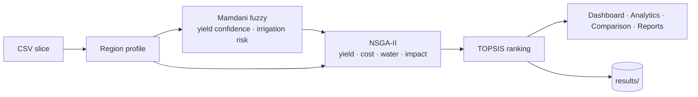
Details: [ALGORITHMS.md](#doc-algorithms), [OPTIMIZATION_PIPELINE.md](#doc-optimization-pipeline).

### API at a glance
`GET /health` · `GET /api/catalog` · `GET /api/region-profile` · `POST /api/farm-plans` · `GET /api/results` · `GET /api/results/{run_id}` · `GET /api/weather|dashboard|history|soil-profile|plans|comparison|compare-fuzzy/{district}` – see [API_REFERENCE.md](#doc-api-reference).

### Deployment
Frontend on Vercel (`vercel.json`, `VITE_API_BASE` in `.env.production`); backend on Fly.io (`fly.toml`, Docker, volume for `results/`); GitHub Actions runs the tests, then deploys. See [ARCHITECTURE.md](#doc-architecture) §6.

### Known limitations
Irrigation/fertiliser multipliers currently have no yield benefit (optimiser keeps them at the minimum); the yield objective sums tonnes across crops; fuzzy output affects only expected yield; district-level data, single season; demo-only client-side authentication. Full list and roadmap: [RESEARCH_REVIEW.md](#doc-research-review), [TODO.md](#doc-todo).

### Documentation index
[PROJECT_KNOWLEDGE](#doc-project-knowledge) · [ARCHITECTURE](#doc-architecture) · [FOLDER_STRUCTURE](#doc-folder-structure) · [FRONTEND](#doc-frontend) · [BACKEND](#doc-backend) · [DATASETS](#doc-datasets) · [ALGORITHMS](#doc-algorithms) · [API_REFERENCE](#doc-api-reference) · [DATA_FLOW](#doc-data-flow) · [USER_FLOW](#doc-user-flow) · [OPTIMIZATION_PIPELINE](#doc-optimization-pipeline) · [REPORT_PIPELINE](#doc-report-pipeline) · [HISTORY_PIPELINE](#doc-history-pipeline) · [SCORING_AND_RANKING](#doc-scoring-and-ranking) · [CONFIGURATION](#doc-configuration) · [DEPENDENCIES](#doc-dependencies) · [PROJECT_REVIEW](#doc-project-review) · [DATA_VALIDATION](#doc-data-validation) · [PERFORMANCE_REVIEW](#doc-performance-review) · [SECURITY_REVIEW](#doc-security-review) · [UI_UX_REVIEW](#doc-ui-ux-review) · [RESEARCH_REVIEW](#doc-research-review) · [TECHNICAL_DEBT](#doc-technical-debt) · [IMPROVEMENT_LOG](#doc-improvement-log) · [CHANGELOG](#doc-changelog) · [TODO](#doc-todo) · [EXPLAINABILITY](#doc-explainability)

<a id="doc-folder-structure"></a>

## Folder Structure

Every folder and every significant file in `final_year_project/`, what it is, and whether anything uses it.
Status legend: **Active** = part of the running system · **Reference** = documentation/design material, not executed · **Stale** = superseded copy, should not be edited · **Generated** = produced at runtime.

```
final_year_project/
├── agrooptimize-backend/          Active   Python/FastAPI backend (its own git repo, branch main)
├── stitch_agrooptimize_app/       Active   Local working copy of the React frontend (same source as frontend/ in the git repo)
├── datasets/                      Stale    Older copy of the 16 CSVs (differs from backend data/raw/)
├── docs/                          Active   This documentation set (added 2026-09-29)
├── reference_docs/                Reference Paper PDF, rubric PDF, viva-prep .docx
├── .github/workflows/             Inactive CI/CD file outside the git repo – GitHub never sees it (TODO T-9)
├── _backups/                      Reference Tarball of the frontend taken before the 2026-09-29 audit edits
└── AgroOptimize_Updated.zip       Stale    Snapshot archive of agrooptimize-backend (incl. .pytest_cache, results/)
```

### `agrooptimize-backend/`

| Path | Status | Purpose |
|---|---|---|
| `app/__init__.py` | Active | Empty package marker |
| `app/config.py` | Active | Every tunable constant and modelling assumption (paths, locations, season→month map, prices, wage, carbon factors, NSGA-II hyper-parameters). See [CONFIGURATION.md](#doc-configuration) |
| `app/schemas.py` | Active | Pydantic v2 request/response models (`FarmPlanRequest`, `FarmPlanResponse`, …) |
| `app/main.py` | Active | FastAPI app, CORS, 13 route handlers. See [API_REFERENCE.md](#doc-api-reference) |
| `app/data/loader.py` | Active | Reads the 16 CSVs, concatenates per kind, `lru_cache(maxsize=1)` |
| `app/data/preprocessing.py` | Active | Builds `RegionSeasonProfile` (soil, rainfall, water, candidate crops); soil fertility index; `[0,1]` snapshot; provenance flag |
| `app/fuzzy/engine.py` | Active | Mamdani fuzzy inference system (3 inputs, 2 outputs, 26 rules) + per-crop confidence adjustment |
| `app/optimization/problem.py` | Active | `FarmPlanProblem` (pymoo `Problem`): chromosome bounds + 4 vectorised objectives + budget constraint |
| `app/optimization/operators.py` | Active | Custom `SinglePointCrossover`, `GaussianMutation`, `AllocationRepair` |
| `app/optimization/nsga2_runner.py` | Active | Runs pymoo NSGA-II (serialised by a lock), decodes Pareto front, hypervolume convergence history |
| `app/decision/ranking.py` | Active | Hard-limit filters, TOPSIS ranking, trade-off wording, confidence labels |
| `app/services/plan_service.py` | Active | Orchestrates the 5-stage pipeline for `POST /api/farm-plans` and the CLI |
| `app/services/results_store.py` | Active | Persists runs to `results/` (JSON/CSV/PNG), lists and loads them |
| `app/services/dashboard_service.py` | Active | Logic for the 7 frontend-facing endpoints (weather, dashboard, history, soil, plans, comparison, fuzzy comparison) |
| `data/raw/*.csv` | Active | **The** dataset: 4 districts × {crop, land, rainfall, water_availability}. See [DATASETS.md](#doc-datasets) |
| `tests/test_api.py` | Active | 21 tests – core REST endpoints |
| `tests/test_dashboard.py` | Active | 52 tests – dashboard endpoints (weather incl. mocked Open-Meteo, history scoping, plans, comparison) |
| `tests/test_data.py` | Active | 36 tests – loader, catalog, profile building, fertility formula, snapshot |
| `tests/test_fuzzy.py` | Active | 22 tests – fuzzy ranges, rule directionality, per-crop penalty |
| `tests/test_pipeline.py` | Active | 34 tests – end-to-end pipeline, NSGA-II invariants, persistence |
| `tests/test_hardening.py` | Active | 40 tests added 2026-09-29 – path safety, caching, validation, provenance, determinism under concurrency |
| `run_demo.py` | Active | CLI: run the whole pipeline without a server and print a ranked table |
| `requirements.txt` | Active | Python dependencies (see [DEPENDENCIES.md](#doc-dependencies)) |
| `Dockerfile`, `.dockerignore` | Active | Production image (python:3.11-slim, uvicorn on :8000) |
| `fly.toml` | Active | Fly.io app `agrooptimize-backend`, region `sin`, volume mounted at `/app/results` |
| `render.yaml` | Reference | Alternative Render.com deployment (free plan, no persistent disk declared) |
| `pytest.ini` | Active | Test discovery, `-v --tb=short`, suppresses Deprecation/User warnings |
| `.env.example` | Reference | Documents knobs; **nothing reads it** – `config.py` does not load env vars except `CORS_ALLOW_ORIGINS` in `main.py` |
| `results/` | Generated | Saved runs (`<run_id>.json`, `_plans.csv`, `_convergence.csv`, `_convergence.png`). Git-ignored. The 8 runs present were produced from an **older dataset version** (see [DATA_VALIDATION.md](#doc-data-validation) §D12) |
| `docs/*.md` | Reference (partly stale) | Team-written docs (architecture, API, assumptions, fuzzy rules, literature survey, results). Several numbers are outdated – see [TECHNICAL_DEBT.md](#doc-technical-debt) TD-12 |
| `notes/methodology_notes.md`, `notes/viva_prep.md` | Reference (partly stale) | Narrative methodology and viva Q&A |
| `notes/AgroOptimize_Guide_Review_Status.docx` | Reference | Guide review tracker |
| `README.md`, `CONTRIBUTING.md` | Stale | README still says "34 tests", "6 endpoints", "frontend not built". Replacement: [README_UPDATED.md](#doc-readme-updated) |
| `frontend/` | Active | **The React app in version control** (GitHub `main`). Same source as the local `stitch_agrooptimize_app/` working copy described below. (A local checkout that is behind `origin/main` may show only part of it – always `git fetch` first.) |
| `.pytest_cache/`, `app/**/__pycache__/` | Generated | Tool caches (git-ignored) |

### `stitch_agrooptimize_app/` (frontend; in the git repo this is `frontend/`)

| Path | Status | Purpose |
|---|---|---|
| `index.html` | Active | Vite entry; loads Google Fonts (Inter, Montserrat, Material Symbols) and `/src/main.jsx`. Favicon is an external `googleusercontent.com` URL |
| `src/main.jsx` | Active | `createRoot` + `<StrictMode>` |
| `src/App.jsx` | Active | State-machine router (`currentView` string), user state in `localStorage`, layout shell (sidebar/top bar/mobile drawer), health check |
| `src/index.css` | Active | Tailwind v4 `@theme` design tokens (Material-3-style colour roles, typography scale) + keyframes |
| `src/services/api.js` | Active | The only module that calls the backend; `ApiError`, `describeApiError`, per-browser `client_id` |
| `src/utils/download.js` | Active (new) | `downloadFile`, `toCsv` (with CSV-injection guard), `slug` |
| `src/views/*.jsx` | Active | 10 page components – see [FRONTEND.md](#doc-frontend) |
| `src/components/DataSourceNotice.jsx` | Active | "historical vs live vs personalised" banner |
| `src/components/CountryCodeModal.jsx` | Active | Phone country-code picker (Auth) |
| `src/components/AccountAuthOverlay.jsx` | Active | Mock "authorisation" dialog (Settings → unlink Google, demo only) |
| `src/components/ParticleBackground.jsx` | Active | Canvas particle animation on onboarding |
| `src/components/SuccessCheckSvg.jsx` | Active | Animated check mark (profile complete) |
| `public/favicon.svg`, `public/icons.svg` | Unused | Vite scaffold assets, not referenced |
| `package.json`, `package-lock.json` | Active | React 19.2, Tailwind 4.3, Vite 8.2, oxlint 1.75 |
| `vite.config.js` | Active | `react()` + `tailwindcss()` plugins |
| `.oxlintrc.json` | Active | Lint rules; now ignores `dist/` and the mock-up HTML |
| `vercel.json` | Active | SPA rewrite `/(.*) → /index.html`, output `dist` |
| `.env.production` | Active | `VITE_API_BASE=https://agrooptimize-backend.fly.dev` |
| `.vercel/project.json` | Active | Vercel project link (`agrooptimize`) |
| `<screen_name>/code.html` (28 folders) | Reference | Static HTML mock-ups exported from Google Stitch (Tailwind CDN). Design source for the React views; not built or served |
| `agrooptimize_structural_system/DESIGN.md` | Reference | Design-token spec (colours, type scale) the Tailwind theme mirrors |
| `agrooptimize_brand_logo/screen.png`, `a_realistic_profile_photo…/screen.png` | Reference | Mock-up images |
| `node_modules/` | Generated | npm install output |

Removed on 2026-09-29 (all preserved in `_backups/stitch_agrooptimize_app_before_audit_2026-09-29.tar.gz`): `_to_delete/` (stale scaffold build + an intentionally-empty `weatherData.js`), `src/components/ShaderBackground.jsx` (never imported), `src/assets/{hero.png,react.svg,vite.svg}` (scaffold leftovers), empty `src/data/`.

### `datasets/` (top level)

16 CSVs with the same names as `agrooptimize-backend/data/raw/` but an **older schema**: no `data_source` / `Annual_Normal_mm` columns, no 2024 rows (612 lines vs 761), and different `Normal_Rainfall_mm` values (e.g. Coimbatore January normal 7.5 mm here vs 37.5 mm in `data/raw`). Nothing reads it. Keep only as an archive, or delete to avoid confusion (TODO T-8).

### `reference_docs/`

| File | Content |
|---|---|
| `Reference_Paper_AgroOptimize.pdf` | The team's own 6-page paper (*A fuzzy-evolutionary decision support system for agricultural farming under uncertainties*). The implementation diverges from it in several places – see [RESEARCH_REVIEW.md](#doc-research-review) §3 |
| `Phase 2 Project Rubrics.pdf` | Guide Review 1 (7), Panel Review 1 (20), Guide Review 2 (8) rubrics for research/application/software projects |
| `AgroOptimize_Panel_Viva_Prep.docx` | Viva preparation notes |

---

# Part 2 — Architecture & Code

<a id="doc-architecture"></a>

## Architecture

AgroOptimize is a two-tier web application: a **React SPA** (`stitch_agrooptimize_app/`) talking JSON over HTTPS to a **stateless FastAPI service** (`agrooptimize-backend/`) that runs a data → fuzzy → NSGA-II → TOPSIS pipeline over 16 CSV files. There is **no database** and **no server-side user model**: user profiles live in browser `localStorage`, saved optimisation runs live as files on a disk volume.

### 1. System context


### 2. Backend module structure

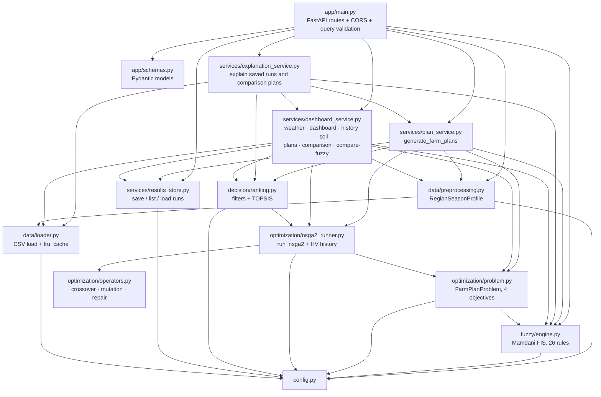

Design properties:

* **Layered and acyclic.** Data → fuzzy → optimisation → decision → services → HTTP. Lower layers never import upward (`ranking.py` imports only the `FarmPlan` dataclass from the runner).
* **Two orchestrators.** `plan_service.generate_farm_plans` serves `POST /api/farm-plans` and the CLI (≤50 plans, persistence, filters, user preference). `dashboard_service._run_dashboard_pareto_front` serves the dashboard endpoints (population 100, up to 100 plans, no persistence, memoised). They deliberately share the same lower-level modules.
* **Explanations are a separate read-only layer.** `explanation_service` consumes a saved run or the memoised comparison front and never runs its own optimisation; see [EXPLAINABILITY.md](#doc-explainability).
* **Deferred imports in `main.py`.** Route handlers import services inside the function body; it only affects import order, not behaviour.

### 3. Request lifecycle – `POST /api/farm-plans`

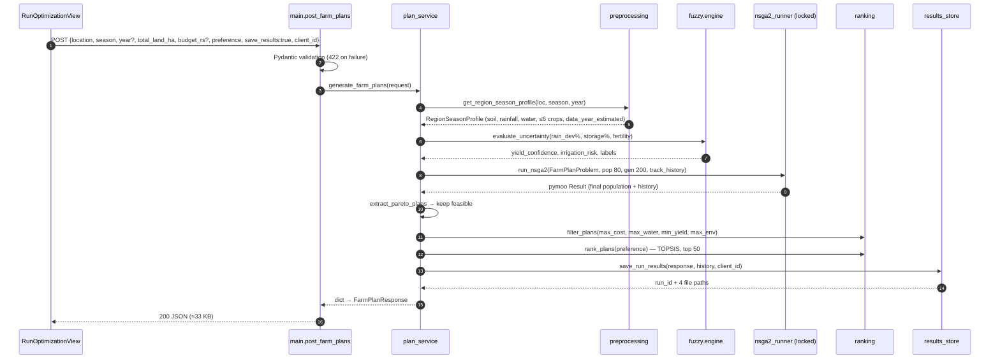

Errors: `ValueError` anywhere in stages 1–4 (unknown location, no data for the year/season, <2 candidate crops) → HTTP 400. Pydantic → 422.

### 4. Frontend architecture

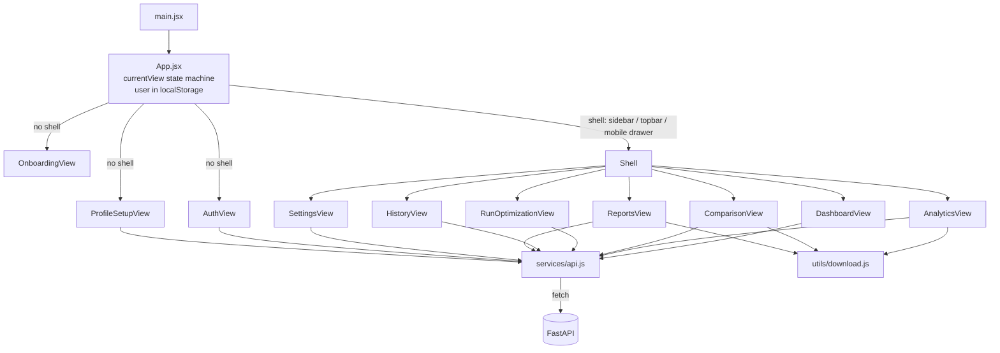

* **No router library.** Navigation is `setCurrentView(id)`; the current view name is persisted to `localStorage['agro_currentView']`, so a reload returns to the same page but browser Back/Forward and deep links do not work.
* **No global store.** `App` owns `user`, `currentView`, layout and language; each view fetches its own data in `useEffect` with a `cancelled` flag to ignore late responses.
* **Guard:** any shell view without a valid district on file bounces to profile setup/onboarding.

### 5. Data at rest

| Store | Where | Content | Lifetime |
|---|---|---|---|
| CSV dataset | Docker image `/app/data/raw` | 761 rows over 16 files | Immutable per deploy |
| Loader cache | Process memory (`lru_cache`) | 4 concatenated DataFrames | Process lifetime |
| Dashboard front cache | Process memory (`lru_cache(32)`) | Pareto fronts per (district, season, year, land, budget, history flag) | Process lifetime |
| Saved runs | `/app/results` (Fly volume) | `<run_id>.json` (+ CSV, convergence CSV/PNG) | Unbounded – never pruned |
| Run summary cache | Process memory | Parsed summaries keyed by file mtime/size | Process lifetime |
| User profile | Browser `localStorage['agro_user']` | name, phone, email, district, land size, crop, avatar (data-URL) | Until logout / site-data clear |
| Demo credential | `localStorage['agro_register_password_sha256']` | SHA-256 of password | Same |
| Client id | `localStorage['agro_client_id']` | random UUID, scopes History | Same |

### 6. Deployment topology

| Component | Platform | Config file | Notes |
|---|---|---|---|
| Frontend | Vercel (project `agrooptimize`) | `vercel.json`, `.env.production` | Static build; `VITE_API_BASE` baked in at build time |
| Backend | Fly.io app `agrooptimize-backend` | `fly.toml`, `Dockerfile` | `min_machines_running = 1`, health check `GET /health` every 15 s, `CORS_ALLOW_ORIGINS=https://agrooptimize.vercel.app` |
| Backend (alt.) | Render.com | `render.yaml` | Free plan, no persistent disk → saved runs lost on restart |
| CI | GitHub Actions | `.github/workflows/deploy-backend.yml` | On push to `main` touching `agrooptimize-backend/**`: `pytest` job, then `flyctl deploy` (deploy now `needs: test`) |

### 7. Concurrency model

Uvicorn runs one worker process. FastAPI runs the synchronous route handlers in a thread pool (default 40 threads). All optimisation runs go through `nsga2_runner._NSGA2_RUN_LOCK`, so at most **one NSGA-II run executes at a time**; others queue. This is required for correctness because the custom operators use NumPy's global RNG (see [PERFORMANCE_REVIEW.md](#doc-performance-review) §2 and [CHANGELOG.md](#doc-changelog)). Horizontal scaling = more Fly machines (each with its own lock and caches); saved runs would then need shared storage, because a Fly volume attaches to one machine.

### 8. Architectural decisions and trade-offs

| Decision | Rationale | Cost / risk |
|---|---|---|
| Files instead of a database | Explicit project requirement: runs must be inspectable, attachable to reports, versionable | No querying, no multi-machine sharing, no retention policy |
| No server-side accounts; `client_id` scoping | Scope of a final-year project | Not a security boundary (anyone who knows a `client_id` sees that history) |
| pymoo for NSGA-II mechanics, custom operators | Correct non-dominated sort/crowding from a vetted library; operators match the paper's text | Custom operators use the global NumPy RNG → needs the lock |
| scikit-fuzzy `ControlSystem` | Readable Mamdani rule syntax | ~600 ms first-call build; per-call simulation object allocation |
| Two orchestration paths (`plan_service` vs `dashboard_service`) | Dashboard needs 100 plans and no persistence without altering the tested path | Duplicated pipeline wiring (TD-4) |
| State-machine navigation instead of react-router | Simplicity | No URLs per page, no Back button, no deep links |

<a id="doc-backend"></a>

## Backend

`agrooptimize-backend/` – Python 3.11 (Docker) / 3.10+ (local), FastAPI, pymoo 0.6, scikit-fuzzy 0.5, pandas 2. ~3,250 lines of application code, 205 tests. Endpoint contracts: [API_REFERENCE.md](#doc-api-reference). Algorithms: [ALGORITHMS.md](#doc-algorithms).

### 1. Running it

```bash
cd agrooptimize-backend
pip install -r requirements.txt
uvicorn app.main:app --reload --port 8000     # Swagger at /docs
python3 run_demo.py --location Erode --season Rabi --land 3 --preference max_yield --top 3
python3 -m pytest -q                            # 205 tests, ~15 s
```

### 2. Module reference

#### `app/config.py`
Constants only (no functions, no env loading). Grouped: paths (`RAW_DATA_DIR`, `RESULTS_DIR`), dataset structure (`LOCATIONS`, `DATASET_KINDS`, `AG_SEASONS`, `SEASON_MONTH_MAP`, `DISTRICT_COORDINATES`), candidate selection, economics, water, environment, rainfall-dependency factors, decision-variable bounds, NSGA-II hyper-parameters, `MAX_RETURNED_PLANS`. Full table with provenance: [CONFIGURATION.md](#doc-configuration).

#### `app/schemas.py`
| Model | Used as | Notes |
|---|---|---|
| `FarmPlanRequest` | body of POST /api/farm-plans | validation bounds listed in API_REFERENCE; `client_id ≤ 128`, filters ≥ 0 (added) |
| `SoilOut`, `RainfallOut`, `WaterOut`, `CropCandidateOut`, `RegionProfileOut` | nested in `FarmPlanResponse` | `RegionProfileOut.data_year_estimated` defaults False so older saved runs validate |
| `FuzzyAssessmentOut`, `RankedPlanOut`, `RunMeta`, `ConvergencePointOut`, `SavedFilesOut` | nested | |
| `FarmPlanResponse` | response of POST /api/farm-plans and GET /api/results/{id} | acts as a filter: stored keys `saved_at`, `client_id` are dropped |
| `SavedRunSummaryOut` | GET /api/results | |
| `CatalogOut` | GET /api/catalog | |

The seven dashboard endpoints and `/api/region-profile` return plain dicts with **no response_model** (TD-7).

#### `app/main.py`
Creates `FastAPI(title="AgroOptimize API", version="0.1.0")`, adds CORS (localhost dev origins + `CORS_ALLOW_ORIGINS`), defines shared `Query` validators (`_LAND_HA_QUERY` 0 < x ≤ 100 000, `_BUDGET_QUERY` > 0, `_CLIENT_ID_QUERY` ≤ 128 chars) and 13 handlers. Each handler is a thin wrapper: call a service, map `ValueError` → 400/404 and `PlanGenerationError` → 503. `list_results` redacts `client_id`.

#### `app/data/loader.py`
| Function | Behaviour |
|---|---|
| `_read_kind(kind)` | For each location reads `data/raw/<loc>_<kind>.csv`; raises `FileNotFoundError` naming the missing file; `pd.concat` |
| `load_all()` | `lru_cache(maxsize=1)`; returns `{"crop","land","rainfall","water"}` DataFrames |
| `clear_cache()` | clears the above (tests) |
| `available_locations/years/seasons()` | used only by tests |

#### `app/data/preprocessing.py`
| Symbol | Behaviour |
|---|---|
| dataclasses `CropCandidate`, `SoilProfile`, `RainfallProfile`, `WaterProfile`, `RegionSeasonProfile` | typed pipeline input; `RegionSeasonProfile.data_year_estimated` added |
| `compute_soil_fertility_index(...)` | 0–100 index (ALGORITHMS §1) |
| `canonical_choice(value, options, kind)` | case/whitespace-insensitive match → canonical spelling; `ValueError` otherwise (added) |
| `ESTIMATED_SOURCE_PREFIX`, `is_estimated_year(loc, year)` | True if all crop rows for (loc, year) have `data_source` starting "Estimated" (added) |
| `_resolve_year` | None → latest year for the location; unknown year → `ValueError` listing available years |
| `list_catalog()` | locations, seasons, sorted years, crops per season (across all locations) |
| `get_region_season_profile(location, season, year, max_candidate_crops)` | the Stage-1 builder: land row (first match), rainfall/water rows for the season's months, top-N crops by revenue; raises `ValueError` for any empty slice or <2 crops |
| `_REFERENCE_RANGES`, `_minmax`, `normalized_snapshot(profile)` | display-only [0,1] values |

#### `app/fuzzy/engine.py`
| Symbol | Behaviour |
|---|---|
| `UncertaintyAssessment` | `yield_confidence`, `irrigation_risk` (0–1, 3 dp) + three dominant labels |
| `_build_system()` | `lru_cache(1)`: defines universes, MFs, 26 rules, returns `ControlSystem` + antecedents (first call ≈0.6 s) |
| `evaluate_uncertainty(rain_dev, storage, fertility)` | clips inputs, new `ControlSystemSimulation` per call, centroid outputs ÷ 100; falls back to 0.5/0.5 on `KeyError/ValueError` |
| `_dominant_label` | argmax membership |
| `crop_yield_confidence(base, risk, dependency)` | per-crop penalty (≤ 40 %) |

#### `app/optimization/problem.py`
`CropVector.from_candidates(crops, assessment, use_fuzzy)` precomputes per-crop NumPy arrays (confidence = 1.0 when `use_fuzzy=False`). `FarmPlanProblem(profile, assessment, total_land_ha, budget_rs, use_fuzzy)` sets bounds (allocation lower bound 1e−4), 4 objectives, optional 1 inequality constraint; `_evaluate` is fully vectorised; `decode(x)` → dict of lists.

#### `app/optimization/operators.py`
`AllocationRepair`, `SinglePointCrossover(prob)`, `GaussianMutation(prob, sigma)` – see ALGORITHMS §4.1. All use `np.random` (global RNG).

#### `app/optimization/nsga2_runner.py`
| Symbol | Behaviour |
|---|---|
| `_NSGA2_RUN_LOCK` | process-wide lock serialising runs (added) |
| `FarmPlan` | decoded plan with rounded objective values and `feasible` |
| `run_nsga2(problem, pop_size, n_gen, …, seed=42, track_history)` | builds pymoo `NSGA2` with custom operators, seeds global RNG and runs `minimize` under the lock |
| `run_nsga2_with_fuzzy_toggle(profile, assessment, land, budget, use_fuzzy, **kw)` | builds the problem with `use_fuzzy`, returns `(problem, result)` |
| `extract_convergence_history(result)` | per-generation best/mean objectives + normalised hypervolume; `[]` without history |
| `extract_pareto_plans(result, problem)` | decode `result.X/F/G` into `FarmPlan`s |

#### `app/decision/ranking.py`
`filter_plans`, `rank_plans` (TOPSIS), `RankedPlan`, `to_dict_list`, helpers `_minmax_norm`, `_plain_minmax`, `_bucket`, `_round_percentages_to_100`, `_PREFERENCE_WEIGHTS`.

#### `app/services/plan_service.py`
`generate_farm_plans(request, results_dir=None)` – Stages 1–5; see [OPTIMIZATION_PIPELINE.md](#doc-optimization-pipeline). Returns a plain dict shaped like `FarmPlanResponse`.

#### `app/services/results_store.py`
| Symbol | Behaviour |
|---|---|
| `is_valid_run_id` | regex `^[A-Za-z0-9][A-Za-z0-9_-]{0,127}$` (added) |
| `make_run_id(loc, season, year)` | `<loc>_<season>_<year>_<YYYYMMDDTHHMMSSZ>` (slugified, UTC) |
| `_reserve_run_id(out_dir, base)` | exclusive-create claim; `-2`, `-3`… on same-second collision (added) |
| `save_run_results(response, history, out_dir, client_id)` | writes JSON (atomic), plans CSV (list/dict cells JSON-encoded), and if history: convergence CSV + PNG |
| `_atomic_write_text` | temp file + `os.replace` (added) |
| `_plot_convergence` | matplotlib Agg; two panels (HV; best yield & best cost on twin axes); 130 dpi |
| `_summarise`, `_SUMMARY_CACHE` | per-file summary cached by (mtime_ns, size) (added) |
| `list_saved_runs(out_dir)` | summaries newest-first by filename; corrupt/incomplete files skipped |
| `load_run(run_id, out_dir)` | validated id → dict or None (corrupt → None) |

#### `app/services/dashboard_service.py`
| Symbol | Behaviour |
|---|---|
| `resolve_location` | case-insensitive district → canonical; `ValueError` (→404) |
| `_current_season(today)` | month → first matching season in `SEASON_MONTH_MAP` |
| `_latest_year_for(df, loc)` | max year |
| `_WMO_CODE_TO_CONDITION`, `_CONDITION_TEXT`, `_condition_for_rainfall` | weather icon mapping; CSV fallback thresholds >100 mm rainy, >50 partly cloudy |
| `_get_weather_live(loc)` | Open-Meteo `/v1/forecast` (current + 6 daily, Asia/Kolkata, timeout 5 s) |
| `_get_weather_from_csv(loc)` | current-month and next-5-month averages |
| `get_weather(loc)` | live, else CSV; failure logged with `logging` |
| `_ACTION_LIBRARY`, `_soil_status_label`, `_current_land_row`, `_REFERENCE_FARM_HA` | dashboard helpers |
| `PlanGenerationError` | raised by `get_plans` → 503 |
| `get_dashboard(loc, client_id)` | KPI payload (SCORING_AND_RANKING §4) incl. `data_year(_estimated)` |
| `get_soil_profile(loc)` | latest-year current-season soil |
| `get_history(loc, client_id)` | HISTORY_PIPELINE |
| `_run_dashboard_pareto_front(...)` → `_cached_pareto_front(...)` (`lru_cache(32)`), `clear_pareto_cache()` | pop-100 run, memoised; returns profile, assessment, feasible plans, confidence map, convergence history |
| `_summarize_pareto_front`, `get_fuzzy_comparison` | fuzzy vs non-fuzzy study |
| `get_plans` | ≤100 ranked plans per hectare + HV history |
| `_radar_scores`, `_PLOT_LABELS` (deprecated), `get_comparison` | Plans A/B/C |

#### `app/services/explanation_service.py`
| Symbol | Behaviour |
|---|---|
| `ExplanationContext` | everything needed to explain one plan: region profile, fuzzy, ranked set, index, preference, land, budget (+ whether recorded), convergence history, meta, subject |
| `context_from_saved_run(record, rank)` | from a stored run (budget "not recorded" for older runs) |
| `context_from_comparison(location, plan, land, budget)` | from the memoised dashboard front ranked under A/B/C's preference |
| `explain(ctx)` | builds all sections (see EXPLAINABILITY.md); helpers `_crop_breakdown`, `_objective_analysis`, `_rank_under_all_preferences`, `_trade_offs`, `_constraints`, `_historical`, `_confidence`, `_risks` |
| `explain_saved_run`, `explain_comparison_plan` | convenience wrappers used by `main.py` |

Supporting additions: `ranking.topsis_scores`, `ranking.preference_weights`, `ranking.OBJECTIVES`; `fuzzy.engine.input_memberships`, `fired_rules`, `output_term`; `plan_service.region_profile_payload`; `RunMeta.total_land_ha / budget_rs`.

### 3. Error handling summary

| Layer | Strategy |
|---|---|
| Data | `ValueError` with explicit message for every empty slice |
| Fuzzy | clip inputs; neutral 0.5/0.5 on inference failure |
| Optimiser | infeasible solutions flagged, callers drop them; empty list is a valid result |
| `/api/plans` | broad `except Exception` → `PlanGenerationError` → 503 (also swallows `ValueError` for bad season/year into 503) |
| Weather | broad `except` → CSV fallback, logged |
| Persistence | corrupt files skipped; atomic writes |
| HTTP | ValueError→400 (core) / 404 (dashboard), validation→422 |

Not handled: disk full during save (500), Open-Meteo slowness (up to 5 s per call × 5 calls on the dashboard), extremely large `pop_size × n_gen` requests (bounded at 300 × 500).

### 4. Testing

| File | Focus | Count |
|---|---|---|
| test_api.py | core endpoints, validation, budget constraint | 21 |
| test_dashboard.py | dashboard endpoints, weather parsing (mocked), history scoping | 52 |
| test_data.py | CSV presence, loader cache, catalog, profile, fertility formula | 36 |
| test_fuzzy.py | output ranges, rule directionality, per-crop penalty | 22 |
| test_pipeline.py | end-to-end, NSGA-II invariants, persistence, convergence | 34 |
| test_hardening.py | run-id safety, cache, atomic save, validation, provenance, determinism, concurrency, run-id collisions, client_id redaction | 40 |
| test_explanation.py | explanation structure, traceability, confidence, constraints, honesty rules, endpoints | 25 |

Gaps: operators unit-tested only indirectly; no test pins numeric outputs (a golden-master test would catch unintended model drift – TODO T-13); weather tests call the real Open-Meteo API when network is available; no frontend tests at all.

<a id="doc-frontend"></a>

## Frontend

`stitch_agrooptimize_app/` – React 19.2, Vite 8.2, Tailwind CSS 4.3 (via `@tailwindcss/vite`), oxlint. ~5,200 lines in `src/`. No router, no state library, no chart library (all charts are hand-written SVG), no test framework. Visual design originates from Google Stitch mock-ups (the `*/code.html` folders) and the token spec `agrooptimize_structural_system/DESIGN.md`.

```bash
cd stitch_agrooptimize_app
npm install
npm run dev                                   # http://localhost:5173, talks to http://localhost:8000
VITE_API_BASE=http://localhost:8010 npm run dev   # point at another backend
npm run lint && npm run build                 # oxlint (0 warnings) + production build to dist/
```

### 1. Application shell (`src/App.jsx`)

| State | Stored | Purpose |
|---|---|---|
| `currentView` | `localStorage.agro_currentView` | which page renders: onboarding, login, register, profile-setup, dashboard, analytics, comparison, run-optimization, history, reports, settings |
| `user` | `localStorage.agro_user` | profile `{fullName, phoneNumber, email, location, landSize, primaryCrop, avatar, season}` |
| `selectedLanguage` | memory | en/hi/ta – **no translations exist**; only highlights the chosen option |
| `dashboardLayout` | memory | 'sidebar' / 'topbar' |
| `activePlanId` | memory | Comparison's "Select This Plan" |
| `backendOnline` | memory | result of one `GET /health` at start-up (footer dot) |

Guards: a shell view without a valid district (`DISTRICTS.includes(user.location)`) redirects to profile-setup (or onboarding when no user). `handleAuthSuccess` goes to the dashboard only for a login with a complete profile; otherwise profile-setup. Logout clears the two keys and returns to onboarding (the demo password digest and `client_id` are kept).

Layouts: fixed 256 px sidebar (desktop, default), sticky top bar (desktop, toggle on the dashboard), mobile header + slide-in drawer (<768 px). Footer shows backend reachability.

### 2. API layer (`src/services/api.js`)

* `API_BASE = import.meta.env.VITE_API_BASE || 'http://localhost:8000'`.
* Constants `DISTRICTS`, `SEASONS`, `PREFERENCES` mirror backend config.
* `extractDistrict(str)` → first district name contained in the string, else "Coimbatore".
* `getOrCreateClientId()` → `crypto.randomUUID()` stored as `agro_client_id`; sent with dashboard, history and farm-plan calls.
* `ApiError {status, detail}`, `describeApiError(err)`, `BACKEND_UNREACHABLE_MSG` (dev: how to start uvicorn; prod: plain-language) – added 2026-09-29.
* Methods: `checkHealth, getCatalog, getWeather, getDashboard, getHistory, getSoilProfile, getResult, getPlans, getComparison, getFuzzyComparison, runOptimization`. `runOptimization` maps `land_area_ha→total_land_ha`, `budget→budget_rs` and always sends `save_results: true`.

`src/utils/download.js` (added): `downloadFile(name, text, mime)`, `toCsv(rows, columns)` (quotes and neutralises `= + - @` prefixes in text cells), `slug()`.

### 3. Pages

#### OnboardingView (no shell)
2 s splash (logo + typewriter), then a 4-slide scroll-snap carousel (two stock images from `googleusercontent.com`, a static "Balanced / Max Yield / Safe" illustration, and Create Account / Log In). Language menu (English/हिन्दी). Canvas `ParticleBackground`. No API calls.

#### AuthView (no shell) – demo authentication, device-local only
Sub-views: login (phone or email tab + password), register-1 (name, optional email, phone with `CountryCodeModal`, password ≥ 8 chars), register-2 (district from `DISTRICTS`, land size ≥ 0.5 ha, primary crop from `/api/catalog` or a fallback list), otp. The OTP is generated in the browser and shown in a fake "Messages" toast with an Auto-fill button – **no SMS is sent**. Login verifies only the password against the digest stored in `localStorage` (the phone/email typed at login is not checked). Since 2026-09-29 the password is stored as SHA-256 (`agro_register_password_sha256`), migrating any legacy plaintext entry.

#### ProfileSetupView (no shell)
Step 1 name + avatar (FileReader → data-URL stored in `localStorage`, can be large), skippable. Step 2 district, current season, primary crop, land size (ha). Step 3 "Profile complete" (was "Verification completed" – nothing is verified). Calls `/api/catalog`.

#### DashboardView
Calls in parallel: `getWeather(user.location)`, `getDashboard(user.location)`, `getWeather` × 4 districts. Renders: time-of-day greeting; `DataSourceNotice` (historical); **estimated-data banner** when `data_year_estimated`; 4 KPI cards (Active Plans, Estimated Yield + trend, Water Utilization bar + label, Soil Health + status) – each card navigates to Comparison/Analytics on click; Crop Allocation Overview (revenue shares); Recommended Actions with local-only "Schedule" toggles; weather card with Local / Districts tabs (live vs "Historical estimate" wording from `source`); Quick Links. Skeleton loaders per section; failure text per section.

#### AnalyticsView
Calls `getPlans`, `getSoilProfile`, `getFuzzyComparison` for `user.location` (always 5 ha, current season, latest year – the user's land size is **not** passed). Renders KPI row (Valid Plans, Min Yield Target, Water Limit, Soil Suitability), an SVG cost-vs-yield scatter (500×300 viewBox, hover tooltip, gold recommended point, faded non-compliant points), three range sliders (max cost/ha, min yield/ha, max water ML/ha) with reset, "Best Compliant Plan" (cheapest compliant), a hypervolume convergence line chart, and the fuzzy vs non-fuzzy table. **Export** downloads a CSV of all plans with a `meets_current_constraints` column (was an `alert()`).

#### ComparisonView
Calls `getComparison(user.location)`. Renders a 6-axis SVG radar (selected plan filled, weighted recommendation dashed), a metrics table (crops, t/ha, ₹/ha, **Env. Impact/ha** with relative bar, water label), the selected plan's crop allocations (% and ha), a generic "Getting Started" 2-step template (clearly labelled as generic), an "Adjust Weights" modal (yield/cost/water sliders re-ranking A/B/C), and **Export CSV** (A/B/C metrics + radar). Removed: fabricated "Plots 1, 2, 4" labels, "View Full Calendar" and "Activated Plan" alerts, arbitrary ₹50,000 red threshold, inverted "n/20" impact.

#### RunOptimizationView
Form: district (defaults to profile district, warns when different), season, year ("Latest available" or catalog years), land (≥0.5 ha), optional budget, preference. Submit fires `runOptimization` immediately and shows a full-screen 4-stage progress animation on fixed timers (≈0.9 + 3×1.3 + 0.9 s ≈ 5.7 s minimum, independent of the real ≈0.3 s run); then shows the top plan (t/ha, ₹/ha, confidence, trade-off summary, estimated-year note) with Run Another / View in History / Generate Report. Errors: 4xx → backend's `detail`; network → unreachable message.

#### HistoryView
Calls `getHistory(user.location)` (client-scoped). Search box (matches season text), year filter, timeline cards (season, date, target yield, estimated cost, status), details modal (plans count, preference, fuzzy confidence/risk %). Empty state links to Run Optimization.

#### ReportsView
Calls `getHistory`; lists this browser's saved runs; "Generate Report" fetches `getResult(run_id)` and adds a card to "Recently Generated" (memory only – lost on navigation). Each card: **Download report** (plain-text report built from the saved run – see [REPORT_PIPELINE.md](#doc-report-pipeline)) and **Copy summary** (clipboard). Both were `alert()` stubs.

#### SettingsView
Profile (name, email, phone, avatar, district dropdown, land size, primary crop) → `onUpdateUser` (localStorage only) with an inline "saved on this device" status; language buttons; notification toggles (local state only, nothing is sent); mock Google-link section now labelled "Demo only"; logout.

### 3b. Explanations
Every recommended plan has a "Why?" entry point: Comparison (Explain per row, "Why this plan?", "Compare explanations"), Run Optimization ("Why this plan?"), History ("Explain top plan"), Reports ("Why?" and the explanation inside the downloaded report). API calls: `api.getResultExplanation(runId, rank)`, `api.getComparisonExplanation(location, plan)`. Details: [EXPLAINABILITY.md](#doc-explainability).

### 4. Shared components

| Component | Used by | Notes |
|---|---|---|
| `DataSourceNotice` | Dashboard, Analytics, Comparison | Explains historical vs live-generic vs personalised |
| `CountryCodeModal` | AuthView | searchable country list |
| `AccountAuthOverlay` | SettingsView | mock consent dialog |
| `ParticleBackground` | Onboarding | canvas animation |
| `SuccessCheckSvg` | ProfileSetup | animated check |
| `ExplanationPanel`, `ExplanationModal`, `ExplanationComparison` | Comparison, Run Optimization, History, Reports | render the backend explanation JSON (no reasoning in the UI); modal handles loading/errors/Escape; side-by-side A/B/C view |

### 5. Styling system

`src/index.css` defines Tailwind v4 `@theme` tokens: Material-3 colour roles (primary `#005226`, secondary `#795900`, surface scale, error), font families (Montserrat headlines, Inter body), a type scale (`headline-lg`, `body-md`, `label-sm` …), spacing (`gutter`, `touch-target-min` 48 px), shadows (`soft`, `ambient`) and keyframes (`fadeIn`, `slideIn`, `shimmer`, typewriter). Icons are the Material Symbols web font loaded from Google Fonts; if that request fails the icon names render as literal words (observed in testing).

### 6. Loading, empty and error states

Every data section has a pulse skeleton while loading, an explicit empty state, and a failure message (now the shared `BACKEND_UNREACHABLE_MSG`, or the backend's own `detail`). The app never substitutes fabricated data on failure (an explicit design rule in the codebase comments).

### 7. Strengths and weaknesses

Strengths: consistent design tokens; honest empty/error states; single API module; cancellation guards on every effect; responsive layout with mobile drawer; minimal dependencies.

Weaknesses (details in [UI_UX_REVIEW.md](#doc-ui-ux-review) and [TECHNICAL_DEBT.md](#doc-technical-debt)): no URL routing; no tests; inaccessible clickable `<div>` cards and icon-only buttons; language switcher does nothing; Analytics/Comparison ignore the user's land size and budget; simulated progress timing; several external image/font dependencies; large views (AuthView 700 lines, AnalyticsView 600) mixing data, layout and chart code.

<a id="doc-api-reference"></a>

## API Reference

Base URL: local `http://localhost:8000`; production `https://agrooptimize-backend.fly.dev` (from `stitch_agrooptimize_app/.env.production`). Interactive schema: `GET /docs` (Swagger) and `/openapi.json`. No authentication on any endpoint. All bodies are JSON. Latencies are measured in-process (TestClient, Apple Silicon laptop, 2026-09-29); network adds to them.

| Method | Path | Purpose | Used by frontend | Cold / warm latency |
|---|---|---|---|---|
| GET | `/health` | Liveness | App.jsx startup | 1–18 ms |
| GET | `/api/catalog` | Locations, seasons, years, crops | Auth, ProfileSetup, Settings, RunOptimization | 16 ms |
| GET | `/api/region-profile` | Stages 1–2 only (data + fuzzy) | – | 632 ms first call (builds FIS), then ~10 ms |
| POST | `/api/farm-plans` | Full pipeline, optionally saved | RunOptimization | ≈300 ms (pop 80 × 200 gen) |
| GET | `/api/results` | List saved runs | – | O(#runs), cached by mtime |
| GET | `/api/results/{run_id}` | One saved run | Reports | ~1 ms |
| GET | `/api/weather/{district}` | Live weather (Open-Meteo) or CSV fallback | Dashboard (×5 calls) | network-bound, ≤5 s timeout |
| GET | `/api/dashboard/{district}` | KPI cards, actions, crop split | Dashboard | 42 ms |
| GET | `/api/history/{district}` | This browser's saved runs | History, Reports | ~1 ms |
| GET | `/api/soil-profile/{district}` | Soil snapshot | Analytics | ~1 ms |
| GET | `/api/plans/{district}` | ≤100 Pareto plans + HV history | Analytics | 966 ms cold / 3 ms cached |
| GET | `/api/comparison/{district}` | Plans A/B/C + radar | Comparison | 369 ms cold / 3 ms cached |
| GET | `/api/compare-fuzzy/{district}` | Fuzzy vs non-fuzzy study | Analytics | 746 ms (2 runs, not cached) |
| GET | `/api/results/{run_id}/explanation?rank=` | Explanation of one plan in a saved run | Run Optimization, History, Reports | tens of ms |
| GET | `/api/comparison/{district}/explanation?plan=` | Explanation of Plan A/B/C | Comparison | ~1 s cold, fast when the front is cached |

`{district}` is case-insensitive (`coimbatore`, `Salem`, ` ERODE `). Unknown → 404.

### Error model

| Status | When | Body |
|---|---|---|
| 400 | `ValueError` in the pipeline for core endpoints (unknown location/season, no data for year, <2 crops) | `{"detail": "No data for location='Salem', year=2019. Available years: [...]"}` |
| 404 | Unknown district on dashboard endpoints; unknown/invalid `run_id`; `ValueError` in comparison/compare-fuzzy | `{"detail": "..."}` |
| 422 | Pydantic/Query validation | `{"detail": [{"loc": [...], "msg": "...", "type": "..."}]}` |
| 503 | `/api/plans` optimisation failure | `{"detail": {"error": "Optimization failed", "message": "...", "location": "..."}}` |
| 500 | Unhandled exception | FastAPI default |

The frontend's `describeApiError` (src/services/api.js) turns any of these into user text.

---

### GET /health
`200 {"status": "ok"}`

### GET /api/catalog
```json
{"locations": ["Coimbatore","Erode","Salem","Pollachi"],
 "seasons": ["Kharif","Rabi","Summer"],
 "years": [2020,2021,2022,2023,2024],
 "crops_by_season": {"Kharif": ["Banana","Coconut","Cotton","Groundnut","Maize","Paddy","Sorghum","Sugarcane","Tapioca","Turmeric","Vegetables"],
                     "Rabi": ["Banana","Groundnut","Paddy","Sugarcane","Sunflower","Turmeric","Wheat"],
                     "Summer": ["Banana","Coconut","Fodder Crops","Maize","Mango","Vegetables"]}}
```
`years` includes 2024, which is estimated (see [DATASETS.md](#doc-datasets) §1).

### GET /api/region-profile
Query: `location` (required, case-insensitive), `season` (required), `year` (optional, default latest).
```json
{"location":"Salem","year":2024,"season":"Kharif",
 "soil":{"soil_type":"Red Loam","avg_ph":6.8,"organic_carbon_percent":0.58,"n_status":"Medium","p_status":"Medium","k_status":"Medium","irrigation_percent":60.4,"fertility_index":67.8},
 "rainfall":{"avg_monthly_rainfall_mm":63.1,"avg_deviation_percent":-21.1,"avg_humidity_percent":70.5,"avg_max_temp_c":35.5,"avg_min_temp_c":24.05,"months_used":["June","July","August","September"],"effective_rainfall_mm":176.68},
 "water":{"avg_storage_percent":62.0,"groundwater_status":"Very High","avg_deficit_surplus_mcm":0.0},
 "candidate_crops":["Paddy","Tapioca","Maize","Groundnut","Cotton"],
 "normalized_snapshot":{"soil_ph_norm":0.56,"organic_carbon_norm":0.387,"rainfall_norm":0.421,"rainfall_deviation_norm":0.289,"water_storage_norm":0.62,"soil_fertility_index_norm":0.678},
 "data_year_estimated":true,
 "fuzzy_assessment":{"yield_confidence":0.636,"irrigation_risk":0.465,"rainfall_label":"deficit","water_label":"medium","soil_label":"medium"}}
```
Note: here `candidate_crops` is a list of names; in `POST /api/farm-plans` it is a list of objects.

### POST /api/farm-plans
Request (`FarmPlanRequest`):

| Field | Type | Constraint | Default | Meaning |
|---|---|---|---|---|
| location | str | one of catalog locations (case-insensitive) | required | |
| season | str | Kharif/Rabi/Summer (case-insensitive) | required | |
| year | int | must exist for location | latest (2024) | |
| total_land_ha | float | > 0 | required | farm size |
| budget_rs | float | > 0 | none | hard constraint cost ≤ budget |
| preference | enum | balanced, max_yield, min_cost, min_water, min_env_impact | balanced | TOPSIS weights |
| max_candidate_crops | int | 2–12 | 6 | top-N by revenue |
| max_cost_rs, max_water_liters, min_yield_tonnes, max_env_impact | float | ≥ 0 | none | post-hoc filters |
| pop_size | int | 8–300 | 80 | |
| n_gen | int | 5–500 | 200 | |
| save_results | bool | | true | persist to results/ and track convergence |
| client_id | str | ≤128 chars | none | scopes History |

Response (`FarmPlanResponse`, ≈33 KB with 50 plans):
```json
{"region_profile": {"...": "as region-profile, but candidate_crops are objects:",
                    "candidate_crops":[{"name":"Paddy","crop_type":"Cereal","yield_kg_ha":5871.0,"water_req_mm":1236.0,"rainfall_dependency":"Low","irrigation_type":"Flood","sowing_month":"June","harvest_month":"November","crop_duration_days":145}],
                    "data_year_estimated": true},
 "fuzzy_assessment": {"yield_confidence":0.636,"irrigation_risk":0.465,"rainfall_label":"deficit","water_label":"medium","soil_label":"medium"},
 "plans": [{"rank":1,"crop_names":["Paddy","Tapioca","Maize","Groundnut","Cotton"],
            "allocation_percent":[0.01,91.33,3.26,5.39,0.01],"area_ha":[0.001,4.566,0.163,0.269,0.001],
            "irrigation_multiplier":[0.853,0.7,0.7,0.7,0.7],"fertilizer_multiplier":[0.845,0.7,0.7,0.7,0.7],
            "yield_tonnes":64.764,"cost_rs":197947.86,"water_liters":21504151.5,"env_impact_score":194.346,
            "feasible":true,"composite_score":0.6319,
            "normalized_scores":{"yield":0.921,"cost":0.352,"water":0.603,"env":0.586},
            "confidence_label":"Moderate",
            "trade_off_summary":"High yield, Moderate cost, Moderate water use, Moderate environmental impact (confidence: moderate)"}],
 "convergence_history": [{"generation":1,"population_size":80,"best_yield_tonnes":0.0,"mean_yield_tonnes":0.0,"best_cost_rs":0.0,"mean_cost_rs":0.0,"best_water_liters":0.0,"mean_water_liters":0.0,"best_env_impact":0.0,"mean_env_impact":0.0,"hypervolume":0.0}],
 "meta": {"algorithm":"NSGA-II","pop_size":80,"n_gen":200,"crossover_prob":0.85,"mutation_prob":0.12,"preference":"balanced","n_pareto_solutions_found":80,"n_plans_returned":50,"optimize_seconds":0.291},
 "run_id": "salem_kharif_2024_<UTC timestamp>",
 "saved_files": {"run_id":"…","json_path":"…/results/….json","plans_csv_path":"…","convergence_csv_path":"…","convergence_plot_path":"…"}}
```
(`convergence_history` values above are placeholders showing the shape; it has one entry per generation when `save_results` is true and is `[]` otherwise. `run_id`/`saved_files` are `null` when not saved.) Units: `yield_tonnes`, `cost_rs`, `water_liters`, `env_impact_score` are **totals over `total_land_ha`**, not per hectare. `saved_files` exposes absolute server paths (minor information disclosure – see [SECURITY_REVIEW.md](#doc-security-review)).

### GET /api/results
List of `{run_id, location, season, year, preference, saved_at, n_plans, client_id}` newest-first by filename. `client_id` is **always null** in this response (redacted 2026-09-29).

### GET /api/results/{run_id}
The stored record validated through `FarmPlanResponse` (so extra stored keys such as `saved_at`, `client_id` are dropped). `run_id` must match `^[A-Za-z0-9][A-Za-z0-9_-]{0,127}$`; anything else, a missing file, or a corrupt file → 404.

### GET /api/weather/{district}
Captured live on 2026-09-29 (values change daily):
```json
{"location":"Salem","temp":33,"condition":"cloud","conditionText":"Cloudy","rainfall_mm":7.1,"humidity":54,
 "source":"Live (Open-Meteo)","forecast":[{"day":"Wed","icon":"rainy","temp":"32° / 24°"}, "... 5 entries"]}
```
`condition`/`icon` are Material Symbols icon names mapped from WMO weather codes. On any Open-Meteo failure the fallback uses rainfall.csv averages for the current month (current) and the next 5 **months** (labelled "Mon…Fri" – see UI_UX_REVIEW), with `source = "Historical CSV average (live weather unavailable)"`. Not cached: every call hits Open-Meteo.

### GET /api/dashboard/{district}?client_id=
```json
{"location":"Salem","data_year":2024,"data_year_estimated":true,
 "estimated_yield":19.1,"yield_trend":"+3.0%","active_plans":0,
 "soil_health_pct":68,"water_utilization_pct":74.3,"soil_status":"Moderate",
 "recommended_actions":[{"id":"monitor","title":"No urgent action needed","description":"Soil N/P/K status and water storage are all within normal range.","priority":"low","window":"Routine monitoring"}],
 "crop_allocations":[{"crop":"Paddy","pct":35.6,"ha":3.6},{"crop":"Tapioca","pct":35.3,"ha":3.5},{"crop":"Maize","pct":29.1,"ha":2.9}]}
```
Field derivations: [SCORING_AND_RANKING.md](#doc-scoring-and-ranking) §4. `client_id` ≤128 chars.

### GET /api/history/{district}?client_id=
```json
{"history":[{"id":"salem_kharif_2023_20260907T181135Z","season":"Kharif 2023","date":"2026-09-07","location":"Salem",
             "target_yield":"11.28 t/ha","est_cost":"₹37,421/ha","status":"Completed","num_plans":50,
             "preference":"balanced","fuzzy_weights":{"yield_confidence":0.742,"irrigation_risk":0.12,"...":"labels"},"is_estimated":false}]}
```
Only runs whose stored `client_id` equals the query parameter; none without it. Ordered newest save first. Details: [HISTORY_PIPELINE.md](#doc-history-pipeline).

### GET /api/soil-profile/{district}
```json
{"location":"Salem","soil_pH":6.8,"organic_carbon_pct":0.58,"N_status":"Medium","P_status":"Medium","K_status":"Medium",
 "fertility_index":0.678,"irrigated_ha":93840.0,"total_agricultural_ha":155480.0}
```
Row = latest year, current season. `fertility_index` here is 0–1 (elsewhere 0–100).

### GET /api/plans/{district}?total_land_ha=5&budget_rs=
`total_land_ha` > 0 and ≤ 100 000 (default 5); `budget_rs` > 0.
```json
{"location":"Salem","total_land_ha":5.0,"num_plans":100,
 "fuzzy_weights":{"yield_confidence":0.636,"irrigation_risk":0.465},
 "plans":[{"id":0,"cost":38858,"yield_val":12.11,"water_val":4.11,"env_impact":38.99,"is_recommended":true,
           "crops":{"Tapioca":0.834,"Maize":0.0917,"Groundnut":0.0741},"rank":1}],
 "best_plan":{"id":0,"cost":38858,"yield_val":12.11},
 "is_fallback":false,
 "hypervolume_history":[{"generation":1,"hypervolume":0.2603},"…",{"generation":200,"hypervolume":0.8114}]}
```
Per-hectare units: `cost` ₹/ha, `yield_val` t/ha, `water_val` **million litres/ha**, `env_impact` score/ha. `crops` omits shares ≤ 0.5 %. Season = current calendar season; year = latest. `is_fallback` is always false (kept for compatibility).

### GET /api/comparison/{district}?total_land_ha=5&budget_rs=
```json
{"location":"Salem","total_land_ha":5.0,"plans":{
  "A":{"name":"Plan A -- Balanced","crops":"Tapioca, Maize, Groundnut","yield_val":12.11,"cost":38858,"env_impact":38.99,
       "water":"Moderate","recommended":true,
       "allocations":[{"crop":"Tapioca","pct":"83%","ha":"4.2 Ha","plots":"Plots 1, 2, 4"}],
       "radar_scores":{"yield":83,"cost_eff":12,"water":17,"land":100,"risk":53,"market":23}},
  "B":{"name":"Plan B -- Max Yield","...":"..."},
  "C":{"name":"Plan C -- Lowest Cost","...":"..."}}}
```
`allocations[].plots` is a **deprecated placeholder** with no data behind it (no plot geometry exists); the current UI ignores it. `water` is relative among A/B/C: Efficient (lowest), High usage (highest), Moderate.

### GET /api/compare-fuzzy/{district}?season=&year=&total_land_ha=5&budget_rs=
```json
{"location":"Salem","season":"Kharif","year":2024,"total_land_ha":5.0,
 "fuzzy_assessment":{"yield_confidence":0.636,"irrigation_risk":0.465,"rainfall_label":"deficit","water_label":"medium","soil_label":"medium"},
 "fuzzy":{"n_plans":100,"best_yield_tonnes_per_ha":13.963,"min_cost_rs_per_ha":30209.3,"min_water_liters_per_ha":1648307.1,"min_env_impact_per_ha":16.633},
 "non_fuzzy":{"n_plans":100,"best_yield_tonnes_per_ha":26.955,"min_cost_rs_per_ha":30209.3,"min_water_liters_per_ha":1648307.1,"min_env_impact_per_ha":16.633}}
```
Cost/water/impact minima are identical by construction (fuzzy only scales yield) – see [ALGORITHMS.md](#doc-algorithms) §4.6.

### CORS
Allowed origins: `http://localhost:5173`, `http://localhost:5174`, `http://localhost:3000` plus comma-separated `CORS_ALLOW_ORIGINS` (production: `https://agrooptimize.vercel.app`). All methods and headers; `allow_credentials=True` (not needed – no cookies are used).

### GET /api/results/{run_id}/explanation  and  GET /api/comparison/{district}/explanation

Structured, data-derived explanation of one recommended plan (`ExplanationOut`, ≈19 KB). Query: `rank` (saved runs, 1–500, default 1) or `plan` = A | B | C plus `total_land_ha`, `budget_rs` (comparison). Top-level keys: `subject, summary, reasons, objectives, trade_offs, constraints, benefits, risks, historical_context, confidence, insights, alternatives, economics, crop_breakdown, consistency_checks, timeline, fuzzy_reasoning`. Every list item has `id, title, detail, source, evidence` (+ `status` for constraints, `severity` for risks). Abbreviated example (Salem Plan A):

```json
{"summary": {"location": "Salem", "season": "Rabi", "year": 2024, "data_year_estimated": true, "preference": "balanced",
             "rank": 1, "plans_compared": 100, "closeness": 0.6152, "recommendation": "Recommended", "confidence_pct": 74.9,
             "crop_mix": [{"crop": "Sugarcane", "share_pct": 53.03, "area_ha": 2.652}, {"crop": "Sunflower", "share_pct": 46.96, "area_ha": 2.348}]},
 "risks": [{"id": "rainfall-deficit", "title": "Rainfall below normal", "severity": "high", "source": "dataset + fuzzy",
            "detail": "Season rainfall is -36.8% vs normal (fuzzy set: deficit); effective rainfall of 208 mm covers 18% of this plan's land-weighted crop water need (1153 mm).",
            "evidence": {"deviation_pct": -36.75, "rainfall_coverage_pct": 18.0}}],
 "confidence": {"overall_pct": 74.9, "method": "Unweighted mean of the available components ...",
                "components": [{"id": "data_quality", "score": 50.0, "detail": "... 2024 values are estimates ... (×0.5)."}]}}
```
Errors: 404 unknown run/district, 400 rank beyond the run's plans, 422 invalid parameters. Full description: [EXPLAINABILITY.md](#doc-explainability).

<a id="doc-configuration"></a>

## Configuration, Constants and Assumptions

All modelling constants live in `agrooptimize-backend/app/config.py`; a few more are local to modules. **Provenance** column: *Sourced* (traceable to a named public figure, as documented in the code comment – not re-verified here), *Convention* (standard unit/agronomic convention), *Assumption* (chosen by the team, no source), *Tuned* (adjusted by hand to get desired behaviour).

### 1. Environment variables

| Variable | Read by | Default | Purpose |
|---|---|---|---|
| `CORS_ALLOW_ORIGINS` | `app/main.py` | empty | comma-separated extra allowed origins (production sets `https://agrooptimize.vercel.app` in `fly.toml`/`render.yaml`) |
| `PORT` | – (set in fly.toml) | 8000 | **not read**; the Dockerfile CMD hard-codes `--port 8000` |
| `VITE_API_BASE` | frontend build (`import.meta.env`) | `http://localhost:8000` | backend URL; `.env.production` sets `https://agrooptimize-backend.fly.dev` |
| `FLY_API_TOKEN` | GitHub Actions secret | – | deploy |

`agrooptimize-backend/.env.example` lists `DATA_DIR`, `RESULTS_DIR`, `LOG_LEVEL`, `NSGA2_*`, `API_*`, but **nothing reads them** (its own header says so). Making `RESULTS_DIR`, `NSGA2_SEED` and log level environment-configurable is TODO T-14.

### 2. `app/config.py`

#### Paths and dataset structure
| Constant | Value | Provenance |
|---|---|---|
| `RAW_DATA_DIR` | `<project>/data/raw` | – |
| `RESULTS_DIR` | `<project>/results` | – (Fly volume mounts here) |
| `LOCATIONS` | Coimbatore, Erode, Salem, Pollachi | dataset |
| `DATASET_KINDS` | crop, land, rainfall, water_availability | dataset |
| `AG_SEASONS` | Kharif, Rabi, Summer | dataset |
| `SEASON_MONTH_MAP` | Kharif Jun–Sep; Rabi Oct–Mar; Summer Feb–May | Assumption (overlapping; Rabi uses same-year Jan–Mar – DATA_VALIDATION D6) |
| `DISTRICT_COORDINATES` | lat/lon of town centres | Convention; used only for weather |

#### Candidate crops
| `DEFAULT_MAX_CANDIDATE_CROPS` | 6 | Assumption (never binding: ≤5 crops per slice) |
| `MIN_CANDIDATE_CROPS` | 2 | Assumption |

#### Economics (objective f2)
| Constant | Value | Provenance per code comment |
|---|---|---|
| `FERTILIZER_PRICE_RS_PER_KG_NUTRIENT["N"]` | 12.87 ₹/kg N | Sourced: urea MRP ₹266.50 / 45 kg bag ÷ 46 % N |
| `…["P"]` | 58.70 ₹/kg P₂O₅ | Sourced: DAP ₹1,350 / 50 kg ÷ 46 % P₂O₅ (ignores DAP's 18 % N – the N in DAP is not credited) |
| `…["K"]` | 56.67 ₹/kg K₂O | Sourced (market rate, not MRP): MOP ₹1,700 / 50 kg ÷ 60 % |
| `LABOR_WAGE_RS_PER_DAY` | 319 | Sourced: MGNREGA Tamil Nadu FY 2024-25 (FY 2025-26 rate ₹336 per the same comment) |
| `WATER_COST_RS_PER_MM_PER_HA` | 3.0 | Assumption, **not used** |

#### Water (objective f3)
| `LITERS_PER_MM_PER_HA` | 10,000 | Convention (1 mm × 1 ha = 10 m³) |
| `RAINFALL_UTILIZATION_FACTOR` | 0.7 | Assumption (single effective-rainfall fraction for all soils/months; FAO/USDA-SCS effective-rainfall methods would vary it) |

#### Environment (objective f4)
| `CARBON_FERTILIZER_FACTOR` | 0.15 per kg NPK | Assumption (unitless proxy; comment cites IPCC 2006 EF1 = 0.01 kg N₂O-N/kg N ≈ 4.68 kg CO₂e/kg N as real-world context, deliberately not used) |
| `CARBON_PUMPING_FACTOR` | 0.01 per mm·ha | Assumption |

#### Fuzzy coupling
| `RAINFALL_DEPENDENCY_FACTOR` | Very Low 0.1, Low 0.3, Medium 0.6, High 1.0 | Assumption |

#### Decision-variable bounds
| `ALLOC_MIN, ALLOC_MAX` | 0.0, 1.0 (lower bound overridden to 1e−4 in `problem.py`) | Assumption |
| `IRRIGATION_MULT_MIN/MAX` | 0.7 / 1.3 | Assumption |
| `FERTILIZER_MULT_MIN/MAX` | 0.7 / 1.3 | Assumption |

#### NSGA-II
| `NSGA2_POP_SIZE` | 80 | Assumption (paper gives none) |
| `NSGA2_N_GEN` | 200 | Paper |
| `NSGA2_CROSSOVER_PROB` | 0.85 | Paper |
| `NSGA2_MUTATION_PROB` | 0.12 | Paper |
| `NSGA2_MUTATION_SIGMA` | 0.12 (× gene range) | Assumption |
| `NSGA2_SEED` | 42 | Convention |
| `NSGA2_FAST_POP_SIZE / FAST_N_GEN` | 24 / 15 | tests only |
| `MAX_RETURNED_PLANS` | 50 | Assumption (paper: 20–50 plans) |

### 3. Constants outside `config.py`

| Location | Constant | Value | Provenance |
|---|---|---|---|
| `preprocessing.py` | fertility weights / pH optimum / slope / OC saturation / status scores | 0.3/0.3/0.4, 6.5, 40, 1.0 %, 30/60/90 | Assumption |
| `preprocessing.py` | `_REFERENCE_RANGES` | pH 4–9, OC 0–1.5, rain 0–150, dev ±50, storage 0–100 | Assumption (display only) |
| `fuzzy/engine.py` | all MF breakpoints; universes; 26 rules; fallback 0.5/0.5; max penalty 0.4 | see ALGORITHMS §2 | Assumption |
| `optimization/problem.py` | allocation lower bound | 1e−4 | Implementation detail |
| `nsga2_runner.py` | HV reference point, clip | 1.1 ×4, 1.5 | Convention |
| `ranking.py` | `_YIELD_GROUP_WEIGHT` and preference weights | 0.30; 0.55/0.15 | Tuned / Assumption |
| `ranking.py` | bucket thresholds | 0.33 / 0.66 | Assumption |
| `ranking.py` | default crop confidence if missing | 0.7 | Assumption |
| `dashboard_service.py` | `_DEMO_POP_SIZE` | 100 | Assumption |
| `dashboard_service.py` | soil status thresholds | 70 / 45 | Assumption |
| `dashboard_service.py` | irrigation action threshold | storage < 40 % | Assumption |
| `dashboard_service.py` | action urgency windows | "Next 24 hours" … | Assumption (text) |
| `dashboard_service.py` | `_REFERENCE_FARM_HA` | 10 ha | Presentation |
| `dashboard_service.py` | CSV weather thresholds | >100 mm rainy, >50 mm partly cloudy | Assumption |
| `dashboard_service.py` | Open-Meteo timeout, forecast days | 5 s, 6 | Convention |
| `dashboard_service.py` | `_cached_pareto_front` size | 32 | Implementation |
| `main.py` | land upper bound, client_id length | 100,000 ha, 128 | Validation |
| `schemas.py` | pop 8–300, gen 5–500, candidate crops 2–12 | | Validation |
| Frontend `DashboardView` | water label thresholds | 70 / 40 | Presentation |
| Frontend `RunOptimizationView` | progress timers | 900 / 1300 ms | Presentation |
| Frontend `api.js` | fallback district | Coimbatore | Implementation |

### 4. Deployment configuration

| File | Key settings |
|---|---|
| `Dockerfile` | `python:3.11-slim`, installs gcc/g++, `pip install -r requirements.txt`, copies `app/ data/ run_demo.py`, `mkdir /app/results`, `uvicorn app.main:app --host 0.0.0.0 --port 8000 --proxy-headers`; runs as root |
| `.dockerignore` | excludes `.git`, `notes/`, `docs/`, `tests/`, `results/`, caches |
| `fly.toml` | app `agrooptimize-backend`, region `sin`, `force_https`, `auto_stop_machines=false`, `min_machines_running=1`, 1 shared CPU / 512 MB, health `/health` 15 s, volume `agrooptimize_results → /app/results` |
| `render.yaml` | docker runtime, free plan, Singapore, health `/health`, CORS env |
| `vercel.json` | `npm run build`, output `dist`, SPA rewrite |
| `.github/workflows/deploy-backend.yml` | on push to `main` under `agrooptimize-backend/**`: `test` job (Python 3.11, pytest) → `deploy` job (`needs: test`) |
| `pytest.ini` | testpaths `tests`, `-v --tb=short`, ignore Deprecation/User warnings |
| `.oxlintrc.json` | react + oxc plugins; `rules-of-hooks` error; ignores `dist/**`, `*/code.html` |

Monorepo note: the workflow's `paths: agrooptimize-backend/**` assumes the GitHub repository root is `final_year_project/`, but locally only `agrooptimize-backend/` is a git repository (and it contains `frontend/`, not `stitch_agrooptimize_app/`). Confirm which layout the GitHub remote actually has (TODO T-9).

<a id="doc-dependencies"></a>

## Dependencies

### 1. Backend (`agrooptimize-backend/requirements.txt`)

Only lower bounds are pinned (`>=`); there is no lock file, so a fresh install today can resolve to different versions than the ones tested. Versions below are what the 205-test suite passed with on 2026-09-29 (Python 3.13.9, Anaconda); the Docker image uses Python 3.11.

| Package | Constraint | Tested | Why it exists | Used in |
|---|---|---|---|---|
| fastapi | ≥0.110 | 0.141.1 | HTTP API, validation, OpenAPI docs | `app/main.py` |
| uvicorn[standard] | ≥0.27 | 0.52.2 | ASGI server | Dockerfile CMD |
| pydantic | ≥2.5 | 2.12.4 | request/response models | `app/schemas.py` |
| pandas | ≥2.1 | 2.3.3 | CSV loading, filtering, aggregation, CSV output | `data/`, `services/` |
| numpy | ≥1.26 | 2.3.5 | vectorised objectives, operators, TOPSIS | `optimization/`, `decision/` |
| pymoo | ≥0.6.1 | 0.6.2 | NSGA-II survival/selection, `Problem`, hypervolume `HV` | `optimization/` |
| scikit-fuzzy | ≥0.4.2 | 0.5.0 | Mamdani `ControlSystem`, `trimf` | `fuzzy/engine.py` |
| networkx | ≥3.2 | (installed) | **indirect**: imported by `skfuzzy.control` (rule graph); not imported by app code | – |
| matplotlib | ≥3.8 | 3.11.1 | convergence PNG (Agg backend) | `results_store._plot_convergence` |
| requests | ≥2.31 | 2.32.5 | Open-Meteo call | `dashboard_service._get_weather_live` |
| pytest | ≥8.0 | 8.4.2 | tests | `tests/` – **test-only, but installed in the production image** |
| httpx | ≥0.28 | 0.28.1 | required by `fastapi.testclient` | tests – **test-only** |

Recommendations: split `requirements-dev.txt` (pytest, httpx) from runtime; generate a lock (`pip-compile` / `uv pip compile`) so Docker, CI and laptops run identical versions; the Dockerfile's `gcc g++` install is unnecessary when all packages ship wheels (they do for these versions on linux/amd64) and adds ~200 MB.

### 2. Frontend (`stitch_agrooptimize_app/package.json`)

| Package | Range | Locked | Why | Kind |
|---|---|---|---|---|
| react, react-dom | ^19.2.8 | 19.2.8 | UI | runtime |
| tailwindcss | ^4.3.3 | 4.3.3 | utility CSS, `@theme` tokens | build |
| @tailwindcss/vite | ^4.3.3 | 4.3.3 | Tailwind v4 Vite integration | build |
| vite | ^8.2.0 | 8.2.1 | dev server, bundler | dev |
| @vitejs/plugin-react | ^6.0.4 | 6.0.5 | JSX transform, fast refresh | dev |
| oxlint | ^1.75.0 | 1.78.0 | lint (`react`, `oxc` plugins) | dev |
| @types/react, @types/react-dom | ^19 | 19.2.18 / 19.2.4 | editor type hints only (project is JS, not TS) | dev |

`package-lock.json` is committed → reproducible installs. Tailwind is listed under `dependencies` though it is build-time only (harmless for a static build).

### 3. Runtime external services

| Service | Used for | Failure mode |
|---|---|---|
| Open-Meteo `api.open-meteo.com/v1/forecast` | live weather (no key; free for non-commercial use per Open-Meteo's terms) | 5 s timeout → CSV fallback |
| Google Fonts (Inter, Montserrat, Material Symbols) | typography and **all icons** | icons render as words (observed) |
| `lh3.googleusercontent.com/aida-public/...` | logo, onboarding images, favicon (Stitch-generated asset URLs) | broken images; URLs are not guaranteed to be permanent |
| Vercel | frontend hosting | – |
| Fly.io | backend hosting + volume | – |
| GitHub Actions + `superfly/flyctl-actions@master` | CI/CD | action pinned to a moving branch (`@master`) – pin a tag/SHA |

### 4. Dependency hygiene findings

| Finding | Recommendation |
|---|---|
| No backend lock file | add one |
| Test tools shipped to production | split requirements |
| `flyctl-actions@master` | pin to a release |
| External logo/images | vendor into `public/` |
| Material Symbols font (~all icons) loaded from Google at runtime | self-host or subset the icon font |

---

# Part 3 — Data

<a id="doc-datasets"></a>

## Datasets

Authoritative copy: `agrooptimize-backend/data/raw/` (16 CSV files, 761 lines incl. headers). The top-level `final_year_project/datasets/` folder is an **older, unused** version (see §7).

All facts below were measured from the files on 2026-09-29 with pandas (`app.data.loader.load_all()`); quality findings are summarised here and analysed in depth in [DATA_VALIDATION.md](#doc-data-validation).

### 1. Overview

| Kind | File pattern | Grain | Rows (all 4 districts) | Years | Used by |
|---|---|---|---|---|---|
| Crop history | `<district>_crop.csv` | Location × Year × Season × Crop | 205 | 2020–2024 | Candidate crops, all 4 NSGA-II objectives, dashboard yield KPI, catalog |
| Land & soil | `<district>_land.csv` | Location × Year × Season | 60 | 2020–2024 | Soil fertility index → fuzzy input; dashboard soil KPI and actions; soil-profile endpoint |
| Rainfall & weather | `<district>_rainfall.csv` | Location × Year × Month | 240 | 2020–2024 | Fuzzy rainfall input, effective rainfall (water objective), weather fallback |
| Water availability | `<district>_water_availability.csv` | Location × Year × Month | 240 | 2020–2024 | Fuzzy water input, dashboard water KPI and irrigation action |

Districts: Coimbatore, Erode, Salem, Pollachi (`config.LOCATIONS`). Note: Pollachi is a taluk/town in Coimbatore district, not a separate revenue district – the "districts" label is an approximation.

**Relationships.** All four kinds join on `Location` + `Year`. Crop and land additionally join on the agricultural `Season` (Kharif/Rabi/Summer). Rainfall and water are monthly and carry a *meteorological* season label (Winter / Summer / Southwest Monsoon / Northeast Monsoon) that the code ignores; instead `config.SEASON_MONTH_MAP` selects months:

| Agricultural season | Months aggregated | Note |
|---|---|---|
| Kharif | Jun, Jul, Aug, Sep | |
| Rabi | Oct, Nov, Dec, Jan, Feb, Mar | Jan–Mar are taken from the **same calendar year**, not the following year |
| Summer | Feb, Mar, Apr, May | Feb–Mar overlap with Rabi |

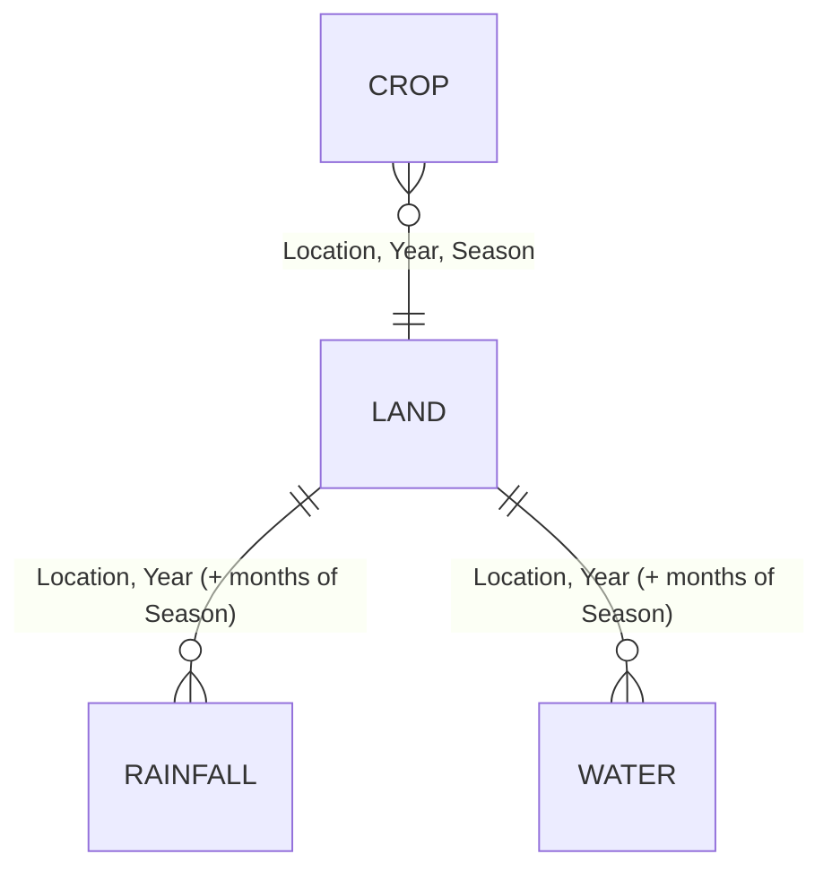

**Provenance column.** Every file has `data_source`:

* `"Project baseline dataset (2020-2023, course-provided)"` – rows 2020–2023. Original source not documented anywhere in the repository.
* `"Estimated (2024) - live download attempted from data.gov.in API (403), CGWB gwdata portal (maintenance mode), … Value = 2023 actual x ~1.061 growth factor"` (crop), `"… 2023 actual carried forward unchanged"` (land), `"… 2023 actual monthly rainfall/weather repeated verbatim"` (rainfall), `"… 2023 actual monthly water-availability figures repeated verbatim"` (water). **All 2024 rows are synthetic.** Because the pipeline defaults to the latest year, every request without an explicit `year` uses 2024. Since 2026-09-29 the API reports this via `data_year_estimated` (see [API_REFERENCE.md](#doc-api-reference)).

Missing values: **none** in any file. Duplicate rows: **none**.

### 2. `<district>_crop.csv` (23 columns)

| Column | Unit / type | Range (all rows) | Used? | Where |
|---|---|---|---|---|
| Location | text | 4 values | ✔ | filters |
| Year | int | 2020–2024 | ✔ | filters, year resolution |
| Season | Kharif/Rabi/Summer | | ✔ | filters |
| Crop_Name | text | 15 crops | ✔ | candidate names |
| Crop_Type | Cereal, Commercial, Fiber, Fodder, Fruit, Horticulture, Oilseed, Plantation, Root Crop, Spice | | ✔ | response only |
| Area_Sown_Ha | ha | 6,420 – 45,773 | ✘ | – |
| Area_Harvested_Ha | ha | 6,400 – 45,547 | ✘ | – |
| Production_Tonnes | t | 18,660 – 4,396,686 | ✘ | – |
| Yield_Kg_Ha | kg/ha | 1,500 (cotton) – 98,449 (sugarcane) | ✔ | objective f1 (yield); dashboard "estimated yield" |
| MSP_Rs_Qtl | ₹ per quintal | 650 – 8,600 | loaded, **not used** in any objective | – |
| Revenue_Rs_Lakh | ₹ lakh (district total) | 6,739 – 1,381,219 | ✔ | ranks candidate crops (top-N); dashboard crop split |
| Water_Req_mm | mm per season | 350 – 1,854 | ✔ | objective f3 (net of effective rain), f4 carbon term |
| Fertilizer_N_Kg_Ha | kg N/ha | 25 – 257.5 | ✔ | f2 cost, f4 leaching + carbon |
| Fertilizer_P_Kg_Ha | kg P₂O₅/ha (assumed basis) | 30 – 82.4 | ✔ | f2, f4 carbon |
| Fertilizer_K_Kg_Ha | kg K₂O/ha (assumed basis) | 30 – 164.8 | ✔ | f2, f4 carbon |
| Pesticide_Cost_Rs_Ha | ₹/ha | 800 – 3,914 | ✔ | f2 |
| Labor_Days_Ha | person-days/ha | 50 – 185.4 | ✔ | f2 (× ₹319/day) |
| Crop_Duration_Days | days | 90 – 365 | ✔ | response only |
| Sowing_Month, Harvest_Month | month name or "Any" | | ✔ | response only |
| Irrigation_Type | Drip, Drip+Flood, Flood, Rainfed, Sprinkler | | ✔ | response only |
| Rainfall_Dependency | Very Low / Low / Medium / High | | ✔ | per-crop fuzzy penalty factor 0.1/0.3/0.6/1.0; Comparison "market" radar axis |
| data_source | text | 2 values | ✔ | `is_estimated_year()` |

Crops per location/season/year (identical every year):

| | Kharif | Rabi | Summer |
|---|---|---|---|
| Coimbatore | Sugarcane, Maize, Groundnut, Cotton, Sorghum | Paddy, Wheat, Turmeric, Sunflower | Vegetables, Banana |
| Erode | Sugarcane, Turmeric, Maize, Cotton, Groundnut | Paddy, Banana, Sunflower | Vegetables, Coconut |
| Salem | Paddy, Maize, Tapioca, Groundnut, Cotton | Sugarcane, Banana, Sunflower | Vegetables, Mango |
| Pollachi | Coconut, Paddy, Banana, Sugarcane, Vegetables | Paddy, Groundnut, Turmeric | Maize, Fodder Crops |

Because at most 5 crops exist per slice, `DEFAULT_MAX_CANDIDATE_CROPS = 6` never truncates; every Summer problem has only **2** crops.

**Internal consistency (verified):** `Production_Tonnes = Area_Harvested_Ha × Yield_Kg_Ha / 1000` (max relative error 0.06 %); `Revenue_Rs_Lakh = Production_Tonnes × 10 × MSP_Rs_Qtl / 10⁵` (max 0.22 %); `Area_Harvested ≤ Area_Sown` in all rows.

**Temporal behaviour:** the median year-over-year yield ratio 2020→21, 21→22, 22→23 is exactly **1.00**; 2024 = 2023 × 1.03 for every crop (area also ×1.03, hence production ×1.061 as the provenance string says).

### 3. `<district>_land.csv` (22 columns)

| Column | Unit | Range | Used? | Where |
|---|---|---|---|---|
| Total_Land_Ha, Agricultural_Land_Ha, Irrigated_Land_Ha, Rainfed_Land_Ha, Fallow/Forest/Urban/Wasteland/Horticulture/Plantation_Ha | ha | 7,420 – 583,052 | Agricultural and Irrigated only | `GET /api/soil-profile` |
| Irrigation_Percent | % of agricultural land | 49.8 – 68.7 | ✔ | profile (display) |
| Agricultural_Percent | % of total land | 44.3 – 61.9 | ✘ | |
| Soil_Type | Red Sandy Loam (Coimbatore), Red Laterite (Erode), Red Loam (Salem), Black Cotton Soil (Pollachi) | | ✔ | display |
| Avg_Soil_pH | pH | 6.5 – 7.5 | ✔ | fertility index |
| Organic_Carbon_Percent | % | 0.53 – 0.75 | ✔ | fertility index |
| N_Status, P_Status, K_Status | Low/Medium/High | K never Low | ✔ | fertility index; dashboard fertiliser actions |

Consistency: `Irrigated + Rainfed = Agricultural` exactly; `Irrigation_Percent = Irrigated/Agricultural×100` within 0.06.
Temporal behaviour: pH rises by exactly **+0.1/year** and organic carbon by **+0.01/year** in every district; Rabi/Summer OC are Kharif −0.01/−0.02.

### 4. `<district>_rainfall.csv` (16 columns)

| Column | Unit | Range | Used? | Where |
|---|---|---|---|---|
| Month | name | 12 per year | ✔ | season filter |
| Season | meteorological season | | ✘ | |
| Monthly_Rainfall_mm | mm | 2.8 – 158.4 | ✔ | effective rainfall; weather fallback |
| Rainy_Days, Max_Daily_Rainfall_mm | days, mm | | ✘ | |
| Min_Temp_C, Max_Temp_C | °C | 17.8 – 41.0 | ✔ | profile; weather fallback |
| Humidity_Percent | % | 50 – 87 | ✔ | profile; weather fallback |
| Rainfall_Type | Light/Monsoon/Pre-monsoon | | ✘ | |
| Normal_Rainfall_mm | mm | 23.3 – 105 | ✘ (implicitly via Deviation_Percent) | |
| Deviation_from_Normal_mm | mm | −59.4 – 97.7 | ✘ | |
| Deviation_Percent | % | **−93.0 – +339.5** | ✔ | **fuzzy input `rainfall_dev`** (seasonal mean) |
| Annual_Normal_mm | mm | 650 (Erode) / 700 (Coimbatore) / 750 (Pollachi) / 800 (Salem) | ✘ | |

`Normal_Rainfall_mm` is **constant within each meteorological season** (e.g. Coimbatore: 37.5 mm for Jan and Feb, 23.3 for Mar–May, 95 for Jun–Sep, 58.3 for Oct–Dec – together exactly the 700 mm annual normal). Real monthly normals are not flat, so monthly deviations are exaggerated (Coimbatore May 2020 = +193.6 %). Consistency: `Deviation_from_Normal_mm = Monthly − Normal` exactly; `Deviation_Percent` matches within 0.05.

Annual observed totals vs stated normal: Coimbatore 619–639 mm (normal 700), Erode 566–579 (650), Salem 676–706 (800), **Pollachi 1,016–1,055 (750)**.

### 5. `<district>_water_availability.csv` (18 columns)

| Column | Unit | Range | Used? | Where |
|---|---|---|---|---|
| River_Inflow_MCM | million m³ | 4.2 – 152.4 | ✘ | |
| Reservoir_Storage_MCM, Reservoir_Capacity_MCM | million m³ | 109.5–272.3 / 248.6–320.4 | ✘ | |
| Storage_Percent | % of capacity | 35 – 85 | ✔ | **fuzzy input `water_storage`**; dashboard "irrigation" action (<40 %) |
| Groundwater_Level_mbgl | m below ground | 15 – 34 | ✘ | |
| Groundwater_Status | Very Low … Very High (7 labels) | | ✔ | profile (mode over months) |
| Canal_Release_MCM | million m³ | 4.4 – 64.4 | ✘ | |
| Irrigation_Water_MCM, Drinking_Water_MCM, Industrial_Water_MCM | million m³ | | Irrigation only | dashboard "water utilisation" numerator |
| Total_Demand_MCM | million m³ | 4.4 – 64.4 | ✔ | dashboard denominator |
| Deficit_Surplus_MCM | million m³ | **always 0.0** | ✔ (profile) | carries no information |
| Primary_Source | Bhavani River, Pillur/Mettur/Bhavanisagar/Aliyar Dam, … | | ✘ | |

Consistency: `Storage% = Storage/Capacity` within 0.014; `Total_Demand = Irrigation + Drinking + Industrial` exactly; `Total_Demand = Canal_Release` exactly.
Temporal behaviour: **`Storage_Percent` is identical for every year** at each location-month (all 48 location-months); `Groundwater_Level_mbgl` also never changes across years. Seasonal storage means therefore differ only by district and season, never by year.

### 6. Transformations applied by the code

| Step | Code | Formula / rule |
|---|---|---|
| Load | `loader._read_kind` | concatenate the 4 district files per kind; cached for process lifetime |
| Year resolution | `preprocessing._resolve_year` | `year=None` → latest year for that location in crop.csv (2024) |
| Soil fertility index (0–100) | `compute_soil_fertility_index` | `0.3·clamp(100−40·|pH−6.5|) + 0.3·clamp(100·OC/1.0) + 0.4·mean(status→{Low 30, Med 60, High 90})` |
| Seasonal rainfall | `get_region_season_profile` | mean over the season's months of Monthly_Rainfall_mm, Deviation_Percent, Humidity, Max/Min temp |
| Effective rainfall | same | `mean_monthly_rain × n_months × 0.7` (mm per season) |
| Water profile | same | mean Storage_Percent, mode Groundwater_Status, mean Deficit_Surplus |
| Candidate crops | same | crop rows for (loc, year, season) sorted by Revenue_Rs_Lakh desc, top `max(N, 2)` |
| Display normalisation | `normalized_snapshot` | min–max against fixed ranges pH 4–9, OC 0–1.5 %, rain 0–150 mm, deviation −50…+50 %, storage 0–100 %. **Not used by the optimiser** |

Validation performed at load time: file existence only. There is no schema validation, range checking or type enforcement (see TODO T-6).

### 7. The stale `datasets/` folder

Same 16 file names, older content: no `data_source`/`Annual_Normal_mm` columns, no 2024 rows, and different rainfall normals (e.g. Coimbatore January `Normal_Rainfall_mm` 7.5 vs 37.5, deviation +9.3 % vs −78.1 %). The team's saved runs in `results/` and the numbers in `agrooptimize-backend/docs/results/*.md` and `docs/api_docs.md` (e.g. Coimbatore Kharif 2023 storage 94.7 %, yield confidence 0.775) come from an older dataset version; the current data gives storage 85.0 % and yield confidence 0.620 for the same slice.

### 8. Confidence, weaknesses and official replacements

| Dataset | Confidence | Main weaknesses | Candidate official source (verify current availability) |
|---|---|---|---|
| Crop | Low–medium | Origin undocumented; yields flat over 4 years; 2024 synthetic; "MSP" given for crops with no notified MSP (banana, coconut per quintal, mango, tapioca, vegetables, turmeric); wheat listed for Tamil Nadu Rabi; sugarcane listed under Kharif with January sowing | District-wise Area-Production-Yield from the Directorate of Economics & Statistics (Ministry of Agriculture) via data.gov.in / DES portal; MSP from CACP / PIB notifications; costs from the DES *Cost of Cultivation of Principal Crops* scheme; crop water requirement from FAO-56 or TNAU crop production guides |
| Land & soil | Low | Perfectly linear pH/OC trends; one soil type per district | Soil Health Card portal (soilhealth.dac.gov.in); DES Land Use Statistics |
| Rainfall | Medium-low | Season-flat normals inflate monthly deviations; 2024 repeated | IMD district-wise monthly rainfall and normals (IMD Customized Rainfall Information System) |
| Water | Low | Storage identical every year; Deficit_Surplus always 0; groundwater level constant | CWC reservoir bulletins / India-WRIS (reservoir storage); CGWB groundwater-level data via India-WRIS |

Recommended actions are in [DATA_VALIDATION.md](#doc-data-validation) §5 and [TODO.md](#doc-todo).

<a id="doc-data-validation"></a>

## Data Validation Review

Scope: the 16 files in `agrooptimize-backend/data/raw/`. Method: every check below was executed with pandas against the files on 2026-09-29; numbers are measured, not estimated. Column-level reference: [DATASETS.md](#doc-datasets).

### 1. Summary verdict

The files are **internally consistent** (derived columns match their formulas to <0.25 %) and **clean** (no missing values, no duplicates). But the time series show strong signatures of **synthetic construction**, the latest year is **explicitly estimated**, and the provenance of the 2020–2023 "course-provided" baseline is undocumented. For a system whose selling point is *uncertainty modelling*, the inputs carry almost no real year-to-year variation – so the fuzzy layer cannot demonstrate responding to real variability.

| ID | Finding | Severity | Affects |
|---|---|---|---|
| D1 | All 2024 rows are synthetic and 2024 is the default year | **High** | Every default request, dashboard trend |
| D2 | Reservoir storage identical in every year; groundwater level constant; Deficit_Surplus always 0 | **High** | Fuzzy water input is year-invariant |
| D3 | Crop yields flat 2020–2023; linear pH/OC trends | High | Research validity |
| D4 | Rainfall normals flat within met-seasons → extreme monthly deviations | High | Fuzzy rainfall input |
| D5 | Seasonal deviation computed as mean of monthly percentages | Medium | Fuzzy outputs shift up to 0.21 |
| D6 | Rabi uses Jan–Mar of the same calendar year; Rabi/Summer overlap | Medium | Seasonal aggregation |
| D7 | Pollachi rainfall ~40 % above its own stated normal every year | Medium | Plausibility |
| D8 | "MSP" for crops without a notified MSP; some values need checking | Medium | Unused today, matters if revenue is ever optimised |
| D9 | Agronomic oddities (wheat in TN Rabi, sugarcane as Kharif with January sowing, "Any" months) | Low | Credibility in viva |
| D10 | Provenance of the baseline undocumented; paper says "government" data | **High (integrity)** | Report / paper claims |
| D11 | Duplicate, divergent `datasets/` folder | Low | Confusion |
| D12 | Saved results & results write-ups come from an older dataset | Medium | Reproducibility of reported numbers |

### 2. Checks that pass

| Check | Result |
|---|---|
| Missing values (all 4 kinds) | 0 |
| Exact duplicate rows | 0 |
| `Production = Area_Harvested × Yield / 1000` | max rel. error 0.06 % |
| `Revenue(lakh) = Production × 10 × MSP / 10⁵` | max rel. error 0.22 % |
| `Area_Harvested ≤ Area_Sown` | 205/205 rows |
| `Irrigated + Rainfed = Agricultural` | exact |
| `Irrigation_Percent = Irrigated / Agricultural` | within 0.06 pp |
| `Deviation_mm = Monthly − Normal` | exact |
| `Storage% = Storage / Capacity` | within 0.014 pp |
| `Total_Demand = Irrigation + Drinking + Industrial` | exact |
| 12 months per location-year | yes |
| Every (location, season, year) has ≥2 crops | yes (Summer has exactly 2) |

### 3. Findings in detail

#### D1 – Synthetic 2024 is the default
`data_source` for every 2024 row states the value was produced from 2023 (crop: ×1.03 yield and area; land: copied; rainfall and water: "repeated verbatim"). `preprocessing._resolve_year(year=None)` returns the latest year, 2024. Consequences:
* Every dashboard/analytics/comparison request and every farm-plan request without `year` runs on estimated inputs.
* `GET /api/dashboard/*` reports `yield_trend = "+3.0%"` for **every district** – that is the estimation factor, not an observed trend.
* Fuzzy outputs for 2024 are identical to 2023 (same rainfall/water inputs).

Mitigation implemented: `data_year_estimated` flag in region-profile, farm-plans and dashboard responses, plus a warning banner on the dashboard and a note in the Run Optimization result and downloaded report. **Decision for the team (TODO T-1):** either default to the latest *observed* year or remove the 2024 rows.

#### D2 – Year-invariant water data
For all 48 location-months, `Storage_Percent` has one value across 2020–2024; `Groundwater_Level_mbgl` likewise. Season means per district (identical every year):

| | Kharif | Rabi | Summer |
|---|---|---|---|
| Coimbatore | 85.0 | 69.7 | 61.5 |
| Erode | 78.0 | 62.5 | 53.8 |
| Salem | 62.0 | 45.8 | 38.3 |
| Pollachi | 72.0 | 57.5 | 48.8 |

`Deficit_Surplus_MCM` is 0.0 in all 240 rows, and `Total_Demand_MCM == Canal_Release_MCM` exactly – i.e. demand was generated to equal supply.

#### D3 – Flat or linear series
Median year-over-year yield ratio is exactly 1.00 for 2020→21, 21→22, 22→23. Soil pH increases by exactly 0.1 per year and organic carbon by 0.01 per year in all four districts. Real district statistics do not behave this way. The median coefficient of variation of monthly rainfall across 2020–2023 is 0.09 – very low for Tamil Nadu monsoon rainfall.

#### D4 – Flat rainfall normals
`Normal_Rainfall_mm` is one value per meteorological season, e.g. Coimbatore Jun–Sep = 95 mm each month. Summing gives exactly the stated `Annual_Normal_mm`. Real monthly normals vary within a season, so monthly `Deviation_Percent` ranges from −93 % to +339.5 %. The fuzzy input universe is clipped to ±60 %, so Pollachi Summer (+105 % to +121 %) is saturated at +60.

Structural effect: every Kharif season of Coimbatore and Erode shows a ~−40 % "deficit" in every year, and every Summer a surplus – the classification reflects how the normals were built, not weather.

#### D5 – Averaging percentages
`avg_deviation_percent = mean(monthly Deviation_Percent)`. The hydrologically standard seasonal deviation is `(Σ actual − Σ normal) / Σ normal`. Re-running the fuzzy engine for all 60 location-season-years with the total-based deviation changes:

| Metric | Max absolute change |
|---|---|
| yield_confidence | 0.059 |
| irrigation_risk | **0.213** (Erode Summer 2020: 0.152 → 0.365) |

Examples: Coimbatore Rabi 2023 is −11.1 % by the current method but +1.8 % by totals; Salem Summer 2023 +12.3 % vs −3.1 % (label flips surplus→normal). Kharif is unaffected because its four normals are equal. Not changed in code because it alters every result; recommended fix in TODO T-3.

#### D6 – Season windows
Rabi (Oct–Mar) takes January–March from the **same** calendar year as October–December, so "Rabi 2023" mixes early-2023 and late-2023 weather rather than one contiguous season (Oct 2023–Mar 2024). February and March are counted in both Rabi and Summer.

#### D7 – Pollachi rainfall vs normal
Observed annual totals 1,016–1,055 mm against a stated annual normal of 750 mm (+35–41 % every year), while the other three districts are consistently 5–15 % *below* their normals. Either the normal or the observations are mis-specified.

#### D8 – Price column
`MSP_Rs_Qtl` is filled for banana, coconut, mango, tapioca, vegetables, turmeric and fodder, for which the Government of India does not notify an MSP (coconut is supported as *copra*, not per quintal of nuts). For notified crops some values match published MSPs for the stated marketing year and others appear to be from different years (e.g. maize 2023 = ₹1,962, sunflower 2023 = ₹6,015). These should be checked against the CACP / PIB MSP notifications before any revenue objective is introduced. **Currently the column is loaded but not used by any objective.**

#### D9 – Agronomic plausibility
* Wheat is listed in Coimbatore Rabi; wheat is a very minor crop in Tamil Nadu.
* Sugarcane appears under Kharif (Coimbatore, Erode, Pollachi) and Rabi (Salem) with January sowing and 365-day duration – a 12-month crop cannot be a seasonal option alongside 100-day crops without land-occupancy constraints.
* Banana, coconut, mango: perennial crops treated as seasonal land allocations.
* Sowing/Harvest "Any".

#### D10 – Provenance
Rows 2020–2023 say "course-provided". The team's own `docs/dataset_description.md` flags that the origin "was not independently verified" and warns against claiming data.gov.in/CGWB/TNAU sources. The reference paper's abstract states the system "makes use of agricultural databases given by the government", and `docs/literature_survey.md` claims validation on "real … Tamil Nadu district-level data". Findings D2–D4 are hard to reconcile with real statistics. **This is the single most important item to settle before the viva** (TODO T-2).

#### D11 – Divergent duplicate
`final_year_project/datasets/` differs from `data/raw/` in schema, row count and rainfall normals. Nothing loads it.

#### D12 – Non-reproducible reported results
All 8 JSON runs in `results/` and the tables in `agrooptimize-backend/docs/results/*.md` / `docs/api_docs.md` report e.g. Coimbatore Kharif 2023 storage 94.7 %, yield confidence 0.775. The current data yields 85.0 % and 0.620. Those write-ups must be regenerated from the current code and data.

### 4. What is actually validated at runtime

Only file existence (`loader._read_kind`) and the presence of rows for the requested slice (`get_region_season_profile` raises `ValueError` → HTTP 400). There is no schema, type or range validation.

### 5. Recommended actions (ordered)

1. Decide and document the provenance of the 2020–2023 data (D10).
2. Make the default year the latest observed year, or drop 2024 (D1).
3. Replace water and rainfall with official series (IMD monthly rainfall and normals; CWC/India-WRIS reservoir storage; CGWB groundwater) – this is what gives the fuzzy layer genuine variability (D2, D4).
4. Compute seasonal deviation from totals and make Rabi span Oct(Y)–Mar(Y+1) (D5, D6).
5. Add a schema/range validation step (pandera or explicit asserts) at load time.
6. Delete or clearly archive `datasets/` (D11) and regenerate the results write-ups (D12).

---

# Part 4 — Algorithms, Explainability & Pipelines

<a id="doc-algorithms"></a>

## Algorithms

Every algorithm in the system, as implemented (not as described in the paper). Code references are to `agrooptimize-backend/app/`. Scoring formulas used only by the UI (radar, dashboard KPIs) are in [SCORING_AND_RANKING.md](#doc-scoring-and-ranking).

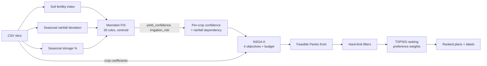

---

### 1. Soil fertility index (`data/preprocessing.py::compute_soil_fertility_index`)

```
ph_score  = clamp(100 − 40·|pH − 6.5|, 0, 100)          # 100 at pH 6.5, 0 at pH 4.0 / 9.0
oc_score  = clamp(100 · OC% / 1.0, 0, 100)               # saturates at 1.0 % organic carbon
npk_score = mean(S(N), S(P), S(K)),  S: Low→30, Medium→60, High→90 (unknown→50)
index     = 0.3·ph_score + 0.3·oc_score + 0.4·npk_score  ∈ [0, 100], rounded to 2 dp
```

* **Why:** collapses five soil attributes into one fuzzy input so the rule base stays 3-dimensional.
* **Arbitrary constants:** 6.5 optimum and slope 40 (pH), 1.0 % OC saturation, 30/60/90 status scores, 0.3/0.3/0.4 weights. Documented as modelling choices, no citation.
* **Observed range in data:** 61.0 – 77.4 (all slices fall in fuzzy sets *medium*/*good*; *poor* is never exercised by real data).
* **Alternatives:** a published Soil Quality Index (e.g. Andrews et al. scoring functions), or feeding N/P/K status to the FIS directly.

### 2. Mamdani fuzzy inference (`fuzzy/engine.py`)

#### 2.1 Variables and membership functions (all triangular, `skfuzzy.trimf`)

| Variable | Universe (step 1) | Set: [a, b, c] |
|---|---|---|
| **rainfall_dev** (input, %) | −60 … 60 | deficit [−60, −60, −5] · normal [−15, 0, 15] · surplus [5, 60, 60] |
| **water_storage** (input, %) | 0 … 100 | low [0, 0, 35] · medium [20, 50, 75] · high [60, 100, 100] |
| **soil_fert** (input, index) | 0 … 100 | poor [0, 0, 40] · medium [25, 50, 75] · good [60, 100, 100] |
| **yield_conf** (output, %) | 0 … 100 | low [0, 0, 45] · medium [30, 55, 75] · high [65, 100, 100] |
| **irrigation_risk** (output, %) | 0 … 100 | low [0, 0, 35] · medium [25, 50, 75] · high [60, 100, 100] |

Inputs are clipped to the universe before inference (`np.clip`). Shoulder sets ([a, a, c]) behave as left/right-open. Note gaps: `rainfall_dev` between −15 and −5 belongs only to deficit/normal partially; there is no point with zero total membership.

#### 2.2 Rule base (26 rules, `_build_system`)

AND = `min`, rule aggregation = `max`, implication = `min` (scikit-fuzzy defaults).

| # | IF | THEN yield_conf | THEN irrigation_risk |
|---|---|---|---|
| 1 | rain deficit ∧ water low | low | high |
| 2 | rain deficit ∧ water medium | medium | medium |
| 3 | rain deficit ∧ water high | medium | medium |
| 4 | rain normal ∧ water low | medium | medium |
| 5 | rain normal ∧ water medium | high | low |
| 6 | rain normal ∧ water high | high | low |
| 7 | rain surplus ∧ water low | medium | low |
| 8 | rain surplus ∧ water medium | high | low |
| 9 | rain surplus ∧ water high | high | low |
| 10 | soil good | high | – |
| 11 | soil poor | low | – |
| 12 | soil medium ∧ rain normal | medium | – |
| 13 | water high ∧ soil good | high | – |
| 14 | water low ∧ soil poor | low | high |
| 15 | deficit ∧ water low ∧ soil poor | low | high |
| 16 | surplus ∧ water high ∧ soil poor | medium | – |
| 17 | water high ∧ soil poor | – | low |
| 18 | water low ∧ soil medium | – | high |
| 19 | deficit ∧ water medium ∧ soil good | medium | – |
| 20 | deficit ∧ soil poor | low | high |
| 21 | normal ∧ water high ∧ soil good | high | low |
| 22 | normal ∧ water medium ∧ soil medium | medium | medium |
| 23 | surplus ∧ water medium ∧ soil medium | medium | – |
| 24 | deficit ∧ water high ∧ soil medium | medium | low |
| 25 | surplus ∧ water high ∧ soil good | high | low |
| 26 | deficit ∧ water medium ∧ soil poor | low | high |

Rule-base properties worth knowing for the viva:

* **Rules do not "cap" or "override".** Mamdani max-aggregation only ever *adds* consequent mass. Rule 5 (normal ∧ medium → high) and rule 22 (… ∧ soil medium → medium) both fire and the centroid lands between the sets. A rule can pull the centroid toward its consequent; it cannot stop another rule from firing.
* **Five rules are provably inert.** If rule B has the same consequent as rule A and a strictly more specific antecedent, B's firing strength (a `min` over more terms) is never larger than A's, so it never changes the aggregated output. Measured by deleting each rule and re-evaluating a 21×21×21 input grid (9,261 points):

  | Rule removed | Max change in yield_conf | Max change in irrigation_risk | Subsumed by |
  |---|---|---|---|
  | 15 | 0 | 0 | 1 (and 14, 20) |
  | 19 | 0 | 0 | 2 |
  | 21 | 0 | 0 | 6 |
  | 25 | 0 | 0 | 9 |
  | 26 | 0 | 0 | 20 |
  | 22 / 24 | 0 | 22.6 / 15.7 pts | yield part subsumed by 12 / 3; risk part active |
  | 16, 17, 18, 20, 23 | up to 19.7 pts | up to 52.1 pts | active |

  The code comment on rule 19 ("caps it at medium") therefore does not describe its behaviour; with rule 10 (soil good → high) also firing, rule 19 contributes nothing. Effective rule count: **21**, not 26 (TODO T-5).
* **Incompleteness for `irrigation_risk`.** Only water/rain rules (1–9, 14, 15, 17, 18, 20–22, 24–26) set it; soil-only situations leave it to the rain×water grid, which is complete (all 9 combinations), so an output always exists.
* **Observed output range** on the real data (60 location-season-years): yield_confidence 0.547–0.883, irrigation_risk 0.117–0.500. Low water and poor soil sets are never activated by the dataset.

#### 2.3 Defuzzification
Centroid (scikit-fuzzy default) on each output universe, divided by 100 → `[0, 1]`. If `compute()` raises (no rule fired – cannot happen after clipping, but guarded) the engine returns 0.5/0.5. Dominant linguistic labels (`rainfall_label`, …) are the set with maximum membership at the clipped input.

#### 2.4 Per-crop adjustment (`crop_yield_confidence`)
```
factor  = {Very Low: 0.1, Low: 0.3, Medium: 0.6, High: 1.0}[Rainfall_Dependency]   (unknown → 0.5)
penalty = irrigation_risk · factor · 0.4
crop_confidence = clip(yield_confidence · (1 − penalty), 0, 1)
```
Maximum penalty 40 % (constant 0.4 is arbitrary). This is the **only** channel through which fuzzy logic influences optimisation.

#### 2.5 Why Mamdani / alternatives
* **Chosen because:** the paper specifies a Mamdani FIS; rules are human-readable, linguistic outputs can be plotted.
* **Sugeno/TSK** would give smoother, faster, differentiable outputs and allow data-driven tuning (ANFIS) once real outcome data exist.
* **Type-2 fuzzy** would model uncertainty in the membership functions themselves – more defensible for "uncertainty" claims.
* **Probabilistic scenarios** (the paper's "probability theory") – sampling rainfall/storage from historical distributions and optimising expected value or CVaR – would make uncertainty affect the *shape* of the trade-off, which the current design cannot (see §4.6).

---

### 3. Optimisation problem (`optimization/problem.py`)

#### 3.1 Decision variables (chromosome length 3n, n = candidate crops, 2–5 in practice)

| Block | Genes | Bounds | Meaning |
|---|---|---|---|
| Allocation | x₀…x_{n−1} | [1e−4, 1] | Share of land; normalised to sum 1 at evaluation and by repair |
| Irrigation | x_n…x_{2n−1} | [0.7, 1.3] | Multiplier on net irrigation need |
| Fertiliser | x_{2n}…x_{3n−1} | [0.7, 1.3] | Multiplier on the NPK dose |

Lower bound 1e−4 means **every candidate crop always receives a non-zero area**; plans therefore always contain all n crops (UI hides shares < 1 %).

#### 3.2 Objectives (vectorised over the population), with aᵢ = share·total_land_ha

| | Formula | Direction |
|---|---|---|
| f1 yield (t) | Σ aᵢ · Yieldᵢ/1000 · crop_confidenceᵢ | maximise (stored as −f1) |
| f2 cost (₹) | Σ aᵢ · [ fertᵢ·(Nᵢ·12.87 + Pᵢ·58.70 + Kᵢ·56.67) + Pesticideᵢ + Labourᵢ·319 ] | minimise |
| f3 water (L) | Σ aᵢ · irrᵢ · max(WaterReqᵢ − effective_rain, 0) · 10 000 | minimise |
| f4 env. impact | √( L · C ), L = Σ aᵢ·fertᵢ·Nᵢ ,  C = Σ aᵢ·[fertᵢ·(Nᵢ+Pᵢ+Kᵢ)·0.15 + irrᵢ·WaterReqᵢ·0.01] | minimise |

Constraint (only when `budget_rs` is given): g = f2 − budget ≤ 0.

Properties that matter (verified numerically, see [RESEARCH_REVIEW.md](#doc-research-review) §4):

1. **Multipliers never improve any objective.** Yield does not depend on `irr` or `fert`; cost, water and impact increase with them. Any multiplier above 0.7 is dominated, so NSGA-II drives them to 0.7: in the final fronts 74–99 % of fertiliser genes and 52–100 % of irrigation genes are < 0.72. The "irrigation/fertiliser optimisation" is effectively inert.
2. **f1–f3 are linear in area** once multipliers sit at their lower bound; the front is a trade-off between crops' per-hectare coefficient vectors. Yield is heavily dominated by sugarcane/tapioca/banana/coconut tonnage.
3. **f4 uses gross `Water_Req_mm`** in the carbon term but f3 uses *net* irrigation – inconsistent treatment of pumping.
4. **f2 excludes water/energy, seed, machinery, land rent.** `WATER_COST_RS_PER_MM_PER_HA` exists in config but is deliberately unwired.
5. Yield–cost correlation across the returned fronts is 0.85–1.00 for 3–5-crop problems; for 2-crop Summer problems it is −1 (no trade-off between yield and cost).

#### 3.3 Constraint handling
pymoo's constraint-domination: a feasible solution beats an infeasible one; between infeasible solutions the smaller violation wins. Infeasible final solutions are flagged `feasible=False` by `extract_pareto_plans` and dropped by the callers. An infeasible budget therefore yields an empty plan list (HTTP 200) rather than an error.

---

### 4. NSGA-II (`optimization/nsga2_runner.py`, `operators.py`)

#### 4.1 Configuration

| Component | Implementation | Value |
|---|---|---|
| Population | `pop_size` | 80 (`/api/farm-plans`), 100 (dashboard endpoints), 24 in fast tests |
| Generations | termination `("n_gen", n)` | 200 (fast tests 15) |
| Initial sampling | pymoo `FloatRandomSampling` | uniform in bounds, then repaired |
| Parent selection | pymoo default binary tournament | compares by constraint violation, then Pareto dominance, then crowding distance |
| Crossover | custom `SinglePointCrossover` | pymoo decides per mating with p = 0.85; cut point uniform in 1…3n−1; tails swapped |
| Mutation | custom `GaussianMutation` | every gene independently with p = 0.12; δ ~ N(0, 0.12·(xu−xl)); clip to bounds |
| Repair | custom `AllocationRepair` | allocation block clipped ≥0, all-zero rows → uniform, renormalised to sum 1; all genes clipped to bounds |
| Survival | pymoo `RankAndCrowding` | fast non-dominated sort, then crowding distance |
| Duplicates | `eliminate_duplicates=True` | identical offspring discarded |
| Seed | `config.NSGA2_SEED = 42` | `np.random.seed(seed)` for custom operators **and** `seed=` for pymoo's own generator |

**Reproducibility and thread safety.** Two RNG streams are involved: pymoo's seeded `Generator` (sampling, selection, crossover yes/no) and NumPy's *global* RNG (cut points, mutation). Because the global RNG is process-wide, concurrent requests used to interfere: measured on the original code, 20 of 40 concurrent runs produced a different front than the same seed run alone. Since 2026-09-29 each run holds `_NSGA2_RUN_LOCK`; the measurement is 0 of 40, and `tests/test_hardening.py::test_concurrent_runs_match_serial_runs` guards it. A cleaner long-term fix is to pass pymoo's `random_state` into the operators (would change outputs, so not done).

#### 4.2 Why single-point crossover and Gaussian mutation
Chosen to match the paper literally. For real-coded chromosomes, SBX + polynomial mutation (pymoo defaults) are the standard choice; single-point crossover on a block-structured chromosome mostly swaps whole multiplier blocks and cuts the allocation block at one place, which limits recombination of allocation patterns.

#### 4.3 Output decoding
`extract_pareto_plans` decodes every individual of `result.X` (pymoo returns the non-dominated set of the final population): allocation renormalised, area = share × land, objectives rounded (yield 3 dp, cost 2 dp, water 1 dp, impact 3 dp).

#### 4.4 Convergence history and hypervolume (`extract_convergence_history`)
When `track_history=True` pymoo deep-copies the algorithm each generation. For each generation: best and mean of each raw objective over the surviving population, and hypervolume:
```
lo, hi = min/max of F over ALL generations of this run
F_norm = clip((F − lo) / (hi − lo), 0, 1.5)
HV     = pymoo HV(ref_point = [1.1, 1.1, 1.1, 1.1])(F_norm)
```
Consequences: HV is **run-relative** (normalised by that run's own extremes), so values are not comparable between runs, districts or the fuzzy/non-fuzzy variants. Typical run: HV 0.26 → 0.81 (Salem Kharif, pop 100).

#### 4.5 Why NSGA-II / alternatives
* **Chosen because:** the paper specifies it; widely taught; returns a spread Pareto set in one run.
* **Caveat:** with 4 objectives NSGA-II's crowding distance loses selection pressure (many-objective regime); **NSGA-III** or **MOEA/D** are designed for ≥4 objectives.
* **Exact alternative:** because f1–f3 are linear in the land shares, an ε-constraint method with an LP solver would give the exact trade-off curve and a proof of optimality; the square-root in f4 is the only non-linearity (it could be linearised by optimising L and C separately). This is the strongest comparison baseline for the report.
* **Performance:** a full run takes ≈0.3 s (pop 80, 200 generations) without history and ≈0.8 s with history.

#### 4.6 How much does fuzzy logic change the optimum?
Fuzzy confidence multiplies each crop's yield by a constant. It rescales f1 per crop but does not touch f2–f4. `GET /api/compare-fuzzy` therefore shows identical min-cost, min-water and min-impact values for the fuzzy and non-fuzzy runs; only best-yield differs (e.g. Salem Kharif 13.96 vs 26.96 t/ha). The crop *ranking* by yield can change when dependencies differ, which is the genuine effect to report.

---

### 5. Decision stage (`decision/ranking.py`)

#### 5.1 Hard-limit filters (`filter_plans`)
Keep plans with cost ≤ `max_cost_rs`, water ≤ `max_water_liters`, yield ≥ `min_yield_tonnes`, impact ≤ `max_env_impact` (each optional). Applied after NSGA-II, so an over-restrictive filter can return 0 plans.

#### 5.2 TOPSIS (`rank_plans`)
```
for each objective j: n_ij = (v_ij − min_j)/(max_j − min_j)      (0.5 if constant)
                      flipped to 1 − n_ij for cost, water, env     → higher is better
M_ij  = w_j · n_ij
A⁺_j  = max_i M_ij,  A⁻_j = min_i M_ij
d⁺_i  = ‖M_i − A⁺‖₂,  d⁻_i = ‖M_i − A⁻‖₂
C_i   = d⁻_i / (d⁺_i + d⁻_i)       (0.5 if both 0)
rank by C_i descending, keep top 50 (plan_service) or 100 (dashboard)
```
Differences from classical TOPSIS (Hwang & Yoon, 1981): min–max instead of vector normalisation, which makes the ideal/anti-ideal exactly 1·w and 0·w per criterion. Weights per preference:

| Preference | yield | cost | water | env |
|---|---|---|---|---|
| balanced | 0.300 | 0.233 | 0.233 | 0.233 |
| max_yield | 0.55 | 0.15 | 0.15 | 0.15 |
| min_cost | 0.15 | 0.55 | 0.15 | 0.15 |
| min_water | 0.15 | 0.15 | 0.55 | 0.15 |
| min_env_impact | 0.15 | 0.15 | 0.15 | 0.55 |

The "balanced" 0.30 was tuned empirically (documented in `ranking.py`) because cost, water and impact are strongly correlated with yield. Alternatives: knee-point selection (no weights), VIKOR (explicit compromise), PROMETHEE II (pairwise outranking), AHP-derived weights elicited from farmers.

#### 5.3 Per-plan labels
* **`normalized_scores`** – the flipped min–max values above (0–1, higher = better).
* **`confidence_label`** – land-weighted crop confidence Σ shareᵢ·crop_confidenceᵢ bucketed ≥0.66 High, ≥0.33 Moderate, else Low. With the observed confidence range (≈0.44–0.88) "Low" never occurs.
* **`trade_off_summary`** – raw (un-flipped) min–max position of each objective bucketed at 0.33/0.66 → "High yield, Moderate cost, …" so "High cost" always means expensive.
* **`allocation_percent`** – largest-remainder rounding so the displayed shares sum to exactly 100.00.

---

### 6. Other derived computations (summary; details in [SCORING_AND_RANKING.md](#doc-scoring-and-ranking))

| Computation | Where | Essence |
|---|---|---|
| Plans A/B/C | `dashboard_service.get_comparison` | #1 of TOPSIS balanced / max_yield / min_cost over one front |
| Radar scores | `_radar_scores` | min–max over the 3 compared plans ×100; risk = (1−irrigation_risk)·100; market = (1−mean dependency factor)·100 |
| Fuzzy vs non-fuzzy | `get_fuzzy_comparison` | two NSGA-II runs (`use_fuzzy` True/False), per-ha best/min summaries |
| Dashboard KPIs | `get_dashboard` | mean yield, year-over-year %, fertility index, irrigation share of demand, rule-based actions |
| Current season | `_current_season` | today's month → first season in `SEASON_MONTH_MAP` containing it (Feb/Mar → Rabi) |
| History rows | `get_history` | per saved run: top plan yield/cost ÷ its area |

<a id="doc-explainability"></a>

## Explainable Recommendation Engine

Every recommended plan can be explained: why it was chosen, how the four objectives were balanced, what was traded away, which constraints hold, benefits, risks, historical context, a decomposed confidence score and a trace of the pipeline. Code: `app/services/explanation_service.py`. UI: `frontend/src/components/ExplanationPanel.jsx`.

### 1. Where the recommendation is created (before this feature)

| Step | Input | Processing | Output | Code |
|---|---|---|---|---|
| Profile | location, season, year | CSV slice → soil, rainfall, water, candidate crops | `RegionSeasonProfile` | `app/data/preprocessing.py` |
| Fuzzy | rain deviation, storage, fertility | Mamdani FIS, 26 rules | yield confidence, irrigation risk | `app/fuzzy/engine.py` |
| Search | profile + fuzzy + land + budget | NSGA-II, 4 objectives | feasible Pareto set | `app/optimization/` |
| **Decision** | Pareto set + preference | **TOPSIS closeness → rank 1 = recommendation** | ranked plans | `app/decision/ranking.py::rank_plans` |
| Delivery | ranked plans | saved run / per-ha dashboard payloads | API responses | `plan_service.py`, `dashboard_service.py` |

The recommendation is TOPSIS rank 1 under the active preference: `POST /api/farm-plans` (user preference), Comparison Plan A/B/C (balanced / max_yield / min_cost).

### 2. Architecture

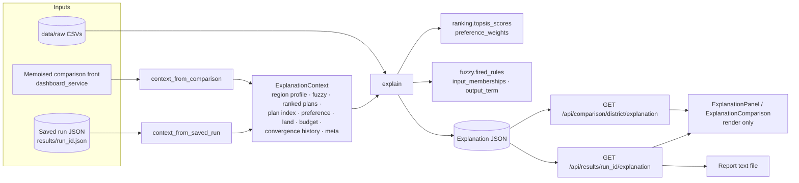

**Design decisions**

| Decision | Why |
|---|---|
| A backend service, not React logic | One source of truth for wording and numbers; reused by four pages and the report; testable |
| Dedicated endpoints instead of extending optimisation responses | Optimisation responses stay lean (~33 KB); explanations (~19 KB) are fetched only when asked for; saved runs explain retroactively, including runs saved before this feature |
| One `ExplanationContext` for saved runs and live comparison plans | Same analysis code path for both |
| Re-use, not re-implement | TOPSIS maths moved into `ranking.topsis_scores` and used by both `rank_plans` and the explainer (48 pipeline outputs verified identical to `main`); fuzzy helpers use the model's own sets and rules |
| Comparison explanations use the history-tracked front | Verified identical to the front the page shows (all 4 districts), so convergence evidence is available without describing a different plan |
| Saved runs now store `meta.total_land_ha`, `meta.budget_rs` | Needed for the budget check; older runs report "not recorded" rather than guessing |

### 3. Sources of every statement

Each item is `{id, title, detail, source, evidence, status?, severity?}`. `detail` is built from `evidence`; `source` is one of: `dataset`, `fuzzy`, `nsga2`, `topsis`, combinations of these, `constraint(s)`, `request`, `run metadata`, `model limitation`. In the UI, hovering any item shows its source and evidence.

| Section | Built from |
|---|---|
| Summary | ranked plan (rank, closeness, shares, area, objective totals), confidence, recommendation rule |
| Reasons | TOPSIS rank and margin; objectives with goodness ≥ 0.60; soil fuzzy set; land share of Low/Very-Low rainfall-dependency crops; budget headroom; historical top-3 share; ranks under other preferences |
| Objectives | stored `normalized_scores` (goodness), preference weights, per-ha values vs the set (best / median / worst), share of the TOPSIS gap to the ideal |
| Trade-offs | best plan in the set per objective vs this plan (per-ha deltas); least-squares slope and correlation of cost and water against yield across the set |
| Constraints | land allocation, budget (if recorded), rainfall (fuzzy set + rainfall coverage), soil (fuzzy set), irrigation risk (fuzzy output set), optimiser feasibility |
| Benefits | objectives better than the set median (percent difference) |
| Risks | irrigation-risk output set, rainfall deficit, rainfall coverage < 50 %, rain-dependent crops, concentration (HHI), perennial crops, weak objectives (goodness < 0.30), estimated data year, year-to-year rainfall variability, inputs at the model minimum |
| Historical context | observed (non-estimated) years in crop.csv and rainfall.csv for the district/season |
| Confidence | see §4 |
| Insights | trade-off position, diversification, main yield driver, rainfall reliance, rank under each preference |
| Alternatives | runner-up per-ha deltas and closeness |
| Timeline | data slice, fuzzy inputs/outputs + fired rules, NSGA-II settings and hypervolume, TOPSIS weights and rank, constraint summary |
| Crop breakdown + consistency | per-crop confidence, expected yield, net irrigation recomputed exactly as `FarmPlanProblem._evaluate`; recomputed totals vs reported totals |

### 4. Formulas

Notation: plan *p* in a ranked set *S* (all feasible plans for comparison explanations; the stored top 50 for saved runs), crops *i*, land share *sᵢ*, area *aᵢ*, multipliers *irrᵢ*, *fertᵢ*.

| Quantity | Formula |
|---|---|
| Per-hectare value | objective total ÷ Σ aᵢ (water in ML = L × 10⁻⁶) |
| Goodness gⱼ | stored TOPSIS min–max score (1 = best in the ranked front) |
| Better-than share | % of other plans in *S* that *p* is at least as good as, on objective *j* |
| Gap share | (wⱼ(1−gⱼ))² / Σₖ (wₖ(1−gₖ))² — objective's share of the squared distance to the TOPSIS ideal; the largest = "main compromise" |
| Strongest objective | argmax gⱼ (ties → larger weight) |
| Crop confidence | `crop_yield_confidence(yield_conf, irrigation_risk, dependency)` (engine) |
| Expected tonnes | aᵢ · Yieldᵢ/1000 · confᵢ |
| Net irrigation | max(WaterReqᵢ − effective rain, 0) · irrᵢ |
| Rainfall coverage | min(100, effective rain ÷ Σ sᵢ·WaterReqᵢ × 100) |
| Concentration | HHI = Σ sᵢ² (1 = one crop) |
| Marginal rate | least-squares slope of cost/ha (or water/ha) on yield/ha over *S*, with Pearson r |
| Historical top-N rate | land-weighted (years crop in district top-3 by Revenue_Rs_Lakh ÷ observed years) |
| Rainfall CV | std/mean of seasonal rainfall totals over observed years |
| Fired rule strength | min of its antecedent membership degrees (Mamdani AND) |
| Indicative revenue (reference only) | Σ tonnesᵢ × 10 × MSP_Rs_Qtlᵢ; profit = revenue − cost |

#### Confidence score
Unweighted mean of the components that can be computed (each 0–100); components that cannot be computed are excluded, not guessed.

| Component | Score | Source |
|---|---|---|
| Climate & soil suitability | 100 × land-weighted crop confidence | fuzzy |
| Data quality | 100 × (season months present ÷ expected, rainfall + water) × (0.5 if the year is estimated, else 1) | dataset |
| Optimisation convergence | 100 × (1 − hypervolume gain in the last 20 % of generations ÷ total gain); excluded without history | NSGA-II |
| Constraint satisfaction | 100 if no constraint is violated, else 0 | constraints |
| Historical consistency | 100 × historical top-N rate | dataset |
| Weather consistency | 100 × (1 − min(1, rainfall CV)) | dataset |
| Ranking robustness | 100 × (preferences under which the plan is within the top 10 % of *S*) ÷ 5 | TOPSIS |

Equal weights are a deliberate, untuned choice: no outcome data exists to calibrate weights, so any other split would be arbitrary.

#### Recommendation label
Highly recommended: rank 1 and confidence ≥ 75 %. Recommended: rank ≤ 5 and confidence ≥ 60 %. Otherwise: Use with caution. (The rule is returned in the payload and shown as a tooltip.)

#### Wording thresholds (constants at the top of the service)
`STRONG_GOODNESS 0.60`, `WEAK_GOODNESS 0.30`, `MIN_SHARE_PCT 1`, `DIVERSIFIED_SHARE_PCT 5`, `CONCENTRATION_HHI 0.50`, `PERENNIAL_DAYS 300`, `INPUT_FLOOR_TOLERANCE 0.02`, `HISTORICAL_TOP_N 3`, `HISTORICAL_HIT_RATE 0.75`, `ROBUST_TOP_FRACTION 0.10`, `CONSISTENCY_TOLERANCE 1 %`. They decide which facts are worth stating; they never alter a number.

### 5. What is deliberately *not* claimed

* **Profit.** The dataset's `MSP_Rs_Qtl` column is not validated (several crops have no government MSP; some values look implausibly high — e.g. sugarcane yields an indicative margin of roughly ₹9.6 lakh/ha for Salem Rabi). Profit is not an optimiser objective. It is therefore shown only in a collapsed "Indicative economics (unvalidated prices)" box, with `validated: false`, and is excluded from reasons, benefits, risks and confidence. A test enforces this.
* **Input advice.** When irrigation and fertiliser multipliers sit at the 0.7 floor, a risk item states that the yield model does not reward higher inputs, instead of presenting the floor as an optimised dose.
* **Budget for old runs.** Shown as "not recorded".
* **Convergence without history.** Excluded from confidence with an explanation.

### 6. API

| Endpoint | Parameters | Errors |
|---|---|---|
| `GET /api/results/{run_id}/explanation` | `rank` 1–500 (default 1) | 404 unknown run, 400 rank beyond the run's plans, 422 invalid rank |
| `GET /api/comparison/{district}/explanation` | `plan` A/B/C (default A), `total_land_ha` > 0, `budget_rs` > 0 | 404 unknown district, 422 invalid plan/land/budget |

Response model: `ExplanationOut` (`app/schemas.py`); JSDoc `Explanation` typedef in `frontend/src/services/api.js`.

### 7. Frontend

| Place | Entry point |
|---|---|
| Comparison | "Explain" on each plan row; "Why this plan?" on the plan detail card; "Compare explanations" (side-by-side A/B/C) |
| Run Optimization | "Why this plan?" on the saved result |
| History | "Explain top plan" in the run details dialog |
| Reports | "Why?" on each report card; the downloaded report includes Recommendation → Reasons → Trade-offs → Benefits → Risks → Confidence breakdown |

`ExplanationPanel` sections: summary (recommendation badge, confidence %, crop-mix bars, per-ha metrics), why recommended, objective balance (goodness bars, STRONGEST / MAIN COMPROMISE badges), trade-offs, constraint checks (status chips), benefits, risks (severity badges), confidence (component bars), historical context, insights, runner-up comparison, pipeline timeline, fired fuzzy rules (collapsible), indicative economics (collapsible, flagged), consistency note. `ExplanationModal` handles loading, errors and Escape-to-close; it is an ARIA dialog.

### 8. Worked example — Salem, Rabi 2024 (estimated year), Plan A (balanced)
Rank #1 of 100, closeness 0.6152, confidence 74.9 % → "Recommended". Sugarcane 53 % / Sunflower 47 %; 31.49 t/ha, ₹51,970/ha, 6.61 ML/ha, impact 68.49/ha. Strongest objective: environmental impact; main compromise: yield. Best-yield alternative: +26.69 t/ha but +41 % cost and +74 % water. Risks include rainfall −36.8 % (deficit), rainfall covering 18 % of crop water need, estimated input year, sugarcane as a 365-day crop in a one-season plan, and inputs at the model minimum. Confidence components: climate/soil 56.3, data quality 50 (estimated year), convergence 100, constraints 100, historical 100, weather 97.7, robustness 20. Recomputed yield and water match reported totals within 0.03 %.

### 9. Testing
`tests/test_explanation.py` (25 tests): structure and serialisation, determinism, summary ↔ plan traceability, recomputation consistency, goodness and weights from TOPSIS, gap shares sum to 100, fired rules equal the engine's, comparison Plan A equals the page's Plan A, confidence = mean of available components, missing history excluded, estimated year lowers data quality and adds a risk, budget reporting incl. old runs, unvalidated prices never used, endpoint success and errors. Full backend suite: 230 passing. Frontend: oxlint clean, build passes, every section server-rendered against real API payloads with no undefined/NaN.

### 10. Future improvements
1. Counterfactuals: "what would make Plan B the recommendation?" (minimal weight change, via `topsis_scores`).
2. Sensitivity of the recommendation to fuzzy inputs (± rainfall deviation) by re-running the memoised pipeline.
3. Calibrate confidence components against observed outcomes once farm results exist; replace equal weights.
4. Validated price data → promote economics from reference to a first-class objective and explanation.
5. Localised wording (English/Tamil) generated from the same evidence.
6. Store the explanation snapshot in the saved run for audit, alongside a version number of the explainer.

<a id="doc-scoring-and-ranking"></a>

## Scoring and Ranking

Every score, label and threshold the system produces, with its exact formula, code location, and an honesty rating: **Derived** (computed from data by a defensible formula), **Heuristic** (formula exists but constants are arbitrary), **Presentation** (a display convention with no analytical meaning).

### 1. Plan-level scores (`app/decision/ranking.py`)

| Output | Formula | Range | Type |
|---|---|---|---|
| `composite_score` | TOPSIS closeness C = d⁻/(d⁺+d⁻) over the weighted, min–max normalised objectives of the plan set (see [ALGORITHMS.md](#doc-algorithms) §5.2) | 0–1 | Derived (weights heuristic) |
| `rank` | order of `composite_score` descending, 1-based, after truncation to 50/100 | 1… | Derived |
| `normalized_scores.{yield,cost,water,env}` | per objective min–max within the returned set; flipped for cost/water/env so 1 = best | 0–1 | Derived, **relative to this run only** |
| `confidence_label` | Σ shareᵢ × crop_confidenceᵢ; ≥0.66 High, ≥0.33 Moderate, else Low (unknown crop → 0.7) | label | Heuristic; "Low" unreachable with current data |
| `trade_off_summary` | raw min–max position of each objective in the set → Low (<0.33) / Moderate / High (≥0.66) | text | Presentation (relative, not absolute) |
| `allocation_percent` | share × 100, largest-remainder rounding to 2 dp so the list sums to 100.00 | % | Derived |

Important: "High yield" means *high relative to the other plans in this run*, not high in agronomic terms.

### 2. Preference weights

| Preference | yield | cost | water | env | Source |
|---|---|---|---|---|---|
| balanced | 0.300 | 0.2333 | 0.2333 | 0.2333 | tuned by hand so rank-1 is mid-range (not a corner) |
| max_yield / min_cost / min_water / min_env_impact | 0.55 on the named objective, 0.15 on the others | | | | convention |

Unknown preference strings fall back to balanced (unreachable through the API because `Preference` is a `Literal`).

### 3. Comparison page (`GET /api/comparison`, `ComparisonView.jsx`)

#### 3.1 Plan selection
One NSGA-II run (population 100) → three TOPSIS rankings of the same feasible front: **A** = balanced #1, **B** = max_yield #1, **C** = min_cost #1. The three can coincide (then the page shows the same plan three times).

#### 3.2 Headline metrics (per hectare, area = Σ area_ha)
`yield_val = yield_tonnes/area` (t/ha) · `cost = cost_rs/area` (₹/ha) · `env_impact = env_impact_score/area`.
`water` label: lowest of the three → "Efficient", highest → "High usage", else "Moderate" (relative only).

#### 3.3 Radar scores (0–100, `dashboard_service._radar_scores`)

| Axis | Formula | Type | Caveat |
|---|---|---|---|
| yield | 100 × (y − min)/(max − min) over A,B,C | Derived | With only 3 points, one plan always scores 0 and one 100 → exaggerated contrast |
| cost_eff | 100 × (1 − (c − min)/(max − min)) | Derived | same |
| water | same on water_liters | Derived | same |
| land | same on env_impact_score ("land impact" proxy) | Derived | label "Land" is loose – it is the fertiliser/pumping impact score |
| risk | 100 × (1 − irrigation_risk) | Heuristic | **identical for all three plans** (regional value) |
| market | 100 × (1 − mean RAINFALL_DEPENDENCY_FACTOR of crops with share > 1 %) | Heuristic | no market data exists; this is climate dependency relabelled |

If all three values are equal the axis is 50.

#### 3.4 "Adjust Weights" re-recommendation (frontend only)
`score = (w_y/100)·radar.yield + (w_c/100)·radar.cost_eff + (w_w/100)·radar.water`, default weights 50/50/50, highest score gets the "Rec" badge. This **is a second recommender** that can disagree with TOPSIS's Plan A (e.g. Coimbatore on 2026-09-29: TOPSIS recommends A, the default weights badge C). See UI_UX_REVIEW U-9.

#### 3.5 Table column "Env. Impact/ha"
Since 2026-09-29 shows the real `env_impact` per hectare (lower is better) with a bar relative to the largest of the three. Previously it showed `round(radar.land/5)/20` – a *goodness* score presented as impact (the gentlest plan showed "20/20").

### 4. Dashboard (`GET /api/dashboard`, `DashboardView.jsx`)

| Card / field | Formula | Type | Caveat |
|---|---|---|---|
| Estimated Yield (t/ha) | mean of `Yield_Kg_Ha` over **all crops and seasons** of the latest year ÷ 1000 | Presentation | Averages sugarcane (~95 t/ha) with cotton (1.5 t/ha): not a yield of any real farm |
| Yield trend | (mean latest − mean previous)/mean previous × 100 | Derived | 2024 is 2023 × 1.03 → always "+3.0 %" (estimation artefact, now flagged) |
| Active Plans | # saved runs for this district with this browser's `client_id` | Derived | |
| Soil Health % | round(fertility index) of latest-year, current-season land row | Heuristic | |
| Soil status | ≥70 Optimal, ≥45 Moderate, else Needs Attention (backend) | Heuristic | same thresholds duplicated in AnalyticsView |
| Water Utilization % | Σ Irrigation_Water_MCM / Σ Total_Demand_MCM × 100 over the latest year | Derived | It is irrigation's *share of demand*, not how well water is used |
| Water badge | ≥70 "Optimal", ≥40 "Moderate", else "Low" (frontend `waterLabel`) | Presentation | A higher irrigation share is not "optimal" in any agronomic sense |
| Recommended actions | Low N/P/K status → apply fertiliser action; mean latest-year storage < 40 % → irrigation action; otherwise "No urgent action" | Heuristic | Urgency windows ("Next 48 hours", "Next 5 days") are hard-coded text; "Schedule" buttons only toggle local state |
| Crop Allocation Overview | top-3 candidate crops by district revenue for the current season; pct = revenue share; ha = share × 10 ha reference | Presentation | A revenue share, not an optimised allocation |
| `data_year`, `data_year_estimated` | latest crop year and whether its rows are "Estimated" | Derived | new |

### 5. Analytics page (`AnalyticsView.jsx`)

| Element | Rule |
|---|---|
| Scatter points | every plan from `/api/plans` (cost/ha vs yield/ha); gold = TOPSIS balanced rank 1 |
| Slider bounds | min/max of the plotted values padded by 10 % |
| "Valid Plans" | plans with cost ≤ max-cost slider, yield ≥ min-yield slider, water ≤ max-water slider |
| "Best Compliant Plan" | **cheapest** valid plan (not TOPSIS) |
| Soil Suitability | `fertility_index × 100` → ≥70 Optimal, ≥45 Moderate, else Needs Attention |
| Convergence chart | `hypervolume_history` (run-relative normalised HV, y-axis from 0) |
| Fuzzy vs non-fuzzy table | `/api/compare-fuzzy` per-hectare best/min values |

### 6. History and Reports

| Field | Formula |
|---|---|
| `target_yield` | top-ranked plan's `yield_tonnes / Σ area_ha` → "x.xx t/ha" |
| `est_cost` | top plan `cost_rs / Σ area_ha` → "₹n/ha" |
| History "Yield confidence / irrigation risk %" | stored fuzzy assessment × 100 |
| Report file | top 3 plans of the saved run, totals and per-ha, plus region snapshot and fuzzy assessment (see [REPORT_PIPELINE.md](#doc-report-pipeline)) |

### 7. Recommendation logic – which "recommended" is which

| Where | "Recommended" means |
|---|---|
| `/api/farm-plans` rank 1 | TOPSIS #1 under the user's chosen preference |
| Analytics gold dot / `is_recommended` | TOPSIS balanced #1 of the dashboard front (pop 100) |
| Analytics "Best Compliant Plan" | cheapest plan passing the sliders |
| Comparison `recommended: true` | Plan A (TOPSIS balanced #1) |
| Comparison "Rec" badge | frontend weighted sum over three radar axes |
| Dashboard actions | rule-based soil/water checks |

Consolidating these (TODO T-11) would remove the most common source of examiner confusion.

<a id="doc-optimization-pipeline"></a>

## Optimization Pipeline

Step-by-step trace of `plan_service.generate_farm_plans` (used by `POST /api/farm-plans` and `run_demo.py`), with a worked example: **Salem, Kharif, latest year (2024), 5 ha, no budget, balanced** – values captured from a real run on 2026-09-29.

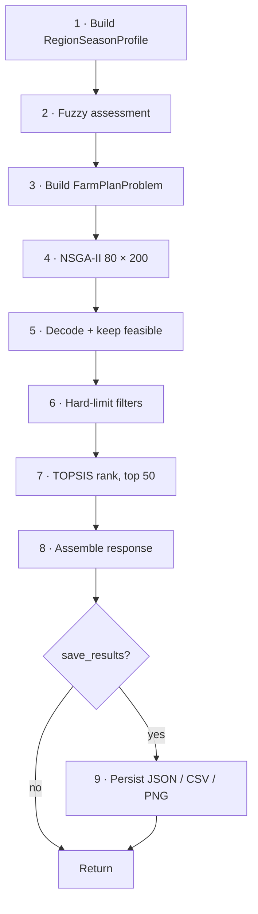

### Stage 1 – Profile (`preprocessing.get_region_season_profile`)
* Canonicalise `location`/`season` (case-insensitive). Resolve year → 2024.
* Land row (Salem, 2024, Kharif): Red Loam, pH 6.8, OC 0.58 %, N/P/K Medium/Medium/Medium → fertility index = 0.3·88 + 0.3·58 + 0.4·60 = **67.8**.
* Rainfall rows Jun–Sep 2024: mean 63.1 mm/month, mean deviation **−21.1 %**, effective rainfall 63.1 × 4 × 0.7 = **176.7 mm**.
* Water rows Jun–Sep: mean storage **62.0 %**, groundwater mode "Very High".
* Crops sorted by revenue: Paddy, Tapioca, Maize, Groundnut, Cotton (5 → chromosome length 15).
* `data_year_estimated = True`.

### Stage 2 – Fuzzy (`fuzzy.evaluate_uncertainty`)
Inputs (−21.1, 62.0, 67.8) → labels deficit / medium / medium → **yield_confidence 0.636, irrigation_risk 0.465**. Per crop: `0.636 × (1 − 0.465 × factor × 0.4)` → Paddy/Maize (Low, 0.3) ≈ 0.600; Tapioca/Groundnut (High, 1.0) ≈ 0.518; Cotton (Medium, 0.6) ≈ 0.565.

### Stage 3 – Problem
Bounds: shares [1e−4, 1], multipliers [0.7, 1.3]. Budget constraint absent (no budget).

### Stage 4 – NSGA-II
`run_nsga2(pop 80, gen 200, seed 42, track_history=save_results)` under the run lock. ≈0.29 s without history.

### Stage 5 – Decode
80 non-dominated solutions (whole final population is non-dominated), all feasible.

### Stage 6 – Filters
None supplied → unchanged.

### Stage 7 – TOPSIS
Balanced weights (0.30, 0.233, 0.233, 0.233); keep top 50. Rank 1:

| Field | Value |
|---|---|
| Crop mix | Tapioca 91.33 %, Groundnut 5.39 %, Maize 3.26 %, Paddy 0.01 %, Cotton 0.01 % |
| Multipliers | irrigation 0.7 on 4 of 5 crops, fertiliser 0.7 on 4 of 5 (see ALGORITHMS §3.2) |
| Yield | 64.76 t (≈12.95 t/ha) |
| Cost | ₹1,97,948 (≈₹39,590/ha) |
| Water | 21.5 million L |
| Impact | 194.3 |
| Closeness | 0.632, confidence Moderate |
| Summary | "High yield, Moderate cost, Moderate water use, Moderate environmental impact" |

### Stage 8 – Response
Region profile (with crop objects and snapshot), fuzzy assessment, ranked plans, convergence history (if tracked), `meta` (algorithm, pop, gen, probabilities, preference, 80 found, 50 returned, seconds).

### Stage 9 – Persistence
See [DATA_FLOW.md](#doc-data-flow) §5. `run_id = salem_kharif_2024_<UTC timestamp>`; `saved_files` lists the four absolute paths.

### Parameters that change the outcome

| Knob | Effect |
|---|---|
| `year` | different land/rainfall/water/crop rows (2024 ≡ 2023 inputs except crop coefficients ×1.03) |
| `total_land_ha` | scales every objective linearly; plan shares unchanged in principle (differences only via RNG path) |
| `budget_rs` | adds constraint; too low → 0 plans |
| `preference` | only re-ranks the same front |
| filters | remove plans after optimisation |
| `max_candidate_crops` | only matters if < number of crops (≤5 in the data) |
| `pop_size`, `n_gen` | front density/convergence; same seed → reproducible |

### Dashboard variant
`dashboard_service._run_dashboard_pareto_front`: identical Stages 1–5 with population 100, current calendar season, 5 ha default, no filters, memoised; ranking done by the caller (balanced for `/api/plans`; three preferences for `/api/comparison`).

<a id="doc-data-flow"></a>

## Data Flow

How a value travels from a CSV cell to a pixel. Companion to [ARCHITECTURE.md](#doc-architecture) (structure) and [OPTIMIZATION_PIPELINE.md](#doc-optimization-pipeline) (stage detail).

### 1. End-to-end

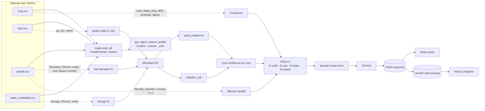

### 2. Field lineage (selected)

| UI value | API field | Computed in | From |
|---|---|---|---|
| Analytics point x (₹/ha) | `plans[].cost` | `get_plans` | f2 ÷ area ← fertiliser NPK × prices, pesticide, labour × wage |
| Analytics point y (t/ha) | `plans[].yield_val` | `get_plans` | f1 ÷ area ← Yield_Kg_Ha × crop confidence |
| Water slider (ML/ha) | `plans[].water_val` | `get_plans` | f3 ÷ area ÷ 10⁶ ← (Water_Req − effective rain) × 10 000 |
| Gold point | `plans[].is_recommended` | `rank_plans('balanced')` | TOPSIS rank 1 |
| Convergence curve | `hypervolume_history` | `extract_convergence_history` | pymoo history, run-normalised HV |
| Comparison radar "risk" | `radar_scores.risk` | `_radar_scores` | 1 − irrigation_risk ← FIS ← rainfall/water/soil |
| Comparison radar "market" | `radar_scores.market` | `_radar_scores` | 1 − mean(Rainfall_Dependency factor) |
| Dashboard Estimated Yield | `estimated_yield` | `get_dashboard` | mean Yield_Kg_Ha (latest year, all crops) |
| Dashboard Water Utilization | `water_utilization_pct` | `get_dashboard` | Σ Irrigation_Water_MCM / Σ Total_Demand_MCM |
| Dashboard Soil Health | `soil_health_pct` | `get_dashboard` | fertility index of current-season land row |
| Dashboard estimated banner | `data_year_estimated` | `is_estimated_year` | `data_source` column |
| History "Target Yield" | `target_yield` | `get_history` | saved run's plan #1 yield ÷ its area |
| Report "Env. impact" | `plans[0].env_impact_score` | saved run | f4 |
| Weather temp | `temp` | `_get_weather_live` | Open-Meteo `current.temperature_2m` (or CSV mean of Max/Min temp) |

### 3. Which parameters reach the optimiser, per entry point

| Entry point | Location | Season | Year | Land | Budget | Population | Preference | Saved |
|---|---|---|---|---|---|---|---|---|
| Run Optimization page → `POST /api/farm-plans` | user choice | user choice | user choice / latest | user choice | user choice | 80 | user choice | yes |
| Analytics → `/api/plans` | profile district | **current calendar season** | latest (2024, estimated) | **5 ha (fixed by frontend)** | none | 100 | balanced | no |
| Comparison → `/api/comparison` | profile district | current season | latest | 5 ha | none | 100 | balanced/max_yield/min_cost | no |
| Analytics → `/api/compare-fuzzy` | profile district | current season | latest | 5 ha | none | 100 ×2 | – | no |
| CLI `run_demo.py` | arg | arg | arg / latest | arg | arg | 80 or arg | arg | unless `--no-save` |

The user's saved `landSize` is used only on the Run Optimization page.

### 4. Caching along the path

| Cache | Key | Invalidation |
|---|---|---|
| `loader.load_all` | – | process restart / `clear_cache()` |
| `fuzzy._build_system` | – | process restart |
| `dashboard_service._cached_pareto_front` (32 entries) | location, season, year, land, budget, track_history | process restart / `clear_pareto_cache()` |
| `results_store._SUMMARY_CACHE` | file path + (mtime, size) | automatic on file change |
| Browser | none (every page visit refetches) | – |

### 5. Persistence flow

`POST /api/farm-plans` with `save_results: true` → `results_store.save_run_results` → reserve `<run_id>.json` → atomic write of the full response + `saved_at` + `client_id` + convergence history → `<run_id>_plans.csv` → `<run_id>_convergence.csv` + `.png`. Read paths: `/api/history` (summaries + plan #1), `/api/dashboard` (count), `/api/results/{id}` (full record, through `FarmPlanResponse`).

<a id="doc-user-flow"></a>

## User Flow

### 1. First visit

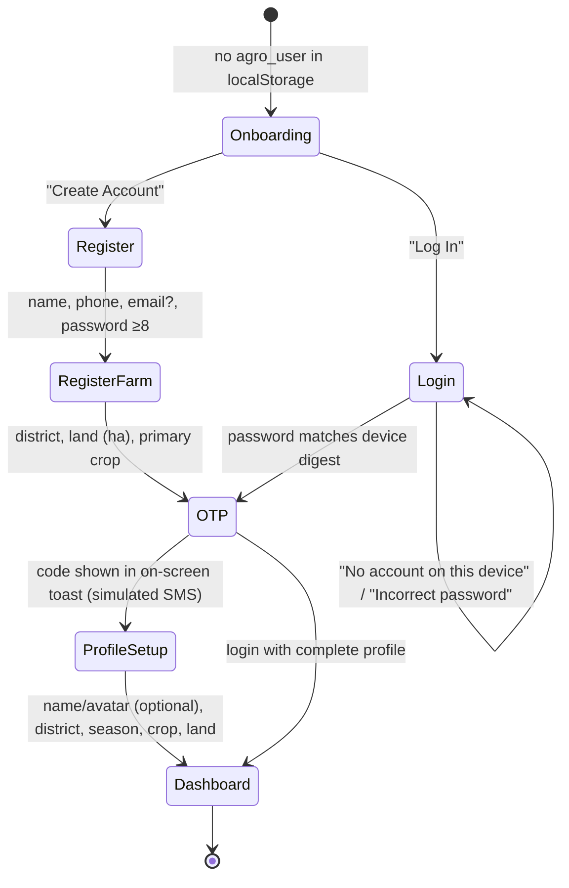

Notes: everything before the dashboard is client-side only. A user who registers already supplies a district, but `handleAuthSuccess(…, isLoginFlow=false)` still routes through ProfileSetup, so district/land/crop are asked twice (UI_UX_REVIEW U-3).

### 2. Main navigation (shell)

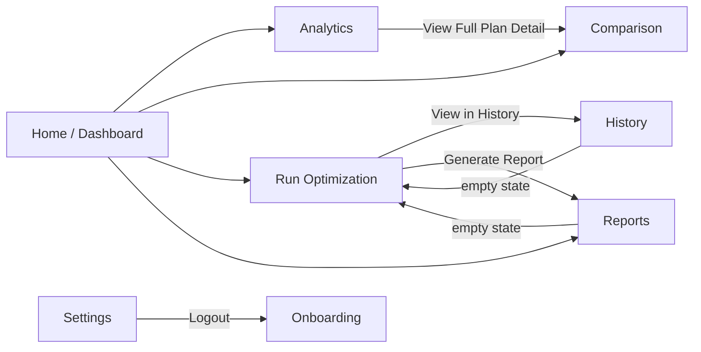

Every shell page is reachable from the sidebar/top bar/drawer: Home, Analytics, Comparison, Run Optimization, History, Reports, Settings.

### 3. Core task: get and keep a personalised plan

1. **Run Optimization** – pick district/season/year/land/budget/preference → *Run Optimization*.
2. Progress screen (~5.7 s animation; the backend finishes in ~0.3 s and is awaited).
3. Result card – top plan's crop mix, t/ha, ₹/ha, confidence, trade-off sentence; note if inputs are estimated.
4. **History** – the run appears (newest first) for that district and this browser only.
5. **Reports** – *Generate Report* on the run → card → *Download report* (.txt) or *Copy summary*.

### 4. Exploration tasks (generic, not saved)

| Page | What the user learns | Inputs used |
|---|---|---|
| Dashboard | district KPIs, soil/water actions, weather | profile district |
| Analytics | the whole Pareto front for the current season, filter by cost/yield/water, convergence, fuzzy effect | profile district, 5 ha |
| Comparison | three representative plans (balanced / max-yield / min-cost), radar, re-weighting | profile district, 5 ha |

`DataSourceNotice` on these pages states they are district-level and not saved.

### 5. Returning visit

`agro_currentView` and `agro_user` restore the last page. Logout clears both but keeps the password digest and `client_id`, so History remains visible after logging back in on the same browser. Clearing site data loses the profile, the "account" and access to History (runs remain on the server, unreachable).

### 6. Failure paths

| Situation | What the user sees |
|---|---|
| Backend down | footer "Server unreachable — live data unavailable"; each section shows the unreachable message |
| No data for chosen year/season | Run page: "Can't run Salem / Rabi: No data for …" (backend detail) |
| Budget too tight | Run completes; result card without a plan section; History shows "--" |
| Weather API down | "Historical estimate" label with month-average values |
| Invalid inputs (e.g. land 0) | browser form validation; backend 422 detail if bypassed |

<a id="doc-report-pipeline"></a>

## Report Pipeline

There are two report artefacts: the **server-side run files** written for every saved run, and the **client-side decision report** a user downloads from the Reports page.

### 1. Server-side run files (`app/services/results_store.py`)

Written by `save_run_results` whenever `POST /api/farm-plans` (or the CLI) runs with `save_results=true`.

| File | Content | Producer |
|---|---|---|
| `<run_id>.json` | full response + `run_id`, `saved_at` (UTC ISO), `client_id`, `convergence_history` | `_atomic_write_text` (temp file + rename) |
| `<run_id>_plans.csv` | one row per ranked plan; list/dict columns JSON-encoded | pandas `to_csv` |
| `<run_id>_convergence.csv` | one row per generation: population, best/mean of 4 objectives, hypervolume | pandas |
| `<run_id>_convergence.png` | 11×4.2 in, 130 dpi: (left) hypervolume vs generation; (right) best yield and best cost vs generation on twin axes | matplotlib (Agg backend) |

`run_id = <location>_<season>_<year>_<YYYYMMDDTHHMMSSZ>`; since 2026-09-29 a `-2`, `-3`… suffix is added if two runs would get the same id in the same second. These files are not served to the browser (only the JSON via `GET /api/results/{run_id}`); the PNG is for the project report.

### 2. Client-side decision report (`src/views/ReportsView.jsx`)

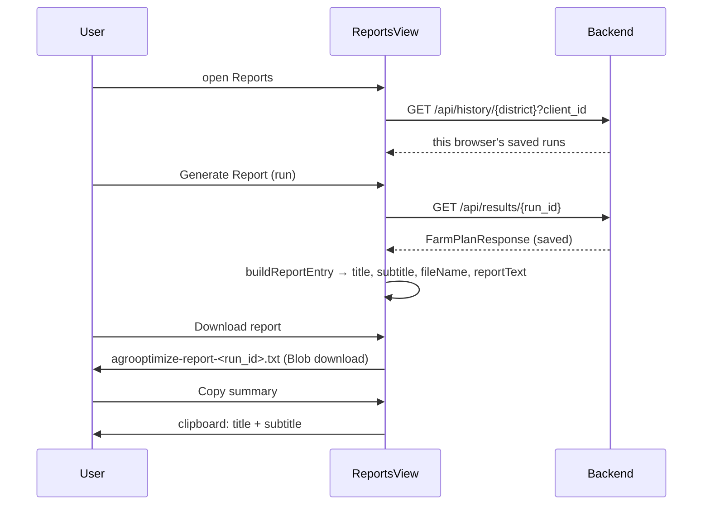

#### Report text structure (`buildReportText`; ~50 lines plus the explanation section)
1. Header – generated time, run id, district/season/year; NOTE line if `data_year_estimated`.
2. Region snapshot – soil type, pH, organic carbon, fertility index; rainfall mean, months, deviation; storage %, groundwater status.
3. Uncertainty assessment – yield confidence with labels; irrigation risk.
4. Optimisation – algorithm, population, generations, feasible plans found, preference.
5. Top 3 plans – TOPSIS closeness, crop mix (share and ha, ≥1 %), yield total and t/ha, cost total and ₹/ha (with the scope note "fertilizer, pesticide and labour only"), irrigation litres, impact score, confidence, trade-off sentence.
6. Why plan #1 was recommended – from `GET /api/results/{run_id}/explanation`: recommendation and rule, confidence, then Reasons → Trade-offs (+ marginal rates) → Benefits → Risks (with severity) → Confidence breakdown. If the explanation cannot be loaded the report says so.
7. Limitations – district-level averages and documented assumptions; decision support, not agronomic advice.

Every value comes from the saved record or its explanation; nothing is invented.

#### Card on screen
Title `"<District> <Season> <Year> -- <crop mix>"`, subtitle `"Yield x t/ha · Cost ₹y/ha · <confidence>"`, date, NEW tag. Cards live in component state only (disappear when leaving the page).

### 3. Gaps vs the paper
The paper promises "a printable one-page decision report … crop-by-plot assignment, irrigation schedules, fertilizer recommendations". Implemented: a plain-text report with crop areas and the modelled multipliers' consequences. Not implemented: PDF, plot assignment (no plot data), irrigation calendar, fertiliser product recommendations. Options: `window.print()` of a styled report view, or server-side PDF generation (e.g. WeasyPrint/ReportLab) – TODO T-15.

<a id="doc-history-pipeline"></a>

## History Pipeline

"History" = the list of optimisation runs **this browser** saved for a district. There are no user accounts; a random per-browser `client_id` is the only scoping key.

### 1. Identity

`src/services/api.js::getOrCreateClientId()` creates `crypto.randomUUID()` once and stores it in `localStorage.agro_client_id`. It is sent as:
* body field `client_id` on `POST /api/farm-plans` (stored in the run JSON),
* query `client_id` on `GET /api/history/{district}` and `GET /api/dashboard/{district}`.

### 2. Write path
Run Optimization → `POST /api/farm-plans {…, save_results: true, client_id}` → `results_store.save_run_results(response, history, client_id=…)` → `results/<run_id>.json` containing `client_id` and `saved_at`.

### 3. Read path (`dashboard_service.get_history`)

```mermaid
flowchart TB
    A[GET /api/history/salem?client_id=X] --> B[resolve_location → Salem]
    B --> C[results_store.list_saved_runs<br/>summaries, cached by mtime]
    C --> D{location == Salem<br/>and client_id == X?}
    D -- no --> skip[skip]
    D -- yes --> E[load_run run_id]
    E --> F[plan #1: yield_tonnes / Σarea_ha → "t/ha"<br/>cost_rs / Σarea_ha → "₹/ha"]
    F --> G[row: id, "Season Year", date, target_yield, est_cost,<br/>status "Completed", num_plans, preference, fuzzy_weights, is_estimated false]
    G --> H[sort by saved_at, newest first]
    H --> I["{history: [...]}"]
```

Rules:
* No `client_id`, or a mismatch, or a legacy run without `client_id` → excluded. A brand-new browser gets `[]` (product decision; no CSV "estimated" filler rows).
* Ordering was previously by the display string `"Kharif 2023"` (alphabetical by season name); fixed to newest save first.
* `is_estimated` is always `false` (kept for response compatibility with an earlier version that mixed in CSV rows).
* Runs with zero plans (e.g. an infeasible budget) appear with `"--"` yield and cost.

### 4. Consumers

| Consumer | Uses |
|---|---|
| HistoryView | timeline cards, search by season text, year filter, details modal (fuzzy confidence/risk %) |
| ReportsView | list of runs to build reports from; `id` → `GET /api/results/{id}` |
| Dashboard "Active Plans" | same filter, count only (`get_dashboard`) |

### 5. Limitations and risks
* **Not a security boundary.** Anyone who learns a `client_id` can read that browser's history. `GET /api/results` used to publish all `client_id`s; now redacted. Run ids are predictable (district_season_year_timestamp), and `GET /api/results/{run_id}` needs no `client_id`.
* **Device-bound.** Clearing site data or switching browsers loses access; runs stay on the server forever.
* **Cost O(#runs).** Each request scans every JSON in `results/` (summaries cached; each matching run is fully parsed again to read plan #1).
* **No deletion** endpoint or UI.

---

# Part 5 — Reviews

<a id="doc-project-review"></a>

## Project Review (senior engineering)

### 1. Scorecard

| Dimension | Rating | Comment |
|---|---|---|
| Architecture | Good | Clear layers (data → fuzzy → optimisation → decision → services → HTTP), acyclic imports, pure functions, single config module |
| Code quality | Good | Readable, heavily commented with rationale; some very long comments and one 750-line service module |
| Correctness | Fair → Good | Two real concurrency/integrity bugs found and fixed (RNG race, run-id collision); model-level defects remain (see RESEARCH_REVIEW) |
| Testing | Good backend / none frontend | 205 backend tests incl. invariants and concurrency; no golden-master; no UI tests |
| Documentation | Good but stale | Extensive team docs, several now out of date; this docs set supersedes them |
| Security | Acceptable for a demo | Key data-exposure bug fixed; no auth by design |
| Performance | Good | Sub-second optimisation; memoisation added |
| Operability | Fair | Health check, CI (now test-gated), Docker; no structured logging/metrics; unbounded storage |
| Repository hygiene | Fair | Frontend is versioned in the repo's `frontend/`, but a second, unversioned working copy (`stitch_agrooptimize_app/`) and a local checkout that had fallen 6 commits behind GitHub make it easy to edit the wrong copy; divergent dataset copy; zip snapshot |
| Data integrity | **Poor** | See DATA_VALIDATION |

### 2. Code review findings

#### Dead / unused
| Item | Where | Action |
|---|---|---|
| `ShaderBackground.jsx`, `src/assets/*`, `_to_delete/`, empty `src/data/` | frontend | **Removed** (backed up) |
| `is_fallback` UI branch | AnalyticsView | **Removed** (backend always false) |
| `weatherFailed` state, `selectedLanguage` prop in AuthView | frontend | **Removed** |
| `loader.available_locations/years/seasons` | backend | used only by tests – keep or move to tests |
| `WATER_COST_RS_PER_MM_PER_HA` | config | documented as intentionally unwired |
| `CropCandidate.msp_rs_qtl`, 26 CSV columns never read | data | keep; candidates for a profit objective |
| `_PLOT_LABELS` / `allocations[].plots` | dashboard_service | marked deprecated; UI no longer renders |
| `is_estimated` in history rows, `is_fallback` in plans | API | always false; kept for compatibility |
| `stitch_agrooptimize_app/` | local disk | duplicate working copy of the repo's `frontend/` – work only in the repo (TODO T-7) |
| `public/favicon.svg`, `public/icons.svg` | frontend | Vite scaffold, unused |

#### Duplication
* Pipeline wiring duplicated in `plan_service.generate_farm_plans` and `dashboard_service._cached_pareto_front` (profile → fuzzy → problem → run → feasible).
* Fertility-index call with the same five kwargs in 3 places; "current land row" logic in 2.
* `FALLBACK_CROPS` list copied into AuthView, ProfileSetupView, SettingsView; soil-status thresholds (70/45) in backend and AnalyticsView; `SEASONS` in api.js and ProfileSetupView; district dropdown markup in 3 views.
* Error banners/empty states repeated per view (now at least share one message constant).

#### Naming / clarity
* `env_impact_score` vs radar "land" vs UI "Land Impact" – three names for one thing.
* `estimated_yield` (dashboard) is a district average, not an estimate for the user.
* `water_utilization_pct` is irrigation's share of demand.
* `get_region_profile` in `main.py` vs `RegionProfileOut` schema not used as its response model.
* `FarmPlanRequest.save_results` also controls history tracking (documented but surprising).

#### Large units
* `dashboard_service.py` (≈770 lines) mixes weather, KPIs, history, optimisation caching, comparison and radar scoring → split into `weather.py`, `dashboard.py`, `history.py`, `analytics.py`.
* `AuthView.jsx` (≈700 lines) holds four sub-screens; `AnalyticsView.jsx` (≈600) mixes fetching, maths and SVG.

#### Magic numbers
Catalogued with provenance in [CONFIGURATION.md](#doc-configuration) §3. The worst offenders are UI-meaning thresholds that are duplicated (70/45 soil, 70/40 water) and the fixed 5 ha used by Analytics/Comparison.

#### Error handling
* `get_plans` wraps everything in `except Exception` → bad season/year becomes 503 instead of 400.
* Weather fallback swallows all exceptions (intentional, now logged via `logging`).
* No global exception handler / request-id logging.

### 3. Testing gaps
1. No golden-master test pinning numeric outputs – model changes can drift silently (the fingerprint script used in this audit is a template: TODO T-13).
2. Operators not unit-tested in isolation.
3. Weather tests depend on network availability (they pass either way, but the "live" branch isn't deterministic).
4. No frontend tests (Vitest + React Testing Library for `api.js`, `download.js`, and view rendering with mocked fetch).
5. No end-to-end test (Playwright: register → run → history → report).

### 4. Documentation gaps (now addressed by `/docs`)
Stale statements in team docs: 34 tests (now 205), 14 rules (26), fertiliser ₹6.5/27/17 and wage ₹400 (now 12.87/58.70/56.67 and 319), "frontend not built", "2020–2023 only", `docs/frontend_integration.md` referenced but missing, results tables from an older dataset.

### 5. Top 10 recommendations
1. Put `stitch_agrooptimize_app/` under git (same repo as the backend or a monorepo) and delete the stale `agrooptimize-backend/frontend/`.
2. Settle data provenance; default to the latest observed year.
3. Fix the inert multipliers with agronomic response functions.
4. Replace tonnage with a profit objective.
5. Add a golden-master regression test and multi-seed evaluation script.
6. Remove the RNG lock by threading pymoo's `random_state` through the operators.
7. Split `dashboard_service.py`; unify the two orchestration paths.
8. Add react-router, accessibility fixes, and pass user land size to Analytics/Comparison.
9. Rate-limit and add a retention policy for `results/`.
10. Refresh the team's viva/methodology notes against these docs.

<a id="doc-research-review"></a>

## Research Review (examiner's perspective)

Reviewed against the team's paper (`reference_docs/Reference_Paper_AgroOptimize.pdf`), the Phase-2 rubric, and the actual code and data. Every quantitative claim here was measured on 2026-09-29.

### 1. Overall assessment

The **engineering** is well above typical final-year level: a clean layered pipeline, a working full-stack deployment, 205 automated tests, reproducible seeded runs, convergence evidence, and unusually honest in-code documentation of assumptions. The **research** claims are weaker than the engineering: the optimisation model has a structural defect that makes two of its three decision-variable blocks inert, the fuzzy layer can only rescale yield, and the dataset shows clear signs of being synthetic while the paper describes it as government data. None of this is hidden by the code – an examiner who reads it will find it. The team should present these openly as limitations with a concrete fix plan rather than be surprised by them.

### 2. Rubric mapping (Phase 2, research-based)

| Rubric item | Evidence in repo | Risk |
|---|---|---|
| Problem statement & gap | `docs/problem_statement.md`, `docs/literature_survey.md` (5 verified papers) | Gap statement says "validated on real Tamil Nadu data" – not supportable today (§5) |
| Methodology (workflow, algorithms, maths, datasets, evaluation) | Methodology notes, this docs set | Evaluation strategy is thin: no baseline other than fuzzy on/off; no quantitative comparison against the paper's results |
| Implementation ≈60 % / 85–90 % | End-to-end backend + frontend + deployment + tests | Strong |
| Preliminary verification & results | Hypervolume convergence, saved runs, results write-ups | Write-ups are from an older dataset (not reproducible now); no statistical robustness (multiple seeds) |
| Technical knowledge / viva | viva_prep.md | Several prepared answers are now inaccurate (14 vs 26 rules, 34 tests, old prices, "real data") |

### 3. Paper vs implementation

| Paper claims | Implementation | Gap |
|---|---|---|
| Fuzzy MFs "triangular and trapezoidal"; soil moisture with 5 sets (Very Dry…Wet) | 5 variables × 3 triangular sets; no soil-moisture variable | Different model |
| Fuzzy + "probability theory"; outputs are "scenario probability weights" | Two crisp scalars; no probabilities or scenarios | Not implemented |
| Chromosome includes "type and amount of fertilizer" and "harvest timing schedule" | Amount multiplier only; no fertiliser type; no timing | Partially |
| "Allocation of crops per plot" | Land shares of one farm; no plots | Different granularity |
| "Numeric data scaled to [0,1] … between the optimization calculations" | Scaling only for display; optimiser uses natural units | Differs |
| NSGA-II, 200 generations, single-point crossover p=0.85, Gaussian mutation p=0.12 | Exactly as stated | ✔ |
| "Final set of 20 to 50 Pareto-optimal plans" | 80–100 non-dominated, 50/100 returned | Close |
| "Confidence interval of robustness" per plan; "Min/Max yield" columns in Table II | Categorical confidence label only; no yield range | Not implemented |
| Parallel-coordinates visual; printable one-page report with irrigation schedules | Scatter + radar; plain-text report; generic 2-step template | Partially |
| Results: 5-acre farm, ~2.2 crore L, Sugarcane + Wheat + Groundnut ≈40 t/ha, 100 plans | Current code/data produce different mixes (e.g. Salem Kharif: Tapioca-dominant, 12.95 t/ha) | Paper results not reproducible from this code/data |
| Reference [2]: Huang et al., *Sustainability* 17(7) 2829 | Repo's literature survey lists Huang et al. in *Scientific Reports* 15:34070 and gives *Sustainability* 17(7) 2829 to Erdoğdu et al. | Citation inconsistency – verify and correct |

### 4. Technical correctness of the model

| # | Issue | Evidence | Consequence | Fix |
|---|---|---|---|---|
| R-1 | Irrigation and fertiliser multipliers have no benefit | f1 has no multiplier term; f2–f4 increase with them | 74–99 % of fertiliser genes and 52–100 % of irrigation genes end at the 0.7 floor; two-thirds of the chromosome is effectively inert | Yield response: FAO-33 water-production function `1 − Ya/Ym = Ky (1 − ETa/ETm)` for irrigation; Mitscherlich or quadratic-plateau response for N |
| R-2 | Yield objective sums tonnes of different crops | sugarcane ≈95 t/ha vs cotton 1.5 t/ha | Optimiser favours heavy crops; "t/ha" of a mix is not meaningful to farmers | Maximise net return (yield × price − cost) – `MSP_Rs_Qtl` already exists – or calorie/protein output |
| R-3 | Fuzzy output only rescales yield per crop | compare-fuzzy: identical min-cost/min-water/min-impact in both arms | The "fuzzy vs non-fuzzy study" mostly shows yield multiplied by the crop confidence (≈0.44–0.88; Salem Kharif best yield 13.96 vs 26.96 t/ha) | Let uncertainty act on water need (irrigation_risk → effective rainfall) and on feasibility; or optimise expected value over rainfall scenarios |
| R-4 | 5 of 26 fuzzy rules have zero effect; rules cannot "cap" outputs under max aggregation | rule-deletion experiment (ALGORITHMS §2.2) | Rule-count claims overstate the model; rule comments misdescribe behaviour | Remove or rewrite; state "21 effective rules" |
| R-5 | Seasonal deviation = mean of monthly percentages; Rabi spans two different seasons | DATA_VALIDATION D5–D6 | irrigation_risk shifts up to 0.21 | totals-based deviation; Oct(Y)–Mar(Y+1) |
| R-6 | Hypervolume normalised per run | ALGORITHMS §4.4 | HV values can't be compared across runs/variants | fixed global normalisation bounds; report HV of fuzzy vs non-fuzzy on the same scale |
| R-7 | Only one seed per result | – | No evidence of robustness | 20–30 seeds, report mean ± sd HV and front statistics |
| R-8 | 4 objectives with NSGA-II; no baseline algorithm | – | Examiners commonly ask "why not NSGA-III/MOEA-D?" | Add NSGA-III (pymoo) and an exact ε-constraint LP baseline for f1–f3 |
| R-9 | Env. impact formula: √(N-leaching × carbon proxy) with arbitrary factors; carbon uses gross, not net, water | CONFIGURATION §2 | Units undefined | Report as index; or use IPCC EF1 for N₂O-CO₂e and pump energy for CO₂ |
| R-10 | Cost excludes water, energy, seed, machinery | f2 | Underestimates cost; the unwired water cost exists | include CACP cost-of-cultivation components |
| R-11 | Perennial crops (coconut, mango, banana, sugarcane) allocated as single-season options | DATASETS §2 | Agronomically invalid mixes | constrain perennials or model multi-season |

### 5. Dataset quality and scientific validity
See [DATA_VALIDATION.md](#doc-data-validation). The decisive points: 2024 is synthetic and the default; storage is identical every year; yields flat 2020–23; rainfall normals are season-flat; provenance is "course-provided". With inputs that barely vary year to year, the system cannot demonstrate *uncertainty handling* on real variability. **The paper and literature survey must not describe this as government or real observed data unless the source is confirmed.**

### 6. Reproducibility

| Aspect | Status |
|---|---|
| Deterministic runs (seed 42) | ✔, now also under concurrent requests |
| Environment | ✘ no lock file; Python 3.11 (Docker) vs 3.13 (dev) |
| Data versioning | ✘ two diverging dataset copies; reported results from an older version |
| Scripts to regenerate every figure/table | Partial (`run_demo.py`; no script regenerating the paper tables) |
| Tests | ✔ 205 |

### 7. Novelty
Combining a Mamdani FIS with NSGA-II and TOPSIS for crop planning is a known pattern (the survey itself cites Fuzzy-Expert-NSGA-II and fuzzy-GA work). Defensible novelty is **contextual and engineering**: a complete, open, tested decision-support web system for four Tamil Nadu locations with transparent assumptions. After fixing R-1–R-3, a genuinely interesting contribution would be showing *how* uncertainty changes the recommended crop mix (not just its yield number).

### 8. Limitations to state proactively
1. District-level aggregates, not farm-level data; one farm modelled as land shares.
2. Dataset provenance and synthetic 2024 year.
3. Input multipliers inert (R-1); tonnage objective (R-2).
4. Fuzzy rules hand-authored, not calibrated against outcomes.
5. Single-season, no rotation or perennial handling.
6. Economic constants from single-point price quotes; environmental impact is an index.
7. No validation against observed farm outcomes.

### 9. Future work (prioritised)
1. Confirm/replace data with IMD, CWC/India-WRIS, CGWB, DES APY, Soil Health Card sources.
2. Crop-water and nitrogen response functions (R-1), profit objective (R-2).
3. Scenario-based uncertainty (sample historic rainfall/storage) with expected-value or CVaR objectives; compare to fuzzy.
4. Baselines: NSGA-III, ε-constraint LP; multi-seed statistics with fixed-normalisation HV.
5. Multi-season rotation model with perennial constraints.
6. Field validation with farmers / KVK agronomists; elicit preference weights (AHP).

### 10. Viva readiness – questions an examiner is likely to ask

| Question | Honest answer grounded in the code |
|---|---|
| "Why do all your top plans use the minimum fertiliser and irrigation?" | Because the current yield model does not respond to inputs; any extra input only adds cost/water/impact, so it is dominated. Planned fix: FAO-33 / N-response functions. |
| "Is your data real?" | State exactly what is known: course-provided baseline 2020–23 of unconfirmed origin; 2024 estimated from 2023 and flagged in the UI/API. |
| "What does fuzzy logic change?" | It scales each crop's expected yield by a confidence derived from rainfall deviation, storage and soil; it does not change cost/water/impact, so the fuzzy/non-fuzzy fronts differ only in the yield axis and possibly crop ranking. |
| "How many rules?" | 26 written, 21 effective – 5 are subsumed under max aggregation (show the deletion experiment). |
| "How do you know it converged?" | Hypervolume rises from ≈0.26 to ≈0.81 and plateaus (Salem Kharif, pop 100); per-run normalised; multi-seed statistics are future work. |
| "Why NSGA-II for 4 objectives?" | Paper specification; NSGA-III/MOEA-D are better suited for ≥4 objectives – planned comparison. |
| "Why TOPSIS; how were weights chosen?" | Closeness to ideal favours balanced plans; 'balanced' yield weight 0.30 tuned by hand because the other three objectives correlate 0.85–1.0 with yield. |
| "Are results reproducible?" | Yes for a given seed and dataset version – including under concurrent requests (fixed and tested). |

<a id="doc-performance-review"></a>

## Performance Review

Measured 2026-09-29 on an Apple-Silicon laptop, Python 3.13, in-process (`TestClient`) unless stated. Production runs on 1 shared vCPU / 512 MB (Fly.io), so expect roughly 2–4× slower CPU-bound numbers there.

### 1. Baseline measurements

| Operation | Time | Notes |
|---|---|---|
| Load 16 CSVs | part of first request | cached for process life |
| First fuzzy call (build 26-rule system) | 66 ms (≈600 ms incl. first imports on `/api/region-profile`) | `lru_cache` afterwards |
| Warm fuzzy call | 3.7 ms | new `ControlSystemSimulation` each call |
| Build region profile | 22 ms | pandas boolean filtering on small frames |
| NSGA-II pop 80 × 200 gen, no history | ≈0.29 s | the `/api/farm-plans` default |
| NSGA-II pop 100 × 200 gen, with history | ≈0.8 s | `/api/plans`; retains **≈71 MB** until the request ends |
| `/api/comparison` cold / warm | 369 ms / 3 ms | warm = new memoisation |
| `/api/plans` cold / warm | 966 ms / 3 ms | |
| `/api/compare-fuzzy` | 746 ms | two runs, not memoised |
| Full test suite | 19 s → 14 s | after memoisation |

Responses: `/api/farm-plans` ≈33 KB (50 plans + 200-point history when saved), `/api/plans` ≈24 KB. Frontend bundle: 361 KB JS (94 KB gzip), 74 KB CSS (12 KB gzip).

**Verdict:** computation is not a bottleneck at the current scale. The real performance risks are the global run lock under concurrency, uncached third-party weather calls, unbounded result files, and simulated UI delays.

### 2. Findings

| ID | Finding | Impact | Status |
|---|---|---|---|
| P-1 | Every dashboard/comparison/plans page visit re-ran NSGA-II with identical inputs (deterministic seed) | 0.4–1 s per visit, CPU on a shared VM | **Fixed**: `lru_cache(32)` over plain-data results (warm 3 ms) |
| P-2 | Global-RNG operators forced serialisation (now an explicit lock) – requests queue behind each other; a `pop_size=300, n_gen=500` request (allowed by the schema) blocks everyone | Head-of-line blocking; DoS lever | Open – pass pymoo's `random_state` into operators (removes the lock), and cap pop×gen or rate-limit |
| P-3 | `list_saved_runs` parsed every run JSON (each embeds a 200-generation history) on every dashboard/history request | O(#runs × file size) per request | **Fixed**: mtime/size-keyed summary cache |
| P-4 | `get_history` re-parses each matching run in full to read plan #1 | O(#matching runs) | Open – store plan #1 metrics in the summary |
| P-5 | Weather: every dashboard load triggers 5 Open-Meteo requests (own district + 4 districts), no caching; each up to a 5 s timeout | Slow dashboard when Open-Meteo is slow; third-party load | Open – 10–15 min TTL cache per district |
| P-6 | `/api/compare-fuzzy` performs two fresh runs every time | 0.75 s per Analytics visit | Open – route both through the memoised front helper |
| P-7 | `track_history=True` deep-copies the population every generation (≈71 MB retained per run) | Memory spikes on 512 MB VM | Mitigated (cache keeps only derived data); consider recording only F per generation via a callback |
| P-8 | Analytics fires `/api/plans` and `/api/compare-fuzzy` simultaneously; with the lock they serialise (≈1.7 s cold) | Perceived latency | Improves with P-6 |
| P-9 | `evaluate_uncertainty` allocates a new `ControlSystemSimulation` per call | 3.7 ms – negligible | Accept |
| P-10 | Run Optimization shows a fixed ≈5.7 s animation although the run takes ≈0.3 s | UX latency ×19 | Open (UI) – drive progress from the real promise, keep a short minimum |
| P-11 | `results/` grows forever (4 files per run: JSON ≈130 KB, PNG ≈75–81 KB, two CSVs – ≈250 KB per saved run) | Disk exhaustion on a fixed volume | Open – retention policy / max runs per client |
| P-12 | Large avatar data-URLs stored in `localStorage` | 5 MB quota per origin; JSON.stringify on every user change | Open – downscale images before storing |
| P-13 | Frontend has no request de-duplication or caching; every navigation refetches | Extra calls (cheap now thanks to P-1) | Accept or add a small SWR-style cache |
| P-14 | Radar/scatter SVGs render ≤100 points | fine | – |

### 3. Scalability outlook

* **Vertical:** CPU-bound work is < 1 s per request; one machine comfortably serves a class-demo load.
* **Horizontal:** each Fly machine has its own lock and caches (fine) but a Fly volume attaches to one machine, so saved runs are not shared – moving results to object storage or a small database is the prerequisite for >1 machine.
* **Algorithmic:** chromosome length ≤ 15 (5 crops). Scaling to many crops or plots would benefit from the LP formulation noted in ALGORITHMS §4.5 rather than a bigger GA.

### 4. Parallelisation opportunities
* `get_fuzzy_comparison`'s two runs are independent (blocked today only by the global RNG).
* Weather for 4 districts could be fetched concurrently server-side in one endpoint instead of 4 browser round trips.
* Batch evaluation is already vectorised over the population; no Python per-individual loops except in crossover (`for k in range(n_matings)`, 40–50 iterations – negligible).

<a id="doc-security-review"></a>

## Security Review

Scope: backend API, frontend, deployment configuration. Threat model: a public demo deployment (Vercel + Fly.io) with no real user accounts and no sensitive agricultural data, but with user-typed personal data (name, phone, email) in browsers and per-browser run histories on the server.

### 1. Summary

| ID | Finding | Severity | Status |
|---|---|---|---|
| S-1 | `GET /api/results` published every run's `client_id`, the only key scoping History → any visitor could read any other visitor's history | **High** | **Fixed** (redacted, test added) |
| S-2 | `run_id` from the URL was joined into a filesystem path without validation | Medium (Starlette blocks `/`, so no traversal was demonstrated, but defence was missing) | **Fixed** (allow-list regex, test with `../`) |
| S-3 | Demo password stored in plaintext in `localStorage` | Medium | **Fixed** (SHA-256 digest, legacy migration) |
| S-4 | No authentication/authorisation anywhere; `client_id` is a bearer token in query strings (logged by proxies) | Medium (by design for a demo) | Open – document; real auth if ever deployed for real users |
| S-5 | `POST /api/farm-plans` is unauthenticated, writes 4 files per call, and can request pop 300 × 500 generations while holding the global run lock | Medium (DoS / disk fill) | Open – rate limit, lower caps, retention |
| S-6 | No rate limiting on any endpoint; each dashboard load proxies 5 calls to Open-Meteo | Low–Medium | Open |
| S-7 | `saved_files` in responses exposes absolute server paths | Low | Open – return relative names |
| S-8 | Same-second `run_id` collision overwrote another user's run files | Medium (integrity) | **Fixed** (exclusive reservation) |
| S-9 | Unbounded `client_id` persisted verbatim to disk | Low | **Fixed** (≤128 chars) |
| S-10 | Negative/zero land or budget accepted by dashboard query params (division by zero → 500/503) | Low | **Fixed** (422) |
| S-11 | CORS `allow_credentials=True` with `*` methods/headers although no cookies are used | Low | Open – set False |
| S-12 | Fake OTP displayed on screen; login does not check phone/email | Informational (demo) | Documented in UI |
| S-13 | Container runs as root; `gcc` in the runtime image; test tools installed | Low | Open |
| S-14 | CI action `superfly/flyctl-actions@master` unpinned (supply-chain) | Low | Open – pin SHA |
| S-15 | Frontend loads images/fonts from third-party hosts (googleusercontent, Google Fonts) → visitor IP disclosure, availability risk | Low | Open – self-host |
| S-16 | Personal data (name, phone, email, photo) kept in `localStorage` in plain JSON | Low (device-local) | Documented; clear on logout (currently only `agro_user` is removed – it is) |
| S-17 | CSV exports could carry spreadsheet formulas | Low | **Mitigated** (`toCsv` prefixes `= + - @` text cells) |
| S-18 | `GET /api/results/{run_id}` needs no `client_id`; run ids are predictable (district_season_year_timestamp) | Low–Medium | Open – require matching `client_id` or add a random suffix |

### 2. Checks with no findings

| Area | Result |
|---|---|
| Hard-coded secrets | None in code. `FLY_API_TOKEN` is a GitHub secret. `.vercel/project.json` contains only project/org ids (not secrets). `.env.production` contains only the public API URL |
| Injection | No SQL, no shell, no `eval`; pandas filters use equality on validated values; `Literal` for preference |
| Deserialisation | Only `json.loads` of files the server wrote |
| XSS | React escapes all rendered strings; no `dangerouslySetInnerHTML`; avatars are data-URLs rendered in `` |
| Input validation | Pydantic on POST body; `Query` bounds on dashboard params (added); location/season allow-listed |
| Error leakage | 503 detail includes the exception message (`live NSGA-II optimisation failed (…)`) – acceptable for a demo, remove for production |
| Dependency CVEs | Not audited here (no lock file); run `pip-audit` / `npm audit` in CI (TODO T-16) |

### 3. Recommendations if this ever serves real farmers
1. Real authentication (e.g. OTP via a provider, or OAuth) and server-side users; replace `client_id` scoping.
2. Rate limiting (e.g. `slowapi`) and a per-client quota on saved runs; retention policy.
3. Run as a non-root user; slim image; pinned dependencies with `pip-audit` in CI.
4. Remove `saved_files` absolute paths; add security headers on Vercel (CSP, `X-Content-Type-Options`, `Referrer-Policy`).
5. Privacy notice for phone/email even though they stay on-device.

<a id="doc-ui-ux-review"></a>

## UI / UX Review

Reviewed by reading every view and by driving the running app in Chrome (2026-09-29, backend on :8010, Vite dev server). "Fixed" items were changed in this pass; everything else is a recommendation.

### 1. What works well
* Coherent visual system (Material-3 colour roles, one type scale, consistent cards and skeletons).
* Honest data provenance: `DataSourceNotice` on Home/Analytics/Comparison distinguishes historical, live-generic and personalised results; explicit empty and error states everywhere; no fabricated fallback data.
* Clear primary task: Run Optimization is the single place that creates saved results, and History/Reports both route users there from their empty states.
* Responsive shell (sidebar, optional top bar, mobile drawer).

### 2. Findings by screen

| ID | Screen | Issue | Status |
|---|---|---|---|
| U-1 | Reports | "PDF" and "share" buttons only showed `alert()` messages claiming a download / copied link | **Fixed**: real .txt report download + clipboard copy with visual confirmation |
| U-2 | Analytics / Comparison | "Export" buttons were `alert()` stubs | **Fixed**: real CSV downloads |
| U-3 | Onboarding → Register → Profile | District, land and crop are asked in Register step 2 and again in Profile Setup | Open – skip Profile step 2 when already provided |
| U-4 | Comparison | "Land Impact n/20" displayed a goodness score as impact (gentlest plan showed the largest number) | **Fixed**: real per-ha impact, lower = better, tooltip |
| U-5 | Comparison | Allocation cards showed invented "Plots 1, 2, 4" labels | **Fixed**: removed; heading renamed "Crop Allocations" |
| U-6 | Comparison | "View Full Calendar" and "Select This Plan" produced alerts; the "Irrigation Schedule" looked computed | **Fixed**: alerts removed; section renamed "Getting Started" and labelled as a generic template |
| U-7 | Comparison | Cost cells turned red above an arbitrary ₹50,000/ha | **Fixed**: removed |
| U-8 | Comparison | Radar axes normalised over only three plans exaggerate differences (always a 0 and a 100) | Open – show absolute values in tooltips, or normalise against the whole front |
| U-9 | Comparison | Two recommendations can disagree: TOPSIS "recommended" Plan A vs the weight-slider "Rec" badge (default 50/50/50 picked Plan C for Coimbatore) | Open – initialise sliders to reproduce TOPSIS, or label the badge "Your weighting" |
| U-10 | Dashboard | "Good Morning" at any time | **Fixed** (time-of-day greeting) |
| U-11 | Dashboard | "+3.0 %" yield trend and all KPIs came from estimated 2024 data with no indication | **Fixed**: warning banner when `data_year_estimated` |
| U-12 | Dashboard | "Estimated Yield" averages all crops (sugarcane with cotton) → a number no farm achieves | Open – show yield for the user's primary crop, or per crop |
| U-13 | Dashboard | "Water Utilization … Optimal" when irrigation's share of demand ≥70 % – label implies a judgement the metric can't support | Open – rename "Irrigation share of water demand", drop the badge |
| U-14 | Dashboard | "Schedule" buttons only toggle a local flag; nothing is scheduled or persisted | Open – rename "Mark as planned" or persist |
| U-15 | Dashboard | Weather CSV fallback labels month averages as "Mon, Tue, …" | Open (backend) – label with month names when `source` is historical |
| U-16 | Analytics | KPI "Avg Yield Target" actually showed the min-yield slider value | **Fixed** ("Min Yield Target") |
| U-17 | Analytics / Comparison | Always optimised for 5 ha and the current calendar season – the user's land size and chosen season are ignored | Open – pass `user.landSize`; add a season selector |
| U-18 | Analytics | "Best Compliant Plan" is the cheapest compliant plan, while the gold dot is the TOPSIS pick – two notions of "best" | Open – rename "Cheapest plan meeting your limits" |
| U-19 | Analytics | Tooltip position uses `window.innerWidth` heuristics; can overflow on small screens | Open |
| U-20 | Run Optimization | Fixed ≈5.7 s staged animation regardless of the real ≈0.3 s run; stages don't reflect real progress | Open – tie to the request, 1 s minimum |
| U-21 | Run Optimization | Backend 400s (e.g. no data) were reported as "Couldn't reach the backend" | **Fixed**: shows the backend's reason |
| U-22 | All | Production users saw "Confirm uvicorn is running on port 8000" | **Fixed**: environment-aware message |
| U-23 | Footer | "Offline — showing cached data" (there is no cache) | **Fixed**: "Server unreachable — live data unavailable" |
| U-24 | Profile setup | "Verification completed … successfully verified" though nothing is verified | **Fixed**: "Profile complete" / "Save Profile" |
| U-25 | Settings | Blocking `alert()`s; "Google account linked successfully!" with no Google involvement | **Fixed**: inline status (aria-live), "Demo only" note |
| U-26 | Auth | On-screen "SMS" toast reveals the OTP; login ignores phone/email | Open – label "Demo code" clearly |
| U-27 | Global | Language switcher (English/हिन्दी/தமிழ்) changes nothing | Open – hide until translations exist, or implement i18n |
| U-28 | Global | No URL routing: Back button leaves the app, pages can't be bookmarked or shared | Open – react-router |
| U-29 | Reports | Generated reports vanish when leaving the page | Open – persist in `localStorage` or regenerate on demand |
| U-30 | History | Search matches only the season text; no sort control; no delete | Open |

### 3. Accessibility

| Issue | Where | Recommendation |
|---|---|---|
| Clickable `<div>` cards (KPI cards, avatar, profile card) not keyboard-focusable, no role | Dashboard, App shell | use `<button>` or add `role="button" tabIndex=0` + key handlers |
| Icon-only buttons without accessible names (menu, close, share) | App, modals | `aria-label` (added for the Reports copy button) |
| Material Symbols ligatures read aloud as words ("water_drop") | everywhere | `aria-hidden="true"` on decorative icons |
| Form labels not associated (`<label>` without `htmlFor`) | Auth, Run, Settings | pair with `id` |
| Modals lack focus trap, `role="dialog"`, Escape-to-close | Comparison weights, History detail, Country modal | adopt a dialog primitive |
| Charts are SVG without text alternatives | Analytics, Comparison | add `<title>`/`aria-label` and a data-table toggle (CSV export now exists) |
| Colour-only status (valid vs faded points, gold recommended) | Analytics | add shape/legend |
| Status messages | Settings | now `role="status" aria-live="polite"` |

### 4. Onboarding and empty states
Good: every empty state names the next action (Run Optimization). Improve: a first-run checklist on the dashboard ("1. Run your first optimisation · 2. Compare plans · 3. Download a report"), and explain terms (Pareto front, TOPSIS, hypervolume) via small info tooltips on Analytics.

### 5. Wording glossary suggestions

| Current | Suggested |
|---|---|
| Water Utilization | Irrigation share of water demand |
| Estimated Yield | Average crop yield in district (all crops) |
| Soil Health % | Soil fertility index |
| Land (radar) | Fertiliser & pumping impact |
| Market (radar) | Weather independence |
| Risk (radar) | Irrigation safety (district-wide) |

---

# Part 6 — Changes & Roadmap

<a id="doc-improvement-log"></a>

## Improvement Log

Why each change was made, how it was verified, and what was deliberately **not** changed. Code-level detail: [CHANGELOG.md](#doc-changelog).

### Principles applied
1. Do not change core model behaviour without a clear defect → every backend change was verified to leave the numeric outputs of 48 pipeline/endpoint calls bit-identical to the original code (fingerprint comparison against a `git archive HEAD` copy).
2. Prefer additive API changes (new fields default safely; deprecated fields kept).
3. Remove anything that presents non-existent functionality or data as real.
4. Back up before deleting (the local `stitch_agrooptimize_app/` working copy has no git history of its own).

### Implemented

| # | Improvement | Category | Evidence / verification |
|---|---|---|---|
| I-1 | Lock around NSGA-II runs | Correctness | New concurrency test; 20/40 → 0/40 mismatches |
| I-2 | Exclusive run-id reservation | Data integrity | `test_same_second_saves_get_distinct_run_ids` |
| I-3 | Redact `client_id` from `/api/results` | Security | `test_results_listing_never_exposes_client_ids` |
| I-4 | `run_id` allow-list, corrupt-file tolerance, atomic writes | Security / robustness | 16 tests in `test_hardening.py` |
| I-5 | Query/body validation | Validation | 11 parametrised 422 tests |
| I-6 | Case-insensitive location/season | Usability | tests; previously `"coimbatore"` → 400 on POST |
| I-7 | Estimated-year provenance flag + UI banner/notes | Scientific honesty | tests + browser check |
| I-8 | History ordering by save time | Bug fix | test |
| I-9 | Memoised dashboard fronts; cached run summaries | Performance | `/api/comparison` 369 → 3 ms warm; suite 19 → 14 s |
| I-10 | Logging instead of print | Operability | – |
| I-11 | CI runs tests before deploying | DevOps | workflow review |
| I-12 | Real CSV exports and text report instead of alerts | UX honesty | browser: 101-line plans CSV, A/B/C CSV, 50-line report without NaN/undefined |
| I-13 | Correct impact column, removed fake plot labels / calendar / threshold | UX honesty | browser |
| I-14 | Structured API errors, environment-aware messages | UX | build + browser |
| I-15 | Hashed demo password | Security | code review (SubtleCrypto; fallback for insecure contexts) |
| I-16 | Dead code removal, lint clean | Maintainability | `npm run lint` 0 warnings |
| I-17 | Accurate wording (greeting, footer, profile, settings, KPI labels) | UX | browser |
| I-18 | Documentation set | Knowledge transfer | this folder |

### Considered but deliberately not implemented (need a team decision or change results)

| Candidate | Reason not done | Where tracked |
|---|---|---|
| Default to 2023 instead of estimated 2024 | Changes every default result and a test; the team chose to add 2024 | T-1 |
| Totals-based rainfall deviation, Rabi across year boundary | Shifts fuzzy outputs by up to 0.21 → all results change | T-3 |
| Yield response to irrigation/fertiliser | Needs sourced agronomic parameters; core model change | T-4 |
| Profit objective | Needs verified prices (current MSP column questionable) | T-10 |
| Remove inert fuzzy rules | No numeric effect, but changes the documented rule count – team should decide wording | T-5 |
| Replace global RNG with pymoo `random_state` | Removes the lock but changes every seeded result | T-19 |
| Weather TTL cache | Would make the existing weather-fallback test order-dependent; needs a small test refactor | T-20 |
| Delete `agrooptimize-backend/frontend/` and `datasets/` | Tracked in git / possibly referenced by the team; decision first | T-7, T-8 |
| Wire `WATER_COST_RS_PER_MM_PER_HA` | Deliberately left unwired by the team; changes f2 | TD-17 |
| Replace arbitrary constants with official values | No constant could be *verified* in this environment beyond what the code already cites; recommendations and candidate sources are listed instead | CONFIGURATION.md, DATASETS.md §8 |

<a id="doc-changelog"></a>

## Changelog

All code modifications made during the 2026-09-29 audit. All changes are submitted together on one branch for review. Frontend changes were made in the local working copy `stitch_agrooptimize_app/` and applied to the repo's `frontend/` (whose source was identical before the changes); the pre-change state is also in `_backups/stitch_agrooptimize_app_before_audit_2026-09-29.tar.gz`.

Verification after all changes: backend **205/205 tests pass** (was 165/165); output fingerprint over 48 endpoint/pipeline results is **identical to HEAD** apart from the new additive provenance fields; frontend `oxlint` 0 warnings (was 3 in `src` + noise), `vite build` succeeds; UI flows exercised in Chrome with no console errors.

### [Unreleased] – Explainable recommendations

#### Added
- `app/services/explanation_service.py` and endpoints `GET /api/results/{run_id}/explanation`, `GET /api/comparison/{district}/explanation` (typed `ExplanationOut`).
- `ranking.topsis_scores` / `preference_weights` (shared TOPSIS maths), fuzzy `input_memberships` / `fired_rules` / `output_term`, `plan_service.region_profile_payload`.
- Saved runs record `meta.total_land_ha` and `meta.budget_rs`.
- Frontend `ExplanationPanel`, `ExplanationModal`, `ExplanationComparison`; explanation entry points on Comparison, Run Optimization, History and Reports; explanation section in downloaded reports.
- `tests/test_explanation.py` (25 tests); `docs/handbook/EXPLAINABILITY.md`.

#### Verified
- 230 backend tests pass; 48 optimisation outputs identical to `main`; frontend lint clean and build passes; all explanation sections render against real API payloads.

### [Unreleased] – 2026-09-29

#### Fixed
- **NSGA-II determinism under concurrent requests** (`app/optimization/nsga2_runner.py`). Runs now hold `_NSGA2_RUN_LOCK` while seeding and using NumPy's global RNG. Before: 20 of 40 concurrent runs returned a different Pareto front than the same seed run alone; after: 0 of 40.
- **Saved-run overwrite on same-second collisions** (`results_store._reserve_run_id`): the JSON filename is claimed with exclusive create; collisions get `-2`, `-3`… suffixes.
- **Client-id exposure**: `GET /api/results` now returns `client_id: null` for every run (`app/main.py`).
- **History ordering**: newest saved run first (was alphabetical by the "Season Year" string) (`dashboard_service.get_history`).
- **Unvalidated `run_id` path join**: allow-list regex in `results_store.is_valid_run_id`; invalid ids → 404.
- **Corrupt run files** no longer 500 the listing/loading (skipped / `None`).
- **Dashboard query parameters**: `total_land_ha` must be > 0 and ≤ 100,000, `budget_rs` > 0, `client_id` ≤ 128 chars (422 instead of 500/503 on division by zero).
- **POST body**: preference filters must be ≥ 0; `client_id` ≤ 128.
- Frontend **Comparison "Land Impact"** showed an inverted goodness score as impact → now the real per-hectare impact (lower is better).
- Frontend **Analytics KPI label** "Avg Yield Target" → "Min Yield Target" (it shows the slider minimum).
- Frontend **Run Optimization errors**: 400/422 now show the backend's reason instead of "couldn't reach the backend".
- `/api/weather` docstring claimed there was no live weather API (there is: Open-Meteo).
- `config.DEFAULT_MAX_CANDIDATE_CROPS` comment described a 3-crop limit that does not exist.

#### Added
- `data_year_estimated` on region profile (`/api/region-profile`, `/api/farm-plans`) and `data_year` + `data_year_estimated` on `/api/dashboard`; `preprocessing.is_estimated_year()`.
- Case-insensitive `location`/`season` for all endpoints (`preprocessing.canonical_choice`).
- Memoisation of the dashboard Pareto front (`dashboard_service._cached_pareto_front`, `clear_pareto_cache`).
- mtime-keyed run-summary cache and atomic JSON writes (`results_store`).
- `tests/test_hardening.py` (40 tests).
- CI: `test` job gating `deploy` in `final_year_project/.github/workflows/deploy-backend.yml`. That file lives outside the git repository, so it is **not** part of the repo changes and has never run on GitHub (TODO T-9).
- Frontend: `ApiError`, `describeApiError`, `BACKEND_UNREACHABLE_MSG` (`services/api.js`); `utils/download.js`; real CSV export (Analytics, Comparison); real text report download and clipboard copy (Reports); estimated-data banner (Dashboard); time-of-day greeting; inline status in Settings; trade-off sentence and estimated-year note on the Run Optimization result.
- Demo password stored as SHA-256 with migration of legacy plaintext (`AuthView.jsx`); `minLength=8` on registration password.
- `/docs` (27 documents).

#### Changed
- `print` → `logging` in `dashboard_service`.
- Magic `reference_land_ha = 10.0` → module constant `_REFERENCE_FARM_HA`.
- `_run_dashboard_pareto_front` now returns the convergence history instead of the pymoo result object (internal API).
- UI wording: footer offline text, profile "Verification completed" → "Profile complete", Settings Google section "Demo only", Comparison "Irrigation Schedule" → "Getting Started (generic template)", "Plot Crop Allocations" → "Crop Allocations", "Export Report" → "Export CSV".
- `.oxlintrc.json` ignores `dist/` and Stitch mock-up HTML.

#### Removed
- Frontend `alert()` stubs (7): PDF download, share link, CSV export ×2, plan activated, calendar, Google link/unlink/profile saved.
- Fabricated "Plots 1, 2, 4" labels from the UI (API field kept, marked deprecated).
- Arbitrary ₹50,000/ha red highlight.
- Dead code/files: `ShaderBackground.jsx`, `src/assets/{hero.png,react.svg,vite.svg}`, `_to_delete/`, empty `src/data/`, unused `weatherFailed` state, unused `selectedLanguage` prop, unused `isFallback` state and banner.

#### Files touched
Backend: `app/config.py`, `app/main.py`, `app/schemas.py`, `app/data/preprocessing.py`, `app/optimization/nsga2_runner.py`, `app/services/plan_service.py`, `app/services/results_store.py`, `app/services/dashboard_service.py`, `tests/test_hardening.py` (new).
Frontend: `src/App.jsx`, `src/services/api.js`, `src/utils/download.js` (new), `src/views/{Dashboard,Analytics,Comparison,Reports,RunOptimization,History,ProfileSetup,Settings,Auth}View.jsx`, `.oxlintrc.json`.
CI: `.github/workflows/deploy-backend.yml`.

<a id="doc-technical-debt"></a>

## Technical Debt Register

Interest = ongoing cost of not fixing. Effort: S (<½ day), M (1–3 days), L (>3 days).

| ID | Debt | Location | Interest | Effort |
|---|---|---|---|---|
| TD-1 | Custom GA operators use NumPy's global RNG → all optimisation serialised behind `_NSGA2_RUN_LOCK` | `optimization/operators.py`, `nsga2_runner.py` | Head-of-line blocking; hidden coupling | M (changes outputs → re-baseline results) |
| TD-2 | Two copies of the frontend (repo `frontend/` and local `stitch_agrooptimize_app/`) | `stitch_agrooptimize_app/`, `frontend/` | Edits made in the wrong copy are lost; risk of confusion about which UI is deployed | S |
| TD-3 | Two dataset copies with different content | `datasets/`, `data/raw/` | Wrong file edited; unreproducible results | S |
| TD-4 | Pipeline wiring duplicated (plan_service vs dashboard_service) | services | Divergent behaviour (pop 80 vs 100, filters, persistence) | M |
| TD-5 | `dashboard_service.py` is a 770-line grab-bag | services | Hard to test/change | M |
| TD-6 | No lock file for Python; test tools in production image | requirements.txt, Dockerfile | Non-reproducible builds, larger image | S |
| TD-7 | Eight endpoints return untyped dicts (no `response_model`) | main.py | No schema in OpenAPI; silent contract drift with the UI | M |
| TD-8 | State-machine navigation instead of a router | App.jsx | No deep links/back button; App grows with each page | M |
| TD-9 | Duplicated UI constants and thresholds (fallback crops, soil 70/45, water 70/40, seasons) | views | Inconsistent labels when one copy changes | S |
| TD-10 | Hard-coded 5 ha and current season for Analytics/Comparison | api.js callers, dashboard_service | Results not personalised | S |
| TD-11 | File-based persistence without retention, indexing or multi-machine support | results_store | Disk growth; O(n) scans; blocks horizontal scaling | L |
| TD-12 | Stale team documentation and notes | agrooptimize-backend/README.md, docs/, notes/ | Wrong answers in viva/report | S (point to /docs) |
| TD-13 | External runtime assets (logo, images, favicon, icon font) | index.html, views | Broken UI if URLs expire / fonts blocked | S |
| TD-14 | `.env.example` documents variables nothing reads | backend | Misleading operators | S |
| TD-15 | Simulated progress timing in RunOptimizationView | frontend | 5.7 s artificial wait | S |
| TD-16 | No frontend tests; no e2e tests | frontend | Regressions found manually | M |
| TD-17 | Model debt: inert multipliers, tonnage objective, yield-only fuzzy coupling, redundant rules | problem.py, engine.py | Research validity | L |
| TD-18 | Hypervolume normalised per run | nsga2_runner | Incomparable convergence numbers | S |
| TD-19 | Deprecated response fields kept for compatibility (`plots`, `is_fallback`, `is_estimated`) | dashboard_service | Payload noise | S (after a frontend release) |
| TD-20 | CI workflow path assumes a monorepo layout that does not match local repos | .github/workflows | Deploys may never trigger | S |

<a id="doc-todo"></a>

## TODO – Remaining Work

Ordered by priority. IDs are referenced from the other documents. "Decision" items need the team/guide, not code.

### P0 – before the next review / viva

| ID | Task | Why | Owner hint |
|---|---|---|---|
| T-1 | **Decision:** default to the latest *observed* year (2023) or delete the 2024 estimated rows | Every default result and the dashboard trend currently use synthetic 2024 data (flagged in UI now) | Team + guide |
| T-2 | **Decision:** establish and write down the provenance of the 2020–2023 baseline; align the paper, survey and viva answers with it | Paper says "government" data; repo says "course-provided"; data shows synthetic signatures | Team |
| T-7 | Work only in the repo's `frontend/`; retire the local `stitch_agrooptimize_app/` copy | Two copies drift; the backup tarball in `_backups/` is the only copy of the pre-audit state | Frontend owner |
| T-12 | Regenerate `agrooptimize-backend/docs/results/*.md` and API examples from the current data; update `README.md` (use `docs/README_UPDATED.md`) and `notes/viva_prep.md` (rule count, test count, prices, "real data" wording) | Reported numbers are not reproducible today | Docs owner |
| T-9 | Move `final_year_project/.github/workflows/deploy-backend.yml` into the repo as `.github/workflows/`, dropping the `agrooptimize-backend/` path prefix and `cd`, and add the `FLY_API_TOKEN` secret | The file sits outside the git repo, so GitHub has never run it | Backend owner |

### P1 – model and research quality

| ID | Task |
|---|---|
| T-4 | Add agronomic response: irrigation via FAO-33 `Ky`, nitrogen via Mitscherlich/quadratic-plateau, so multipliers can pay off (RESEARCH_REVIEW R-1) |
| T-10 | Replace the tonnage objective with net return using verified MSP/market prices (R-2) |
| T-3 | Seasonal rainfall deviation from totals; Rabi = Oct(Y)–Mar(Y+1) (DATA_VALIDATION D5–D6) |
| T-5 | Remove or rewrite fuzzy rules 15, 19, 21, 25, 26 (no effect); fix rule comments |
| T-17 | Multi-seed evaluation script (≥20 seeds), fixed-bounds hypervolume, NSGA-III and ε-constraint LP baselines |
| T-18 | Let uncertainty affect water/feasibility (e.g. irrigation_risk scales effective rainfall) or add rainfall scenarios |

### P2 – engineering

| ID | Task |
|---|---|
| T-6 | Schema/range validation of CSVs at load time (pandera or explicit checks) |
| T-8 | Delete or archive `final_year_project/datasets/` |
| T-11 | Unify recommendation logic (TOPSIS vs Comparison weight badge vs "cheapest compliant") |
| T-13 | Golden-master regression test (fingerprint of key outputs, as used during the audit) |
| T-14 | Read `RESULTS_DIR`, seed, log level from env; drop unused `.env.example` keys |
| T-15 | Printable/PDF report (print stylesheet or server-side PDF) |
| T-16 | `pip-audit` and `npm audit` in CI; pin `flyctl-actions` to a SHA; non-root Docker user; split dev requirements |
| T-19 | Thread pymoo `random_state` through operators and remove the run lock (re-baseline results) |
| T-20 | TTL cache for Open-Meteo; memoise compare-fuzzy; store plan-#1 metrics in run summaries |
| T-21 | Rate limiting + per-client quota + retention policy for `results/`; require `client_id` on `GET /api/results/{id}` |
| T-22 | Return relative file names instead of absolute `saved_files` paths |
| T-23 | Split `dashboard_service.py`; typed response models for all endpoints |

### Explainability follow-ups
| ID | Task |
|---|---|
| T-32 | Counterfactual explanations ("what would make Plan B win?") using `ranking.topsis_scores` |
| T-33 | Sensitivity of the recommendation to fuzzy inputs (± rainfall deviation) |
| T-34 | Calibrate confidence weights once observed outcomes exist |
| T-35 | Promote economics once prices are validated (see T-10) |

### P3 – UX

| ID | Task |
|---|---|
| T-24 | react-router with per-page URLs |
| T-25 | Pass the user's land size (and a season selector) to Analytics/Comparison |
| T-26 | Accessibility pass (buttons not divs, aria-labels, dialog focus trap, `aria-hidden` icons, label association) |
| T-27 | Hide the language switcher or implement i18n (English/Tamil) |
| T-28 | Progress indicator tied to the real request |
| T-29 | Persist generated reports; history sort/delete |
| T-30 | Self-host logo, images and the icon font |
| T-31 | Frontend tests (Vitest + RTL) and a Playwright e2e flow |
