# AgroOptimize — Complete Project Documentation (single file)

All 49 handbook documents combined and grouped into 6 parts. Cross-references point to the section of the same name below.

## Table of Contents

- **Part 1 — Overview**
  - [PROJECT_KNOWLEDGE](#doc-project-knowledge)
  - [README_UPDATED](#doc-readme-updated)
  - [FOLDER_STRUCTURE](#doc-folder-structure)
- **Part 2 — Architecture, Code & Deployment**
  - [ARCHITECTURE](#doc-architecture)
  - [BACKEND](#doc-backend)
  - [FRONTEND](#doc-frontend)
  - [API_REFERENCE](#doc-api-reference)
  - [CONFIGURATION](#doc-configuration)
  - [DEPENDENCIES](#doc-dependencies)
  - [DEPLOYMENT_GUIDE](#doc-deployment-guide)
  - [DEPLOYMENT_REPORT](#doc-deployment-report)
- **Part 3 — Data, District Intelligence & Scenario Simulation**
  - [DATASETS](#doc-datasets)
  - [DATA_VALIDATION](#doc-data-validation)
  - [DISTRICT_INTELLIGENCE](#doc-district-intelligence)
  - [SCENARIO_SIMULATION](#doc-scenario-simulation)
- **Part 4 — Algorithms, Fuzzy System, NSGA-II, Explainability & Pipelines**
  - [ALGORITHMS](#doc-algorithms)
  - [FUZZY_SYSTEM_ANALYSIS](#doc-fuzzy-system-analysis)
  - [FUZZY_EXPLAINABILITY](#doc-fuzzy-explainability)
  - [FUZZY_RESEARCH_REVIEW](#doc-fuzzy-research-review)
  - [FUZZY_IMPROVEMENT_SUMMARY](#doc-fuzzy-improvement-summary)
  - [NSGAII_ANALYSIS](#doc-nsgaii-analysis)
  - [NSGAII_PROFILE](#doc-nsgaii-profile)
  - [NSGAII_RESEARCH_REVIEW](#doc-nsgaii-research-review)
  - [NSGAII_IMPROVEMENT_SUMMARY](#doc-nsgaii-improvement-summary)
  - [NSGAII_ARCHITECTURE](#doc-nsgaii-architecture)
  - [NSGAII_IMPROVEMENTS](#doc-nsgaii-improvements)
  - [NSGAII_BENCHMARK_RESULTS](#doc-nsgaii-benchmark-results)
  - [TOPSIS_ARCHITECTURE](#doc-topsis-architecture)
  - [TOPSIS_WEIGHT_ANALYSIS](#doc-topsis-weight-analysis)
  - [TOPSIS_DYNAMIC_ENGINE](#doc-topsis-dynamic-engine)
  - [TOPSIS_PROFILE_GUIDE](#doc-topsis-profile-guide)
  - [TOPSIS_EXPLAINABILITY](#doc-topsis-explainability)
  - [TOPSIS_COMPARISON](#doc-topsis-comparison)
  - [EXPLAINABILITY](#doc-explainability)
  - [SCORING_AND_RANKING](#doc-scoring-and-ranking)
  - [OPTIMIZATION_PIPELINE](#doc-optimization-pipeline)
  - [DATA_FLOW](#doc-data-flow)
  - [USER_FLOW](#doc-user-flow)
  - [REPORT_PIPELINE](#doc-report-pipeline)
  - [HISTORY_PIPELINE](#doc-history-pipeline)
- **Part 5 — Reviews**
  - [PROJECT_REVIEW](#doc-project-review)
  - [RESEARCH_REVIEW](#doc-research-review)
  - [PERFORMANCE_REVIEW](#doc-performance-review)
  - [SECURITY_REVIEW](#doc-security-review)
  - [UI_UX_REVIEW](#doc-ui-ux-review)
- **Part 6 — Changes & Roadmap**
  - [IMPROVEMENT_LOG](#doc-improvement-log)
  - [CHANGELOG](#doc-changelog)
  - [TECHNICAL_DEBT](#doc-technical-debt)
  - [TODO](#doc-todo)

---

# Part 1 — Overview

<a id="doc-project-knowledge"></a>

## AgroOptimize – Project Knowledge Handbook

Self-contained handbook. If you read only one file, read this one; it links to the detailed documents. State as of **2026-09-29** (after the audit described in [IMPROVEMENT_LOG.md](#doc-improvement-log)).

---

### 1. What the project is

AgroOptimize is a final-year project (Team 52, Amrita Vishwa Vidyapeetham, 23CSE498 Phase II; guide Dr. G. Jeyakumar; students VVS Vamsi, Vennela Harshini, Garudammagari Sreenithya, Gaddam Jahnavi). It is a web-based **decision-support system that recommends how a farmer should split land among candidate crops** (and how intensively to irrigate and fertilise each) for a chosen location, season and year, balancing four objectives:

1. maximise expected yield (tonnes),
2. minimise production cost (₹: fertiliser + pesticide + labour),
3. minimise irrigation water (litres),
4. minimise an environmental-impact index (nitrogen-leaching × carbon proxy).

Uncertainty about rainfall, water storage and soil is handled by a **Mamdani fuzzy inference system**, whose outputs reduce each crop's expected yield. **NSGA-II** finds the Pareto set of trade-off plans; **TOPSIS** ranks them by the farmer's stated preference. The team's paper (`reference_docs/Reference_Paper_AgroOptimize.pdf`) describes the method; the implementation differs from it in several places (§11).

Coverage: Coimbatore, Erode, Salem, Pollachi (Tamil Nadu); seasons Kharif, Rabi, Summer; years 2020–2023 (baseline) + 2024 (estimated).

### 2. Components and where they live

| Component | Path | Tech |
|---|---|---|
| Backend API + pipeline | `agrooptimize-backend/` (git repo, branch `main`) | Python 3.11, FastAPI, pandas, scikit-fuzzy, pymoo, matplotlib |
| Frontend | `frontend/` in the git repo (local working copy: `stitch_agrooptimize_app/`) | React 19, Vite 8, Tailwind 4, hand-drawn SVG charts |
| Dataset | `agrooptimize-backend/data/raw/*.csv` | 16 CSVs |
| Saved runs | `agrooptimize-backend/results/` (Fly volume in prod) | JSON/CSV/PNG |
| Deploy | Fly.io (backend), Vercel (frontend), GitHub Actions | Docker |
| Stale copies | `datasets/`, `AgroOptimize_Updated.zip` | ignore |

Full map: [FOLDER_STRUCTURE.md](#doc-folder-structure). Architecture diagrams: [ARCHITECTURE.md](#doc-architecture).

### 3. The dataset in one page ([DATASETS.md](#doc-datasets), [DATA_VALIDATION.md](#doc-data-validation))

| File kind | Grain | Key columns used |
|---|---|---|
| crop | location × year × season × crop (205 rows) | Yield_Kg_Ha, Water_Req_mm, Fertilizer_N/P/K_Kg_Ha, Pesticide_Cost_Rs_Ha, Labor_Days_Ha, Revenue_Rs_Lakh (ranking), Rainfall_Dependency |
| land | location × year × season (60) | Avg_Soil_pH, Organic_Carbon_Percent, N/P/K_Status, Irrigated/Agricultural ha |
| rainfall | location × year × month (240) | Monthly_Rainfall_mm, Deviation_Percent, temps, humidity |
| water_availability | location × year × month (240) | Storage_Percent, Groundwater_Status, Irrigation_Water_MCM, Total_Demand_MCM |

2–5 crops per location/season (Summer always 2). Clean (no nulls/duplicates) and internally consistent, **but**: 2024 rows are synthetic (2023 carried forward or ×1.03) and 2024 is the default year; storage % identical every year; yields flat 2020–23; pH/OC rise linearly; rainfall normals are flat per meteorological season (monthly deviations −93 % … +340 %); provenance of 2020–23 is "course-provided". The API/UI now flag estimated years (`data_year_estimated`).

### 4. The pipeline ([ALGORITHMS.md](#doc-algorithms), [OPTIMIZATION_PIPELINE.md](#doc-optimization-pipeline))

**Stage 1 – profile** (`app/data/preprocessing.py`). For (location, season, year): soil fertility index `0.3·pH_score + 0.3·OC_score + 0.4·NPK_score` (0–100); mean seasonal rainfall deviation % and storage % over the season's months (Kharif Jun–Sep, Rabi Oct–Mar same calendar year, Summer Feb–May); effective rainfall = mean monthly rain × months × 0.7; candidate crops = top-N (6) by historical revenue.

**Stage 2 – fuzzy** (`app/fuzzy/engine.py`). Inputs: rainfall deviation [−60, 60] %, storage [0, 100] %, fertility [0, 100]; three triangular sets each (deficit/normal/surplus; low/medium/high; poor/medium/good). Outputs yield_confidence and irrigation_risk (low/medium/high on 0–100, centroid ÷ 100). 26 rules (9-rule rain×water grid, 5 soil interactions, 12 three-way extensions); min/max Mamdani; **6 rules (13, 15, 19, 21, 25, 26) provably have no effect** (audit and per-rule attribution: [FUZZY_SYSTEM_ANALYSIS.md](#doc-fuzzy-system-analysis), [FUZZY_EXPLAINABILITY.md](#doc-fuzzy-explainability)). Per crop: `confidence = yield_confidence × (1 − irrigation_risk × dep × 0.4)`, dep ∈ {0.1, 0.3, 0.6, 1.0} for Very Low…High rainfall dependency. Observed on real data: yield_confidence 0.55–0.88, irrigation_risk 0.12–0.50.

**Stage 3 – NSGA-II** (`app/optimization/`). Chromosome = n land shares ∈ [1e−4, 1] (renormalised to sum 1) + n irrigation multipliers ∈ [0.7, 1.3] + n fertiliser multipliers ∈ [0.7, 1.3]. Objectives with area aᵢ:
- f1 = −Σ aᵢ·Yieldᵢ/1000·confᵢ
- f2 = Σ aᵢ·(fertᵢ·(12.87·N + 58.70·P + 56.67·K) + pesticide + 319·labour_days)
- f3 = Σ aᵢ·irrᵢ·max(WaterReqᵢ − effective_rain, 0)·10 000
- f4 = √(Σaᵢ·fertᵢ·Nᵢ × Σaᵢ·[0.15·fertᵢ·(N+P+K)ᵢ + 0.01·irrᵢ·WaterReqᵢ])
- optional constraint f2 ≤ budget.

pymoo NSGA2 with random uniform sampling, binary tournament, custom single-point crossover (p 0.85), custom per-gene Gaussian mutation (p 0.12, σ = 0.12 × range), repair (renormalise shares, clip), rank-and-crowding survival, duplicate elimination; population 80 (farm-plans) or 100 (dashboard), 200 generations, seed 42; ≈0.3 s per run. Runs are serialised by a lock because the custom operators use NumPy's global RNG (concurrency previously broke reproducibility). Optional per-generation history → run-normalised 4-D hypervolume (ref point 1.1).

**Stage 4 – decision** (`app/decision/ranking.py`). Optional hard filters, then TOPSIS on min–max normalised objectives (cost/water/impact flipped) with preference weights (balanced 0.30/0.233/0.233/0.233; the other four put 0.55 on their objective); closeness = d⁻/(d⁺+d⁻); top 50. Each plan gets normalised scores, a confidence label (land-weighted crop confidence ≥0.66 High, ≥0.33 Moderate), and a relative trade-off sentence.

**Stage 5 – persist** (`app/services/results_store.py`). `<location>_<season>_<year>_<UTC timestamp>[-n]` → JSON (atomic), plans CSV, convergence CSV and PNG.

#### Known model behaviour you must understand
- **Multipliers are inert**: yield does not depend on irrigation or fertiliser, so NSGA-II pushes them to 0.7 (74–99 % of fertiliser genes, 52–100 % of irrigation genes).
- **Yield is tonnage summed across crops**, dominated by sugarcane/tapioca/banana/coconut.
- **Fuzzy only rescales yield**; the fuzzy vs non-fuzzy study shows identical min-cost/min-water/min-impact.
- Yield correlates 0.85–1.0 with cost in 3–5-crop problems; 2-crop Summer problems have no yield–cost trade-off.

### 5. Backend API ([API_REFERENCE.md](#doc-api-reference))

| Endpoint | What |
|---|---|
| `GET /health` | `{"status":"ok"}` |
| `GET /api/catalog` | locations, seasons, years (2020–2024), crops per season |
| `GET /api/region-profile?location&season&year` | stages 1–2 only |
| `POST /api/farm-plans` | full pipeline; body `FarmPlanRequest` (location, season, year?, total_land_ha>0, budget_rs?, preference, filters, pop_size 8–300, n_gen 5–500, save_results, client_id) |
| `GET /api/results`, `/api/results/{run_id}` | saved runs (client ids redacted in the list) |
| `GET /api/weather/{district}` | Open-Meteo live, CSV fallback |
| `GET /api/dashboard/{district}?client_id` | KPIs, actions, crop revenue split, provenance |
| `GET /api/history/{district}?client_id` | this browser's saved runs, newest first |
| `GET /api/soil-profile/{district}` | soil snapshot |
| `GET /api/plans/{district}?total_land_ha&budget_rs` | ≤100 per-hectare plans + hypervolume history (memoised) |
| `GET /api/comparison/{district}` | Plans A (balanced), B (max yield), C (min cost) + 6-axis radar (memoised) |
| `GET /api/compare-fuzzy/{district}` | fuzzy vs non-fuzzy summary |

Errors: 400 pipeline `ValueError` (core), 404 unknown district/run, 422 validation, 503 optimisation failure. Dashboard endpoints use the **current calendar season**, **latest year**, **5 ha** unless told otherwise.

### 6. Frontend ([FRONTEND.md](#doc-frontend), [USER_FLOW.md](#doc-user-flow))

Single-page app with a `currentView` state machine (no router). Flow: Onboarding → Register/Login (**demo, device-local**: password stored as SHA-256 in localStorage, OTP shown on screen) → Profile setup (district, season, crop, land) → shell with Home, Analytics, Comparison, Run Optimization, History, Reports, Settings. User profile and a random `client_id` live in localStorage; `client_id` scopes History.

- **Home**: KPI cards (active plans, district-average yield + trend, irrigation share of demand, soil fertility), estimated-data banner, recommended actions from soil N/P/K and storage, weather (live/fallback), crop revenue split.
- **Analytics**: scatter of all Pareto plans (₹/ha vs t/ha), cost/yield/water sliders, cheapest compliant plan, hypervolume chart, fuzzy vs non-fuzzy table, CSV export.
- **Comparison**: plans A/B/C table (t/ha, ₹/ha, impact/ha, water label), radar, weight sliders (a second, frontend-only recommender), crop allocations, CSV export.
- **Run Optimization**: the only action that saves a personalised run (animated ≈5.7 s progress over a ≈0.3 s request).
- **History / Reports**: saved runs; downloadable plain-text decision report and clipboard summary.

### 7. Scores and labels ([SCORING_AND_RANKING.md](#doc-scoring-and-ranking))
Radar axes: yield/cost_eff/water/land = min–max over the three compared plans ×100; risk = (1 − irrigation_risk)×100 (same for all plans); market = (1 − mean rainfall-dependency factor)×100 (no market data). Dashboard: estimated_yield = mean Yield_Kg_Ha of all crops/1000; yield_trend = year-over-year % (+3.0 % for 2024 is the estimation factor); water_utilization = Σ irrigation / Σ demand; soil status 70/45 thresholds. "Recommended" means different things on different pages (TOPSIS, cheapest compliant, weighted radar badge).

### 7b. Explainability
Any recommended plan can be explained via `GET /api/results/{run_id}/explanation` or `GET /api/comparison/{district}/explanation`: reasons, objective balance (goodness, weights, share of gap to the TOPSIS ideal), trade-offs vs the best plan per objective, constraint checks, benefits, risks, historical context from observed years, a confidence % (unweighted mean of climate/soil, data quality, convergence, constraints, historical consistency, weather consistency, ranking robustness), insights, and a pipeline trace with fired fuzzy rules. All derived from pipeline values and CSVs; profit from the unvalidated MSP column is shown for reference only. See [EXPLAINABILITY.md](#doc-explainability).

### 7c. District Intelligence
`GET /api/district-intelligence/{district}` and the District Intelligence page profile a district from observed rows only: overview, coverage, climate, soil, water, crop history, a crop suitability score (mean of climate & soil, rainfall fit, prominence, yield stability and resource efficiency; per-hectare values from the optimiser's own objective function), historical prices (not live), generated insights and a summary. Missing fields show "Data not available". See [DISTRICT_INTELLIGENCE.md](#doc-district-intelligence).

### 7d. Scenario Simulation
`POST /api/simulations/run` and the Scenario Simulation page optimise the original and a modified set of conditions (rainfall, water availability, fertiliser cost, market price, land, budget, preference or priority weights) through the full pipeline, five paired seeds per side, and report what changed and why: both recommendations, paired-test impact on yield, cost, water, environmental impact, profit and confidence, decision-impact statements, trade-offs, fuzzy and TOPSIS differences, crop effects and the historical comparison. Simulations can be saved and exported. See [SCENARIO_SIMULATION.md](#doc-scenario-simulation).

### 8. Configuration ([CONFIGURATION.md](#doc-configuration), [DEPENDENCIES.md](#doc-dependencies))
Everything in `app/config.py`. Sourced constants: fertiliser ₹12.87/kg N, ₹58.70/kg P₂O₅, ₹56.67/kg K₂O (from bag prices); labour ₹319/day (MGNREGA TN 2024-25). Assumptions: rainfall utilisation 0.7, carbon proxies 0.15/0.01, dependency factors, multiplier bounds 0.7–1.3, all fuzzy breakpoints, TOPSIS weights. Paper-given: 200 generations, p_c 0.85, p_m 0.12. Env vars actually read: `CORS_ALLOW_ORIGINS` (backend), `VITE_API_BASE` (frontend build).

### 9. Quality status
- Tests: 205 backend (pytest), 0 frontend. Lint clean. Build green.
- Security ([SECURITY_REVIEW.md](#doc-security-review)): no auth by design; client-id leak, path validation, plaintext password, run-id overwrite fixed; rate limiting, retention, non-root container open.
- Performance ([PERFORMANCE_REVIEW.md](#doc-performance-review)): sub-second; memoised dashboard fronts; open: weather caching, lock contention for large requests, unbounded results.
- UX ([UI_UX_REVIEW.md](#doc-ui-ux-review)): honest states; alert stubs replaced with real exports; open: routing, accessibility, i18n, personalisation of Analytics.
- Debt ([TECHNICAL_DEBT.md](#doc-technical-debt)), remaining work ([TODO.md](#doc-todo)).

### 10. Research standing ([RESEARCH_REVIEW.md](#doc-research-review))
Strong engineering; the research case needs (a) settled data provenance, (b) input-response functions so the multipliers matter, (c) a profit or nutrition objective instead of summed tonnes, (d) uncertainty that shapes the trade-off rather than only scaling yield, (e) multi-seed statistics and baselines (NSGA-III, ε-constraint LP). The honest viva answers are listed in RESEARCH_REVIEW §10.

### 11. Paper vs implementation (short)
Implemented as stated: NSGA-II with 200 generations, single-point crossover 0.85, Gaussian mutation 0.12, four objectives, Mamdani engine, ranked plans with trade-off text and preference filters, web interface. Different or missing: trapezoidal MFs / 5-set soil moisture, probability-weighted scenarios, fertiliser type and harvest timing genes, per-plot assignment, [0,1] scaling inside optimisation, robustness confidence intervals, parallel-coordinates chart, printable PDF report with irrigation schedule; the paper's result tables are not reproducible from the current code/data; reference [2] conflicts with the repo's verified literature survey.

### 12. Glossary

| Term | Meaning here |
|---|---|
| Kharif / Rabi / Summer | Indian cropping seasons (monsoon / winter / pre-monsoon) |
| Candidate crops | crops on record for the slice, top-N by district revenue |
| Plan | land shares + multipliers for the candidate crops, with four objective values |
| Pareto front | set of plans none of which is better on all four objectives than another |
| Hypervolume | volume of normalised objective space dominated by the population, vs ref point 1.1 |
| TOPSIS closeness | relative distance to the ideal vs anti-ideal plan (0–1, higher better) |
| Yield confidence | fuzzy estimate (0–1) of how much of book yield is realised this season |
| Irrigation risk | fuzzy estimate (0–1) of extra irrigation pressure |
| `client_id` | random per-browser id that scopes History |
| `data_year_estimated` | the resolved year's rows are estimates (2024) |

### 13. How to verify anything in this handbook
```bash
cd agrooptimize-backend && python3 -m pytest -q              # 205 passing
python3 run_demo.py --location Salem --season Kharif --land 5 # stage-by-stage printout
uvicorn app.main:app --port 8000 && open http://localhost:8000/docs
```

<a id="doc-readme-updated"></a>

## AgroOptimize

**A fuzzy-evolutionary decision-support system for crop planning under uncertainty** – four Tamil Nadu locations (Coimbatore, Erode, Salem, Pollachi), a Mamdani fuzzy model of rainfall/water/soil conditions, NSGA-II multi-objective optimisation of land allocation and input intensity (yield, cost, water, environmental impact), and TOPSIS ranking of the resulting Pareto-optimal plans – delivered as a FastAPI backend and a React web app.

Team 52, Amrita Vishwa Vidyapeetham (23CSE498 Project Phase II) · Guide: Dr. G. Jeyakumar
VVS Vamsi · Vennela Harshini · Garudammagari Sreenithya · Gaddam Jahnavi

> **Data notice.** The 2020–2023 dataset is a course-provided baseline whose original sources are not documented in this repository; the 2024 rows are estimates derived from 2023 and are flagged as such by the API (`data_year_estimated`) and the UI. See [docs/DATASETS.md](#doc-datasets).

### Features
- Region profile per location/season/year: soil fertility index, seasonal rainfall deviation, reservoir storage, candidate crops.
- Mamdani fuzzy inference (3 inputs, 2 outputs, 26 rules) → yield confidence and irrigation risk, applied per crop by rainfall dependency.
- NSGA-II (pymoo) with the paper's single-point crossover (p = 0.85) and Gaussian mutation (p = 0.12), 200 generations, optional budget constraint, hypervolume convergence tracking; deterministic for a given seed.
- TOPSIS ranking under five preferences; plain-language trade-off summaries; hard-limit filters.
- Web app: dashboard (KPIs, weather via Open-Meteo), Pareto-front analytics with live filters and CSV export, three-plan comparison with radar chart, personalised runs with history and downloadable reports.
- Every saved run persisted as JSON + CSV + convergence chart.
- District Intelligence Center: one page per district with climate, soil, water, crop history, crop suitability, historical prices and generated insights ([DISTRICT_INTELLIGENCE.md](#doc-district-intelligence)).
- Scenario Simulation: change rainfall, water, input costs, prices, land, budget or priorities and see how — and why — the optimised recommendation changes, with statistically tested impacts ([SCENARIO_SIMULATION.md](#doc-scenario-simulation)).
- Fuzzy system transparency: every fuzzy inference explained rule by rule (decisive vs masked rules, share and importance), plus a tested audit of the rule base and membership functions ([FUZZY_SYSTEM_ANALYSIS.md](#doc-fuzzy-system-analysis)).
- Explainable recommendations: why a plan was chosen, trade-offs, constraint checks, risks, historical context and a decomposed confidence score – all derived from the pipeline's own numbers ([EXPLAINABILITY.md](#doc-explainability)).

### Repository layout
```
final_year_project/
├── agrooptimize-backend/     FastAPI + pipeline (git repo)
│   ├── app/                  config, schemas, main, data/, fuzzy/, optimization/, decision/, services/
│   ├── data/raw/             16 CSVs (4 locations × crop/land/rainfall/water)
│   ├── tests/                205 pytest tests
│   └── run_demo.py           CLI demo
├── stitch_agrooptimize_app/  React 19 + Vite 8 + Tailwind 4 frontend
├── docs/                     full documentation (start with PROJECT_KNOWLEDGE.md)
└── .github/workflows/        test + deploy backend to Fly.io
```

### Quick start

Backend
```bash
cd agrooptimize-backend
python3 -m pip install -r requirements.txt
uvicorn app.main:app --reload --port 8000        # API docs: http://localhost:8000/docs
python3 run_demo.py --location Salem --season Kharif --year 2023 --land 5 --budget 250000
python3 -m pytest -q
```

Frontend tests: `cd frontend && npm test`.

Frontend
```bash
cd stitch_agrooptimize_app
npm install
npm run dev                                      # http://localhost:5173 (expects the API on :8000)
# another API: VITE_API_BASE=http://localhost:8010 npm run dev
npm run lint && npm run build
```

### How it works
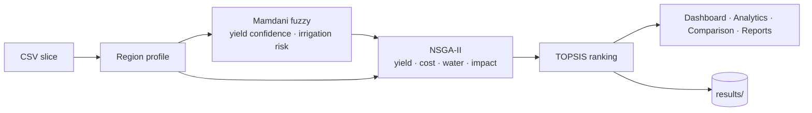
Details: [ALGORITHMS.md](#doc-algorithms), [OPTIMIZATION_PIPELINE.md](#doc-optimization-pipeline).

### API at a glance
`GET /health` · `GET /api/catalog` · `GET /api/region-profile` · `POST /api/farm-plans` · `GET /api/results` · `GET /api/results/{run_id}` · `GET /api/weather|dashboard|history|soil-profile|plans|comparison|compare-fuzzy/{district}` – see [API_REFERENCE.md](#doc-api-reference).

### Deployment
Frontend on Vercel (`vercel.json`, `VITE_API_BASE` in `.env.production`); backend on Fly.io (`fly.toml`, Docker, volume for `results/`); GitHub Actions runs the tests, then deploys. See [ARCHITECTURE.md](#doc-architecture) §6.

### Known limitations
Irrigation/fertiliser multipliers currently have no yield benefit (optimiser keeps them at the minimum); the yield objective sums tonnes across crops; fuzzy output affects only expected yield; district-level data, single season; demo-only client-side authentication. Full list and roadmap: [RESEARCH_REVIEW.md](#doc-research-review), [TODO.md](#doc-todo).

### Documentation index
[PROJECT_KNOWLEDGE](#doc-project-knowledge) · [ARCHITECTURE](#doc-architecture) · [FOLDER_STRUCTURE](#doc-folder-structure) · [FRONTEND](#doc-frontend) · [BACKEND](#doc-backend) · [DATASETS](#doc-datasets) · [ALGORITHMS](#doc-algorithms) · [API_REFERENCE](#doc-api-reference) · [DATA_FLOW](#doc-data-flow) · [USER_FLOW](#doc-user-flow) · [OPTIMIZATION_PIPELINE](#doc-optimization-pipeline) · [REPORT_PIPELINE](#doc-report-pipeline) · [HISTORY_PIPELINE](#doc-history-pipeline) · [SCORING_AND_RANKING](#doc-scoring-and-ranking) · [CONFIGURATION](#doc-configuration) · [DEPENDENCIES](#doc-dependencies) · [PROJECT_REVIEW](#doc-project-review) · [DATA_VALIDATION](#doc-data-validation) · [PERFORMANCE_REVIEW](#doc-performance-review) · [SECURITY_REVIEW](#doc-security-review) · [UI_UX_REVIEW](#doc-ui-ux-review) · [RESEARCH_REVIEW](#doc-research-review) · [TECHNICAL_DEBT](#doc-technical-debt) · [IMPROVEMENT_LOG](#doc-improvement-log) · [CHANGELOG](#doc-changelog) · [TODO](#doc-todo) · [EXPLAINABILITY](#doc-explainability) · [DISTRICT_INTELLIGENCE](#doc-district-intelligence) · [SCENARIO_SIMULATION](#doc-scenario-simulation) · [FUZZY_SYSTEM_ANALYSIS](#doc-fuzzy-system-analysis) · [FUZZY_EXPLAINABILITY](#doc-fuzzy-explainability) · [FUZZY_RESEARCH_REVIEW](#doc-fuzzy-research-review) · [FUZZY_IMPROVEMENT_SUMMARY](#doc-fuzzy-improvement-summary) · [NSGAII_ANALYSIS](#doc-nsgaii-analysis) · [NSGAII_PROFILE](#doc-nsgaii-profile) · [NSGAII_RESEARCH_REVIEW](#doc-nsgaii-research-review) · [NSGAII_IMPROVEMENT_SUMMARY](#doc-nsgaii-improvement-summary)

<a id="doc-folder-structure"></a>

## Folder Structure

Every folder and every significant file in `final_year_project/`, what it is, and whether anything uses it.
Status legend: **Active** = part of the running system · **Reference** = documentation/design material, not executed · **Stale** = superseded copy, should not be edited · **Generated** = produced at runtime.

```
final_year_project/
├── agrooptimize-backend/          Active   Python/FastAPI backend (its own git repo, branch main)
├── stitch_agrooptimize_app/       Active   Local working copy of the React frontend (same source as frontend/ in the git repo)
├── datasets/                      Stale    Older copy of the 16 CSVs (differs from backend data/raw/)
├── docs/                          Active   This documentation set (added 2026-09-29)
├── reference_docs/                Reference Paper PDF, rubric PDF, viva-prep .docx
├── .github/workflows/             Inactive CI/CD file outside the git repo – GitHub never sees it (TODO T-9)
├── _backups/                      Reference Tarball of the frontend taken before the 2026-09-29 audit edits
└── AgroOptimize_Updated.zip       Stale    Snapshot archive of agrooptimize-backend (incl. .pytest_cache, results/)
```

### `agrooptimize-backend/`

| Path | Status | Purpose |
|---|---|---|
| `app/__init__.py` | Active | Empty package marker |
| `app/config.py` | Active | Every tunable constant and modelling assumption (paths, locations, season→month map, prices, wage, carbon factors, NSGA-II hyper-parameters). See [CONFIGURATION.md](#doc-configuration) |
| `app/schemas.py` | Active | Pydantic v2 request/response models (`FarmPlanRequest`, `FarmPlanResponse`, …) |
| `app/main.py` | Active | FastAPI app, CORS, 13 route handlers. See [API_REFERENCE.md](#doc-api-reference) |
| `app/data/loader.py` | Active | Reads the 16 CSVs, concatenates per kind, `lru_cache(maxsize=1)` |
| `app/data/preprocessing.py` | Active | Builds `RegionSeasonProfile` (soil, rainfall, water, candidate crops); soil fertility index; `[0,1]` snapshot; provenance flag |
| `app/fuzzy/engine.py` | Active | Mamdani fuzzy inference system (3 inputs, 2 outputs, 26 rules) + per-crop confidence adjustment + rule-level explanation |
| `app/fuzzy/audit.py` | Active | Read-only audit of the fuzzy system (dominance, coverage, firing, monotonicity) |
| `scripts/benchmark_fuzzy.py` | Tool | Times the fuzzy layer and its callers |
| `app/optimization/problem.py` | Active | `FarmPlanProblem` (pymoo `Problem`): chromosome bounds + 4 vectorised objectives + budget constraint |
| `app/optimization/operators.py` | Active | Custom `SinglePointCrossover`, `GaussianMutation`, `AllocationRepair`, vectorised binary tournament; enhanced-mode operators (smart sampling, adaptive crossover/mutation, duplicate elimination) |
| `app/optimization/nsga2_runner.py` | Active | Runs pymoo NSGA-II in the configured engine mode (serialised by a lock), decodes Pareto front, hypervolume convergence history, engine report |
| `app/optimization/engine_settings.py` | Active | Engine modes (original / enhanced) and per-feature switches |
| `app/optimization/monitoring.py` | Active | Per-generation monitor: history, diversity, runtime profile, adaptive-mutation controller, early-stopping criterion |
| `scripts/profile_nsga2.py` | Tool | Phase-by-phase profile of one optimisation run |
| `scripts/benchmark_nsga2.py` | Tool | Quality benchmark / ablation study of engine modes and parameters |
| `app/decision/ranking.py` | Active | Hard-limit filters, TOPSIS ranking, trade-off wording, confidence labels |
| `app/services/plan_service.py` | Active | Orchestrates the 5-stage pipeline for `POST /api/farm-plans` and the CLI |
| `app/services/results_store.py` | Active | Persists runs to `results/` (JSON/CSV/PNG), lists and loads them |
| `app/services/district_service.py` | Active | District Intelligence aggregation (cached) |
| `app/services/simulation_service.py` | Active | Scenario Simulation and decision impact analysis |
| `results/simulations/` | Generated | Saved simulations (git-ignored with the rest of `results/`) |
| `app/services/dashboard_service.py` | Active | Logic for the 7 frontend-facing endpoints (weather, dashboard, history, soil, plans, comparison, fuzzy comparison) |
| `data/raw/*.csv` | Active | **The** dataset: 4 districts × {crop, land, rainfall, water_availability}. See [DATASETS.md](#doc-datasets) |
| `tests/test_api.py` | Active | 21 tests – core REST endpoints |
| `tests/test_dashboard.py` | Active | 52 tests – dashboard endpoints (weather incl. mocked Open-Meteo, history scoping, plans, comparison) |
| `tests/test_data.py` | Active | 36 tests – loader, catalog, profile building, fertility formula, snapshot |
| `tests/test_fuzzy.py` | Active | 22 tests – fuzzy ranges, rule directionality, per-crop penalty |
| `tests/test_pipeline.py` | Active | 34 tests – end-to-end pipeline, NSGA-II invariants, persistence |
| `tests/test_nsga2_engine.py` | Active | 38 tests – original mode reproduces published results, speed-ups equal the replaced code, each enhanced feature |
| `tests/test_hardening.py` | Active | 40 tests added 2026-09-29 – path safety, caching, validation, provenance, determinism under concurrency |
| `run_demo.py` | Active | CLI: run the whole pipeline without a server and print a ranked table |
| `requirements.txt` | Active | Python dependencies (see [DEPENDENCIES.md](#doc-dependencies)) |
| `Dockerfile`, `.dockerignore` | Active | Production image (python:3.11-slim, uvicorn on :8000) |
| `fly.toml` | Active | Fly.io app `agrooptimize-backend`, region `sin`, volume mounted at `/app/results` |
| `render.yaml` | Reference | Alternative Render.com deployment (free plan, no persistent disk declared) |
| `pytest.ini` | Active | Test discovery, `-v --tb=short`, suppresses Deprecation/User warnings |
| `.env.example` | Reference | Documents knobs; **nothing reads it** – `config.py` does not load env vars except `CORS_ALLOW_ORIGINS` in `main.py` |
| `results/` | Generated | Saved runs (`<run_id>.json`, `_plans.csv`, `_convergence.csv`, `_convergence.png`). Git-ignored. The 8 runs present were produced from an **older dataset version** (see [DATA_VALIDATION.md](#doc-data-validation) §D12) |
| `docs/*.md` | Reference (partly stale) | Team-written docs (architecture, API, assumptions, fuzzy rules, literature survey, results). Several numbers are outdated – see [TECHNICAL_DEBT.md](#doc-technical-debt) TD-12 |
| `notes/methodology_notes.md`, `notes/viva_prep.md` | Reference (partly stale) | Narrative methodology and viva Q&A |
| `notes/AgroOptimize_Guide_Review_Status.docx` | Reference | Guide review tracker |
| `README.md`, `CONTRIBUTING.md` | Stale | README still says "34 tests", "6 endpoints", "frontend not built". Replacement: [README_UPDATED.md](#doc-readme-updated) |
| `frontend/` | Active | **The React app in version control** (GitHub `main`). Same source as the local `stitch_agrooptimize_app/` working copy described below. (A local checkout that is behind `origin/main` may show only part of it – always `git fetch` first.) |
| `.pytest_cache/`, `app/**/__pycache__/` | Generated | Tool caches (git-ignored) |

### `stitch_agrooptimize_app/` (frontend; in the git repo this is `frontend/`)

| Path | Status | Purpose |
|---|---|---|
| `index.html` | Active | Vite entry; loads Google Fonts (Inter, Montserrat, Material Symbols) and `/src/main.jsx`. Favicon is an external `googleusercontent.com` URL |
| `src/main.jsx` | Active | `createRoot` + `<StrictMode>` |
| `src/App.jsx` | Active | State-machine router (`currentView` string), user state in `localStorage`, layout shell (sidebar/top bar/mobile drawer), health check |
| `src/index.css` | Active | Tailwind v4 `@theme` design tokens (Material-3-style colour roles, typography scale) + keyframes |
| `src/services/api.js` | Active | The only module that calls the backend; `ApiError`, `describeApiError`, per-browser `client_id` |
| `src/views/DistrictIntelligenceView.jsx`, `src/components/district/` | Active | District Intelligence page and its sections |
| `src/views/SimulationView.jsx`, `src/components/simulation/` | Active | Scenario Simulation page and its sections |
| `src/utils/simulationView.js`, `src/utils/simulationReport.jsx` | Active | Simulation helpers and HTML report |
| `src/components/charts/` | Active | Reusable LineChart, BarChart, ChartCard, chart theme |
| `src/utils/districtView.js` | Active | District page selection/formatting helpers |
| `src/**/*.test.js(x)`, `src/__fixtures__/` | Active | Vitest tests and a real API payload fixture |
| `src/utils/download.js` | Active (new) | `downloadFile`, `toCsv` (with CSV-injection guard), `slug` |
| `src/views/*.jsx` | Active | 10 page components – see [FRONTEND.md](#doc-frontend) |
| `src/components/DataSourceNotice.jsx` | Active | "historical vs live vs personalised" banner |
| `src/components/CountryCodeModal.jsx` | Active | Phone country-code picker (Auth) |
| `src/components/AccountAuthOverlay.jsx` | Active | Mock "authorisation" dialog (Settings → unlink Google, demo only) |
| `src/components/ParticleBackground.jsx` | Active | Canvas particle animation on onboarding |
| `src/components/SuccessCheckSvg.jsx` | Active | Animated check mark (profile complete) |
| `public/favicon.svg`, `public/icons.svg` | Unused | Vite scaffold assets, not referenced |
| `package.json`, `package-lock.json` | Active | React 19.2, Tailwind 4.3, Vite 8.2, oxlint 1.75 |
| `vite.config.js` | Active | `react()` + `tailwindcss()` plugins |
| `.oxlintrc.json` | Active | Lint rules; now ignores `dist/` and the mock-up HTML |
| `vercel.json` | Active | SPA rewrite `/(.*) → /index.html`, output `dist` |
| `.env.production` | Active | `VITE_API_BASE=https://agrooptimize-backend.fly.dev` |
| `.vercel/project.json` | Active | Vercel project link (`agrooptimize`) |
| `<screen_name>/code.html` (28 folders) | Reference | Static HTML mock-ups exported from Google Stitch (Tailwind CDN). Design source for the React views; not built or served |
| `agrooptimize_structural_system/DESIGN.md` | Reference | Design-token spec (colours, type scale) the Tailwind theme mirrors |
| `agrooptimize_brand_logo/screen.png`, `a_realistic_profile_photo…/screen.png` | Reference | Mock-up images |
| `node_modules/` | Generated | npm install output |

Removed on 2026-09-29 (all preserved in `_backups/stitch_agrooptimize_app_before_audit_2026-09-29.tar.gz`): `_to_delete/` (stale scaffold build + an intentionally-empty `weatherData.js`), `src/components/ShaderBackground.jsx` (never imported), `src/assets/{hero.png,react.svg,vite.svg}` (scaffold leftovers), empty `src/data/`.

### `datasets/` (top level)

16 CSVs with the same names as `agrooptimize-backend/data/raw/` but an **older schema**: no `data_source` / `Annual_Normal_mm` columns, no 2024 rows (612 lines vs 761), and different `Normal_Rainfall_mm` values (e.g. Coimbatore January normal 7.5 mm here vs 37.5 mm in `data/raw`). Nothing reads it. Keep only as an archive, or delete to avoid confusion (TODO T-8).

### `reference_docs/`

| File | Content |
|---|---|
| `Reference_Paper_AgroOptimize.pdf` | The team's own 6-page paper (*A fuzzy-evolutionary decision support system for agricultural farming under uncertainties*). The implementation diverges from it in several places – see [RESEARCH_REVIEW.md](#doc-research-review) §3 |
| `Phase 2 Project Rubrics.pdf` | Guide Review 1 (7), Panel Review 1 (20), Guide Review 2 (8) rubrics for research/application/software projects |
| `AgroOptimize_Panel_Viva_Prep.docx` | Viva preparation notes |

---

# Part 2 — Architecture, Code & Deployment

<a id="doc-architecture"></a>

## Architecture

AgroOptimize is a two-tier web application: a **React SPA** (`stitch_agrooptimize_app/`) talking JSON over HTTPS to a **stateless FastAPI service** (`agrooptimize-backend/`) that runs a data → fuzzy → NSGA-II → TOPSIS pipeline over 16 CSV files. There is **no database** and **no server-side user model**: user profiles live in browser `localStorage`, saved optimisation runs live as files on a disk volume.

### 1. System context

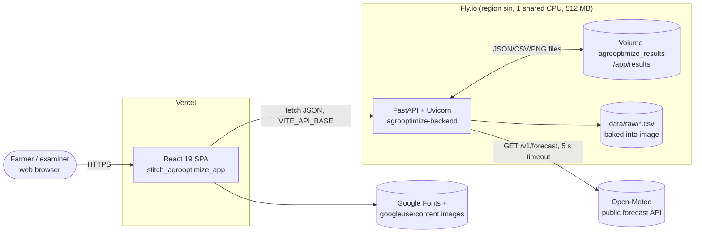

### 2. Backend module structure

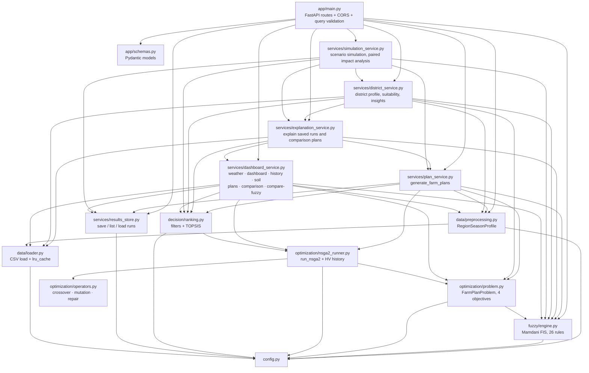

Design properties:

* **Layered and acyclic.** Data → fuzzy → optimisation → decision → services → HTTP. Lower layers never import upward (`ranking.py` imports only the `FarmPlan` dataclass from the runner).
* **Two orchestrators.** `plan_service.generate_farm_plans` serves `POST /api/farm-plans` and the CLI (≤50 plans, persistence, filters, user preference). `dashboard_service._run_dashboard_pareto_front` serves the dashboard endpoints (population 100, up to 100 plans, no persistence, memoised). They deliberately share the same lower-level modules.
* **Explanations are a separate read-only layer.** `explanation_service` consumes a saved run or the memoised comparison front and never runs its own optimisation; see [EXPLAINABILITY.md](#doc-explainability).
* **Deferred imports in `main.py`.** Route handlers import services inside the function body; it only affects import order, not behaviour.

### 3. Request lifecycle – `POST /api/farm-plans`

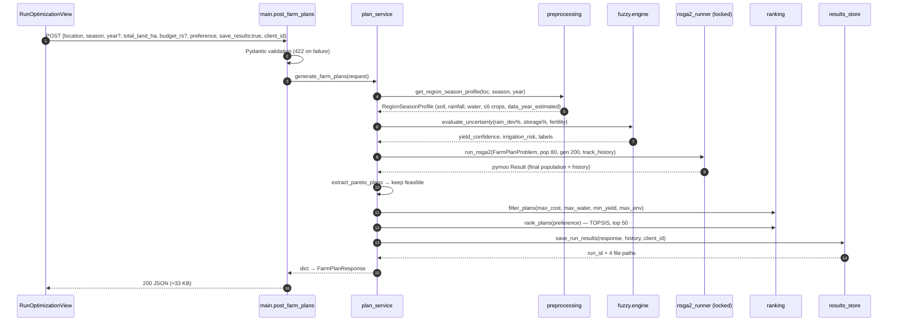

Errors: `ValueError` anywhere in stages 1–4 (unknown location, no data for the year/season, <2 candidate crops) → HTTP 400. Pydantic → 422.

### 4. Frontend architecture

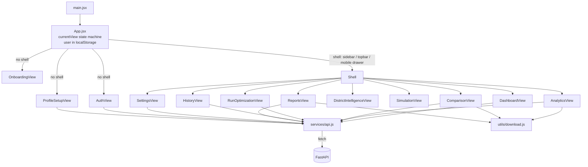

* **No router library.** Navigation is `setCurrentView(id)`; the current view name is persisted to `localStorage['agro_currentView']`, so a reload returns to the same page but browser Back/Forward and deep links do not work.
* **No global store.** `App` owns `user`, `currentView`, layout and language; each view fetches its own data in `useEffect` with a `cancelled` flag to ignore late responses.
* **Guard:** any shell view without a valid district on file bounces to profile setup/onboarding.

### 5. Data at rest

| Store | Where | Content | Lifetime |
|---|---|---|---|
| CSV dataset | Docker image `/app/data/raw` | 761 rows over 16 files | Immutable per deploy |
| Loader cache | Process memory (`lru_cache`) | 4 concatenated DataFrames | Process lifetime |
| District profile cache | Process memory (`lru_cache(8)`) | Full district-intelligence payload per district | Process lifetime |
| Unsaved simulation results | Process memory (32 newest, by token) | Result awaiting "Save" — never reused as a computation cache | Process lifetime |
| Saved simulations | `results/simulations/sim_*.json` | Inputs + full result, scoped by `client_id` | Until deleted |
| Dashboard front cache | Process memory (`lru_cache(32)`) | Pareto fronts per (district, season, year, land, budget, history flag) | Process lifetime |
| Saved runs | `/app/results` (Fly volume) | `<run_id>.json` (+ CSV, convergence CSV/PNG) | Unbounded – never pruned |
| Run summary cache | Process memory | Parsed summaries keyed by file mtime/size | Process lifetime |
| User profile | Browser `localStorage['agro_user']` | name, phone, email, district, land size, crop, avatar (data-URL) | Until logout / site-data clear |
| Demo credential | `localStorage['agro_register_password_sha256']` | SHA-256 of password | Same |
| Client id | `localStorage['agro_client_id']` | random UUID, scopes History | Same |

### 6. Deployment topology

| Component | Platform | Config file | Notes |
|---|---|---|---|
| Frontend | Vercel (project `agrooptimize`) | `vercel.json`, `.env.production` | Static build; `VITE_API_BASE` baked in at build time |
| Backend | Fly.io app `agrooptimize-backend` | `fly.toml`, `Dockerfile` | `min_machines_running = 1`, health check `GET /health` every 15 s, `CORS_ALLOW_ORIGINS=https://agrooptimize.vercel.app` |
| Backend (alt.) | Render.com | `render.yaml` | Free plan, no persistent disk → saved runs lost on restart |
| CI | GitHub Actions | `.github/workflows/deploy-backend.yml` | On push to `main` touching `agrooptimize-backend/**`: `pytest` job, then `flyctl deploy` (deploy now `needs: test`) |

### 7. Concurrency model

Uvicorn runs one worker process. FastAPI runs the synchronous route handlers in a thread pool (default 40 threads). All optimisation runs go through `nsga2_runner._NSGA2_RUN_LOCK`, so at most **one NSGA-II run executes at a time**; others queue. This is required for correctness because the custom operators use NumPy's global RNG (see [PERFORMANCE_REVIEW.md](#doc-performance-review) §2 and [CHANGELOG.md](#doc-changelog)). Horizontal scaling = more Fly machines (each with its own lock and caches); saved runs would then need shared storage, because a Fly volume attaches to one machine.

### 8. Architectural decisions and trade-offs

| Decision | Rationale | Cost / risk |
|---|---|---|
| Files instead of a database | Explicit project requirement: runs must be inspectable, attachable to reports, versionable | No querying, no multi-machine sharing, no retention policy |
| No server-side accounts; `client_id` scoping | Scope of a final-year project | Not a security boundary (anyone who knows a `client_id` sees that history) |
| pymoo for NSGA-II mechanics, custom operators | Correct non-dominated sort/crowding from a vetted library; operators match the paper's text | Custom operators use the global NumPy RNG → needs the lock |
| scikit-fuzzy `ControlSystem` | Readable Mamdani rule syntax | ~600 ms first-call build; per-call simulation object allocation |
| Two orchestration paths (`plan_service` vs `dashboard_service`) | Dashboard needs 100 plans and no persistence without altering the tested path | Duplicated pipeline wiring (TD-4) |
| State-machine navigation instead of react-router | Simplicity | No URLs per page, no Back button, no deep links |

<a id="doc-backend"></a>

## Backend

`agrooptimize-backend/` – Python 3.11 (Docker) / 3.10+ (local), FastAPI, pymoo 0.6, scikit-fuzzy 0.5, pandas 2. ~3,250 lines of application code, 205 tests. Endpoint contracts: [API_REFERENCE.md](#doc-api-reference). Algorithms: [ALGORITHMS.md](#doc-algorithms).

### 1. Running it

```bash
cd agrooptimize-backend
pip install -r requirements.txt
uvicorn app.main:app --reload --port 8000     # Swagger at /docs
python3 run_demo.py --location Erode --season Rabi --land 3 --preference max_yield --top 3
python3 -m pytest -q                            # 205 tests, ~15 s
```

### 2. Module reference

#### `app/config.py`
Constants only (no functions, no env loading). Grouped: paths (`RAW_DATA_DIR`, `RESULTS_DIR`), dataset structure (`LOCATIONS`, `DATASET_KINDS`, `AG_SEASONS`, `SEASON_MONTH_MAP`, `DISTRICT_COORDINATES`), candidate selection, economics, water, environment, rainfall-dependency factors, decision-variable bounds, NSGA-II hyper-parameters, `MAX_RETURNED_PLANS`. Full table with provenance: [CONFIGURATION.md](#doc-configuration).

#### `app/schemas.py`
| Model | Used as | Notes |
|---|---|---|
| `FarmPlanRequest` | body of POST /api/farm-plans | validation bounds listed in API_REFERENCE; `client_id ≤ 128`, filters ≥ 0 (added) |
| `SoilOut`, `RainfallOut`, `WaterOut`, `CropCandidateOut`, `RegionProfileOut` | nested in `FarmPlanResponse` | `RegionProfileOut.data_year_estimated` defaults False so older saved runs validate |
| `FuzzyAssessmentOut`, `RankedPlanOut`, `RunMeta`, `ConvergencePointOut`, `SavedFilesOut` | nested | |
| `FarmPlanResponse` | response of POST /api/farm-plans and GET /api/results/{id} | acts as a filter: stored keys `saved_at`, `client_id` are dropped |
| `SavedRunSummaryOut` | GET /api/results | |
| `CatalogOut` | GET /api/catalog | |

The seven dashboard endpoints and `/api/region-profile` return plain dicts with **no response_model** (TD-7).

#### `app/main.py`
Creates `FastAPI(title="AgroOptimize API", version="0.1.0")`, adds CORS (localhost dev origins + `CORS_ALLOW_ORIGINS`), defines shared `Query` validators (`_LAND_HA_QUERY` 0 < x ≤ 100 000, `_BUDGET_QUERY` > 0, `_CLIENT_ID_QUERY` ≤ 128 chars) and 13 handlers. Each handler is a thin wrapper: call a service, map `ValueError` → 400/404 and `PlanGenerationError` → 503. `list_results` redacts `client_id`.

#### `app/data/loader.py`
| Function | Behaviour |
|---|---|
| `_read_kind(kind)` | For each location reads `data/raw/<loc>_<kind>.csv`; raises `FileNotFoundError` naming the missing file; `pd.concat` |
| `load_all()` | `lru_cache(maxsize=1)`; returns `{"crop","land","rainfall","water"}` DataFrames |
| `clear_cache()` | clears the above (tests) |
| `available_locations/years/seasons()` | used only by tests |

#### `app/data/preprocessing.py`
| Symbol | Behaviour |
|---|---|
| dataclasses `CropCandidate`, `SoilProfile`, `RainfallProfile`, `WaterProfile`, `RegionSeasonProfile` | typed pipeline input; `RegionSeasonProfile.data_year_estimated` added |
| `compute_soil_fertility_index(...)` | 0–100 index (ALGORITHMS §1) |
| `canonical_choice(value, options, kind)` | case/whitespace-insensitive match → canonical spelling; `ValueError` otherwise (added) |
| `ESTIMATED_SOURCE_PREFIX`, `is_estimated_year(loc, year)` | True if all crop rows for (loc, year) have `data_source` starting "Estimated" (added) |
| `_resolve_year` | None → latest year for the location; unknown year → `ValueError` listing available years |
| `list_catalog()` | locations, seasons, sorted years, crops per season (across all locations) |
| `get_region_season_profile(location, season, year, max_candidate_crops)` | the Stage-1 builder: land row (first match), rainfall/water rows for the season's months, top-N crops by revenue; raises `ValueError` for any empty slice or <2 crops |
| `_REFERENCE_RANGES`, `_minmax`, `normalized_snapshot(profile)` | display-only [0,1] values |

#### `app/fuzzy/engine.py`
| Symbol | Behaviour |
|---|---|
| `UncertaintyAssessment` | `yield_confidence`, `irrigation_risk` (0–1, 3 dp) + three dominant labels |
| `_build_system()` | `lru_cache(1)`: defines universes, MFs, 26 rules, returns `ControlSystem` + antecedents (first call ≈0.6 s) |
| `evaluate_uncertainty(rain_dev, storage, fertility)` | clips inputs to `INPUT_BOUNDS`, scikit-fuzzy inference memoised per clipped input (`_evaluate_cached`, 4096), centroid outputs ÷ 100; falls back to 0.5/0.5 on `KeyError/ValueError`; new result object per call |
| `MEMBERSHIP_FUNCTIONS`, `INPUT_BOUNDS`, `RULE_SCENARIOS` | the triangles, input universes and scenario names of rules 15–26 |
| `rule_specs()` | the 26 rules as plain data (conditions, conclusions, text), built once |
| `input_memberships`, `fired_rules`, `output_term` | memberships (3 dp), fired rules (memoised), output term of a crisp value |
| `explain_inference(rain_dev, storage, fertility)` | rule-level attribution: status, limiting condition, area share, leave-one-out importance, ranking (FUZZY_EXPLAINABILITY.md) |
| `_dominant_label` | argmax membership |
| `crop_yield_confidence(base, risk, dependency)` | per-crop penalty (≤ 40 %) |

#### `app/fuzzy/audit.py`
Read-only measurements: `rule_dominance`, `membership_coverage`, `output_bounds`, `leave_one_out`, `firing_statistics`, `monotonicity`, `evaluate_grid` (exact batch path), `summary` (cached, served by `/api/fuzzy/audit`). `scripts/benchmark_fuzzy.py` times the fuzzy layer and its callers.

#### `app/optimization/problem.py`
`CropVector.from_candidates(crops, assessment, use_fuzzy)` precomputes per-crop NumPy arrays (confidence = 1.0 when `use_fuzzy=False`). `FarmPlanProblem(profile, assessment, total_land_ha, budget_rs, use_fuzzy)` sets bounds (allocation lower bound 1e−4), 4 objectives, optional 1 inequality constraint; `_evaluate` is fully vectorised; `decode(x)` → dict of lists.

#### `app/optimization/operators.py`
`AllocationRepair`, `SinglePointCrossover(prob)` (vectorised over matings, same cut points as the former loop), `GaussianMutation(prob, sigma)` – see ALGORITHMS §4.1; they use `np.random` (global RNG). `binary_tournament` is pymoo's NSGA-II tournament vectorised (identical decisions and tie draws). Enhanced-mode operators: `SmartSampling` / `seed_chromosomes`, `AdaptiveSinglePointCrossover`, `AdaptiveGaussianMutation`, `TolerantDuplicateElimination`; `CountingDuplicateElimination` wraps the duplicate check to count rejections.

#### `app/optimization/engine_settings.py`, `monitoring.py`
`EngineSettings` / `engine_settings(mode)`: mode and per-feature switches from `config.NSGA2_ENGINE_*`. `EngineMonitor` (pymoo callback): per-generation objective history (replaces `save_history`), diversity statistics, runtime, adaptive-mutation probability. `FrontStagnationTermination`: optional early stopping. See [NSGAII_IMPROVEMENT_SUMMARY.md](#doc-nsgaii-improvement-summary).

#### `app/optimization/nsga2_runner.py`
| Symbol | Behaviour |
|---|---|
| `_NSGA2_RUN_LOCK` | process-wide lock serialising runs (added) |
| `FarmPlan` | decoded plan with rounded objective values and `feasible` |
| `run_nsga2(problem, pop_size, n_gen, …, seed=42, track_history, mode=None, engine=None)` | builds pymoo `NSGA2` for the engine mode (default `config.NSGA2_ENGINE_MODE`), seeds global RNG and runs `minimize` under the lock with an `EngineMonitor`; attaches `result.engine_report` (mode, profile, diversity) |
| `run_nsga2_with_fuzzy_toggle(profile, assessment, land, budget, use_fuzzy, **kw)` | builds the problem with `use_fuzzy`, returns `(problem, result)` |
| `extract_convergence_history(result)` | per-generation best/mean objectives + normalised hypervolume; `[]` without history |
| `extract_pareto_plans(result, problem)` | decode `result.X/F/G` into `FarmPlan`s |

#### `app/decision/ranking.py`
`filter_plans`, `rank_plans` (TOPSIS), `RankedPlan`, `to_dict_list`, helpers `_minmax_norm`, `_plain_minmax`, `_bucket`, `_round_percentages_to_100`, `_PREFERENCE_WEIGHTS`.

#### `app/services/plan_service.py`
`generate_farm_plans(request, results_dir=None)` – Stages 1–5; see [OPTIMIZATION_PIPELINE.md](#doc-optimization-pipeline). Returns a plain dict shaped like `FarmPlanResponse`.

#### `app/services/results_store.py`
| Symbol | Behaviour |
|---|---|
| `is_valid_run_id` | regex `^[A-Za-z0-9][A-Za-z0-9_-]{0,127}$` (added) |
| `make_run_id(loc, season, year)` | `<loc>_<season>_<year>_<YYYYMMDDTHHMMSSZ>` (slugified, UTC) |
| `_reserve_run_id(out_dir, base)` | exclusive-create claim; `-2`, `-3`… on same-second collision (added) |
| `save_run_results(response, history, out_dir, client_id)` | writes JSON (atomic), plans CSV (list/dict cells JSON-encoded), and if history: convergence CSV + PNG |
| `_atomic_write_text` | temp file + `os.replace` (added) |
| `_plot_convergence` | matplotlib Agg; two panels (HV; best yield & best cost on twin axes); 130 dpi |
| `_summarise`, `_SUMMARY_CACHE` | per-file summary cached by (mtime_ns, size) (added) |
| `list_saved_runs(out_dir)` | summaries newest-first by filename; corrupt/incomplete files skipped |
| `load_run(run_id, out_dir)` | validated id → dict or None (corrupt → None) |

#### `app/services/dashboard_service.py`
| Symbol | Behaviour |
|---|---|
| `resolve_location` | case-insensitive district → canonical; `ValueError` (→404) |
| `_current_season(today)` | month → first matching season in `SEASON_MONTH_MAP` |
| `_latest_year_for(df, loc)` | max year |
| `_WMO_CODE_TO_CONDITION`, `_CONDITION_TEXT`, `_condition_for_rainfall` | weather icon mapping; CSV fallback thresholds >100 mm rainy, >50 partly cloudy |
| `_get_weather_live(loc)` | Open-Meteo `/v1/forecast` (current + 6 daily, Asia/Kolkata, timeout 5 s) |
| `_get_weather_from_csv(loc)` | current-month and next-5-month averages |
| `get_weather(loc)` | live, else CSV; failure logged with `logging` |
| `_ACTION_LIBRARY`, `_soil_status_label`, `_current_land_row`, `_REFERENCE_FARM_HA` | dashboard helpers |
| `PlanGenerationError` | raised by `get_plans` → 503 |
| `get_dashboard(loc, client_id)` | KPI payload (SCORING_AND_RANKING §4) incl. `data_year(_estimated)` |
| `get_soil_profile(loc)` | latest-year current-season soil |
| `get_history(loc, client_id)` | HISTORY_PIPELINE |
| `_run_dashboard_pareto_front(...)` → `_cached_pareto_front(...)` (`lru_cache(32)`), `clear_pareto_cache()` | pop-100 run, memoised; returns profile, assessment, feasible plans, confidence map, convergence history |
| `_summarize_pareto_front`, `get_fuzzy_comparison` | fuzzy vs non-fuzzy study |
| `get_plans` | ≤100 ranked plans per hectare + HV history |
| `_radar_scores`, `_PLOT_LABELS` (deprecated), `get_comparison` | Plans A/B/C |

#### `app/services/explanation_service.py`
| Symbol | Behaviour |
|---|---|
| `ExplanationContext` | everything needed to explain one plan: region profile, fuzzy, ranked set, index, preference, land, budget (+ whether recorded), convergence history, meta, subject |
| `context_from_saved_run(record, rank)` | from a stored run (budget "not recorded" for older runs) |
| `context_from_comparison(location, plan, land, budget)` | from the memoised dashboard front ranked under A/B/C's preference |
| `explain(ctx)` | builds all sections (see EXPLAINABILITY.md); helpers `_crop_breakdown`, `_objective_analysis`, `_rank_under_all_preferences`, `_trade_offs`, `_constraints`, `_historical`, `_confidence`, `_risks` |
| `explain_saved_run`, `explain_comparison_plan` | convenience wrappers used by `main.py` |

Supporting additions: `ranking.topsis_scores`, `ranking.preference_weights`, `ranking.OBJECTIVES`; `fuzzy.engine.input_memberships`, `fired_rules`, `output_term`; `plan_service.region_profile_payload`; `RunMeta.total_land_ha / budget_rs`.

#### `app/services/district_service.py`
| Symbol | Behaviour |
|---|---|
| `get_district_intelligence(location)` | canonical district → cached `_build` payload |
| `_coverage`, `_climate`, `_soil`, `_water`, `_crops`, `_suitability`, `_market`, `_overview`, `_insights`, `_summary` | one section each (see DISTRICT_INTELLIGENCE.md) |
| `trend(years, values)`, `variability_label(cv)` | first-to-last change, slope, CV, direction and variability labels |
| `clear_cache()` | drop cached payloads |

Shared helpers added for it: `preprocessing.observed_rows`, `explanation_service.make_item`.

#### `app/services/simulation_service.py`
| Symbol | Behaviour |
|---|---|
| `simulate(request)` | baseline and scenario through `plan_service.run_pipeline` with `ENSEMBLE_SEEDS`; returns every analysis section |
| `resolve(request)` | validation and control mapping (`WATER_LEVEL_STORAGE_PCT`, `market_price_step_pct`, priorities → weights) |
| `_paired(...)` | means, ranges, paired t-test, verdict |
| `_side`, `_run_metrics`, `_cheapest_plan`, `_evaluate_plan` | per-side payload, per-run outcomes, cost lower bound, plan re-evaluation |
| `_conditions`, `_comparison`, `_share_tests`, `_impact`, `_crop_effects`, `_fuzzy_changes`, `_optimization`, `_constraints`, `_historical`, `_decision_impact`, `_trade_offs`, `_summary` | one section each (see SCENARIO_SIMULATION.md) |
| `remember`, `pending` | in-memory results awaiting save |

Supporting changes: `plan_service.run_pipeline` / `PipelineAdjustments` / `PipelineRun` (`generate_farm_plans` calls it); `preprocessing.get_region_season_profile(rainfall_factor, storage_override_pct)`; `FarmPlanProblem(fertilizer_price_factor)` and `single_crop_metrics()`; `ranking.rank_plans(weights)` and `normalise_weights`; `ExplanationContext.weights / price_factor` and `explanation_service.indicative_economics`; `results_store.save_simulation / list_simulations / load_simulation / delete_simulation`. All defaults leave existing outputs unchanged.

### 3. Error handling summary

| Layer | Strategy |
|---|---|
| Data | `ValueError` with explicit message for every empty slice |
| Fuzzy | clip inputs; neutral 0.5/0.5 on inference failure |
| Optimiser | infeasible solutions flagged, callers drop them; empty list is a valid result |
| `/api/plans` | broad `except Exception` → `PlanGenerationError` → 503 (also swallows `ValueError` for bad season/year into 503) |
| Weather | broad `except` → CSV fallback, logged |
| Persistence | corrupt files skipped; atomic writes |
| HTTP | ValueError→400 (core) / 404 (dashboard), validation→422 |

Not handled: disk full during save (500), Open-Meteo slowness (up to 5 s per call × 5 calls on the dashboard), extremely large `pop_size × n_gen` requests (bounded at 300 × 500).

### 4. Testing

| File | Focus | Count |
|---|---|---|
| test_api.py | core endpoints, validation, budget constraint | 21 |
| test_dashboard.py | dashboard endpoints, weather parsing (mocked), history scoping | 52 |
| test_data.py | CSV presence, loader cache, catalog, profile, fertility formula | 36 |
| test_fuzzy.py | output ranges, rule directionality, per-crop penalty | 22 |
| test_pipeline.py | end-to-end, NSGA-II invariants, persistence, convergence | 34 |
| test_hardening.py | run-id safety, cache, atomic save, validation, provenance, determinism, concurrency, run-id collisions, client_id redaction | 40 |
| test_explanation.py | explanation structure, traceability, confidence, constraints, honesty rules, endpoints | 25 |
| test_district.py | district aggregations vs raw CSVs, suitability, market, missing data, caching, endpoint | 96 |
| test_simulation.py | pipeline hooks, validation, paired comparison, end-to-end scenarios vs CSV, history, statements, persistence, endpoints | 61 |
| test_fuzzy_audit.py | memoised engine = uncached scikit-fuzzy, rule-level explanation exactness and consistency, audit vs analytic values, firing on data, endpoints | 170 |
| test_nsga2_engine.py | original mode = recorded digests, vectorised operators = replaced code, monitor = `save_history`, engine report, each enhanced feature, pipeline meta | 38 |

Gaps: operators unit-tested only indirectly; no test pins numeric outputs (a golden-master test would catch unintended model drift – TODO T-13); weather tests call the real Open-Meteo API when network is available; no frontend tests at all.

<a id="doc-frontend"></a>

## Frontend

`stitch_agrooptimize_app/` – React 19.2, Vite 8.2, Tailwind CSS 4.3 (via `@tailwindcss/vite`), oxlint. ~5,200 lines in `src/`. No router, no state library, no chart library (all charts are hand-written SVG), no test framework. Visual design originates from Google Stitch mock-ups (the `*/code.html` folders) and the token spec `agrooptimize_structural_system/DESIGN.md`.

```bash
cd stitch_agrooptimize_app
npm install
npm run dev                                   # http://localhost:5173, talks to http://localhost:8000
VITE_API_BASE=http://localhost:8010 npm run dev   # point at another backend
npm run lint && npm run build                 # oxlint (0 warnings) + production build to dist/
npm test                                      # Vitest: charts, district helpers and sections
```

### 1. Application shell (`src/App.jsx`)

| State | Stored | Purpose |
|---|---|---|
| `currentView` | `localStorage.agro_currentView` | which page renders: onboarding, login, register, profile-setup, dashboard, analytics, comparison, run-optimization, history, reports, settings |
| `user` | `localStorage.agro_user` | profile `{fullName, phoneNumber, email, location, landSize, primaryCrop, avatar, season}` |
| `selectedLanguage` | memory | en/hi/ta – **no translations exist**; only highlights the chosen option |
| `dashboardLayout` | memory | 'sidebar' / 'topbar' |
| `activePlanId` | memory | Comparison's "Select This Plan" |
| `backendOnline` | memory | result of one `GET /health` at start-up (footer dot) |

Guards: a shell view without a valid district (`DISTRICTS.includes(user.location)`) redirects to profile-setup (or onboarding when no user). `handleAuthSuccess` goes to the dashboard only for a login with a complete profile; otherwise profile-setup. Logout clears the two keys and returns to onboarding (the demo password digest and `client_id` are kept).

Layouts: fixed 256 px sidebar (desktop, default), sticky top bar (desktop, toggle on the dashboard), mobile header + slide-in drawer (<768 px). Footer shows backend reachability.

### 2. API layer (`src/services/api.js`)

* `API_BASE = import.meta.env.VITE_API_BASE || 'http://localhost:8000'`.
* Constants `DISTRICTS`, `SEASONS`, `PREFERENCES` mirror backend config.
* `extractDistrict(str)` → first district name contained in the string, else "Coimbatore".
* `getOrCreateClientId()` → `crypto.randomUUID()` stored as `agro_client_id`; sent with dashboard, history and farm-plan calls.
* `ApiError {status, detail}`, `describeApiError(err)`, `BACKEND_UNREACHABLE_MSG` (dev: how to start uvicorn; prod: plain-language) – added 2026-09-29.
* Methods: `checkHealth, getCatalog, getWeather, getDashboard, getHistory, getSoilProfile, getResult, getPlans, getComparison, getFuzzyComparison, runOptimization`. `runOptimization` maps `land_area_ha→total_land_ha`, `budget→budget_rs` and always sends `save_results: true`.

`src/utils/download.js` (added): `downloadFile(name, text, mime)`, `toCsv(rows, columns)` (quotes and neutralises `= + - @` prefixes in text cells), `slug()`.

### 3. Pages

#### OnboardingView (no shell)
2 s splash (logo + typewriter), then a 4-slide scroll-snap carousel (two stock images from `googleusercontent.com`, a static "Balanced / Max Yield / Safe" illustration, and Create Account / Log In). Language menu (English/हिन्दी). Canvas `ParticleBackground`. No API calls.

#### AuthView (no shell) – demo authentication, device-local only
Sub-views: login (phone or email tab + password), register-1 (name, optional email, phone with `CountryCodeModal`, password ≥ 8 chars), register-2 (district from `DISTRICTS`, land size ≥ 0.5 ha, primary crop from `/api/catalog` or a fallback list), otp. The OTP is generated in the browser and shown in a fake "Messages" toast with an Auto-fill button – **no SMS is sent**. Login verifies only the password against the digest stored in `localStorage` (the phone/email typed at login is not checked). Since 2026-09-29 the password is stored as SHA-256 (`agro_register_password_sha256`), migrating any legacy plaintext entry.

#### ProfileSetupView (no shell)
Step 1 name + avatar (FileReader → data-URL stored in `localStorage`, can be large), skippable. Step 2 district, current season, primary crop, land size (ha). Step 3 "Profile complete" (was "Verification completed" – nothing is verified). Calls `/api/catalog`.

#### DashboardView
Calls in parallel: `getWeather(user.location)`, `getDashboard(user.location)`, `getWeather` × 4 districts. Renders: time-of-day greeting; `DataSourceNotice` (historical); **estimated-data banner** when `data_year_estimated`; 4 KPI cards (Active Plans, Estimated Yield + trend, Water Utilization bar + label, Soil Health + status) – each card navigates to Comparison/Analytics on click; Crop Allocation Overview (revenue shares); Recommended Actions with local-only "Schedule" toggles; weather card with Local / Districts tabs (live vs "Historical estimate" wording from `source`); Quick Links. Skeleton loaders per section; failure text per section.

#### AnalyticsView
Calls `getPlans`, `getSoilProfile`, `getFuzzyComparison` for `user.location` (always 5 ha, current season, latest year – the user's land size is **not** passed). Renders KPI row (Valid Plans, Min Yield Target, Water Limit, Soil Suitability), an SVG cost-vs-yield scatter (500×300 viewBox, hover tooltip, gold recommended point, faded non-compliant points), three range sliders (max cost/ha, min yield/ha, max water ML/ha) with reset, "Best Compliant Plan" (cheapest compliant), a hypervolume convergence line chart, and the fuzzy vs non-fuzzy table. **Export** downloads a CSV of all plans with a `meets_current_constraints` column (was an `alert()`).

#### ComparisonView
Calls `getComparison(user.location)`. Renders a 6-axis SVG radar (selected plan filled, weighted recommendation dashed), a metrics table (crops, t/ha, ₹/ha, **Env. Impact/ha** with relative bar, water label), the selected plan's crop allocations (% and ha), a generic "Getting Started" 2-step template (clearly labelled as generic), an "Adjust Weights" modal (yield/cost/water sliders re-ranking A/B/C), and **Export CSV** (A/B/C metrics + radar). Removed: fabricated "Plots 1, 2, 4" labels, "View Full Calendar" and "Activated Plan" alerts, arbitrary ₹50,000 red threshold, inverted "n/20" impact.

#### RunOptimizationView
Form: district (defaults to profile district, warns when different), season, year ("Latest available" or catalog years), land (≥0.5 ha), optional budget, preference. Submit fires `runOptimization` immediately and shows a full-screen 4-stage progress animation on fixed timers (≈0.9 + 3×1.3 + 0.9 s ≈ 5.7 s minimum, independent of the real ≈0.3 s run); then shows the top plan (t/ha, ₹/ha, confidence, trade-off summary, estimated-year note) with Run Another / View in History / Generate Report. Errors: 4xx → backend's `detail`; network → unreachable message.

#### HistoryView
Calls `getHistory(user.location)` (client-scoped). Search box (matches season text), year filter, timeline cards (season, date, target yield, estimated cost, status), details modal (plans count, preference, fuzzy confidence/risk %). Empty state links to Run Optimization.

#### ReportsView
Calls `getHistory`; lists this browser's saved runs; "Generate Report" fetches `getResult(run_id)` and adds a card to "Recently Generated" (memory only – lost on navigation). Each card: **Download report** (plain-text report built from the saved run – see [REPORT_PIPELINE.md](#doc-report-pipeline)) and **Copy summary** (clipboard). Both were `alert()` stubs.

#### SettingsView
Profile (name, email, phone, avatar, district dropdown, land size, primary crop) → `onUpdateUser` (localStorage only) with an inline "saved on this device" status; language buttons; notification toggles (local state only, nothing is sent); mock Google-link section now labelled "Demo only"; logout.

### 3b. Explanations
Every recommended plan has a "Why?" entry point: Comparison (Explain per row, "Why this plan?", "Compare explanations"), Run Optimization ("Why this plan?"), History ("Explain top plan"), Reports ("Why?" and the explanation inside the downloaded report). API calls: `api.getResultExplanation(runId, rank)`, `api.getComparisonExplanation(location, plan)`. Details: [EXPLAINABILITY.md](#doc-explainability).

### 3c. District Intelligence
Sidebar item after Run Optimization. One request (`api.getDistrictIntelligence`) per district; sections render the payload; filters run in the browser. Quick actions: run optimization with the district preselected (`navigateTo(view, params)`), compare district, text report, analytics, CSV/JSON export. Details: [DISTRICT_INTELLIGENCE.md](#doc-district-intelligence).

### 3d. Scenario Simulation
Sidebar item after District Intelligence. Form for the original conditions and the scenario controls; `api.runSimulation` (~4 s, spinner) returns the full analysis; sections render it. Save (named), reopen and delete scenarios; export a self-contained HTML report with charts (lazy-loaded module) or JSON. Details: [SCENARIO_SIMULATION.md](#doc-scenario-simulation).

### 4. Shared components

| Component | Used by | Notes |
|---|---|---|
| `DataSourceNotice` | Dashboard, Analytics, Comparison | Explains historical vs live-generic vs personalised |
| `CountryCodeModal` | AuthView | searchable country list |
| `AccountAuthOverlay` | SettingsView | mock consent dialog |
| `ParticleBackground` | Onboarding | canvas animation |
| `SuccessCheckSvg` | ProfileSetup | animated check |
| `charts/LineChart`, `charts/BarChart`, `charts/ChartCard`, `charts/chartTheme` | District Intelligence (reusable) | emphasis colouring, hover tooltips, reference lines, minimum y-span, chart/table toggle |
| `district/DistrictSections` | District Intelligence | overview, climate, soil, water, crop performance, suitability, market, insights sections |
| `charts/GroupedBarChart`, `charts/DeltaBarChart`, `charts/RadarChart` | Scenario Simulation (reusable) | two-series bars with run-range whiskers; % change around zero with written verdicts; two-profile radar |
| `simulation/SimulationSections` | Scenario Simulation | recommendation, impact, decision impact, trade-offs, optimisation difference, crop effects, history, conditions |
| `ExplanationPanel`, `ExplanationModal`, `ExplanationComparison` | Comparison, Run Optimization, History, Reports | render the backend explanation JSON (no reasoning in the UI); modal handles loading/errors/Escape; side-by-side A/B/C view |

### 5. Styling system

`src/index.css` defines Tailwind v4 `@theme` tokens: Material-3 colour roles (primary `#005226`, secondary `#795900`, surface scale, error), font families (Montserrat headlines, Inter body), a type scale (`headline-lg`, `body-md`, `label-sm` …), spacing (`gutter`, `touch-target-min` 48 px), shadows (`soft`, `ambient`) and keyframes (`fadeIn`, `slideIn`, `shimmer`, typewriter). Icons are the Material Symbols web font loaded from Google Fonts; if that request fails the icon names render as literal words (observed in testing).

### 6. Loading, empty and error states

Every data section has a pulse skeleton while loading, an explicit empty state, and a failure message (now the shared `BACKEND_UNREACHABLE_MSG`, or the backend's own `detail`). The app never substitutes fabricated data on failure (an explicit design rule in the codebase comments).

### 7. Strengths and weaknesses

Strengths: consistent design tokens; honest empty/error states; single API module; cancellation guards on every effect; responsive layout with mobile drawer; minimal dependencies.

Weaknesses (details in [UI_UX_REVIEW.md](#doc-ui-ux-review) and [TECHNICAL_DEBT.md](#doc-technical-debt)): no URL routing; no tests; inaccessible clickable `<div>` cards and icon-only buttons; language switcher does nothing; Analytics/Comparison ignore the user's land size and budget; simulated progress timing; several external image/font dependencies; large views (AuthView 700 lines, AnalyticsView 600) mixing data, layout and chart code.

<a id="doc-api-reference"></a>

## API Reference

Base URL: local `http://localhost:8000`; production `https://agrooptimize-backend.fly.dev` (from `stitch_agrooptimize_app/.env.production`). Interactive schema: `GET /docs` (Swagger) and `/openapi.json`. No authentication on any endpoint. All bodies are JSON. Latencies are measured in-process (TestClient, Apple Silicon laptop, 2026-09-29); network adds to them.

| Method | Path | Purpose | Used by frontend | Cold / warm latency |
|---|---|---|---|---|
| GET | `/health` | Liveness | App.jsx startup | 1–18 ms |
| GET | `/api/catalog` | Locations, seasons, years, crops | Auth, ProfileSetup, Settings, RunOptimization | 16 ms |
| GET | `/api/region-profile` | Stages 1–2 only (data + fuzzy) | – | 632 ms first call (builds FIS), then ~10 ms |
| POST | `/api/farm-plans` | Full pipeline, optionally saved | RunOptimization | ≈300 ms (pop 80 × 200 gen) |
| GET | `/api/results` | List saved runs | – | O(#runs), cached by mtime |
| GET | `/api/results/{run_id}` | One saved run | Reports | ~1 ms |
| GET | `/api/topsis/profiles` | Ranking profiles, weights, criteria, custom-weight rules | – | ~1 ms |
| GET / POST | `/api/results/{run_id}/topsis` | Re-rank a saved run under a ranking profile or custom weights | Run Optimization | a few ms |
| GET | `/api/weather/{district}` | Live weather (Open-Meteo) or CSV fallback | Dashboard (×5 calls) | network-bound, ≤5 s timeout |
| GET | `/api/dashboard/{district}` | KPI cards, actions, crop split | Dashboard | 42 ms |
| GET | `/api/history/{district}` | This browser's saved runs | History, Reports | ~1 ms |
| GET | `/api/soil-profile/{district}` | Soil snapshot | Analytics | ~1 ms |
| GET | `/api/plans/{district}` | ≤100 Pareto plans + HV history | Analytics | 966 ms cold / 3 ms cached |
| GET | `/api/comparison/{district}` | Plans A/B/C + radar | Comparison | 369 ms cold / 3 ms cached |
| GET | `/api/compare-fuzzy/{district}` | Fuzzy vs non-fuzzy study | Analytics | 746 ms (2 runs, not cached) |
| GET | `/api/results/{run_id}/explanation?rank=` | Explanation of one plan in a saved run | Run Optimization, History, Reports | tens of ms |
| GET | `/api/comparison/{district}/explanation?plan=` | Explanation of Plan A/B/C | Comparison | ~1 s cold, fast when the front is cached |
| GET | `/api/district-intelligence/{district}` | Aggregated district profile | District Intelligence | 30–120 ms cold, ≈0 cached |
| GET | `/api/fuzzy/explain?rainfall_dev=&water_storage=&soil_fert=` | Rule-level explanation of one fuzzy inference | – | ≈5 ms |
| GET | `/api/fuzzy/audit` | Rule-base and membership-function audit + firing on the dataset | – | ≈0.7 s cold, cached |
| POST | `/api/simulations/run` | Run a scenario simulation (baseline + scenario, 5 seeds each) | Scenario Simulation | ~4 s, never cached |
| POST | `/api/simulations` | Save a simulation result by token | Scenario Simulation | fast |
| GET | `/api/simulations?client_id=` | This browser's saved simulations | Scenario Simulation | fast |
| GET | `/api/simulations/{id}?client_id=` | One saved simulation | Scenario Simulation | fast |
| DELETE | `/api/simulations/{id}?client_id=` | Delete a saved simulation | Scenario Simulation | fast |

`{district}` is case-insensitive (`coimbatore`, `Salem`, ` ERODE `). Unknown → 404.

### Error model

| Status | When | Body |
|---|---|---|
| 400 | `ValueError` in the pipeline for core endpoints (unknown location/season, no data for year, <2 crops) | `{"detail": "No data for location='Salem', year=2019. Available years: [...]"}` |
| 404 | Unknown district on dashboard endpoints; unknown/invalid `run_id`; `ValueError` in comparison/compare-fuzzy | `{"detail": "..."}` |
| 422 | Pydantic/Query validation | `{"detail": [{"loc": [...], "msg": "...", "type": "..."}]}` |
| 503 | `/api/plans` optimisation failure | `{"detail": {"error": "Optimization failed", "message": "...", "location": "..."}}` |
| 500 | Unhandled exception | FastAPI default |

The frontend's `describeApiError` (src/services/api.js) turns any of these into user text.

---

### GET /health
`200 {"status": "ok"}`

### GET /api/catalog
```json
{"locations": ["Coimbatore","Erode","Salem","Pollachi"],
 "seasons": ["Kharif","Rabi","Summer"],
 "years": [2020,2021,2022,2023,2024],
 "crops_by_season": {"Kharif": ["Banana","Coconut","Cotton","Groundnut","Maize","Paddy","Sorghum","Sugarcane","Tapioca","Turmeric","Vegetables"],
                     "Rabi": ["Banana","Groundnut","Paddy","Sugarcane","Sunflower","Turmeric","Wheat"],
                     "Summer": ["Banana","Coconut","Fodder Crops","Maize","Mango","Vegetables"]}}
```
`years` includes 2024, which is estimated (see [DATASETS.md](#doc-datasets) §1).

### GET /api/region-profile
Query: `location` (required, case-insensitive), `season` (required), `year` (optional, default latest).
```json
{"location":"Salem","year":2024,"season":"Kharif",
 "soil":{"soil_type":"Red Loam","avg_ph":6.8,"organic_carbon_percent":0.58,"n_status":"Medium","p_status":"Medium","k_status":"Medium","irrigation_percent":60.4,"fertility_index":67.8},
 "rainfall":{"avg_monthly_rainfall_mm":63.1,"avg_deviation_percent":-21.1,"avg_humidity_percent":70.5,"avg_max_temp_c":35.5,"avg_min_temp_c":24.05,"months_used":["June","July","August","September"],"effective_rainfall_mm":176.68},
 "water":{"avg_storage_percent":62.0,"groundwater_status":"Very High","avg_deficit_surplus_mcm":0.0},
 "candidate_crops":["Paddy","Tapioca","Maize","Groundnut","Cotton"],
 "normalized_snapshot":{"soil_ph_norm":0.56,"organic_carbon_norm":0.387,"rainfall_norm":0.421,"rainfall_deviation_norm":0.289,"water_storage_norm":0.62,"soil_fertility_index_norm":0.678},
 "data_year_estimated":true,
 "fuzzy_assessment":{"yield_confidence":0.636,"irrigation_risk":0.465,"rainfall_label":"deficit","water_label":"medium","soil_label":"medium"}}
```
Note: here `candidate_crops` is a list of names; in `POST /api/farm-plans` it is a list of objects.

### POST /api/farm-plans
Request (`FarmPlanRequest`):

| Field | Type | Constraint | Default | Meaning |
|---|---|---|---|---|
| location | str | one of catalog locations (case-insensitive) | required | |
| season | str | Kharif/Rabi/Summer (case-insensitive) | required | |
| year | int | must exist for location | latest (2024) | |
| total_land_ha | float | > 0 | required | farm size |
| budget_rs | float | > 0 | none | hard constraint cost ≤ budget |
| preference | enum | balanced, max_yield, min_cost, min_water, min_env_impact | balanced | TOPSIS weights (classic preferences) |
| profile | enum | balanced, profit, water, sustainability, low_cost, custom | none | ranking profile ([TOPSIS_PROFILE_GUIDE.md](#doc-topsis-profile-guide)); cannot be combined with a preference other than balanced |
| custom_weights | object | criterion → 0–1, summing to 1; criteria: yield, market_price, income, cost, water, env, budget, soil, land, rainfall | none | required for, and only allowed with, profile custom |
| compare_profiles | bool | | false | also return `meta.profile_comparison` |
| max_candidate_crops | int | 2–12 | 6 | top-N by revenue |
| max_cost_rs, max_water_liters, min_yield_tonnes, max_env_impact | float | ≥ 0 | none | post-hoc filters |
| pop_size | int | 8–300 | 80 | |
| n_gen | int | 5–500 | 200 | |
| save_results | bool | | true | persist to results/ and track convergence |
| client_id | str | ≤128 chars | none | scopes History |

Response (`FarmPlanResponse`, ≈33 KB with 50 plans):
```json
{"region_profile": {"...": "as region-profile, but candidate_crops are objects:",
                    "candidate_crops":[{"name":"Paddy","crop_type":"Cereal","yield_kg_ha":5871.0,"water_req_mm":1236.0,"rainfall_dependency":"Low","irrigation_type":"Flood","sowing_month":"June","harvest_month":"November","crop_duration_days":145}],
                    "data_year_estimated": true},
 "fuzzy_assessment": {"yield_confidence":0.636,"irrigation_risk":0.465,"rainfall_label":"deficit","water_label":"medium","soil_label":"medium"},
 "plans": [{"rank":1,"crop_names":["Paddy","Tapioca","Maize","Groundnut","Cotton"],
            "allocation_percent":[0.01,91.33,3.26,5.39,0.01],"area_ha":[0.001,4.566,0.163,0.269,0.001],
            "irrigation_multiplier":[0.853,0.7,0.7,0.7,0.7],"fertilizer_multiplier":[0.845,0.7,0.7,0.7,0.7],
            "yield_tonnes":64.764,"cost_rs":197947.86,"water_liters":21504151.5,"env_impact_score":194.346,
            "feasible":true,"composite_score":0.6319,
            "normalized_scores":{"yield":0.921,"cost":0.352,"water":0.603,"env":0.586},
            "confidence_label":"Moderate",
            "trade_off_summary":"High yield, Moderate cost, Moderate water use, Moderate environmental impact (confidence: moderate)"}],
 "convergence_history": [{"generation":1,"population_size":80,"best_yield_tonnes":0.0,"mean_yield_tonnes":0.0,"best_cost_rs":0.0,"mean_cost_rs":0.0,"best_water_liters":0.0,"mean_water_liters":0.0,"best_env_impact":0.0,"mean_env_impact":0.0,"hypervolume":0.0}],
 "meta": {"algorithm":"NSGA-II","pop_size":80,"n_gen":200,"crossover_prob":0.85,"mutation_prob":0.12,"preference":"balanced","n_pareto_solutions_found":80,"n_plans_returned":50,"optimize_seconds":0.291,
          "quality_metrics":{"reference_front":"front + lower-bound-multiplier copies (non-dominated union)","pareto_size":80,
            "feasible_pareto_size":80,"constraint_satisfaction_rate":1.0,"dominated_by_lower_bound_copy":1.0,"runtime_seconds":0.2737,
            "generations":200,"evaluations":16000,"mean_objectives":{"yield_tonnes":39.53,"cost_rs":180937.6,"water_liters":19067479.8,"env_impact_score":226.27},
            "hypervolume":0.335263,"hypervolume_ratio":0.830674,"gd":0.514275,"igd":0.10979,"igd_plus":0.073573,"spread":0.493938,"spacing":0.12189}},
 "run_id": "salem_kharif_2024_<UTC timestamp>",
 "saved_files": {"run_id":"…","json_path":"…/results/….json","plans_csv_path":"…","convergence_csv_path":"…","convergence_plot_path":"…"}}
```
`meta.topsis` (optional; absent in runs saved before it existed) records the weights that ranked the run: `profile` (null for a classic preference other than balanced, or for simulation priorities), `label`, `preference`, `weights` (all ten criteria), `criteria` (those with a positive weight, with label and direction), `method`, `budget_active`. With `compare_profiles: true`, `meta.profile_comparison` holds the front ranked under every standard profile ([TOPSIS_COMPARISON.md](#doc-topsis-comparison)). Saved runs also store the ranked front (`ranked_front`, not returned by the API) so they can be re-ranked exactly.

`meta.quality_metrics` (optional; absent in runs saved before it existed) describes the quality of the run's Pareto front: hypervolume and its ratio to a reference front, generational distance (GD), inverted generational distance (IGD), IGD+, generalised spread and spacing, on objectives normalised to the reference front's ideal and nadir, where the reference is the front plus each plan's copy with irrigation and fertiliser multipliers at 0.7 (never worse in this model). Lower is better for GD, IGD, IGD+, spread and spacing. Values that cannot be computed (no feasible plan, fewer than two plans) are `null`. See [NSGAII_IMPROVEMENTS.md](#doc-nsgaii-improvements) §2.3.

(`convergence_history` values above are placeholders showing the shape; it has one entry per generation when `save_results` is true and is `[]` otherwise. `run_id`/`saved_files` are `null` when not saved.) Units: `yield_tonnes`, `cost_rs`, `water_liters`, `env_impact_score` are **totals over `total_land_ha`**, not per hectare. `saved_files` exposes absolute server paths (minor information disclosure – see [SECURITY_REVIEW.md](#doc-security-review)).

### GET /api/results
List of `{run_id, location, season, year, preference, ranking, saved_at, n_plans, client_id}` (`ranking`: label of the weights that ranked the run, null for runs saved before ranking profiles) newest-first by filename. `client_id` is **always null** in this response (redacted 2026-09-29).

### GET /api/results/{run_id}
The stored record validated through `FarmPlanResponse` (so extra stored keys such as `saved_at`, `client_id` are dropped). `run_id` must match `^[A-Za-z0-9][A-Za-z0-9_-]{0,127}$`; anything else, a missing file, or a corrupt file → 404.

### GET /api/weather/{district}
Captured live on 2026-09-29 (values change daily):
```json
{"location":"Salem","temp":33,"condition":"cloud","conditionText":"Cloudy","rainfall_mm":7.1,"humidity":54,
 "source":"Live (Open-Meteo)","forecast":[{"day":"Wed","icon":"rainy","temp":"32° / 24°"}, "... 5 entries"]}
```
`condition`/`icon` are Material Symbols icon names mapped from WMO weather codes. On any Open-Meteo failure the fallback uses rainfall.csv averages for the current month (current) and the next 5 **months** (labelled "Mon…Fri" – see UI_UX_REVIEW), with `source = "Historical CSV average (live weather unavailable)"`. Not cached: every call hits Open-Meteo.

### GET /api/dashboard/{district}?client_id=
```json
{"location":"Salem","data_year":2024,"data_year_estimated":true,
 "estimated_yield":19.1,"yield_trend":"+3.0%","active_plans":0,
 "soil_health_pct":68,"water_utilization_pct":74.3,"soil_status":"Moderate",
 "recommended_actions":[{"id":"monitor","title":"No urgent action needed","description":"Soil N/P/K status and water storage are all within normal range.","priority":"low","window":"Routine monitoring"}],
 "crop_allocations":[{"crop":"Paddy","pct":35.6,"ha":3.6},{"crop":"Tapioca","pct":35.3,"ha":3.5},{"crop":"Maize","pct":29.1,"ha":2.9}]}
```
Field derivations: [SCORING_AND_RANKING.md](#doc-scoring-and-ranking) §4. `client_id` ≤128 chars.

### GET /api/history/{district}?client_id=
```json
{"history":[{"id":"salem_kharif_2023_20260907T181135Z","season":"Kharif 2023","date":"2026-09-07","location":"Salem",
             "target_yield":"11.28 t/ha","est_cost":"₹37,421/ha","status":"Completed","num_plans":50,
             "preference":"balanced","fuzzy_weights":{"yield_confidence":0.742,"irrigation_risk":0.12,"...":"labels"},"is_estimated":false}]}
```
Only runs whose stored `client_id` equals the query parameter; none without it. Ordered newest save first. Details: [HISTORY_PIPELINE.md](#doc-history-pipeline).

### GET /api/soil-profile/{district}
```json
{"location":"Salem","soil_pH":6.8,"organic_carbon_pct":0.58,"N_status":"Medium","P_status":"Medium","K_status":"Medium",
 "fertility_index":0.678,"irrigated_ha":93840.0,"total_agricultural_ha":155480.0}
```
Row = latest year, current season. `fertility_index` here is 0–1 (elsewhere 0–100).

### GET /api/plans/{district}?total_land_ha=5&budget_rs=
`total_land_ha` > 0 and ≤ 100 000 (default 5); `budget_rs` > 0.
```json
{"location":"Salem","total_land_ha":5.0,"num_plans":100,
 "fuzzy_weights":{"yield_confidence":0.636,"irrigation_risk":0.465},
 "plans":[{"id":0,"cost":38858,"yield_val":12.11,"water_val":4.11,"env_impact":38.99,"is_recommended":true,
           "crops":{"Tapioca":0.834,"Maize":0.0917,"Groundnut":0.0741},"rank":1}],
 "best_plan":{"id":0,"cost":38858,"yield_val":12.11},
 "is_fallback":false,
 "hypervolume_history":[{"generation":1,"hypervolume":0.2603},"…",{"generation":200,"hypervolume":0.8114}]}
```
Per-hectare units: `cost` ₹/ha, `yield_val` t/ha, `water_val` **million litres/ha**, `env_impact` score/ha. `crops` omits shares ≤ 0.5 %. Season = current calendar season; year = latest. `is_fallback` is always false (kept for compatibility).

### GET /api/comparison/{district}?total_land_ha=5&budget_rs=
```json
{"location":"Salem","total_land_ha":5.0,"plans":{
  "A":{"name":"Plan A -- Balanced","crops":"Tapioca, Maize, Groundnut","yield_val":12.11,"cost":38858,"env_impact":38.99,
       "water":"Moderate","recommended":true,
       "allocations":[{"crop":"Tapioca","pct":"83%","ha":"4.2 Ha","plots":"Plots 1, 2, 4"}],
       "radar_scores":{"yield":83,"cost_eff":12,"water":17,"land":100,"risk":53,"market":23}},
  "B":{"name":"Plan B -- Max Yield","...":"..."},
  "C":{"name":"Plan C -- Lowest Cost","...":"..."}}}
```
`allocations[].plots` is a **deprecated placeholder** with no data behind it (no plot geometry exists); the current UI ignores it. `water` is relative among A/B/C: Efficient (lowest), High usage (highest), Moderate.

### GET /api/compare-fuzzy/{district}?season=&year=&total_land_ha=5&budget_rs=
```json
{"location":"Salem","season":"Kharif","year":2024,"total_land_ha":5.0,
 "fuzzy_assessment":{"yield_confidence":0.636,"irrigation_risk":0.465,"rainfall_label":"deficit","water_label":"medium","soil_label":"medium"},
 "fuzzy":{"n_plans":100,"best_yield_tonnes_per_ha":13.963,"min_cost_rs_per_ha":30209.3,"min_water_liters_per_ha":1648307.1,"min_env_impact_per_ha":16.633},
 "non_fuzzy":{"n_plans":100,"best_yield_tonnes_per_ha":26.955,"min_cost_rs_per_ha":30209.3,"min_water_liters_per_ha":1648307.1,"min_env_impact_per_ha":16.633}}
```
Cost/water/impact minima are identical by construction (fuzzy only scales yield) – see [ALGORITHMS.md](#doc-algorithms) §4.6.

### CORS
Allowed origins: `http://localhost:5173`, `http://localhost:5174`, `http://localhost:3000` plus comma-separated `CORS_ALLOW_ORIGINS` (production: `https://agrooptimize.vercel.app`). All methods and headers; `allow_credentials=True` (not needed – no cookies are used).

### GET /api/topsis/profiles

`{default_profile, profiles: [{profile, label, summary, weights, tiers?, method}], criteria: [{key, label, direction, unit, source}], custom: {default_weights, sum_to, tolerance, min, max}}`.

### GET /api/results/{run_id}/topsis?profile=&compare=  and  POST /api/results/{run_id}/topsis

Re-ranks a saved run's front with TOPSIS only (no NSGA-II re-run). GET takes a standard `profile` (default balanced) and `compare` (default true). POST takes `{"profile": "custom", "custom_weights": {...}, "compare": true}` (or any standard profile). Response (`TopsisRankingOut`):

| Field | Meaning |
|---|---|
| `topsis` | as `meta.topsis` |
| `plans` | ranked plans (`RankedPlanOut`, top 50) |
| `ranked_over` | `ranked_front` (the stored front) or `returned_plans` (older runs: the 50 saved plans) |
| `plans_ranked` | number of plans ranked |
| `explanation` | `ideal_best`, `ideal_worst`, the top 10 plans with weight → contribution → score per criterion, and `pairs` explaining each plan against the next ([TOPSIS_EXPLAINABILITY.md](#doc-topsis-explainability)) |
| `comparison` | the front under all five profiles, when `compare` |

Errors: 404 unknown run; 422 invalid profile or weights (e.g. not summing to 1); 400 a run without feasible plans.

### GET /api/results/{run_id}/explanation  and  GET /api/comparison/{district}/explanation

Structured, data-derived explanation of one recommended plan (`ExplanationOut`, ≈19 KB). Query: `rank` (saved runs, 1–500, default 1) or `plan` = A | B | C plus `total_land_ha`, `budget_rs` (comparison). Top-level keys: `subject, summary, reasons, objectives, trade_offs, constraints, benefits, risks, historical_context, confidence, insights, alternatives, economics, crop_breakdown, consistency_checks, timeline, fuzzy_reasoning`, and optional `topsis` (the plan's weight → contribution → score, `versus_previous`, `versus_next`, `rank_by_profile`). Every list item has `id, title, detail, source, evidence` (+ `status` for constraints, `severity` for risks). Abbreviated example (Salem Plan A):

```json
{"summary": {"location": "Salem", "season": "Rabi", "year": 2024, "data_year_estimated": true, "preference": "balanced",
             "rank": 1, "plans_compared": 100, "closeness": 0.6152, "recommendation": "Recommended", "confidence_pct": 74.9,
             "crop_mix": [{"crop": "Sugarcane", "share_pct": 53.03, "area_ha": 2.652}, {"crop": "Sunflower", "share_pct": 46.96, "area_ha": 2.348}]},
 "risks": [{"id": "rainfall-deficit", "title": "Rainfall below normal", "severity": "high", "source": "dataset + fuzzy",
            "detail": "Season rainfall is -36.8% vs normal (fuzzy set: deficit); effective rainfall of 208 mm covers 18% of this plan's land-weighted crop water need (1153 mm).",
            "evidence": {"deviation_pct": -36.75, "rainfall_coverage_pct": 18.0}}],
 "confidence": {"overall_pct": 74.9, "method": "Unweighted mean of the available components ...",
                "components": [{"id": "data_quality", "score": 50.0, "detail": "... 2024 values are estimates ... (×0.5)."}]}}
```
Errors: 404 unknown run/district, 400 rank beyond the run's plans, 422 invalid parameters. Full description: [EXPLAINABILITY.md](#doc-explainability).

### GET /api/district-intelligence/{district}

One aggregated district profile (`DistrictIntelligenceOut`, ≈55 KB): `district, overview, coverage, climate, soil, water, crops, suitability, market, insights[], summary`. Built from observed rows only; fields the dataset lacks are `null` with a note; sections without data return `{"available": false, "note": "Data not available"}`. Case-insensitive district; 404 for unknown districts. Cached per district. Full field description and an example: [DISTRICT_INTELLIGENCE.md](#doc-district-intelligence).

### Scenario Simulation

`POST /api/simulations/run` takes `{base, scenario, client_id}` (`SimulationRequest`) and returns `SimulationOut`: `token, inputs, conditions, baseline, scenario, comparison, impact, crop_effects, fuzzy_changes, optimization, constraints, historical, decision_impact[], trade_offs, summary, meta`. Invalid controls, an unknown district or an infeasible baseline → 422. `POST /api/simulations {token, name, client_id}` saves a result computed in this process (201; 404 if the token expired or belongs to another browser). `GET /api/simulations`, `GET /api/simulations/{id}` and `DELETE /api/simulations/{id}` require `client_id` and only see that browser's simulations. Controls, validation and an example: [SCENARIO_SIMULATION.md](#doc-scenario-simulation).

### Fuzzy system transparency

`GET /api/fuzzy/explain` returns `fuzzy.engine.explain_inference` for one input triple (clipped like the engine; non-finite → 422): `inputs`, `outputs` (value, term and its membership, term cuts with setting rules, term area shares, `matches_engine`), `rules` (strength, status decisive/masked/not fired, `masked_by`, `tied_with`, limiting condition, `contribution_pct`, `leave_one_out_change`, `importance`), `ranking`, `summary`, `method`. Plan explanations carry the same object as `fuzzy_reasoning.inference`. `GET /api/fuzzy/audit` returns `dominance`, `coverage`, `output_bounds`, `dataset_firing`. See [FUZZY_EXPLAINABILITY.md](#doc-fuzzy-explainability) and [FUZZY_SYSTEM_ANALYSIS.md](#doc-fuzzy-system-analysis).

<a id="doc-configuration"></a>

## Configuration, Constants and Assumptions

All modelling constants live in `agrooptimize-backend/app/config.py`; a few more are local to modules. **Provenance** column: *Sourced* (traceable to a named public figure, as documented in the code comment – not re-verified here), *Convention* (standard unit/agronomic convention), *Assumption* (chosen by the team, no source), *Tuned* (adjusted by hand to get desired behaviour).

### 1. Environment variables

| Variable | Read by | Default | Purpose |
|---|---|---|---|
| `CORS_ALLOW_ORIGINS` | `app/main.py` | empty | comma-separated extra allowed origins (production sets `https://agrooptimize.vercel.app` in `fly.toml`/`render.yaml`) |
| `PORT` | – (set in fly.toml) | 8000 | **not read**; the Dockerfile CMD hard-codes `--port 8000` |
| `VITE_API_BASE` | frontend build (`import.meta.env`) | `http://localhost:8000` | backend URL; `.env.production` sets `https://agrooptimize-backend.fly.dev` |
| `FLY_API_TOKEN` | GitHub Actions secret | – | deploy |

`agrooptimize-backend/.env.example` lists `DATA_DIR`, `RESULTS_DIR`, `LOG_LEVEL`, `NSGA2_*`, `API_*`, but **nothing reads them** (its own header says so). Making `RESULTS_DIR`, `NSGA2_SEED` and log level environment-configurable is TODO T-14.

### 2. `app/config.py`

#### Paths and dataset structure
| Constant | Value | Provenance |
|---|---|---|
| `RAW_DATA_DIR` | `<project>/data/raw` | – |
| `RESULTS_DIR` | `<project>/results` | – (Fly volume mounts here) |
| `LOCATIONS` | Coimbatore, Erode, Salem, Pollachi | dataset |
| `DATASET_KINDS` | crop, land, rainfall, water_availability | dataset |
| `AG_SEASONS` | Kharif, Rabi, Summer | dataset |
| `SEASON_MONTH_MAP` | Kharif Jun–Sep; Rabi Oct–Mar; Summer Feb–May | Assumption (overlapping; Rabi uses same-year Jan–Mar – DATA_VALIDATION D6) |
| `DISTRICT_COORDINATES` | lat/lon of town centres | Convention; used only for weather |

#### Candidate crops
| `DEFAULT_MAX_CANDIDATE_CROPS` | 6 | Assumption (never binding: ≤5 crops per slice) |
| `MIN_CANDIDATE_CROPS` | 2 | Assumption |

#### Economics (objective f2)
| Constant | Value | Provenance per code comment |
|---|---|---|
| `FERTILIZER_PRICE_RS_PER_KG_NUTRIENT["N"]` | 12.87 ₹/kg N | Sourced: urea MRP ₹266.50 / 45 kg bag ÷ 46 % N |
| `…["P"]` | 58.70 ₹/kg P₂O₅ | Sourced: DAP ₹1,350 / 50 kg ÷ 46 % P₂O₅ (ignores DAP's 18 % N – the N in DAP is not credited) |
| `…["K"]` | 56.67 ₹/kg K₂O | Sourced (market rate, not MRP): MOP ₹1,700 / 50 kg ÷ 60 % |
| `LABOR_WAGE_RS_PER_DAY` | 319 | Sourced: MGNREGA Tamil Nadu FY 2024-25 (FY 2025-26 rate ₹336 per the same comment) |
| `WATER_COST_RS_PER_MM_PER_HA` | 3.0 | Assumption, **not used** |

#### Water (objective f3)
| `LITERS_PER_MM_PER_HA` | 10,000 | Convention (1 mm × 1 ha = 10 m³) |
| `RAINFALL_UTILIZATION_FACTOR` | 0.7 | Assumption (single effective-rainfall fraction for all soils/months; FAO/USDA-SCS effective-rainfall methods would vary it) |

#### Environment (objective f4)
| `CARBON_FERTILIZER_FACTOR` | 0.15 per kg NPK | Assumption (unitless proxy; comment cites IPCC 2006 EF1 = 0.01 kg N₂O-N/kg N ≈ 4.68 kg CO₂e/kg N as real-world context, deliberately not used) |
| `CARBON_PUMPING_FACTOR` | 0.01 per mm·ha | Assumption |

#### Fuzzy coupling
| `RAINFALL_DEPENDENCY_FACTOR` | Very Low 0.1, Low 0.3, Medium 0.6, High 1.0 | Assumption |

#### Decision-variable bounds
| `ALLOC_MIN, ALLOC_MAX` | 0.0, 1.0 (lower bound overridden to 1e−4 in `problem.py`) | Assumption |
| `IRRIGATION_MULT_MIN/MAX` | 0.7 / 1.3 | Assumption |
| `FERTILIZER_MULT_MIN/MAX` | 0.7 / 1.3 | Assumption |

#### NSGA-II
| `NSGA2_POP_SIZE` | 80 | Assumption (paper gives none) |
| `NSGA2_N_GEN` | 200 | Paper |
| `NSGA2_CROSSOVER_PROB` | 0.85 | Paper |
| `NSGA2_MUTATION_PROB` | 0.12 | Paper |
| `NSGA2_MUTATION_SIGMA` | 0.12 (× gene range) | Assumption |
| `NSGA2_SEED` | 42 | Convention |
| `NSGA2_FAST_POP_SIZE / FAST_N_GEN` | 24 / 15 | tests only |
| `NSGA2_ENGINE_MODE` | `"original"` (env `AGROOPTIMIZE_NSGA2_MODE`) | `original` reproduces published results; `enhanced` is experimental ([NSGAII_IMPROVEMENTS.md](#doc-nsgaii-improvements)) |
| `NSGA2_ENGINE_FEATURES` | per-mode switches | enhanced: smart initialisation, adaptive mutation, constraint-aware initialisation, duplicate avoidance; available but off: adaptive crossover, tolerance duplicate removal, early stopping, LHS initialisation, parallel evaluation ([NSGAII_BENCHMARK_RESULTS.md](#doc-nsgaii-benchmark-results)) |
| `NSGA2_ENGINE_MUTATION_PROB` | original 0.12, enhanced 0.05 | Parameter study (NSGAII_PROFILE.md §4) |
| `NSGA2_ADAPTIVE_MUTATION` | min 0.02, max 0.30, diversity floor 0.5, converged scale 0.2 | Tuned on seeds 100–104 |
| `NSGA2_ADAPTIVE_CROSSOVER` | schedule `linear` (0.95 → 0.70) or `diversity` (0.85 at the diversity peak → 0.95 at half of it) | Off in both modes |
| `NSGA2_SMART_INIT_FRACTION` | 0.2 | Tuned |
| `NSGA2_DUPLICATE_TOLERANCE` | 1e-4 | Off in both modes |
| `NSGA2_EARLY_STOPPING` | criterion `hypervolume` (patience 30, tolerance 1e-4 relative, min 60) or `objective_space` (pymoo: xtol 0.0005, ftol 0.005, period 50, n_skip 5) | Off in both modes; patience/tolerance also define stagnation for adaptive mutation |
| `NSGA2_PARALLEL_WORKERS` | 4 | Threads for `parallel_evaluation` (off) |
| `MAX_RETURNED_PLANS` | 50 | Assumption (paper: 20–50 plans) |

### 3. Constants outside `config.py`

| Location | Constant | Value | Provenance |
|---|---|---|---|
| `preprocessing.py` | fertility weights / pH optimum / slope / OC saturation / status scores | 0.3/0.3/0.4, 6.5, 40, 1.0 %, 30/60/90 | Assumption |
| `preprocessing.py` | `_REFERENCE_RANGES` | pH 4–9, OC 0–1.5, rain 0–150, dev ±50, storage 0–100 | Assumption (display only) |
| `fuzzy/engine.py` | all MF breakpoints; universes; 26 rules; fallback 0.5/0.5; max penalty 0.4 | see ALGORITHMS §2 | Assumption |
| `optimization/problem.py` | allocation lower bound | 1e−4 | Implementation detail |
| `nsga2_runner.py` | HV reference point, clip | 1.1 ×4, 1.5 | Convention |
| `ranking.py` | `_YIELD_GROUP_WEIGHT` and preference weights | 0.30; 0.55/0.15 | Tuned / Assumption |
| `ranking.py` | bucket thresholds | 0.33 / 0.66 | Assumption |
| `ranking.py` | default crop confidence if missing | 0.7 | Assumption |
| `dashboard_service.py` | `_DEMO_POP_SIZE` | 100 | Assumption |
| `dashboard_service.py` | soil status thresholds | 70 / 45 | Assumption |
| `dashboard_service.py` | irrigation action threshold | storage < 40 % | Assumption |
| `dashboard_service.py` | action urgency windows | "Next 24 hours" … | Assumption (text) |
| `dashboard_service.py` | `_REFERENCE_FARM_HA` | 10 ha | Presentation |
| `dashboard_service.py` | CSV weather thresholds | >100 mm rainy, >50 mm partly cloudy | Assumption |
| `dashboard_service.py` | Open-Meteo timeout, forecast days | 5 s, 6 | Convention |
| `dashboard_service.py` | `_cached_pareto_front` size | 32 | Implementation |
| `main.py` | land upper bound, client_id length | 100,000 ha, 128 | Validation |
| `schemas.py` | pop 8–300, gen 5–500, candidate crops 2–12 | | Validation |
| Frontend `DashboardView` | water label thresholds | 70 / 40 | Presentation |
| Frontend `RunOptimizationView` | progress timers | 900 / 1300 ms | Presentation |
| Frontend `api.js` | fallback district | Coimbatore | Implementation |

### 4. Deployment configuration

| File | Key settings |
|---|---|
| `Dockerfile` | two stages: `node:22-slim` builds `frontend/dist` (`npm ci`, `vite build`); `python:3.13-slim` installs pinned binary wheels from `requirements.txt`, copies `app/ data/` and the build, runs as user `agro` (uid 10001), `uvicorn app.main:app --host 0.0.0.0 --port $PORT --proxy-headers`, 1 worker. See [DEPLOYMENT_GUIDE.md](#doc-deployment-guide) |
| `.dockerignore` | excludes `.git`, `tests/`, `docs/`, `notes/`, `scripts/`, `results/`, caches, `frontend/node_modules`, `frontend/dist`, `frontend/.env*` |
| `fly.toml` | app `agrooptimize-backend`, region `sin`, `force_https`, `auto_stop_machines=false`, `min_machines_running=1`, 1 shared CPU / 512 MB, health `/health` 15 s, volume `agrooptimize_results → /app/results` |
| `render.yaml` | one Docker web service `agrooptimize` (frontend + API), free plan, Singapore, health `/health`, auto-deploy with build filters, `AGROOPTIMIZE_NSGA2_MODE=original`; optional persistent disk documented in comments |
| `vercel.json` | `npm run build`, output `dist`, SPA rewrite |
| `.github/workflows/deploy-backend.yml` | on push to `main` under `agrooptimize-backend/**`: `test` job (Python 3.11, pytest) → `deploy` job (`needs: test`) |
| Environment | `AGROOPTIMIZE_RESULTS_DIR` (saved runs/simulations folder, default `results/`), `AGROOPTIMIZE_FRONTEND_DIST` (frontend build served by the API, default `frontend/dist`), `AGROOPTIMIZE_NSGA2_MODE`, `CORS_ALLOW_ORIGINS`, `PORT`; frontend build: `VITE_API_BASE` (optional; production default is the page origin) |
| `requirements.txt` / `requirements-dev.txt` | pinned runtime dependencies / runtime + pytest, httpx |
| `pytest.ini` | testpaths `tests`, `-v --tb=short`, ignore Deprecation/User warnings |
| `.oxlintrc.json` | react + oxc plugins; `rules-of-hooks` error; ignores `dist/**`, `*/code.html` |

Monorepo note: the workflow's `paths: agrooptimize-backend/**` assumes the GitHub repository root is `final_year_project/`, but locally only `agrooptimize-backend/` is a git repository (and it contains `frontend/`, not `stitch_agrooptimize_app/`). Confirm which layout the GitHub remote actually has (TODO T-9).

<a id="doc-dependencies"></a>

## Dependencies

### 1. Backend (`agrooptimize-backend/requirements.txt`)

Only lower bounds are pinned (`>=`); there is no lock file, so a fresh install today can resolve to different versions than the ones tested. Versions below are what the 205-test suite passed with on 2026-09-29 (Python 3.13.9, Anaconda); the Docker image uses Python 3.11.

| Package | Constraint | Tested | Why it exists | Used in |
|---|---|---|---|---|
| fastapi | ≥0.110 | 0.141.1 | HTTP API, validation, OpenAPI docs | `app/main.py` |
| uvicorn[standard] | ≥0.27 | 0.52.2 | ASGI server | Dockerfile CMD |
| pydantic | ≥2.5 | 2.12.4 | request/response models | `app/schemas.py` |
| pandas | ≥2.1 | 2.3.3 | CSV loading, filtering, aggregation, CSV output | `data/`, `services/` |
| numpy | ≥1.26 | 2.3.5 | vectorised objectives, operators, TOPSIS | `optimization/`, `decision/` |
| pymoo | ≥0.6.1 | 0.6.2 | NSGA-II survival/selection, `Problem`, hypervolume `HV` | `optimization/` |
| scikit-fuzzy | ≥0.4.2 | 0.5.0 | Mamdani `ControlSystem`, `trimf` | `fuzzy/engine.py` |
| scipy | ≥1.10 | 1.16.3 | paired t-test (`stats.ttest_rel`); was already installed as a dependency of pymoo and scikit-fuzzy, now listed because it is imported directly | `services/simulation_service.py` |
| networkx | ≥3.2 | (installed) | **indirect**: imported by `skfuzzy.control` (rule graph); not imported by app code | – |
| matplotlib | ≥3.8 | 3.11.1 | convergence PNG (Agg backend) | `results_store._plot_convergence` |
| requests | ≥2.31 | 2.32.5 | Open-Meteo call | `dashboard_service._get_weather_live` |
| pytest | ≥8.0 | 8.4.2 | tests | `tests/` – **test-only, but installed in the production image** |
| httpx | ≥0.28 | 0.28.1 | required by `fastapi.testclient` | tests – **test-only** |

Since the Render deployment: `requirements.txt` pins exact versions (the ones the tests and published results use) and `requirements-dev.txt` adds pytest and httpx; the Dockerfile installs binary wheels only (no gcc/g++). A full lock with hashes (`pip-compile --generate-hashes`) remains a possible next step.

### 2. Frontend (`stitch_agrooptimize_app/package.json`)

| Package | Range | Locked | Why | Kind |
|---|---|---|---|---|
| react, react-dom | ^19.2.8 | 19.2.8 | UI | runtime |
| tailwindcss | ^4.3.3 | 4.3.3 | utility CSS, `@theme` tokens | build |
| @tailwindcss/vite | ^4.3.3 | 4.3.3 | Tailwind v4 Vite integration | build |
| vite | ^8.2.0 | 8.2.1 | dev server, bundler | dev |
| @vitejs/plugin-react | ^6.0.4 | 6.0.5 | JSX transform, fast refresh | dev |
| oxlint | ^1.75.0 | 1.78.0 | lint (`react`, `oxc` plugins) | dev |
| @types/react, @types/react-dom | ^19 | 19.2.18 / 19.2.4 | editor type hints only (project is JS, not TS) | dev |
| vitest | ^5.0.4 | 5.0.4 | frontend unit/render tests (`npm test`); components rendered with react-dom/server | dev |

`package-lock.json` is committed → reproducible installs. Tailwind is listed under `dependencies` though it is build-time only (harmless for a static build).

### 3. Runtime external services

| Service | Used for | Failure mode |
|---|---|---|
| Open-Meteo `api.open-meteo.com/v1/forecast` | live weather (no key; free for non-commercial use per Open-Meteo's terms) | 5 s timeout → CSV fallback |
| Google Fonts (Inter, Montserrat, Material Symbols) | typography and **all icons** | icons render as words (observed) |
| `lh3.googleusercontent.com/aida-public/...` | logo, onboarding images, favicon (Stitch-generated asset URLs) | broken images; URLs are not guaranteed to be permanent |
| Vercel | frontend hosting | – |
| Fly.io | backend hosting + volume | – |
| GitHub Actions + `superfly/flyctl-actions@master` | CI/CD | action pinned to a moving branch (`@master`) – pin a tag/SHA |

### 4. Dependency hygiene findings

| Finding | Recommendation |
|---|---|
| No backend lock file | add one |
| Test tools shipped to production | split requirements |
| `flyctl-actions@master` | pin to a release |
| External logo/images | vendor into `public/` |
| Material Symbols font (~all icons) loaded from Google at runtime | self-host or subset the icon font |

<a id="doc-deployment-guide"></a>

## Deployment Guide

AgroOptimize runs on [Render](https://render.com) as **one Docker web service** that serves the React frontend, the FastAPI backend and the API docs from a single URL. This guide explains how that works and how to deploy, redeploy, update and roll back.

### 1. How the deployment works

```
GitHub repo ──push──► Render (Blueprint: render.yaml)
                         │ docker build (Dockerfile)
                         │   stage 1  node:22-slim      npm ci → vite build → frontend/dist
                         │   stage 2  python:3.13-slim  pip install pinned wheels; copy app/, data/, dist/
                         ▼
                  container: uvicorn app.main:app --port $PORT   (user "agro", 1 worker)
                         │
   https://<service>.onrender.com
       /                → React app (index.html; any page path falls back to it)
       /assets/*        → hashed JS/CSS, cached for a year
       /api/*           → FastAPI endpoints (JSON, gzip over 1 kB)
       /docs, /redoc    → Swagger UI / ReDoc;  /openapi.json
       /health          → {"status": "ok"}  (Render health check)
```

* **Same origin.** The production build calls the API on `window.location.origin` (`frontend/src/services/api.js` → `resolveApiBase`), so no CORS setup and no API URL are needed. `VITE_API_BASE` still overrides it for a frontend hosted elsewhere, e.g. Vercel (`frontend/vercel.json`), together with `CORS_ALLOW_ORIGINS` on the backend.
* **Frontend serving.** `app/frontend.py` mounts `frontend/dist` after every API route. Unknown `/api/…`, `/docs/…` and `/health/…` paths stay JSON 404s, and nothing is mounted when there is no build, so local development is unchanged.
* **Identical results.** `requirements.txt` pins the exact library versions the tests and published results use, and `AGROOPTIMIZE_NSGA2_MODE=original` selects the published NSGA-II engine. `scripts/smoke_test_deployment.py` checks that a deployment gives the same results as a local server (§6).

### 2. Configuration

| Setting | Where | Value | Purpose |
|---|---|---|---|
| Service | `render.yaml` | `agrooptimize`, Docker, plan `free`, region `singapore` | One web service |
| Health check | `render.yaml` | `/health` | Render restarts or keeps the old version if it fails |
| Auto-deploy | `render.yaml` | on, with `buildFilter` paths | Docs-only commits don't trigger a rebuild |
| `PORT` | set by Render | e.g. `10000` | uvicorn listens on it (the Dockerfile defaults to 8000) |
| `AGROOPTIMIZE_NSGA2_MODE` | `render.yaml` | `original` | Published engine; `enhanced` is experimental |
| `AGROOPTIMIZE_RESULTS_DIR` | optional | e.g. `/var/data/results` | Folder for saved runs and simulations (default `/app/results`) |
| `AGROOPTIMIZE_FRONTEND_DIST` | optional | path | Use a different frontend build |
| `CORS_ALLOW_ORIGINS` | optional | comma-separated origins | Only for a frontend on another domain |
| `VITE_API_BASE` | frontend build time, optional | URL | Only for a frontend on another domain |

There are **no secrets**: the only external API (Open-Meteo weather) needs no key.

#### Storage
Saved runs (History, Reports, explanations of saved runs) and saved simulations are files in `/app/results`. On the **free plan the filesystem is temporary**: it is wiped when the service redeploys, restarts or wakes up after sleeping (free services sleep after about 15 minutes without traffic). Everything else is computed from the bundled dataset and needs no storage.

To keep saved runs, use a paid instance type with a persistent disk: in `render.yaml` change `plan: free` to `starter`, uncomment the `disk` block (mounted at `/var/data`) and add `AGROOPTIMIZE_RESULTS_DIR=/var/data/results`. The container runs as a non-root user (uid 10001). If the disk is not writable by that user, saving a run fails; check the logs after the first save.

### 3. First deployment

1. Push the branch to GitHub (the repository is public).
2. In the Render dashboard: **New → Blueprint**, connect the GitHub repository `VamsiVarada-3632/AgroOptimize`, and choose the branch to deploy (`main` once merged, or a feature branch for a preview).
3. Render reads `render.yaml`, shows the `agrooptimize` web service and creates it. The first build takes a few minutes: Node install and build, then Python wheels (~110 MB).
4. When the deploy is **Live**, open `https://<service>.onrender.com` and run the smoke test (§6).

### 4. Redeploy and update

| Task | How |
|---|---|
| Deploy new code | Merge or push to the deployed branch. Auto-deploy builds it if a path in `buildFilter` changed |
| Redeploy without changes | Dashboard → service → **Manual Deploy → Deploy latest commit** |
| Rebuild from scratch | **Manual Deploy → Clear build cache & deploy** (after dependency changes, or if a cached layer is suspect) |
| Change an environment variable | Dashboard → **Environment**, edit, save (Render redeploys). Keep `render.yaml` in sync |
| Change the dataset | Edit `data/raw/*.csv` and push. The data is loaded once per process, so the redeploy picks it up |
| Update dependencies | Change the pins in `requirements.txt` (and `package-lock.json` for the frontend), run the full test suites and the smoke-test comparison locally, then push. A new numpy/pymoo/scikit-fuzzy version can change optimisation results |

Zero-downtime: Render keeps the previous version running until the new one passes `/health`.

### 5. Rollback

1. Dashboard → service → **Events**: every deploy is listed with its commit.
2. Pick the last good deploy → **Rollback** (Render redeploys that build).
3. Auto-deploy stays on, so the next push deploys again. Revert the bad commit in git (`git revert <sha>`) so the branch matches what runs. Rollback alone does not change the repository.

Saved runs are not affected by a rollback on a persistent disk; on the free plan they are lost on any redeploy anyway.

### 6. Verifying a deployment

```bash
# reference from a local server on the same commit
uvicorn app.main:app --port 8000 &
python scripts/smoke_test_deployment.py --base-url http://localhost:8000 --record ref.json
# check the deployment
python scripts/smoke_test_deployment.py --base-url https://<service>.onrender.com --compare ref.json
```

The script calls 34 endpoints and pages: health, docs, the frontend and an asset, the SPA fallback, catalog, region profile, farm plans (saved and unsaved), saved result and its explanation, history, dashboard, weather, soil profile, plans, comparison and its explanation, fuzzy vs non-fuzzy, District Intelligence, fuzzy explain and audit, simulation run, save, list, load and delete, and three error cases. It compares 17 result fingerprints: optimisation, ranking, fuzzy and simulation outputs with timings and ids removed. It exits non-zero on any failure or difference.

The first request after the free service has slept takes ~30–60 s while the instance starts.

### 7. Local production run (without Docker)

```bash
cd frontend && npm ci && npm run build && cd ..
pip install -r requirements.txt
uvicorn app.main:app --port 8000          # http://localhost:8000 serves the app and the API
```

For development, keep using `npm run dev` (port 5173) and `uvicorn app.main:app --reload --port 8000`. The Vite dev server calls the backend on port 8000. If a local `frontend/.env.production` sets `VITE_API_BASE`, local production builds use that URL instead of the same origin.

### 8. Troubleshooting

| Symptom | Cause / fix |
|---|---|
| Build fails in `pip install` with "no matching distribution" | a pin without a Linux wheel for Python 3.13; pick a version that has one (the Dockerfile refuses to compile) |
| Build fails in `npm ci` | `package-lock.json` out of sync with `package.json`; run `npm install` locally and commit the lock |
| Deploy stuck "in progress", then fails the health check | the app did not start: check the logs for an import error or a wrong `PORT` |
| Page loads but shows "Couldn't reach the AgroOptimize server" | the build was made with a `VITE_API_BASE` pointing elsewhere; remove it |
| History empty after a while | free-plan storage was reset (§2) |
| First request very slow | free instance waking up |
| `/api/...` returns the HTML page | should never happen (tested); check that `mount_frontend` is still called last in `app/main.py` |

<a id="doc-deployment-report"></a>

## Deployment Report

What was done to put AgroOptimize on Render, how it was verified, and what is still open. How to deploy, update and roll back: [DEPLOYMENT_GUIDE.md](#doc-deployment-guide).

### 1. Summary

* **Live URL:** https://agrooptimize.onrender.com. One Docker web service on Render's free plan (Singapore) serves the React app, the API, the API docs and the health check from one origin.
* **Built from the repository.** `render.yaml` is a Render Blueprint, and the two-stage `Dockerfile` builds the frontend with Node 22, then installs the pinned Python dependencies on Python 3.13 from binary wheels only.
* **Every endpoint works.** The smoke test passes 34 of 34 checks against the live service: pages, assets, API, docs, saving and loading, and error cases.
* **Results.** Everything that does not run NSGA-II is identical to a local server. NSGA-II results are reproducible on Render from one deploy to the next, but differ from a Mac's at the last bits of floating-point arithmetic, so the fronts follow a different, equally good path (§4).
* **No code paths changed for local development.** Without a frontend build the API behaves as before; `npm run dev` and `uvicorn --reload` work unchanged.

### 2. Changes

| Area | Change | Files |
|---|---|---|
| Dependencies | `requirements.txt` pins the exact versions behind the tests and published results; test tools moved to `requirements-dev.txt` | `requirements.txt`, `requirements-dev.txt` |
| Storage | saved runs go to `AGROOPTIMIZE_RESULTS_DIR` (default `results/`) | `app/config.py` |
| Serving the frontend | FastAPI serves `frontend/dist`: hashed assets cached for a year, other page paths fall back to `index.html`, unknown `/api`, `/docs` and `/health` paths stay JSON 404s; gzip over 1 kB; HEAD answered for pages and `/health` | `app/frontend.py`, `app/main.py` |
| API address | production builds call the API on the page's own origin; `VITE_API_BASE` still overrides it | `frontend/src/services/api.js` |
| Page loading | each page is a lazily loaded chunk: initial JavaScript 476 → 211 kB (122 → 66 kB gzipped) | `frontend/src/App.jsx`, `utils/lazyView.js`, `components/ViewLoading.jsx` |
| Container | two-stage image, non-root user `agro`, listens on `$PORT`, refuses to compile packages from source | `Dockerfile`, `.dockerignore` |
| Render | service `agrooptimize`, health check `/health`, auto-deploy with `buildFilter` so documentation commits don't rebuild, `AGROOPTIMIZE_NSGA2_MODE=original`, a commented-out persistent disk | `render.yaml` |
| Verification | smoke test: 34 checks and 17 result fingerprints, recorded from one server and compared against another | `scripts/smoke_test_deployment.py` |
| Tests | serving, fallback and 404 rules, HEAD requests, results folder setting; API base and lazy loading in the frontend | `tests/test_deployment.py`, `frontend/src/services/api.test.js`, `frontend/src/utils/lazyView.test.js` |

### 3. Deployment history

| Step | Outcome | Fix |
|---|---|---|
| First Blueprint sync | build failed after 19 s: `COPY frontend/public` referred to a folder that is not in the repository | the line was removed; Vite copies `public/` into `dist/` anyway when it exists |
| Second build | live; smoke test 34/34 | — |
| Fingerprint comparison with a local server | NSGA-II results differ (§4) | an attempt to make the mutation's random draws platform-independent was reverted, because it would have changed every published result |
| Repeated comparisons | `last_dataset_update`, saved-file names and `-0.0` vs `0.0` caused false differences | the smoke test now ignores the first two and treats the zeros as equal |
| HEAD requests (used by uptime monitors) | `405 Method Not Allowed` | HEAD is answered for pages and `/health` |

### 4. Result reproducibility

Fingerprints are hashes of the response with timings, ids and dates removed.

| Endpoint group | Render vs local Mac | Render vs Render (redeploys) |
|---|---|---|
| Catalog, region profile, soil profile, dashboard, fuzzy vs non-fuzzy comparison, fuzzy audit, fuzzy explanation, the budget farm plan | identical | identical |
| Farm plans (saved and unsaved), saved result and its explanation, plans, comparison and its explanation, scenario simulation | different | identical |
| District Intelligence | changes with the date on any server | — |

**Why NSGA-II differs:** the mutation uses NumPy's legacy Gaussian generator. On arm64 NumPy computes `x1² + x2²` with a fused multiply-add, and macOS's `log` is not correctly rounded in about 0.07 % of cases; Linux on x86-64 does neither. The first different bit changes one mutation, and the evolutionary search then takes a different path. The quality is the same: over 12 district-seasons Render's fronts have 0.7 % higher hypervolume on average, within seed-to-seed variation.

**What this means:** results are reproducible per platform. Published tables must be regenerated on the machine they are reported for, or on the deployment itself. Making the random stream platform-independent would be one deliberate change to every result (NSGAII_IMPROVEMENTS.md §7).

### 5. Performance (free plan, warm instance)

| Request | Time |
|---|---|
| Health, catalog, pages, saved results | 0.2–0.4 s |
| Farm plan (one NSGA-II run) | 7–11 s |
| Comparison, plans | ~11 s |
| Fuzzy vs non-fuzzy comparison | ~18 s |
| Scenario simulation (5 seeds) | ~80 s |
| First request after the service has slept | 30–60 s extra |

The free instance has 0.1 CPU, so optimisation runs are 20–30 times slower than on a laptop. A paid instance (`starter` or higher) brings them close to local times.

### 6. Known limitations

* **Live weather falls back to the dataset.** On Render, `/api/weather/{district}` answers with "Historical CSV average (live weather unavailable)": the call to Open-Meteo fails from the service, and the reason is only in the service logs. Locally the same code returns live weather. The fallback keeps the dashboard working.
* **Saved runs are temporary on the free plan.** History, Reports and saved simulations are wiped on every redeploy, restart or wake-up. A persistent disk needs a paid plan (DEPLOYMENT_GUIDE.md §2).
* **Cold starts.** The free service sleeps after about 15 minutes without traffic.
* **Slow optimisation** on the free CPU (§5); one worker process, so concurrent runs wait.
* **Platform-dependent NSGA-II results** (§4).

### 7. Future improvements

1. Read the Open-Meteo error from the Render logs and fix live weather (likely an outbound timeout or DNS setting).
2. A paid instance with a persistent disk, or a small database, for saved runs.
3. Run the backend and frontend test suites in CI before Render deploys.
4. Move long simulations to a background job so the request does not wait 80 s.
5. A platform-independent random stream, if identical results on every machine become a requirement.

---

# Part 3 — Data, District Intelligence & Scenario Simulation

<a id="doc-datasets"></a>

## Datasets

Authoritative copy: `agrooptimize-backend/data/raw/` (16 CSV files, 761 lines incl. headers). The top-level `final_year_project/datasets/` folder is an **older, unused** version (see §7).

All facts below were measured from the files on 2026-09-29 with pandas (`app.data.loader.load_all()`); quality findings are summarised here and analysed in depth in [DATA_VALIDATION.md](#doc-data-validation).

### 1. Overview

| Kind | File pattern | Grain | Rows (all 4 districts) | Years | Used by |
|---|---|---|---|---|---|
| Crop history | `<district>_crop.csv` | Location × Year × Season × Crop | 205 | 2020–2024 | Candidate crops, all 4 NSGA-II objectives, dashboard yield KPI, catalog |
| Land & soil | `<district>_land.csv` | Location × Year × Season | 60 | 2020–2024 | Soil fertility index → fuzzy input; dashboard soil KPI and actions; soil-profile endpoint |
| Rainfall & weather | `<district>_rainfall.csv` | Location × Year × Month | 240 | 2020–2024 | Fuzzy rainfall input, effective rainfall (water objective), weather fallback |
| Water availability | `<district>_water_availability.csv` | Location × Year × Month | 240 | 2020–2024 | Fuzzy water input, dashboard water KPI and irrigation action |

Districts: Coimbatore, Erode, Salem, Pollachi (`config.LOCATIONS`). Note: Pollachi is a taluk/town in Coimbatore district, not a separate revenue district – the "districts" label is an approximation.

**Relationships.** All four kinds join on `Location` + `Year`. Crop and land additionally join on the agricultural `Season` (Kharif/Rabi/Summer). Rainfall and water are monthly and carry a *meteorological* season label (Winter / Summer / Southwest Monsoon / Northeast Monsoon) that the code ignores; instead `config.SEASON_MONTH_MAP` selects months:

| Agricultural season | Months aggregated | Note |
|---|---|---|
| Kharif | Jun, Jul, Aug, Sep | |
| Rabi | Oct, Nov, Dec, Jan, Feb, Mar | Jan–Mar are taken from the **same calendar year**, not the following year |
| Summer | Feb, Mar, Apr, May | Feb–Mar overlap with Rabi |

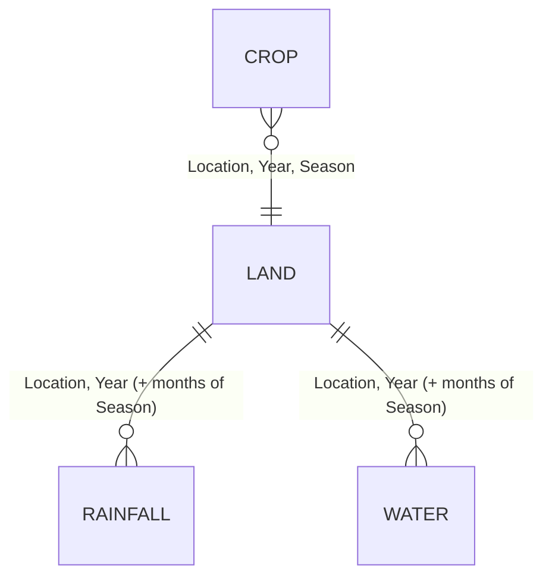

**Provenance column.** Every file has `data_source`:

* `"Project baseline dataset (2020-2023, course-provided)"` – rows 2020–2023. Original source not documented anywhere in the repository.
* `"Estimated (2024) - live download attempted from data.gov.in API (403), CGWB gwdata portal (maintenance mode), … Value = 2023 actual x ~1.061 growth factor"` (crop), `"… 2023 actual carried forward unchanged"` (land), `"… 2023 actual monthly rainfall/weather repeated verbatim"` (rainfall), `"… 2023 actual monthly water-availability figures repeated verbatim"` (water). **All 2024 rows are synthetic.** Because the pipeline defaults to the latest year, every request without an explicit `year` uses 2024. Since 2026-09-29 the API reports this via `data_year_estimated` (see [API_REFERENCE.md](#doc-api-reference)).

Missing values: **none** in any file. Duplicate rows: **none**.

### 2. `<district>_crop.csv` (23 columns)

| Column | Unit / type | Range (all rows) | Used? | Where |
|---|---|---|---|---|
| Location | text | 4 values | ✔ | filters |
| Year | int | 2020–2024 | ✔ | filters, year resolution |
| Season | Kharif/Rabi/Summer | | ✔ | filters |
| Crop_Name | text | 15 crops | ✔ | candidate names |
| Crop_Type | Cereal, Commercial, Fiber, Fodder, Fruit, Horticulture, Oilseed, Plantation, Root Crop, Spice | | ✔ | response only |
| Area_Sown_Ha | ha | 6,420 – 45,773 | ✘ | – |
| Area_Harvested_Ha | ha | 6,400 – 45,547 | ✘ | – |
| Production_Tonnes | t | 18,660 – 4,396,686 | ✘ | – |
| Yield_Kg_Ha | kg/ha | 1,500 (cotton) – 98,449 (sugarcane) | ✔ | objective f1 (yield); dashboard "estimated yield" |
| MSP_Rs_Qtl | ₹ per quintal | 650 – 8,600 | loaded, **not used** in any objective | – |
| Revenue_Rs_Lakh | ₹ lakh (district total) | 6,739 – 1,381,219 | ✔ | ranks candidate crops (top-N); dashboard crop split |
| Water_Req_mm | mm per season | 350 – 1,854 | ✔ | objective f3 (net of effective rain), f4 carbon term |
| Fertilizer_N_Kg_Ha | kg N/ha | 25 – 257.5 | ✔ | f2 cost, f4 leaching + carbon |
| Fertilizer_P_Kg_Ha | kg P₂O₅/ha (assumed basis) | 30 – 82.4 | ✔ | f2, f4 carbon |
| Fertilizer_K_Kg_Ha | kg K₂O/ha (assumed basis) | 30 – 164.8 | ✔ | f2, f4 carbon |
| Pesticide_Cost_Rs_Ha | ₹/ha | 800 – 3,914 | ✔ | f2 |
| Labor_Days_Ha | person-days/ha | 50 – 185.4 | ✔ | f2 (× ₹319/day) |
| Crop_Duration_Days | days | 90 – 365 | ✔ | response only |
| Sowing_Month, Harvest_Month | month name or "Any" | | ✔ | response only |
| Irrigation_Type | Drip, Drip+Flood, Flood, Rainfed, Sprinkler | | ✔ | response only |
| Rainfall_Dependency | Very Low / Low / Medium / High | | ✔ | per-crop fuzzy penalty factor 0.1/0.3/0.6/1.0; Comparison "market" radar axis |
| data_source | text | 2 values | ✔ | `is_estimated_year()` |

Crops per location/season/year (identical every year):

| | Kharif | Rabi | Summer |
|---|---|---|---|
| Coimbatore | Sugarcane, Maize, Groundnut, Cotton, Sorghum | Paddy, Wheat, Turmeric, Sunflower | Vegetables, Banana |
| Erode | Sugarcane, Turmeric, Maize, Cotton, Groundnut | Paddy, Banana, Sunflower | Vegetables, Coconut |
| Salem | Paddy, Maize, Tapioca, Groundnut, Cotton | Sugarcane, Banana, Sunflower | Vegetables, Mango |
| Pollachi | Coconut, Paddy, Banana, Sugarcane, Vegetables | Paddy, Groundnut, Turmeric | Maize, Fodder Crops |

Because at most 5 crops exist per slice, `DEFAULT_MAX_CANDIDATE_CROPS = 6` never truncates; every Summer problem has only **2** crops.

**Internal consistency (verified):** `Production_Tonnes = Area_Harvested_Ha × Yield_Kg_Ha / 1000` (max relative error 0.06 %); `Revenue_Rs_Lakh = Production_Tonnes × 10 × MSP_Rs_Qtl / 10⁵` (max 0.22 %); `Area_Harvested ≤ Area_Sown` in all rows.

**Temporal behaviour:** the median year-over-year yield ratio 2020→21, 21→22, 22→23 is exactly **1.00**; 2024 = 2023 × 1.03 for every crop (area also ×1.03, hence production ×1.061 as the provenance string says).

### 3. `<district>_land.csv` (22 columns)

| Column | Unit | Range | Used? | Where |
|---|---|---|---|---|
| Total_Land_Ha, Agricultural_Land_Ha, Irrigated_Land_Ha, Rainfed_Land_Ha, Fallow/Forest/Urban/Wasteland/Horticulture/Plantation_Ha | ha | 7,420 – 583,052 | Agricultural and Irrigated only | `GET /api/soil-profile` |
| Irrigation_Percent | % of agricultural land | 49.8 – 68.7 | ✔ | profile (display) |
| Agricultural_Percent | % of total land | 44.3 – 61.9 | ✘ | |
| Soil_Type | Red Sandy Loam (Coimbatore), Red Laterite (Erode), Red Loam (Salem), Black Cotton Soil (Pollachi) | | ✔ | display |
| Avg_Soil_pH | pH | 6.5 – 7.5 | ✔ | fertility index |
| Organic_Carbon_Percent | % | 0.53 – 0.75 | ✔ | fertility index |
| N_Status, P_Status, K_Status | Low/Medium/High | K never Low | ✔ | fertility index; dashboard fertiliser actions |

Consistency: `Irrigated + Rainfed = Agricultural` exactly; `Irrigation_Percent = Irrigated/Agricultural×100` within 0.06.
Temporal behaviour: pH rises by exactly **+0.1/year** and organic carbon by **+0.01/year** in every district; Rabi/Summer OC are Kharif −0.01/−0.02.

### 4. `<district>_rainfall.csv` (16 columns)

| Column | Unit | Range | Used? | Where |
|---|---|---|---|---|
| Month | name | 12 per year | ✔ | season filter |
| Season | meteorological season | | ✘ | |
| Monthly_Rainfall_mm | mm | 2.8 – 158.4 | ✔ | effective rainfall; weather fallback |
| Rainy_Days, Max_Daily_Rainfall_mm | days, mm | | ✘ | |
| Min_Temp_C, Max_Temp_C | °C | 17.8 – 41.0 | ✔ | profile; weather fallback |
| Humidity_Percent | % | 50 – 87 | ✔ | profile; weather fallback |
| Rainfall_Type | Light/Monsoon/Pre-monsoon | | ✘ | |
| Normal_Rainfall_mm | mm | 23.3 – 105 | ✘ (implicitly via Deviation_Percent) | |
| Deviation_from_Normal_mm | mm | −59.4 – 97.7 | ✘ | |
| Deviation_Percent | % | **−93.0 – +339.5** | ✔ | **fuzzy input `rainfall_dev`** (seasonal mean) |
| Annual_Normal_mm | mm | 650 (Erode) / 700 (Coimbatore) / 750 (Pollachi) / 800 (Salem) | ✘ | |

`Normal_Rainfall_mm` is **constant within each meteorological season** (e.g. Coimbatore: 37.5 mm for Jan and Feb, 23.3 for Mar–May, 95 for Jun–Sep, 58.3 for Oct–Dec – together exactly the 700 mm annual normal). Real monthly normals are not flat, so monthly deviations are exaggerated (Coimbatore May 2020 = +193.6 %). Consistency: `Deviation_from_Normal_mm = Monthly − Normal` exactly; `Deviation_Percent` matches within 0.05.

Annual observed totals vs stated normal: Coimbatore 619–639 mm (normal 700), Erode 566–579 (650), Salem 676–706 (800), **Pollachi 1,016–1,055 (750)**.

### 5. `<district>_water_availability.csv` (18 columns)

| Column | Unit | Range | Used? | Where |
|---|---|---|---|---|
| River_Inflow_MCM | million m³ | 4.2 – 152.4 | ✘ | |
| Reservoir_Storage_MCM, Reservoir_Capacity_MCM | million m³ | 109.5–272.3 / 248.6–320.4 | ✘ | |
| Storage_Percent | % of capacity | 35 – 85 | ✔ | **fuzzy input `water_storage`**; dashboard "irrigation" action (<40 %) |
| Groundwater_Level_mbgl | m below ground | 15 – 34 | ✘ | |
| Groundwater_Status | Very Low … Very High (7 labels) | | ✔ | profile (mode over months) |
| Canal_Release_MCM | million m³ | 4.4 – 64.4 | ✘ | |
| Irrigation_Water_MCM, Drinking_Water_MCM, Industrial_Water_MCM | million m³ | | Irrigation only | dashboard "water utilisation" numerator |
| Total_Demand_MCM | million m³ | 4.4 – 64.4 | ✔ | dashboard denominator |
| Deficit_Surplus_MCM | million m³ | **always 0.0** | ✔ (profile) | carries no information |
| Primary_Source | Bhavani River, Pillur/Mettur/Bhavanisagar/Aliyar Dam, … | | ✘ | |

Consistency: `Storage% = Storage/Capacity` within 0.014; `Total_Demand = Irrigation + Drinking + Industrial` exactly; `Total_Demand = Canal_Release` exactly.
Temporal behaviour: **`Storage_Percent` is identical for every year** at each location-month (all 48 location-months); `Groundwater_Level_mbgl` also never changes across years. Seasonal storage means therefore differ only by district and season, never by year.

### 6. Transformations applied by the code

| Step | Code | Formula / rule |
|---|---|---|
| Load | `loader._read_kind` | concatenate the 4 district files per kind; cached for process lifetime |
| Year resolution | `preprocessing._resolve_year` | `year=None` → latest year for that location in crop.csv (2024) |
| Soil fertility index (0–100) | `compute_soil_fertility_index` | `0.3·clamp(100−40·|pH−6.5|) + 0.3·clamp(100·OC/1.0) + 0.4·mean(status→{Low 30, Med 60, High 90})` |
| Seasonal rainfall | `get_region_season_profile` | mean over the season's months of Monthly_Rainfall_mm, Deviation_Percent, Humidity, Max/Min temp |
| Effective rainfall | same | `mean_monthly_rain × n_months × 0.7` (mm per season) |
| Water profile | same | mean Storage_Percent, mode Groundwater_Status, mean Deficit_Surplus |
| Candidate crops | same | crop rows for (loc, year, season) sorted by Revenue_Rs_Lakh desc, top `max(N, 2)` |
| Display normalisation | `normalized_snapshot` | min–max against fixed ranges pH 4–9, OC 0–1.5 %, rain 0–150 mm, deviation −50…+50 %, storage 0–100 %. **Not used by the optimiser** |

Validation performed at load time: file existence only. There is no schema validation, range checking or type enforcement (see TODO T-6).

### 7. The stale `datasets/` folder

Same 16 file names, older content: no `data_source`/`Annual_Normal_mm` columns, no 2024 rows, and different rainfall normals (e.g. Coimbatore January `Normal_Rainfall_mm` 7.5 vs 37.5, deviation +9.3 % vs −78.1 %). The team's saved runs in `results/` and the numbers in `agrooptimize-backend/docs/results/*.md` and `docs/api_docs.md` (e.g. Coimbatore Kharif 2023 storage 94.7 %, yield confidence 0.775) come from an older dataset version; the current data gives storage 85.0 % and yield confidence 0.620 for the same slice.

### 8. Confidence, weaknesses and official replacements

| Dataset | Confidence | Main weaknesses | Candidate official source (verify current availability) |
|---|---|---|---|
| Crop | Low–medium | Origin undocumented; yields flat over 4 years; 2024 synthetic; "MSP" given for crops with no notified MSP (banana, coconut per quintal, mango, tapioca, vegetables, turmeric); wheat listed for Tamil Nadu Rabi; sugarcane listed under Kharif with January sowing | District-wise Area-Production-Yield from the Directorate of Economics & Statistics (Ministry of Agriculture) via data.gov.in / DES portal; MSP from CACP / PIB notifications; costs from the DES *Cost of Cultivation of Principal Crops* scheme; crop water requirement from FAO-56 or TNAU crop production guides |
| Land & soil | Low | Perfectly linear pH/OC trends; one soil type per district | Soil Health Card portal (soilhealth.dac.gov.in); DES Land Use Statistics |
| Rainfall | Medium-low | Season-flat normals inflate monthly deviations; 2024 repeated | IMD district-wise monthly rainfall and normals (IMD Customized Rainfall Information System) |
| Water | Low | Storage identical every year; Deficit_Surplus always 0; groundwater level constant | CWC reservoir bulletins / India-WRIS (reservoir storage); CGWB groundwater-level data via India-WRIS |

Recommended actions are in [DATA_VALIDATION.md](#doc-data-validation) §5 and [TODO.md](#doc-todo).

<a id="doc-data-validation"></a>

## Data Validation Review

Scope: the 16 files in `agrooptimize-backend/data/raw/`. Method: every check below was executed with pandas against the files on 2026-09-29; numbers are measured, not estimated. Column-level reference: [DATASETS.md](#doc-datasets).

### 1. Summary verdict

The files are **internally consistent** (derived columns match their formulas to <0.25 %) and **clean** (no missing values, no duplicates). But the time series show strong signatures of **synthetic construction**, the latest year is **explicitly estimated**, and the provenance of the 2020–2023 "course-provided" baseline is undocumented. For a system whose selling point is *uncertainty modelling*, the inputs carry almost no real year-to-year variation – so the fuzzy layer cannot demonstrate responding to real variability.

| ID | Finding | Severity | Affects |
|---|---|---|---|
| D1 | All 2024 rows are synthetic and 2024 is the default year | **High** | Every default request, dashboard trend |
| D2 | Reservoir storage identical in every year; groundwater level constant; Deficit_Surplus always 0 | **High** | Fuzzy water input is year-invariant |
| D3 | Crop yields flat 2020–2023; linear pH/OC trends | High | Research validity |
| D4 | Rainfall normals flat within met-seasons → extreme monthly deviations | High | Fuzzy rainfall input |
| D5 | Seasonal deviation computed as mean of monthly percentages | Medium | Fuzzy outputs shift up to 0.21 |
| D6 | Rabi uses Jan–Mar of the same calendar year; Rabi/Summer overlap | Medium | Seasonal aggregation |
| D7 | Pollachi rainfall ~40 % above its own stated normal every year | Medium | Plausibility |
| D8 | "MSP" for crops without a notified MSP; some values need checking | Medium | Unused today, matters if revenue is ever optimised |
| D9 | Agronomic oddities (wheat in TN Rabi, sugarcane as Kharif with January sowing, "Any" months) | Low | Credibility in viva |
| D10 | Provenance of the baseline undocumented; paper says "government" data | **High (integrity)** | Report / paper claims |
| D11 | Duplicate, divergent `datasets/` folder | Low | Confusion |
| D12 | Saved results & results write-ups come from an older dataset | Medium | Reproducibility of reported numbers |

### 2. Checks that pass

| Check | Result |
|---|---|
| Missing values (all 4 kinds) | 0 |
| Exact duplicate rows | 0 |
| `Production = Area_Harvested × Yield / 1000` | max rel. error 0.06 % |
| `Revenue(lakh) = Production × 10 × MSP / 10⁵` | max rel. error 0.22 % |
| `Area_Harvested ≤ Area_Sown` | 205/205 rows |
| `Irrigated + Rainfed = Agricultural` | exact |
| `Irrigation_Percent = Irrigated / Agricultural` | within 0.06 pp |
| `Deviation_mm = Monthly − Normal` | exact |
| `Storage% = Storage / Capacity` | within 0.014 pp |
| `Total_Demand = Irrigation + Drinking + Industrial` | exact |
| 12 months per location-year | yes |
| Every (location, season, year) has ≥2 crops | yes (Summer has exactly 2) |

### 3. Findings in detail

#### D1 – Synthetic 2024 is the default
`data_source` for every 2024 row states the value was produced from 2023 (crop: ×1.03 yield and area; land: copied; rainfall and water: "repeated verbatim"). `preprocessing._resolve_year(year=None)` returns the latest year, 2024. Consequences:
* Every dashboard/analytics/comparison request and every farm-plan request without `year` runs on estimated inputs.
* `GET /api/dashboard/*` reports `yield_trend = "+3.0%"` for **every district** – that is the estimation factor, not an observed trend.
* Fuzzy outputs for 2024 are identical to 2023 (same rainfall/water inputs).

Mitigation implemented: `data_year_estimated` flag in region-profile, farm-plans and dashboard responses, plus a warning banner on the dashboard and a note in the Run Optimization result and downloaded report. **Decision for the team (TODO T-1):** either default to the latest *observed* year or remove the 2024 rows.

#### D2 – Year-invariant water data
For all 48 location-months, `Storage_Percent` has one value across 2020–2024; `Groundwater_Level_mbgl` likewise. Season means per district (identical every year):

| | Kharif | Rabi | Summer |
|---|---|---|---|
| Coimbatore | 85.0 | 69.7 | 61.5 |
| Erode | 78.0 | 62.5 | 53.8 |
| Salem | 62.0 | 45.8 | 38.3 |
| Pollachi | 72.0 | 57.5 | 48.8 |

`Deficit_Surplus_MCM` is 0.0 in all 240 rows, and `Total_Demand_MCM == Canal_Release_MCM` exactly – i.e. demand was generated to equal supply.

#### D3 – Flat or linear series
Median year-over-year yield ratio is exactly 1.00 for 2020→21, 21→22, 22→23. Soil pH increases by exactly 0.1 per year and organic carbon by 0.01 per year in all four districts. Real district statistics do not behave this way. The median coefficient of variation of monthly rainfall across 2020–2023 is 0.09 – very low for Tamil Nadu monsoon rainfall.

#### D4 – Flat rainfall normals
`Normal_Rainfall_mm` is one value per meteorological season, e.g. Coimbatore Jun–Sep = 95 mm each month. Summing gives exactly the stated `Annual_Normal_mm`. Real monthly normals vary within a season, so monthly `Deviation_Percent` ranges from −93 % to +339.5 %. The fuzzy input universe is clipped to ±60 %, so Pollachi Summer (+105 % to +121 %) is saturated at +60.

Structural effect: every Kharif season of Coimbatore and Erode shows a ~−40 % "deficit" in every year, and every Summer a surplus – the classification reflects how the normals were built, not weather.

#### D5 – Averaging percentages
`avg_deviation_percent = mean(monthly Deviation_Percent)`. The hydrologically standard seasonal deviation is `(Σ actual − Σ normal) / Σ normal`. Re-running the fuzzy engine for all 60 location-season-years with the total-based deviation changes:

| Metric | Max absolute change |
|---|---|
| yield_confidence | 0.059 |
| irrigation_risk | **0.213** (Erode Summer 2020: 0.152 → 0.365) |

Examples: Coimbatore Rabi 2023 is −11.1 % by the current method but +1.8 % by totals; Salem Summer 2023 +12.3 % vs −3.1 % (label flips surplus→normal). Kharif is unaffected because its four normals are equal. Not changed in code because it alters every result; recommended fix in TODO T-3.

#### D6 – Season windows
Rabi (Oct–Mar) takes January–March from the **same** calendar year as October–December, so "Rabi 2023" mixes early-2023 and late-2023 weather rather than one contiguous season (Oct 2023–Mar 2024). February and March are counted in both Rabi and Summer.

#### D7 – Pollachi rainfall vs normal
Observed annual totals 1,016–1,055 mm against a stated annual normal of 750 mm (+35–41 % every year), while the other three districts are consistently 5–15 % *below* their normals. Either the normal or the observations are mis-specified.

#### D8 – Price column
`MSP_Rs_Qtl` is filled for banana, coconut, mango, tapioca, vegetables, turmeric and fodder, for which the Government of India does not notify an MSP (coconut is supported as *copra*, not per quintal of nuts). For notified crops some values match published MSPs for the stated marketing year and others appear to be from different years (e.g. maize 2023 = ₹1,962, sunflower 2023 = ₹6,015). These should be checked against the CACP / PIB MSP notifications before any revenue objective is introduced. **Currently the column is loaded but not used by any objective.**

#### D9 – Agronomic plausibility
* Wheat is listed in Coimbatore Rabi; wheat is a very minor crop in Tamil Nadu.
* Sugarcane appears under Kharif (Coimbatore, Erode, Pollachi) and Rabi (Salem) with January sowing and 365-day duration – a 12-month crop cannot be a seasonal option alongside 100-day crops without land-occupancy constraints.
* Banana, coconut, mango: perennial crops treated as seasonal land allocations.
* Sowing/Harvest "Any".

#### D10 – Provenance
Rows 2020–2023 say "course-provided". The team's own `docs/dataset_description.md` flags that the origin "was not independently verified" and warns against claiming data.gov.in/CGWB/TNAU sources. The reference paper's abstract states the system "makes use of agricultural databases given by the government", and `docs/literature_survey.md` claims validation on "real … Tamil Nadu district-level data". Findings D2–D4 are hard to reconcile with real statistics. **This is the single most important item to settle before the viva** (TODO T-2).

#### D11 – Divergent duplicate
`final_year_project/datasets/` differs from `data/raw/` in schema, row count and rainfall normals. Nothing loads it.

#### D12 – Non-reproducible reported results
All 8 JSON runs in `results/` and the tables in `agrooptimize-backend/docs/results/*.md` / `docs/api_docs.md` report e.g. Coimbatore Kharif 2023 storage 94.7 %, yield confidence 0.775. The current data yields 85.0 % and 0.620. Those write-ups must be regenerated from the current code and data.

### 4. What is actually validated at runtime

Only file existence (`loader._read_kind`) and the presence of rows for the requested slice (`get_region_season_profile` raises `ValueError` → HTTP 400). There is no schema, type or range validation.

### 5. Recommended actions (ordered)

1. Decide and document the provenance of the 2020–2023 data (D10).
2. Make the default year the latest observed year, or drop 2024 (D1).
3. Replace water and rainfall with official series (IMD monthly rainfall and normals; CWC/India-WRIS reservoir storage; CGWB groundwater) – this is what gives the fuzzy layer genuine variability (D2, D4).
4. Compute seasonal deviation from totals and make Rabi span Oct(Y)–Mar(Y+1) (D5, D6).
5. Add a schema/range validation step (pandera or explicit asserts) at load time.
6. Delete or clearly archive `datasets/` (D11) and regenerate the results write-ups (D12).

<a id="doc-district-intelligence"></a>

## District Intelligence Center

A single page that profiles a district before any optimisation is run: overview, data coverage, climate, soil, water, crop history, crop suitability, historical prices, generated insights and an executive summary. Backend: `app/services/district_service.py`. Frontend: `frontend/src/views/DistrictIntelligenceView.jsx` and `frontend/src/components/district/DistrictSections.jsx`.

### 1. Where district information lived before

| Information | Previously exposed by | Reused here |
|---|---|---|
| Soil fertility index | `preprocessing.compute_soil_fertility_index` (dashboard, profiles) | yes |
| Season profiles (rainfall deviation, storage, candidate crops) | `preprocessing.get_region_season_profile` | yes (suitability) |
| Fuzzy assessment / sets | `fuzzy.engine` | yes (`evaluate_uncertainty`, `input_memberships`, crop confidence) |
| Per-crop yield, cost, irrigation, impact | `FarmPlanProblem` objective function | yes – evaluated for one-crop, one-hectare plans |
| Min–max goodness | `ranking.topsis_scores` | yes (resource efficiency) |
| Observed vs estimated rows | `explanation_service._observed` | moved to `preprocessing.observed_rows`, shared |
| Statement format with evidence | `explanation_service._item` | made public as `make_item`, shared |
| Dashboard KPIs, weather, soil snapshot | `dashboard_service` | not duplicated; the dashboard stays the "today" view, this page is the historical profile |
| District names, coordinates, season months | `config` | yes |

### 2. Architecture and flow

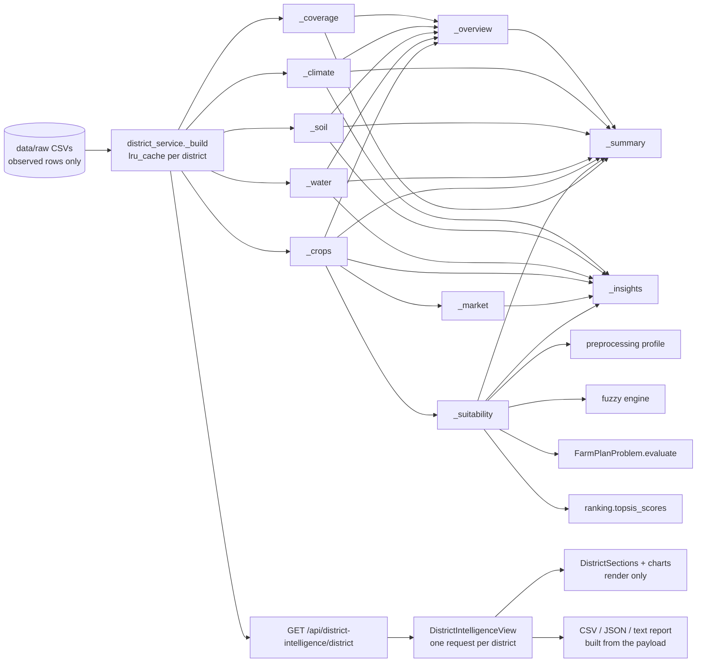

* One aggregate endpoint instead of many small ones: the page needs everything at once, and the payload is ≈55 KB.
* The payload is a pure function of the CSVs → `lru_cache(maxsize=8)`; cold build 30–120 ms, cached ≈1 µs.
* Filtering (season, crop, year, metric) happens in the browser over the returned records; no extra requests.

### 3. Data rules
* **Observed rows only** feed every statistic and trend. Rows whose `data_source` starts with "Estimated" (2024) appear only in `coverage.estimated_years`, and the summary says they were excluded.
* **No estimates.** Fields the dataset lacks are `null` with a note (e.g. `agricultural_zone`), shown as "Data not available". Whole sections return `{"available": false, "note": "Data not available"}` when their rows are missing.
* **Data artefacts are stated, not hidden**: identical reservoir storage every year, constant groundwater depth with a varying status label, and deficit/surplus always 0.

### 4. Sections: content and sources

| Section | Content | Source |
|---|---|---|
| Overview | agricultural area, total area, irrigated %, soil types, mean annual rainfall vs stated normal, mean temperature and humidity, primary irrigation sources (share of monthly records), major crops (mean sown area), seasons and years, last dataset update (CSV modification date) | land, rainfall, water, crop CSVs; file metadata |
| Coverage | observed and estimated years, rows per file, monthly completeness, provenance strings | all CSVs |
| Climate | annual totals vs normals, monthly series, meteorological-season shares, agricultural-season totals, trends (rainfall, temperature, humidity, rainy days) | rainfall CSV |
| Soil | per-season records with fertility index, latest values and fuzzy soil set, trends, N/P/K characteristics, limitations (Low nutrient, OC < 1 %), crop categories grown | land CSV, fertility index, fuzzy sets |
| Water | yearly demand/inflow/storage/groundwater, storage by month and by season (with fuzzy water set and the 40 % action threshold), groundwater status distribution, irrigation dependency, stress indicators, glossary | water and land CSVs, fuzzy sets |
| Crop history | every observed record (area, share of season area, production, yield, price, revenue) and per crop-season trends | crop CSV |
| Suitability | ranked crops per season and overall (§5) | profile, fuzzy, optimiser objectives, crop CSV |
| Market | price by year, mean, trend, strongest/weakest growth; flagged historical, not live, unvalidated | crop CSV `MSP_Rs_Qtl` |
| Insights | generated statements with evidence (§6) | all of the above |
| Summary | 4–6 sentences assembled from the computed facts | all of the above |

### 5. Calculations

| Quantity | Formula |
|---|---|
| Trend | first vs last observed value: change % = (last − first)/|first| × 100; least-squares slope per year; CV = sample SD ÷ mean |
| Direction | `unchanged` if all values equal; `stable` if |change| < 5 %; otherwise increasing / decreasing |
| Variability | CV < 0.10 low, < 0.25 moderate, otherwise high |
| Annual rainfall / normal | Σ monthly rainfall / Σ monthly normal for the year; deviation % |
| Season share | Σ rainfall in a meteorological season ÷ Σ all rainfall (observed years) |
| Mean temperature | mean of (max + min)/2 over observed months |
| Irrigated % | Σ irrigated ha ÷ Σ agricultural ha (season records of a year) |
| Irrigation share of demand | Σ irrigation MCM ÷ Σ total demand MCM per year |
| Area share | crop sown area ÷ season's total sown area, per year |
| Storage fuzzy set | `fuzzy.input_memberships` on the seasonal mean storage |

#### Crop suitability score
For each season, the latest observed year's profile is built (all crops), the fuzzy assessment is computed, and `FarmPlanProblem.evaluate` is called with one row per crop: the whole hectare on that crop, irrigation and fertiliser multipliers at 1.0. This returns the optimiser's own per-hectare yield (fuzzy-adjusted), cost, irrigation and impact. Five components (0–1), equal weights, score = mean × 100:

| Component | Definition |
|---|---|
| Climate & soil | fuzzy crop confidence for the season |
| Rainfall fit | min(1, effective rainfall ÷ crop water requirement) |
| Prominence | crop's mean share of the season's sown area ÷ the largest such share in the season |
| Yield stability | 1 − min(1, CV of observed yields) |
| Resource efficiency | mean min–max goodness of cost, irrigation and impact per hectare among the season's crops (`ranking.topsis_scores`) |

Tonnage is displayed but not scored: tonnes of sugarcane and of sunflower are not comparable. Equal weights are deliberate (no outcome data to calibrate against). With only two crops in Summer, min–max goodness is 0 or 1 for each; that is stated in the method text.

#### Thresholds (constants in `district_service.py`)
`STABLE_CHANGE_PCT 5`, `LOW_CV 0.10`, `HIGH_CV 0.25`, `MAJOR_CROPS 5`, `LOW_STORAGE_PCT 40` (same as the dashboard's irrigation action), `CONCENTRATED_SHARE_PCT 50`.

### 6. Insights generated
Annual rainfall trend; rainfall against the stated normal; seasonal composition; temperature trend; fastest and slowest production growth with an area-vs-yield attribution; yield consistency (lowest/highest CV); "yields flat" when every series is stable; cropping pattern per season (largest share, concentrated vs diversified); irrigation-dependency trend; static reservoir records; static groundwater depth; soil fertility trend; largest historical price rise (flagged unvalidated); highest suitability score. Each insight is `{id, title, detail, source, evidence}`.

### 7. API

`GET /api/district-intelligence/{district}` – case-insensitive; 404 for unknown districts. Response model `DistrictIntelligenceOut` (`app/schemas.py`): `district, overview, coverage, climate, soil, water, crops, suitability, market, insights[], summary{sentences[], text}`. Abbreviated example (Salem):

```json
{"district": "Salem",
 "overview": {"agricultural_area_ha": 148513.0, "irrigated_pct": 57.9, "soil_types": ["Red Loam"],
              "average_annual_rainfall_mm": 692.7, "stated_annual_normal_mm": 800.0, "average_temperature_c": 29.0,
              "agricultural_zone": null, "agricultural_zone_note": "The dataset has no agro-climatic zone field.",
              "last_dataset_update": "2026-09-18"},
 "coverage": {"observed_years": [2020, 2021, 2022, 2023], "estimated_years": [2024]},
 "suitability": {"year_basis": 2023, "rankings": [{"rank": 1, "crop": "Sunflower", "season": "Rabi", "score": 73.4,
   "components": {"climate_soil": 0.531, "rainfall_fit": 0.594, "prominence": 0.543, "yield_stability": 1.0, "resource_efficiency": 1.0},
   "expected_yield_t_ha": 1.33, "cost_rs_ha": 28580.0, "water_req_mm": 350.0}]},
 "summary": {"text": "Salem grows 10 crops across 3 seasons; ..."}}
```

### 8. Frontend

| Piece | Role |
|---|---|
| `views/DistrictIntelligenceView.jsx` | district selector, loading skeleton, error state, summary, quick actions, compare panel, sections |
| `components/district/DistrictSections.jsx` | `OverviewSection`, `ClimateSection`, `SoilSection`, `WaterSection`, `CropPerformanceSection` (season/crop/year/metric filters), `SuitabilitySection`, `MarketSection`, `InsightsSection`, `StatTile` |
| `components/charts/LineChart.jsx`, `BarChart.jsx`, `ChartCard.jsx`, `chartTheme.js` | reusable charts: emphasis colouring, hover tooltips, reference lines, minimum y-span, chart/table toggle |
| `utils/districtView.js` | selection and formatting only: filters, series, distribution bars, CSV, text report, compare rows |
| `App.jsx` | nav item "District Intelligence" (after Run Optimization); `navigateTo(view, params)` lets Run Optimization open with the district preselected |

Chart design: the selected series is in the accent green `#1f6b3a`, others in gray `#8f998e` (validated: CVD ΔE 18.8, normal ΔE 22.1; gray contrast 2.95:1, hence the table view on every chart). One y-axis per chart. `minSpan` keeps near-constant series (temperature, fertility index, prices) from looking volatile.

Quick actions: Run optimization (preselects this district), Compare district (side-by-side table of nine indicators, loaded on demand), Generate report (text file from the payload), View analytics, Export data (crop records CSV), Export all (JSON).

### 9. Tests
* Backend `tests/test_district.py` (96, parametrised over the four districts): trend helper, structure and serialisation, nulls with notes, values checked against independent pandas calculations on the CSVs (annual rainfall, temperature, season shares, crop records, area shares, water demand, sources, storage flag), fertility formula reuse, suitability (contiguous ranks, score = mean of components, per-hectare cost/irrigation/yield recomputed directly from the CSV row and config prices), market trend, missing water/soil data, caching, endpoint.
* Frontend (Vitest, 31): charts, filters and series helpers, exports, compare rows, every section rendered against a real Salem payload, and "Data not available" for missing sections.

### 10. Limitations
* Four observed years (2020–2023): trends are descriptive first-to-last changes, not statistically significant trends.
* The dataset lacks an agro-climatic zone, live prices, and soil-to-crop suitability tables; these are reported as unavailable.
* Water storage and groundwater depth do not vary between years in the data; the page says so.
* Prices are the dataset's unvalidated MSP column.
* Suitability weights are equal by design; Summer has only two crops.

### 11. Future improvements
1. Replace rainfall/water with IMD and CWC/India-WRIS series to obtain real inter-annual variation.
2. Add an agro-climatic zone and soil-to-crop suitability reference table (e.g. from TNAU) as a separate, cited dataset.
3. Live market prices (e.g. from a mandi price feed) clearly separated from historical values.
4. Map view of the four locations using `DISTRICT_COORDINATES`.
5. Use the shared chart components on Analytics and Comparison to retire their inline SVG.
6. Server-side PDF district report.

<a id="doc-scenario-simulation"></a>

## Scenario Simulation & Decision Impact Analysis

Lets a user change farming conditions and see how the optimised recommendation responds, and why. Every simulation runs the real pipeline (preprocessing → fuzzy → NSGA-II → TOPSIS → explanation engine) for both the original and the modified conditions; nothing is approximated, cached or hard-coded. Backend: `app/services/simulation_service.py`. Frontend: `frontend/src/views/SimulationView.jsx`, `frontend/src/components/simulation/SimulationSections.jsx`.

### 1. Where scenario inputs enter the pipeline

The pipeline was reverse-engineered stage by stage; each control is applied at the single point where the corresponding quantity is used, through default-neutral hooks (defaults reproduce every existing result exactly — verified on 48 stored outputs).

| Control | Values | Enters at | Hook |
|---|---|---|---|
| Rainfall | −30 … +30 % in 10 % steps | Stage 1: monthly rainfall scaled before the season is aggregated; each month's deviation recomputed against the dataset's own normal (the CSV's `Deviation_Percent` follows the same formula, max difference 0.05). Changes both the fuzzy rainfall input and the effective rainfall in the water objective | `get_region_season_profile(rainfall_factor=)` |
| Water availability | Current, Very low … Very high | Stage 2: fuzzy water-storage input (seasonal storage %) | `get_region_season_profile(storage_override_pct=)` |
| Fertiliser cost | −20 … +30 % | Stage 3: N/P/K prices in the cost objective | `FarmPlanProblem(fertilizer_price_factor=)` |
| Land, budget | any | Stage 3: hectares allocated; budget constraint | existing request fields |
| Preference / priority sliders | named preference or four 0–100 sliders | Stage 7: TOPSIS weights (sliders scaled to sum to 1). NSGA-II is Pareto-based and has no weights | `rank_plans(weights=)` |
| Market price | Decrease / Stable / Increase | Indicative revenue and profit only. Price is not an optimiser objective, so on its own it cannot change the plan | `ExplanationContext.price_factor` |

`plan_service.run_pipeline(request, adjustments, track_history, seed)` runs stages 1–7 with a `PipelineAdjustments` value; `generate_farm_plans` now calls it, so Run Optimization and the simulator share one code path.

#### Value definitions
* **Water levels → storage %** placed in distinct regions of the fuzzy model's own water-storage sets (low [0,0,35], medium [20,50,75], high [60,100,100]): Very low 10 (only *low*), Low 25 (overlap, *low* dominant), Medium 50 (peak of *medium*), High 70 (overlap, *high* dominant), Very high 90 (only *high*). A test checks each level's dominant set.
* **Market step** = the largest one-year change in the district's price column over observed years (Salem 11.4 %, Coimbatore 12.9 %, Erode and Pollachi 11.4 %). The data contains no year-on-year price decline, so *Decrease* is labelled a stress test.

### 2. Why each side runs five times

NSGA-II is stochastic. With identical inputs and different seeds, the recommended plan differs markedly — for Salem Kharif, 5 ha, balanced, the top plan's yield ranged from 50.2 to 69.8 t and Tapioca's share from 65 % to 100 % across seeds 42, 1, 2, 3, 4. Comparing one baseline run with one scenario run would attribute that search variation to the scenario.

Each side is therefore optimised with the same seeds `ENSEMBLE_SEEDS = (42, 1, 2, 3, 4)` (common random numbers), and every change is judged with a **paired t-test** over the five pairs:

| Verdict | Rule |
|---|---|
| improved / worsened | p < 0.05 and |change of means| ≥ 1 % (direction by objective) |
| unchanged | every pair identical, or |change| < 1 % |
| within search variation | moved, but p ≥ 0.05 — not attributed to the scenario |

The displayed recommendation of each side is the **first seed's run** (seed 42, the one Run Optimization uses, with convergence history tracked), so the original recommendation, its explanation and its confidence are exactly what Run Optimization shows for the same inputs (tested).

### 3. Flow

```mermaid
flowchart LR
    UI[SimulationView form] -->|POST /api/simulations/run| R[resolve: validate,<br/>map controls]
    R --> B[baseline: run_pipeline × 5 seeds]
    R --> S[scenario: run_pipeline × 5 seeds<br/>with PipelineAdjustments]
    B & S --> SIDE[_side: explanation of seed-42 run,<br/>per-run metrics, single-crop metrics]
    SIDE --> A[analysis: conditions · comparison · impact (paired) ·<br/>crop effects · fuzzy changes · optimisation difference ·<br/>constraints · historical · statements · trade-offs · summary]
    A --> T[token kept in memory, 32 newest]
    A --> UI2[sections + charts render the payload]
    T -->|POST /api/simulations| SV[results/simulations/sim_*.json]
```

### 4. Result sections

| Section | Content | Computed from |
|---|---|---|
| Conditions | every condition, original vs scenario, where it enters the pipeline | request, both region profiles |
| Recommendation comparison | both recommended crop plans, TOPSIS closeness, recommendation strength, confidence and its components; per-crop mean shares over the runs with p-values | seed-42 runs, explanation engine, paired tests |
| Impact summary | yield, cost, water, environmental impact (totals, or per hectare when land differs), indicative profit, confidence: means, seed ranges, recommended-plan values, change %, p, verdict; baseline run-to-run spread | per-run top plans; `explanation_service.indicative_economics` |
| Decision impact | generated statements (§5) | all sections |
| Trade-offs | improved / worsened / unchanged / within variation; constraints whose status became harder (explanation-engine constraint statuses, budget use ≥ 95 %, infeasibility) | impact, explanation constraints |
| Optimization difference | Pareto sizes and per-hectare ranges, TOPSIS weights and dominant objective, whether the front is identical, weight × goodness contributions, both plans on a common 0–1 scale (min–max over the union of both fronts, the TOPSIS normalisation), fuzzy inputs/outputs, rules whose firing changed by ≥ 0.05 | fronts, `ranking.topsis_scores`, `fuzzy.fired_rules` |
| Condition vs re-optimisation | each seed's baseline plan re-evaluated with the scenario's objective function: *same plan, new conditions* (deterministic) vs *re-optimising* (paired test) | `FarmPlanProblem.evaluate` |
| Crop suitability changes | per crop, grown alone at baseline inputs per hectare (no search): fuzzy confidence, yield, cost, irrigation, impact under each side's conditions; mean land share | `FarmPlanProblem.single_crop_metrics` |
| Historical comparison | recommended crops vs the district's observed cropping pattern and yields; alignment = Σ min(plan share, historical share) with historical shares rescaled over the candidate crops | `district_service` trends (observed years) |
| Scenario summary | 3–7 sentences from the computed facts | all sections |

An infeasible scenario (e.g. budget below the cheapest possible plan) returns `scenario.available = false` with the reason and the cheapest possible plan's cost (all land in the cheapest crop at the lowest fertiliser level — cost is linear in the allocation, so this is the true minimum). An infeasible baseline is a 422.

### 5. Generated statements
Rainfall (effective rainfall, deviation, fuzzy set, the crop whose irrigation need changed most); water availability (storage, fuzzy set, irrigation risk); crop suitability (most and least affected fuzzy confidence, with rainfall dependency); fertiliser (cost change per hectare by crop); priorities (dominant TOPSIS weight); market (profit only); land shifts — only for shifts that are ≥ 5 pp **and** p < 0.05, prefixed "With only X changed" when exactly one condition changed, with the crop's own per-hectare changes and how it compared with the crop that lost land; "within search variation" for large but unreliable shifts; no reliable change in the crop mix; carry-over of the baseline plan. Format `{id, title, detail, source, evidence}` (`explanation_service.make_item`).

### 6. Example (Salem, Kharif, 5 ha, balanced; rainfall −20 %, water Low, priorities 30/20/40/10)
4.1 s for 10 optimisations. Original Tapioca 91 % / Maize 3 % / Groundnut 5 % → simulated Tapioca 42 % / Maize 54 % / Groundnut 4 % (shift consistent for Tapioca and Maize). Means of 5 runs: yield −57.2 % (p 0.0004), cost −12.2 % (p 0.0003), irrigation water −17.9 % (p 0.006), environmental impact +15.5 % (p 0.0009), indicative profit −55.7 %; confidence 73.6 % → 68.4 %. Without the priority change (rainfall −20 % and water Low only) the same comparison gave cost −6.6 % (p 0.11) and irrigation water −6.7 % (p 0.47) — within search variation — while the yield (−48.0 %) and profit changes were reliable.

### 7. API

| Method | Path | Purpose |
|---|---|---|
| POST | `/api/simulations/run` | run a simulation (`SimulationRequest` → `SimulationOut` + `token`); 422 on invalid input |
| POST | `/api/simulations` | save a result of this session by `token` (`SimulationSaveIn`) → 201 summary; 404 if expired or another browser's |
| GET | `/api/simulations?client_id=` | this browser's saved simulations, newest first |
| GET | `/api/simulations/{id}?client_id=` | full saved record (inputs + result) |
| DELETE | `/api/simulations/{id}?client_id=` | delete one |

Request:
```json
{"base": {"location": "Salem", "season": "Kharif", "year": null, "total_land_ha": 5, "budget_rs": null, "preference": "balanced"},
 "scenario": {"rainfall_change_pct": -20, "water_availability": "low", "fertilizer_cost_change_pct": 0, "market_price": "stable",
              "total_land_ha": null, "budget_rs": null, "preference": null,
              "priorities": {"yield": 30, "cost": 20, "water": 40, "env": 10}},
 "client_id": "…"}
```
Validation: rainfall ∈ {−30,−20,−10,0,10,20,30}; fertiliser ∈ {−20,−10,0,10,20,30}; water ∈ {current, very_low, low, medium, high, very_high}; market ∈ {decrease, stable, increase}; priorities 0–100, not all zero; land 0–100 000 ha. Saving uses a server-held token, so a stored result is exactly what was computed (the client cannot submit its own numbers). Saved ids are timestamped with a random suffix and scoped to the browser's `client_id`, like saved runs.

### 8. Frontend

| Piece | Role |
|---|---|
| `views/SimulationView.jsx` | form (original conditions + scenario controls + priority sliders), saved scenarios (open / delete), run, save with a name, export report (HTML) and JSON |
| `components/simulation/SimulationSections.jsx` | `RecommendationSection`, `ImpactSection`, `DecisionImpactSection`, `TradeOffSection`, `OptimizationSection`, `CropEffectsSection`, `HistoricalSection`, `ConditionsSection`, `VerdictBadge` |
| `components/charts/GroupedBarChart.jsx` | two series per category with min–max whiskers (crop plan, confidence components, objective contributions, indexed objective comparison) |
| `components/charts/DeltaBarChart.jsx` | % change around zero, value and verdict written next to each bar |
| `components/charts/RadarChart.jsx` | both plans on the common objective scale |
| `utils/simulationView.js` | request building, reopening, formatting, chart data selection (no outcome is computed) |
| `utils/simulationReport.jsx` | self-contained HTML report with the charts rendered to static SVG; loaded on demand so `react-dom/server` stays out of the main bundle |

Charts reuse the validated accent/gray pair (simulated = accent green, original = gray; CVD ΔE 18.8). Both series are always named in a legend, verdicts carry text and an icon, and every chart has a table view. Yield, cost, water and impact have different units, so they share one chart **indexed to the original mean = 100**; absolute values are in the impact cards and the table view. Bar charts keep a 480 px minimum width and scroll inside their card on phones.

### 9. Tests
* Backend `tests/test_simulation.py` (61): hooks neutral by default and exact when used (rainfall and deviation recomputed from the CSV, storage, fertiliser cost recomputed from CSV rows and config prices, single-crop metrics, explicit weights = preference weights); `run_pipeline` = a normal run; water levels in their fuzzy sets; market step recomputed; parameter validation; paired comparison (identical, constant shift, noisy, missing runs; p-value equals `scipy.stats.ttest_rel`); end-to-end scenarios — unchanged (no change reported, same plan as Run Optimization, same confidence), drought (inputs reach the pipeline, crop water needs from the CSV, impact = paired means, seed runs reproduce independently, decomposition re-evaluation), market (profit only), priorities (identical front, weights), infeasible budget (cheapest plan recomputed from the CSV), land change (per-hectare basis); historical alignment recomputed; statements only attribute reliable shifts; trade-offs follow verdicts; explanation weights and price factor; persistence (scoping, path safety, delete); pending-result bound; all endpoints.
* Frontend (Vitest, 24 new): request building and reopening, formatting, selection helpers, the three chart components, every section against real payloads (drought and infeasible), the exported report, the empty page.

### 10. Limitations
* Five seeds per side is a compromise between rigour and response time (~4 s); small effects can be reported as "within search variation" that more runs might resolve.
* Market price changes cannot alter the plan because price is not an objective; prices are the dataset's unvalidated MSP column.
* Water availability acts only through the fuzzy model (the optimiser has no water-availability constraint); irrigation water itself is driven by crop requirements and effective rainfall.
* Rainfall scaling is uniform across the season's months; temperature, humidity and soil stay at the dataset values.
* The default data year is 2024, which is estimated; the page says so.
* Unsaved results are kept in process memory (32 newest) for saving; they are lost on restart.

### 11. Future improvements
1. Adaptive run count (add seeds until the confidence interval of the headline change is narrow enough).
2. Optional water-availability constraint in `FarmPlanProblem` so scarce water can bind the plan directly.
3. Month-level rainfall patterns (e.g. delayed onset) rather than a uniform factor.
4. Profit as an optional fifth objective once prices are validated.
5. Sensitivity sweeps (e.g. rainfall −30 → +30 in one request) with a response curve.
6. Server-side PDF report.

---

# Part 4 — Algorithms, Fuzzy System, NSGA-II, Explainability & Pipelines

<a id="doc-algorithms"></a>

## Algorithms

Every algorithm in the system, as implemented (not as described in the paper). Code references are to `agrooptimize-backend/app/`. Scoring formulas used only by the UI (radar, dashboard KPIs) are in [SCORING_AND_RANKING.md](#doc-scoring-and-ranking).

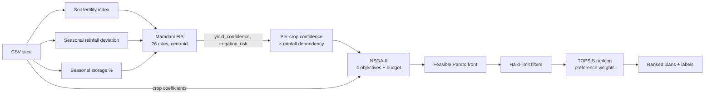

---

### 1. Soil fertility index (`data/preprocessing.py::compute_soil_fertility_index`)

```
ph_score  = clamp(100 − 40·|pH − 6.5|, 0, 100)          # 100 at pH 6.5, 0 at pH 4.0 / 9.0
oc_score  = clamp(100 · OC% / 1.0, 0, 100)               # saturates at 1.0 % organic carbon
npk_score = mean(S(N), S(P), S(K)),  S: Low→30, Medium→60, High→90 (unknown→50)
index     = 0.3·ph_score + 0.3·oc_score + 0.4·npk_score  ∈ [0, 100], rounded to 2 dp
```

* **Why:** collapses five soil attributes into one fuzzy input so the rule base stays 3-dimensional.
* **Arbitrary constants:** 6.5 optimum and slope 40 (pH), 1.0 % OC saturation, 30/60/90 status scores, 0.3/0.3/0.4 weights. Documented as modelling choices, no citation.
* **Observed range in data:** 61.0 – 77.4 (all slices fall in fuzzy sets *medium*/*good*; *poor* is never exercised by real data).
* **Alternatives:** a published Soil Quality Index (e.g. Andrews et al. scoring functions), or feeding N/P/K status to the FIS directly.

### 2. Mamdani fuzzy inference (`fuzzy/engine.py`)

#### 2.1 Variables and membership functions (all triangular, `skfuzzy.trimf`)

| Variable | Universe (step 1) | Set: [a, b, c] |
|---|---|---|
| **rainfall_dev** (input, %) | −60 … 60 | deficit [−60, −60, −5] · normal [−15, 0, 15] · surplus [5, 60, 60] |
| **water_storage** (input, %) | 0 … 100 | low [0, 0, 35] · medium [20, 50, 75] · high [60, 100, 100] |
| **soil_fert** (input, index) | 0 … 100 | poor [0, 0, 40] · medium [25, 50, 75] · good [60, 100, 100] |
| **yield_conf** (output, %) | 0 … 100 | low [0, 0, 45] · medium [30, 55, 75] · high [65, 100, 100] |
| **irrigation_risk** (output, %) | 0 … 100 | low [0, 0, 35] · medium [25, 50, 75] · high [60, 100, 100] |

Inputs are clipped to the universe before inference (`np.clip`). Shoulder sets ([a, a, c]) behave as left/right-open. Note gaps: `rainfall_dev` between −15 and −5 belongs only to deficit/normal partially; there is no point with zero total membership.

#### 2.2 Rule base (26 rules, `_build_system`)

AND = `min`, rule aggregation = `max`, implication = `min` (scikit-fuzzy defaults).

| # | IF | THEN yield_conf | THEN irrigation_risk |
|---|---|---|---|
| 1 | rain deficit ∧ water low | low | high |
| 2 | rain deficit ∧ water medium | medium | medium |
| 3 | rain deficit ∧ water high | medium | medium |
| 4 | rain normal ∧ water low | medium | medium |
| 5 | rain normal ∧ water medium | high | low |
| 6 | rain normal ∧ water high | high | low |
| 7 | rain surplus ∧ water low | medium | low |
| 8 | rain surplus ∧ water medium | high | low |
| 9 | rain surplus ∧ water high | high | low |
| 10 | soil good | high | – |
| 11 | soil poor | low | – |
| 12 | soil medium ∧ rain normal | medium | – |
| 13 | water high ∧ soil good | high | – |
| 14 | water low ∧ soil poor | low | high |
| 15 | deficit ∧ water low ∧ soil poor | low | high |
| 16 | surplus ∧ water high ∧ soil poor | medium | – |
| 17 | water high ∧ soil poor | – | low |
| 18 | water low ∧ soil medium | – | high |
| 19 | deficit ∧ water medium ∧ soil good | medium | – |
| 20 | deficit ∧ soil poor | low | high |
| 21 | normal ∧ water high ∧ soil good | high | low |
| 22 | normal ∧ water medium ∧ soil medium | medium | medium |
| 23 | surplus ∧ water medium ∧ soil medium | medium | – |
| 24 | deficit ∧ water high ∧ soil medium | medium | low |
| 25 | surplus ∧ water high ∧ soil good | high | low |
| 26 | deficit ∧ water medium ∧ soil poor | low | high |

Rule-base properties worth knowing for the viva:

* **Rules do not "cap" or "override".** Mamdani max-aggregation only ever *adds* consequent mass. Rule 5 (normal ∧ medium → high) and rule 22 (… ∧ soil medium → medium) both fire and the centroid lands between the sets. A rule can pull the centroid toward its consequent; it cannot stop another rule from firing.
* **Six rules are provably inert** (corrected from five; rule 13 was missed — see [FUZZY_SYSTEM_ANALYSIS.md](#doc-fuzzy-system-analysis) §4, where `app/fuzzy/audit.py` now computes this and the tests check it). If rule B has the same consequent as rule A and a strictly more specific antecedent, B's firing strength (a `min` over more terms) is never larger than A's, so it never changes the aggregated output. Measured by deleting each rule and re-evaluating a 21×21×21 input grid (9,261 points):

  | Rule removed | Max change in yield_conf | Max change in irrigation_risk | Subsumed by |
  |---|---|---|---|
  | 13 | 0 | 0 | 10 |
  | 15 | 0 | 0 | 1 (and 14, 20) |
  | 19 | 0 | 0 | 2 |
  | 21 | 0 | 0 | 6 |
  | 25 | 0 | 0 | 9 |
  | 26 | 0 | 0 | 20 |
  | 22 / 24 | 0 | 22.6 / 15.7 pts | yield part subsumed by 12 / 3; risk part active |
  | 16, 17, 18, 20, 23 | up to 19.7 pts | up to 52.1 pts | active |

  The code comment on rule 19 ("caps it at medium") therefore does not describe its behaviour; with rule 10 (soil good → high) also firing, rule 19 contributes nothing. Effective rule count: **20**, not 26 (TODO T-5).
* **Incompleteness for `irrigation_risk`.** Only water/rain rules (1–9, 14, 15, 17, 18, 20–22, 24–26) set it; soil-only situations leave it to the rain×water grid, which is complete (all 9 combinations), so an output always exists.
* **Observed output range** on the real data (60 location-season-years): yield_confidence 0.547–0.883, irrigation_risk 0.117–0.500. Low water and poor soil sets are never activated by the dataset.

#### 2.3 Defuzzification
Centroid (scikit-fuzzy default) on each output universe, divided by 100 → `[0, 1]`. If `compute()` raises (no rule fired – cannot happen after clipping, but guarded) the engine returns 0.5/0.5. Dominant linguistic labels (`rainfall_label`, …) are the set with maximum membership at the clipped input.

#### 2.4 Per-crop adjustment (`crop_yield_confidence`)
```
factor  = {Very Low: 0.1, Low: 0.3, Medium: 0.6, High: 1.0}[Rainfall_Dependency]   (unknown → 0.5)
penalty = irrigation_risk · factor · 0.4
crop_confidence = clip(yield_confidence · (1 − penalty), 0, 1)
```
Maximum penalty 40 % (constant 0.4 is arbitrary). This is the **only** channel through which fuzzy logic influences optimisation.

#### 2.5 Why Mamdani / alternatives
* **Chosen because:** the paper specifies a Mamdani FIS; rules are human-readable, linguistic outputs can be plotted.
* **Sugeno/TSK** would give smoother, faster, differentiable outputs and allow data-driven tuning (ANFIS) once real outcome data exist.
* **Type-2 fuzzy** would model uncertainty in the membership functions themselves – more defensible for "uncertainty" claims.
* **Probabilistic scenarios** (the paper's "probability theory") – sampling rainfall/storage from historical distributions and optimising expected value or CVaR – would make uncertainty affect the *shape* of the trade-off, which the current design cannot (see §4.6).

---

### 3. Optimisation problem (`optimization/problem.py`)

#### 3.1 Decision variables (chromosome length 3n, n = candidate crops, 2–5 in practice)

| Block | Genes | Bounds | Meaning |
|---|---|---|---|
| Allocation | x₀…x_{n−1} | [1e−4, 1] | Share of land; normalised to sum 1 at evaluation and by repair |
| Irrigation | x_n…x_{2n−1} | [0.7, 1.3] | Multiplier on net irrigation need |
| Fertiliser | x_{2n}…x_{3n−1} | [0.7, 1.3] | Multiplier on the NPK dose |

Lower bound 1e−4 means **every candidate crop always receives a non-zero area**; plans therefore always contain all n crops (UI hides shares < 1 %).

#### 3.2 Objectives (vectorised over the population), with aᵢ = share·total_land_ha

| | Formula | Direction |
|---|---|---|
| f1 yield (t) | Σ aᵢ · Yieldᵢ/1000 · crop_confidenceᵢ | maximise (stored as −f1) |
| f2 cost (₹) | Σ aᵢ · [ fertᵢ·(Nᵢ·12.87 + Pᵢ·58.70 + Kᵢ·56.67) + Pesticideᵢ + Labourᵢ·319 ] | minimise |
| f3 water (L) | Σ aᵢ · irrᵢ · max(WaterReqᵢ − effective_rain, 0) · 10 000 | minimise |
| f4 env. impact | √( L · C ), L = Σ aᵢ·fertᵢ·Nᵢ ,  C = Σ aᵢ·[fertᵢ·(Nᵢ+Pᵢ+Kᵢ)·0.15 + irrᵢ·WaterReqᵢ·0.01] | minimise |

Constraint (only when `budget_rs` is given): g = f2 − budget ≤ 0.

Properties that matter (verified numerically, see [RESEARCH_REVIEW.md](#doc-research-review) §4):

1. **Multipliers never improve any objective.** Yield does not depend on `irr` or `fert`; cost, water and impact increase with them. Any multiplier above 0.7 is dominated, so NSGA-II drives them to 0.7: in the final fronts 74–99 % of fertiliser genes and 52–100 % of irrigation genes are < 0.72. The "irrigation/fertiliser optimisation" is effectively inert.
2. **f1–f3 are linear in area** once multipliers sit at their lower bound; the front is a trade-off between crops' per-hectare coefficient vectors. Yield is heavily dominated by sugarcane/tapioca/banana/coconut tonnage.
3. **f4 uses gross `Water_Req_mm`** in the carbon term but f3 uses *net* irrigation – inconsistent treatment of pumping.
4. **f2 excludes water/energy, seed, machinery, land rent.** `WATER_COST_RS_PER_MM_PER_HA` exists in config but is deliberately unwired.
5. Yield–cost correlation across the returned fronts is 0.85–1.00 for 3–5-crop problems; for 2-crop Summer problems it is −1 (no trade-off between yield and cost).

#### 3.3 Constraint handling
pymoo's constraint-domination: a feasible solution beats an infeasible one; between infeasible solutions the smaller violation wins. Infeasible final solutions are flagged `feasible=False` by `extract_pareto_plans` and dropped by the callers. An infeasible budget therefore yields an empty plan list (HTTP 200) rather than an error.

---

### 4. NSGA-II (`optimization/nsga2_runner.py`, `operators.py`)

#### 4.1 Configuration

| Component | Implementation | Value |
|---|---|---|
| Population | `pop_size` | 80 (`/api/farm-plans`), 100 (dashboard endpoints), 24 in fast tests |
| Generations | termination `("n_gen", n)` | 200 (fast tests 15) |
| Initial sampling | pymoo `FloatRandomSampling` | uniform in bounds, then repaired |
| Parent selection | pymoo default binary tournament | compares by constraint violation, then Pareto dominance, then crowding distance |
| Crossover | custom `SinglePointCrossover` | pymoo decides per mating with p = 0.85; cut point uniform in 1…3n−1; tails swapped |
| Mutation | custom `GaussianMutation` | every gene independently with p = 0.12; δ ~ N(0, 0.12·(xu−xl)); clip to bounds |
| Repair | custom `AllocationRepair` | allocation block clipped ≥0, all-zero rows → uniform, renormalised to sum 1; all genes clipped to bounds |
| Survival | pymoo `RankAndCrowding` | fast non-dominated sort, then crowding distance |
| Duplicates | `eliminate_duplicates=True` | identical offspring discarded |
| Seed | `config.NSGA2_SEED = 42` | `np.random.seed(seed)` for custom operators **and** `seed=` for pymoo's own generator |
| Engine mode | `config.NSGA2_ENGINE_MODE` | `original` (this table, published results) or `enhanced` (adds smart initialisation and adaptive mutation from p = 0.05) – [NSGAII_IMPROVEMENT_SUMMARY.md](#doc-nsgaii-improvement-summary) |

**Reproducibility and thread safety.** Two RNG streams are involved: pymoo's seeded `Generator` (sampling, selection, crossover yes/no) and NumPy's *global* RNG (cut points, mutation). Because the global RNG is process-wide, concurrent requests used to interfere: measured on the original code, 20 of 40 concurrent runs produced a different front than the same seed run alone. Since 2026-09-29 each run holds `_NSGA2_RUN_LOCK`; the measurement is 0 of 40, and `tests/test_hardening.py::test_concurrent_runs_match_serial_runs` guards it. A cleaner long-term fix is to pass pymoo's `random_state` into the operators (would change outputs, so not done).

#### 4.2 Why single-point crossover and Gaussian mutation
Chosen to match the paper literally. For real-coded chromosomes, SBX + polynomial mutation (pymoo defaults) are the standard choice; single-point crossover on a block-structured chromosome mostly swaps whole multiplier blocks and cuts the allocation block at one place, which limits recombination of allocation patterns.

#### 4.3 Output decoding
`extract_pareto_plans` decodes every individual of `result.X` (pymoo returns the non-dominated set of the final population): allocation renormalised, area = share × land, objectives rounded (yield 3 dp, cost 2 dp, water 1 dp, impact 3 dp).

#### 4.4 Convergence history and hypervolume (`extract_convergence_history`)
When `track_history=True` the run's `EngineMonitor` records the population objectives each generation (until 2026-10 pymoo's `save_history` deep-copied the whole algorithm instead; the numbers are identical). For each generation: best and mean of each raw objective over the surviving population, and hypervolume:
```
lo, hi = min/max of F over ALL generations of this run
F_norm = clip((F − lo) / (hi − lo), 0, 1.5)
HV     = pymoo HV(ref_point = [1.1, 1.1, 1.1, 1.1])(F_norm)
```
Consequences: HV is **run-relative** (normalised by that run's own extremes), so values are not comparable between runs, districts or the fuzzy/non-fuzzy variants. Typical run: HV 0.26 → 0.81 (Salem Kharif, pop 100).

#### 4.5 Why NSGA-II / alternatives
* **Chosen because:** the paper specifies it; widely taught; returns a spread Pareto set in one run.
* **Caveat:** with 4 objectives NSGA-II's crowding distance loses selection pressure (many-objective regime); **NSGA-III** or **MOEA/D** are designed for ≥4 objectives.
* **Exact alternative:** because f1–f3 are linear in the land shares, an ε-constraint method with an LP solver would give the exact trade-off curve and a proof of optimality; the square-root in f4 is the only non-linearity (it could be linearised by optimising L and C separately). This is the strongest comparison baseline for the report.
* **Performance:** a full run takes ≈0.3 s (pop 80, 200 generations) with or without history (≈0.75 s with history before 2026-10).
* **Convergence:** every plan the original engine returns is dominated by its own copy with multipliers at 0.7 (960/960 plans, seed 42); the enhanced mode halves that gap – [NSGAII_ANALYSIS.md](#doc-nsgaii-analysis) §4.2.

#### 4.6 How much does fuzzy logic change the optimum?
Fuzzy confidence multiplies each crop's yield by a constant. It rescales f1 per crop but does not touch f2–f4. `GET /api/compare-fuzzy` therefore shows identical min-cost, min-water and min-impact values for the fuzzy and non-fuzzy runs; only best-yield differs (e.g. Salem Kharif 13.96 vs 26.96 t/ha). The crop *ranking* by yield can change when dependencies differ, which is the genuine effect to report.

---

### 5. Decision stage (`decision/ranking.py`)

#### 5.1 Hard-limit filters (`filter_plans`)
Keep plans with cost ≤ `max_cost_rs`, water ≤ `max_water_liters`, yield ≥ `min_yield_tonnes`, impact ≤ `max_env_impact` (each optional). Applied after NSGA-II, so an over-restrictive filter can return 0 plans.

#### 5.2 TOPSIS (`rank_plans`)
```
for each objective j: n_ij = (v_ij − min_j)/(max_j − min_j)      (0.5 if constant)
                      flipped to 1 − n_ij for cost, water, env     → higher is better
M_ij  = w_j · n_ij
A⁺_j  = max_i M_ij,  A⁻_j = min_i M_ij
d⁺_i  = ‖M_i − A⁺‖₂,  d⁻_i = ‖M_i − A⁻‖₂
C_i   = d⁻_i / (d⁺_i + d⁻_i)       (0.5 if both 0)
rank by C_i descending, keep top 50 (plan_service) or 100 (dashboard)
```
Differences from classical TOPSIS (Hwang & Yoon, 1981): min–max instead of vector normalisation, which makes the ideal/anti-ideal exactly 1·w and 0·w per criterion. Weights per preference:

| Preference | yield | cost | water | env |
|---|---|---|---|---|
| balanced | 0.300 | 0.233 | 0.233 | 0.233 |
| max_yield | 0.55 | 0.15 | 0.15 | 0.15 |
| min_cost | 0.15 | 0.55 | 0.15 | 0.15 |
| min_water | 0.15 | 0.15 | 0.55 | 0.15 |
| min_env_impact | 0.15 | 0.15 | 0.15 | 0.55 |

The "balanced" 0.30 was tuned empirically (documented in `ranking.py`) because cost, water and impact are strongly correlated with yield. Alternatives: knee-point selection (no weights), VIKOR (explicit compromise), PROMETHEE II (pairwise outranking), AHP-derived weights elicited from farmers.

Ranking profiles over ten criteria (Profit, Water saving, Sustainability, Low cost, custom weights) rank the same front with the same maths; Balanced is this ranking unchanged. See [TOPSIS_DYNAMIC_ENGINE.md](#doc-topsis-dynamic-engine) and the weight audit in [TOPSIS_WEIGHT_ANALYSIS.md](#doc-topsis-weight-analysis).

#### 5.3 Per-plan labels
* **`normalized_scores`** – the flipped min–max values above (0–1, higher = better).
* **`confidence_label`** – land-weighted crop confidence Σ shareᵢ·crop_confidenceᵢ bucketed ≥0.66 High, ≥0.33 Moderate, else Low. With the observed confidence range (≈0.44–0.88) "Low" never occurs.
* **`trade_off_summary`** – raw (un-flipped) min–max position of each objective bucketed at 0.33/0.66 → "High yield, Moderate cost, …" so "High cost" always means expensive.
* **`allocation_percent`** – largest-remainder rounding so the displayed shares sum to exactly 100.00.

---

### 6. Other derived computations (summary; details in [SCORING_AND_RANKING.md](#doc-scoring-and-ranking))

| Computation | Where | Essence |
|---|---|---|
| Plans A/B/C | `dashboard_service.get_comparison` | #1 of TOPSIS balanced / max_yield / min_cost over one front |
| Radar scores | `_radar_scores` | min–max over the 3 compared plans ×100; risk = (1−irrigation_risk)·100; market = (1−mean dependency factor)·100 |
| Fuzzy vs non-fuzzy | `get_fuzzy_comparison` | two NSGA-II runs (`use_fuzzy` True/False), per-ha best/min summaries |
| Dashboard KPIs | `get_dashboard` | mean yield, year-over-year %, fertility index, irrigation share of demand, rule-based actions |
| Current season | `_current_season` | today's month → first season in `SEASON_MONTH_MAP` containing it (Feb/Mar → Rabi) |
| History rows | `get_history` | per saved run: top plan yield/cost ÷ its area |

<a id="doc-fuzzy-system-analysis"></a>

## Fuzzy System Analysis

Audit of the Mamdani fuzzy inference system in `app/fuzzy/engine.py`: architecture, data flow, membership functions, rule base, strengths, weaknesses and a prioritised improvement plan. Every figure below is produced by `app/fuzzy/audit.py` (also served by `GET /api/fuzzy/audit`) and checked in `tests/test_fuzzy_audit.py`. Explanation of individual inferences: [FUZZY_EXPLAINABILITY.md](#doc-fuzzy-explainability). Literature comparison: [FUZZY_RESEARCH_REVIEW.md](#doc-fuzzy-research-review). What was changed: [FUZZY_IMPROVEMENT_SUMMARY.md](#doc-fuzzy-improvement-summary).

### 1. Architecture and workflow

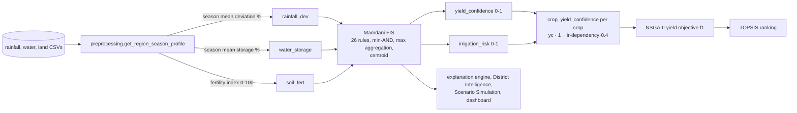

| Element | Implementation |
|---|---|
| Type | Mamdani (scikit-fuzzy 0.5.0 `ControlSystem`) |
| Inputs | `rainfall_dev` [−60, 60] % (deficit, normal, surplus); `water_storage` [0, 100] % (low, medium, high); `soil_fert` [0, 100] (poor, medium, good) |
| Outputs | `yield_conf` [0, 100] and `irrigation_risk` [0, 100] (low, medium, high), divided by 100 |
| Membership functions | 15 triangles (`MEMBERSHIP_FUNCTIONS`) |
| AND / implication / aggregation | min / min (clipping) / max |
| Defuzzification | centroid on the output universe (step 1) upsampled with each cut's crossing points |
| Rules | 26 (14 original + 12 named agro-climatic scenarios); effective 20 (§4) |
| Crisp outputs | rounded to 3 decimals |

**Interaction with the rest of the system.** The FIS runs once per region/season/year profile. Its only path into optimisation is `crop_yield_confidence`, which scales each crop's book yield in objective f1; cost, water and impact (f2–f4) do not use it. TOPSIS sees the effect only through the yield column, and the crop-level confidence also feeds the plan confidence label. The explanation engine, District Intelligence (suitability), Scenario Simulation (fuzzy changes) and the dashboard read the outputs, labels, memberships and fired rules.

Inputs that are **not** fuzzy variables: soil moisture (not in the data), crop history (used by District Intelligence and explanations, not the FIS), budget and land size (NSGA-II constraint and problem size). They are listed in the brief but have no membership functions to audit.

### 2. Data actually seen by the FIS

60 location/season/year profiles (48 observed, 12 estimated 2024 rows):

| Input | Observed range | Distinct values | Notes |
|---|---|---|---|
| rainfall_dev | −41.1 … +121.1 % | 47 | 5 Pollachi Summer profiles (+105 … +121 %) exceed the universe and are clipped to +60 |
| water_storage | 38.3 … 85.0 % | 12 | never below 35 %: the *low* set is never activated |
| soil_fert | 61.0 … 77.4 | 42 | never below 40: the *poor* set is never activated |

Observed outputs: yield_confidence 0.547–0.883, irrigation_risk 0.117–0.500.

### 3. Membership function audit (no changes made)

| Input | ε-completeness | Weakly covered (max membership < 0.5) | Crossing points | Profiles in weak band |
|---|---|---|---|---|
| rainfall_dev | **0.143** | [−32.5, −7.5] and [7.5, 32.5] — 41.6 % of the universe | deficit/normal at −12.86 (μ 0.143); normal/surplus at +12.86 | 35 / 60 |
| water_storage | 0.231 | [17.5, 35.0] and [62.5, 80.0] — 35 % | 26.9 (μ 0.231), 69.2 (μ 0.231) | 15 / 60 |
| soil_fert | 0.231 | [20.0, 37.5] and [62.5, 80.0] — 35 % | 30.8 (μ 0.231), 69.2 (μ 0.231) | 54 / 60 |

No gaps: every point has some membership (no zero-coverage region), and membership sums lie in [0.18, 1.0] (rainfall) and [0.375, 1.0] (others) — the partitions are not partitions of unity.

| Question | Finding |
|---|---|
| Ranges realistic? | Storage and fertility universes fit. The rainfall universe ±60 % clips 5 real profiles (IMD's own categories run to "large excess" ≥ +60 % and "large deficient" ≤ −60 %, so the clip itself is defensible, but the clipped values lose information). |
| Overlap correct? | Overlaps are narrow (8 points for rainfall, 13 for the others) and cross at low membership (0.14–0.23). The common design guideline is ε-completeness ≥ 0.5 (adjacent sets crossing at 0.5); all three inputs fall short. |
| Smooth transitions? | Piecewise linear; the narrow, low crossings produce the non-monotone output steps in §5. |
| Triangular vs Gaussian/bell? | Triangles are adequate and standard (Pedrycz 1994); Gaussians would remove kinks but not the coverage problem, and would change every output. The issue is placement, not shape. |
| Unused regions? | Water *low* and soil *poor* are never activated by the data; rules depending on them (11 of 26) never fire on real profiles. |
| Alignment with external standards | IMD classifies seasonal rainfall within ±19 % of the long-period average as **normal**. The FIS's *normal* set is only [−15, 15] with its crossing at ±12.9 %, so 9 profiles that IMD calls normal (e.g. −13.0 %, −18.2 %, +14.5 %, +19.0 %) get a dominant *deficit* or *surplus* label. |

**Recommendation M-1 (not implemented — changes outputs).** Re-place the rainfall sets so adjacent sets cross at μ = 0.5 at the IMD category boundaries (±19.5 %), which also gives ε-completeness 0.5; the exact triangles are a design decision for the team, not something this audit should invent. Do the same for storage and fertility using agreed reference thresholds (reservoir operating rules; Soil Health Card ratings). Expected benefit: linguistic labels agree with official classifications; ε-completeness ≥ 0.5; fewer non-monotone steps. Cost: every fuzzy output and therefore every optimisation result changes — requires a new results version and re-running the paper's tables.

### 4. Rule base audit (no rules changed)

#### 4.1 Provably inert rules
With AND = min, a rule whose conditions are a superset of another rule's never fires more strongly; with max aggregation, if that other rule concludes the same term, the inert rule can never set the term's cut. Rules whose *every* consequent is subsumed this way cannot change any output.

| Rule | Conditions → conclusions | Subsumed by | Leave-one-out max change (11³ grid) |
|---|---|---|---|
| 13 | water high ∧ soil good → yield high | 10 (soil good → yield high) | 0 |
| 15 | deficit ∧ water low ∧ soil poor → yield low, risk high | 1, 14, 20 | 0 |
| 19 | deficit ∧ water medium ∧ soil good → yield medium | 2 | 0 |
| 21 | normal ∧ water high ∧ soil good → yield high, risk low | 6 (and 10, 13) | 0 |
| 25 | surplus ∧ water high ∧ soil good → yield high, risk low | 9 (and 10, 13) | 0 |
| 26 | deficit ∧ water medium ∧ soil poor → yield low, risk high | 20 (and 11) | 0 |

**Effective rule count: 20.** Partly subsumed (one consequent redundant, the other active): 14 (yield part ← 11), 20 (yield ← 11), 22 (yield ← 12), 24 (yield ← 3). This corrects the earlier statement in ALGORITHMS.md that five rules were inert: rule 13 is also inert.

On the 60 real profiles, the inert rules 13, 19, 21 and 25 do fire (35, 20, 10 and 10 times), but whenever they set a cut they are exactly tied with the rule that subsumes them, so their leave-one-out importance is 0 every time.

#### 4.2 Rules that cannot do what their comments say
Rules 16, 19 and 23 are commented as *capping* yield confidence ("should NOT read as good news", "caps it at medium"). Mamdani max-aggregation cannot cap: a rule only adds its clipped consequent; it cannot remove another rule's *high* term.

| Rule | Intent | Measured effect on yield_confidence (grid) |
|---|---|---|
| 16 | cap yield under flood + poor soil | between −0.020 and **+0.042**: where the rest of the set leans low, adding *medium* raises the centroid |
| 19 | cap at medium for deficit + medium water + good soil | 0 (inert) |
| 23 | moderate the wet-zone transitional case | down to −0.197 (lowers 6.7 % of grid points) — works as a pull, not a cap |

#### 4.3 Firing on the real data (60 profiles)

| | Value |
|---|---|
| Rules fired per profile | 2–11 (mean 5.4) |
| Decisive per profile (set at least one output cut) | 1–5 (mean 3.0); masked mean 2.4 |
| Never fire | 1, 4, 7, 11, 14, 15, 16, 17, 18, 20, 26 (all need water *low* or soil *poor*, or surplus with poor soil) |
| Most frequent | 10 (all 60), 13 (35), 8 (30), 3 and 24 (25) |
| Largest influence (max leave-one-out) | 8 (0.383), 3 (0.284), 22 (0.204), 23 (0.183) |
| Dominating rule | 10 (soil good → yield high) fires in every profile and sets the *high* yield cut in 41 (alone in 30, tied in 11) |

#### 4.4 Other rule-base observations

| ID | Problem | Impact | Suggested improvement | Expected benefit |
|---|---|---|---|---|
| R-1 | 6 inert rules | Rule count overstates the model (26 vs 20 effective); explanations previously listed them as contributors | Keep (brief forbids reducing rules); mark them in explanations and docs as subsumed. Alternative for a future version: give the 3-way rules *weights* or use product AND so specificity matters | Honest rule count; future version could make the scenario rules active |
| R-2 | "Capping" rules cannot cap | Code comments promise behaviour the engine cannot deliver; rule 16 can raise yield | Rewrite as rules on a *lower* term with higher weight, or use a modifier/hedge; or document as "pull towards medium" | Behaviour matches stated agronomic intent |
| R-3 | Single-antecedent soil rules (10, 11) fire whenever their soil set is active | Rule 10 sets the yield *high* cut in 41/60 profiles regardless of water and rainfall; soil dominates yield confidence | Condition soil rules on water/rainfall or weight them below the 2-way grid | Yield confidence responds more to the season |
| R-4 | No conflicting rules in the strict sense (same conditions, opposite conclusions) | — | None | — |
| R-5 | Low-water / poor-soil rules never fire on the data | 11 rules untested by data; their behaviour is only checked synthetically | Keep (needed for drought scenarios, which Scenario Simulation now produces: water *very low* activates them) | Coverage for what-if analysis |
| R-6 | `irrigation_risk` ignores soil except via rules 14, 17, 18, 20, 22, 24 | Acceptable | None | — |

### 5. Inference quality (unchanged by this work)

| Check (11³ … 21³ grid) | Result |
|---|---|
| yield_conf non-decreasing in soil fertility | 0.7 % of steps violate, largest drop 0.011 |
| yield_conf non-decreasing in water storage | **14.4 %** of steps violate, largest drop 0.065 |
| irrigation_risk non-increasing in water storage | **12.0 %** of steps violate, largest rise 0.059 |
| Reachable range (centroid of a single fully fired extreme term) | yield_conf [0.150, 0.883]; irrigation_risk [0.117, 0.867] |

The monotonicity violations come from the weak crossings (§3): as storage moves from 62 to 70 %, *medium* falls faster than *high* rises, and different rules take over the cuts. Centroid defuzzification compresses outputs away from 0 and 1 (Van Leekwijck & Kerre 1999); the observed maximum yield confidence 0.883 is exactly the ceiling.

### 6. Strengths
* Faithful Mamdani implementation on a maintained library; deterministic; inputs clipped, never rejected.
* Linguistic, human-readable rules with named agro-climatic scenarios (15–26).
* A complete 3×3 rainfall × water grid guarantees an output for every input.
* Narrow coupling to optimisation (one scaling factor) keeps the fuzzy layer auditable and the optimiser's behaviour explainable.
* Now: exact rule-level attribution and a reproducible audit (this work).

### 7. Weaknesses
* Low ε-completeness and IMD-misaligned rainfall partition (§3).
* 6 inert rules; capping intent not achievable with max aggregation (§4).
* Non-monotone responses to water storage (§5).
* Output compression by centroid; outputs never reach the extremes.
* No calibration against outcome data (the dataset has no realised-yield-vs-forecast pairs), so "accuracy" cannot be measured directly — only consistency.

### 8. Implementation plan

| Priority | Improvement | Problem / reason | Expected benefit | Difficulty | Risk | Files | Outputs change? | Reproducibility |
|---|---|---|---|---|---|---|---|---|
| **Done – Critical** | Rule-level explanation (`explain_inference`) | Fired-rule list showed masked and inert rules as if they mattered | Exact attribution, ranking, limiting condition | M | Low | engine.py, explanation_service.py, ExplanationPanel.jsx | No | Unaffected |
| **Done – High** | Audit module + API (`audit.py`, `/api/fuzzy/audit`) | Claims about the rule base were hand-measured and partly wrong (5 vs 6 inert) | Reproducible, tested figures | M | Low | audit.py, main.py | No | Unaffected |
| **Done – High** | Memoised inference, cached rule specs | fired_rules re-walked scikit-fuzzy's rule-order generator every call | 140× faster fired rules, 780× faster repeated inference, explanations 1.7× faster | L | Low (bit-identical tested) | engine.py | No | Unaffected |
| **Done – Medium** | Single table for membership functions and bounds | Parameters duplicated inline | Maintainability; audit reads the same numbers | L | None | engine.py | No | Unaffected |
| High (proposed) | M-1: IMD-aligned rainfall partition, ε ≥ 0.5 everywhere | §3 | Labels agree with IMD; fewer non-monotone steps | M | Medium | engine.py | **Yes** | Needs a new results version; paper tables re-run |
| High (proposed) | R-2: make capping rules effective (weights or lower-term rules) | §4.2 | Behaviour matches documented intent | M | Medium | engine.py | **Yes** | As above |
| Medium (proposed) | R-1/R-3: weights or product AND so 3-way rules and soil rules contribute proportionately | §4.1, §4.3 | 26 rules all active; season matters more | M | Medium | engine.py | **Yes** | As above |
| Medium (proposed) | Extend rainfall universe or add *large deficit/excess* sets (IMD categories) | 5 profiles clipped | No information loss | M | Medium | engine.py | **Yes** | As above |
| Low (proposed) | Monotonicity as a regression test with tolerance once M-1 is applied | §5 | Guards future edits | L | Low | tests | No | Unaffected |
| Low (proposed) | Calibrate against realised yields when available (ANFIS / tuning) | §7 | Measured accuracy | H | High | new | **Yes** | New model version |

Only output-preserving items were implemented, because previous optimisation results and the paper's tables must stay reproducible; every proposed item is quantified above so the team can decide on a versioned change.

<a id="doc-fuzzy-explainability"></a>

## Fuzzy Explainability

How AgroOptimize explains a single fuzzy inference: which rules fired, why, with what strength, which of them actually shaped the output, by how much, and how important each one is. Implemented in `fuzzy.engine.explain_inference`; returned in every plan explanation (`fuzzy_reasoning.inference`) and by `GET /api/fuzzy/explain`; shown in the explanation panel's "Fuzzy rules that fired" table. Context: [FUZZY_SYSTEM_ANALYSIS.md](#doc-fuzzy-system-analysis).

### 1. Why a fired-rule list was not enough
Before this work the explanation listed every fired rule with its firing strength. In Mamdani max-aggregation, however, a fired rule only matters if it is the *strongest* rule concluding its output term — otherwise another rule has already cut that term higher and the weaker rule changes nothing. In the Salem Kharif example below, 6 rules fire but only 3 influence the outputs; the old list could not tell them apart and also presented the six provably inert rules as contributors.

### 2. Method (exact, reproduces the engine)
scikit-fuzzy computes, per output variable:

1. firing(rule) = min of the rule's antecedent memberships;
2. cut(term) = max of the firing strengths of the rules concluding that term;
3. aggregated set = max over terms of min(cut, term membership function), on the output universe upsampled with the cut crossing points;
4. crisp output = centroid of the aggregated set ÷ 100.

`explain_inference` rebuilds steps 1–4 with the same scikit-fuzzy primitives (`interp_membership`, `_interp_universe_fast`, `defuzz`). The rebuilt centroid equals the engine's output exactly (difference 0 on a 13 × 11 × 11 grid and 150 random points; checked on every call as `matches_engine`). From that reconstruction:

| Field | Meaning |
|---|---|
| `strength` | firing strength (unrounded min of antecedent memberships) |
| `limiting_condition` | the antecedent with the lowest membership — *why* the rule fired at this strength and no higher |
| `status` | **decisive**: the rule's strength sets at least one output term's cut; **masked**: fired, but a stronger rule set the same term's cut (`masked_by`); **not fired** |
| `tied_with` | rules with exactly the same strength for the same term (they share the credit; removing one changes nothing) |
| `contribution_pct` | per output, the rule's share of the aggregated area: the area is split exactly between the terms that form its upper envelope, and each term's part is credited to the rule(s) that set its cut. Sums to 100 % per output |
| `leave_one_out_change` | output with the rule minus output with the rule removed from the rule base (0–1 scale) — signed effect on the crisp value |
| `importance` | largest absolute leave-one-out change over the two outputs; rules are **ranked** by importance, then contribution, then strength |
| `outputs[var]` | crisp value, dominant output term and its membership (how firmly the value belongs to that label — the label's confidence), term cuts with the rules that set them, term area shares |
| `summary` | fired / decisive / masked counts |

Inert rules always have importance 0; masked rules have importance 0 by construction. Area share and leave-one-out answer different questions: share says *what the output is made of*, leave-one-out says *how much it would move without the rule* (a rule can form much of the area yet move the centroid little when another term would take its place).

### 3. Worked example — Salem, Kharif, latest year
Inputs: rainfall deviation −21.1 % (deficit 0.293), storage 62 % (medium 0.520, high 0.050), soil fertility 67.8 (medium 0.288, good 0.195).

| Rank | Rule | Strength | Status | Share of yield / risk | Leave-one-out (yield / risk) | Limited by |
|---|---|---|---|---|---|---|
| 1 | 2 — deficit ∧ water medium → risk medium, yield medium | 0.293 | decisive | 66.2 % / 90.4 % | −0.026 / +0.094 | rainfall deficit (0.293) |
| 2 | 10 — soil good → yield high | 0.195 | decisive | 33.8 % / – | +0.072 / – | soil good (0.195) |
| 3 | 24 — Canal irrigation advantage under deficit | 0.050 | decisive | – / 9.6 % | – / −0.035 | water high (0.050) |
| 4 | 19 — Post-monsoon Rabi transition | 0.195 | masked by 2 | – | 0 | soil good (0.195) |
| 5 | 3 — deficit ∧ water high → medium, medium | 0.050 | masked by 2 | – | 0 | water high (0.050) |
| 6 | 13 — water high ∧ soil good → yield high | 0.050 | masked by 10 | – | 0 | water high (0.050) |

Outputs: yield_confidence 0.636 (*medium*, membership 0.572) formed by rule 2's *medium* cut (0.293) and rule 10's *high* cut (0.195); irrigation_risk 0.465 (*medium*, 0.861) formed by rule 2's *medium* cut and rule 24's *low* cut (0.050). Reading: the season's rainfall deficit drives both outputs; good soil lifts yield confidence by 0.072; the small share of high storage lowers irrigation risk by 0.035. Rule 19 — commented as capping yield at medium — fires as strongly as rule 10 but is masked by rule 2, which already sets the *medium* cut higher.

### 4. Where it appears
* **Plan explanations** (`GET /api/results/{id}/explanation`, comparison explanations, Scenario Simulation): `fuzzy_reasoning.inference` alongside the existing `input_memberships` and `fired_rules` (unchanged).
* **API**: `GET /api/fuzzy/explain?rainfall_dev=&water_storage=&soil_fert=` for any input triple (clipped like the engine; non-finite → 422).
* **Frontend**: the explanation panel's "Fuzzy rules that fired" table is ranked by importance and shows status (with the masking or tied rule), share of yield / risk, limiting condition and importance, plus the output labels and their memberships. Older payloads without `inference` still render the plain list.

### 5. Tests
`tests/test_fuzzy_audit.py`: explanation equals an uncached scikit-fuzzy run (51 points); shares sum to 100 %; cut setters' strengths equal the cuts; masked rules have stronger maskers and zero importance; limiting membership equals strength; ranking order; leave-one-out equals rebuilding the scikit-fuzzy system without the rule; inert rules have zero importance at 40 random points; the Salem example; integration in the explanation service; endpoints. Frontend: the table renders with and without `inference`.

### 6. Limits
* Attribution is exact for this inference scheme (min/max/centroid); it is not a general causal claim about agronomy.
* Leave-one-out is one-at-a-time; interactions between two removed rules are not reported.
* Explanations describe the model as built — including the coverage and capping weaknesses documented in the analysis.

<a id="doc-fuzzy-research-review"></a>

## Fuzzy Research Review

Comparison of the AgroOptimize Mamdani system with established fuzzy-systems literature and agricultural reference standards. Only recommendations supported by these sources are made; no rule or agronomic relationship is invented. Measurements quoted are from [FUZZY_SYSTEM_ANALYSIS.md](#doc-fuzzy-system-analysis). References are well-known foundational works; confirm page numbers against the publisher's record before citing them in the paper.

### 1. Inference scheme

| Topic | Literature | AgroOptimize | Assessment |
|---|---|---|---|
| Mamdani inference (min implication, max aggregation) | Mamdani & Assilian (1975) [2] | scikit-fuzzy Mamdani, min / max | Consistent with the paper's stated method |
| Interpretability of rule bases | Guillaume (2001) [7]: compact, non-redundant, complete rule bases with distinguishable sets | 6 of 26 rules subsumed; complete 3×3 rainfall×water grid | Redundancy should be reported (done) and, in a future version, resolved |
| Alternatives | Takagi–Sugeno (1985) [3] smoother, data-tunable; ANFIS (Jang 1993) [4] learns MFs from data | Not applicable without outcome data | Appropriate future work once realised yields are available |
| Uncertainty in the MFs themselves | Interval type-2 fuzzy systems (Mendel 2001) [8] | Type-1 | Optional future work; would strengthen "uncertainty" claims |

### 2. Membership functions

| Topic | Literature | AgroOptimize | Recommendation |
|---|---|---|---|
| Triangular MFs | Pedrycz (1994) [5]: triangles are a justified default (good reconstruction, simple) | 15 triangles | Keep triangles; shape is not the problem |
| Coverage of the universe | Lee (1990) [6]: ε-completeness, commonly ε ≥ 0.5 (adjacent sets cross at 0.5) | ε = 0.143 (rainfall), 0.231 (storage, fertility) | Widen overlaps so neighbours cross at 0.5 (M-1) |
| Anchoring sets in domain standards | Fuzzy soil classification (McBratney & Odeh 1997) [9] anchors class boundaries in established survey classes | Rainfall sets do not match IMD categories; 9 IMD-normal profiles labelled deficit/surplus | Align rainfall crossings with IMD's ±19 % "normal" band [12]; anchor fertility sets to Soil Health Card ratings [13] when the index is mapped to them |

### 3. Defuzzification

| Topic | Literature | AgroOptimize | Recommendation |
|---|---|---|---|
| Centroid properties | Van Leekwijck & Kerre (1999) [10]: centroid is continuous and widely used but cannot reach the universe extremes | Range limited to [0.150, 0.883] yield, [0.117, 0.867] risk | Document the ceiling (done). Changing the method (e.g. extending output sets beyond the universe) would change every result — versioned change only |

### 4. Agricultural grounding

| Input | Reference | Relevance |
|---|---|---|
| Rainfall deviation | IMD categories: normal −19 … +19 %, deficient −20 … −59 %, excess +20 … +59 %, large deficient ≤ −60 %, large excess ≥ +60 % [12] | Direct basis for M-1 and for the ±60 % universe (beyond it IMD uses "large" categories — 5 Pollachi Summer profiles are clipped there) |
| Crop water stress / yield response | FAO-56 crop evapotranspiration (Allen et al. 1998) [14]; FAO-33 yield response to water (Doorenbos & Kassam 1979) [15] | Supports modelling rainfall-dependence and irrigation pressure; a future version could replace the fixed 0.4 penalty in `crop_yield_confidence` with an FAO-33 response (Ky) — already listed in RESEARCH_REVIEW.md |
| Soil fertility | Soil Health Card scheme ratings [13] | The fertility index is derived from pH, OC and N/P/K statuses; set boundaries should be traceable to these ratings |

### 5. Decision layer
NSGA-II (Deb et al. 2002) [11] and TOPSIS (Hwang & Yoon 1981) [16] are unaffected: the FIS scales one objective's coefficients. The literature on fuzzy-evolutionary decision support does not require changing that coupling; it does support sensitivity analysis of the fuzzy layer (Saltelli et al. 2008) [17] — the leave-one-out importance and the audit's monotonicity checks are the first steps, and Scenario Simulation already varies the fuzzy inputs.

### 6. Recommendations supported by the review

| ID | Recommendation | Basis | Implemented? |
|---|---|---|---|
| L-1 | Report redundancy, effective rule count and per-rule contribution | [7] | Yes (audit, explanations) |
| L-2 | ε ≥ 0.5 partitions | [6] | Proposed (changes outputs) |
| L-3 | Rainfall sets aligned to IMD categories | [12] | Proposed (changes outputs) |
| L-4 | Keep triangular MFs | [5] | Yes (no change) |
| L-5 | Document centroid ceiling | [10] | Yes |
| L-6 | Sensitivity analysis of the fuzzy layer | [17] | Partly (leave-one-out, monotonicity); global sensitivity proposed |
| L-7 | Data-driven tuning (ANFIS / TSK) once outcome data exist | [3, 4] | Future work |
| L-8 | Type-2 MFs for membership uncertainty | [8] | Future work |

### References
1. Zadeh, L. A. (1965). Fuzzy sets. *Information and Control*, 8(3), 338–353.
2. Mamdani, E. H., & Assilian, S. (1975). An experiment in linguistic synthesis with a fuzzy logic controller. *International Journal of Man-Machine Studies*, 7(1), 1–13.
3. Takagi, T., & Sugeno, M. (1985). Fuzzy identification of systems and its applications to modeling and control. *IEEE Transactions on Systems, Man, and Cybernetics*, 15(1), 116–132.
4. Jang, J.-S. R. (1993). ANFIS: Adaptive-network-based fuzzy inference system. *IEEE Transactions on Systems, Man, and Cybernetics*, 23(3), 665–685.
5. Pedrycz, W. (1994). Why triangular membership functions? *Fuzzy Sets and Systems*, 64(1), 21–30.
6. Lee, C. C. (1990). Fuzzy logic in control systems: Fuzzy logic controller, Parts I and II. *IEEE Transactions on Systems, Man, and Cybernetics*, 20(2), 404–435.
7. Guillaume, S. (2001). Designing fuzzy inference systems from data: An interpretability-oriented review. *IEEE Transactions on Fuzzy Systems*, 9(3), 426–443.
8. Mendel, J. M. (2001). *Uncertain Rule-Based Fuzzy Logic Systems: Introduction and New Directions*. Prentice Hall.
9. McBratney, A. B., & Odeh, I. O. A. (1997). Application of fuzzy sets in soil science: fuzzy logic, fuzzy measurements and fuzzy decisions. *Geoderma*, 77(2–4), 85–113.
10. Van Leekwijck, W., & Kerre, E. E. (1999). Defuzzification: criteria and classification. *Fuzzy Sets and Systems*, 108(2), 159–178.
11. Deb, K., Pratap, A., Agarwal, S., & Meyarivan, T. (2002). A fast and elitist multiobjective genetic algorithm: NSGA-II. *IEEE Transactions on Evolutionary Computation*, 6(2), 182–197.
12. India Meteorological Department. Rainfall categories (departure from the long-period average): normal −19 % to +19 %; deficient −20 % to −59 %; excess +20 % to +59 %; large deficient −60 % or less; large excess +60 % or more. Used in IMD climate summaries, e.g. https://mausam.imd.gov.in/Forecast/marquee_data/IMD%20HQ%20%20Monthly_Clim_Summary_MAR_2023_.pdf
13. Government of India, Soil Health Card scheme — operational guidelines and nutrient rating classes. https://ies.gov.in/arthapedia/concept/soil-health-card-shc
14. Allen, R. G., Pereira, L. S., Raes, D., & Smith, M. (1998). *Crop evapotranspiration — Guidelines for computing crop water requirements*. FAO Irrigation and Drainage Paper 56. FAO, Rome.
15. Doorenbos, J., & Kassam, A. H. (1979). *Yield response to water*. FAO Irrigation and Drainage Paper 33. FAO, Rome.
16. Hwang, C.-L., & Yoon, K. (1981). *Multiple Attribute Decision Making: Methods and Applications*. Springer.
17. Saltelli, A., et al. (2008). *Global Sensitivity Analysis: The Primer*. Wiley.

<a id="doc-fuzzy-improvement-summary"></a>

## Fuzzy Improvement Summary

What changed in the fuzzy system, what did not, and the measured effect. Principle: the published Mamdani system, its 26 rules, its membership functions and every optimisation result stay exactly as they were; improvements are in explainability, auditability, performance and maintainability. Changes that would alter results are documented with measurements as proposals ([FUZZY_SYSTEM_ANALYSIS.md](#doc-fuzzy-system-analysis) §8).

### 1. Before vs after

| Area | Before | After |
|---|---|---|
| Inference | scikit-fuzzy Mamdani, recomputed on every call | Same inference, memoised on the clipped inputs (4096 entries); a new result object per call |
| Rule base | 26 rules, inline | Same 26 rules; read once into `rule_specs()` (with the scenario names already in the comments) |
| Membership functions | Inline `trimf` calls | Same triangles in `MEMBERSHIP_FUNCTIONS`; input bounds in `INPUT_BOUNDS` |
| Explanation | Fired rules with strengths | Plus per-rule status (decisive / masked / tied), limiting condition, area contribution, leave-one-out importance, ranking, output term memberships (`explain_inference`) |
| Audit | Hand-measured statements in docs (one wrong: 5 inert rules) | `app/fuzzy/audit.py`: dominance (6 inert, 20 effective), coverage, output bounds, leave-one-out grid, firing on real data, monotonicity — tested and served at `/api/fuzzy/audit` |
| API | — | `GET /api/fuzzy/explain`, `GET /api/fuzzy/audit` (new, read-only); existing responses gain `fuzzy_reasoning.inference` |
| Frontend | Plain fired-rule table | Ranked table with status, share, limiting condition, importance (falls back to the plain table) |

**Rule changes:** none. **Membership function changes:** none (moved into a table, values identical).

### 2. Validation

| Check | Result |
|---|---|
| Fuzzy outputs (assessment, memberships, fired rules, output terms) on 9,321 inputs (60 real profiles + 21³ grid incl. out-of-range values) | **bit-identical** before/after |
| Optimisation fingerprint (48 stored outputs across districts, seasons, preferences, budgets) | **identical** to `main` |
| Explanation reconstruction vs engine | difference 0 on grid and random points |
| Backend tests | 557 passed (387 existing + 170 new) |
| Frontend tests, lint, build | pass |
| Determinism with the same seed | unchanged (outputs identical) |

Explanations, reports, comparison, Scenario Simulation and District Intelligence all run through the same engine and are covered by their existing test suites, which pass unchanged.

### 3. Performance (median of 5, same machine, `scripts/benchmark_fuzzy.py`, two runs each)

| Measure | main | this branch | Change |
|---|---|---|---|
| Inference, new inputs (ms/call) | 3.79–3.80 | 3.00–3.10 | about −20 % (consistent across runs; cause not isolated) |
| Inference, repeated inputs (ms/call) | 3.89–3.99 | 0.005 | ≈ 780× faster (memoised) |
| Memberships + fired rules, new inputs (ms) | 3.47–3.49 | 0.024–0.025 | ≈ 140× faster: rule list built once instead of walking scikit-fuzzy's rule-order generator each call |
| Full explanation of a saved run (ms) | 6.5–6.7 | 3.8 | 1.7× faster **despite** adding the rule attribution (≈ 4.5 ms when computed on its own) |
| Scenario simulation (s) | 4.05–4.08 | 3.97–4.22 | unchanged — dominated by NSGA-II |
| Peak traced memory, 60 inferences (KB) | 2,425–2,673 | 2,230–2,233 | ≈ −10 % |
| Audit grid (1,331 points) | 5.31 s via the engine | 0.21 s via the exact batch path | 25× faster for analysis |

The fuzzy layer is under 1 % of an optimisation run (one inference per run, 13 per simulation), so end-to-end optimisation time is unchanged; the gains matter for explanations, dashboards and analysis.

### 4. Measured properties (unchanged, now reported)

| Property | Value |
|---|---|
| Effective rules | 20 of 26 (13, 15, 19, 21, 25, 26 subsumed) |
| Rules fired per real profile | 2–11, mean 5.4; decisive 1–5, mean 3.0 |
| Rules never firing on the data | 11 (need water *low* or soil *poor*, never observed) |
| ε-completeness | rainfall 0.143, storage 0.231, fertility 0.231 |
| Monotonicity violations | yield vs storage 14.4 % of steps (≤ 0.065); risk vs storage 12.0 % (≤ 0.059); yield vs fertility 0.7 % |
| Output ceiling (centroid) | yield 0.150–0.883; risk 0.117–0.867 |

### 5. Benefits
* Every fuzzy number in an explanation can now be traced to the rule that produced it, with its exact share and importance.
* The documentation's claims about the rule base are now generated and tested; an error in the earlier docs (5 vs 6 inert rules) is corrected.
* Explanation and dashboard paths are faster; nothing about the published results changed.

### 6. Risks
* Memoisation: results are cached per clipped input triple; the engine is a pure function of its inputs and returns fresh objects, which is tested. If membership functions or rules are edited at runtime (they are not), caches must be cleared.
* The explanation reconstruction depends on scikit-fuzzy's aggregation scheme; it checks itself against the engine on every call (`matches_engine`) and in tests, so a library change would be detected.
* Payload size: plan explanations grow by the inference block (10.5 KB on a 33 KB explanation for Salem Kharif).

### 7. Future work
The output-changing proposals (IMD-aligned rainfall partition with ε ≥ 0.5, effective capping rules, rule weights or product AND, wider rainfall universe, calibration when outcome data exist) are in [FUZZY_SYSTEM_ANALYSIS.md](#doc-fuzzy-system-analysis) §8 with their impact on reproducibility, and their literature basis in [FUZZY_RESEARCH_REVIEW.md](#doc-fuzzy-research-review). They should be done as a versioned model change with the paper's tables re-run.

<a id="doc-nsgaii-analysis"></a>

## NSGA-II Analysis

A study of the AgroOptimize NSGA-II engine as published: how it works, what it does well, where it falls short, and where it spends its time. Measurements come from `scripts/profile_nsga2.py` (phase profile) and `scripts/benchmark_nsga2.py` (quality study); see [NSGAII_PROFILE.md](#doc-nsgaii-profile) for the numbers in full and [NSGAII_IMPROVEMENT_SUMMARY.md](#doc-nsgaii-improvement-summary) for what was changed.

### 1. Execution flow

```
plan_service.run_pipeline
  ├─ preprocessing.get_region_season_profile      (candidate crops, rainfall, storage, soil)
  ├─ fuzzy.evaluate_uncertainty                   (yield confidence, irrigation risk)
  ├─ FarmPlanProblem(profile, assessment, land, budget)
  ├─ nsga2_runner.run_nsga2(problem, pop 80, gen 200, seed 42)
  │     ├─ np.random.seed(seed) under _NSGA2_RUN_LOCK
  │     └─ pymoo minimize(NSGA2, ("n_gen", 200), seed=42)
  │           gen 1:  sampling → repair → duplicate elimination → evaluate → rank & crowding
  │           gen 2…200:
  │               binary tournament (×2 per mating) → single-point crossover (p 0.85)
  │               → Gaussian mutation (p 0.12 per gene) → repair → duplicate elimination
  │               (repeat until 80 unique offspring) → evaluate
  │               → merge parents + offspring (160) → non-dominated sort → crowding → keep 80
  ├─ extract_convergence_history (if the run is saved)
  ├─ extract_pareto_plans → feasible plans
  ├─ ranking.filter_plans → ranking.rank_plans (TOPSIS, top 50)
  └─ response / saved run → explanations, reports, history, comparison, simulation
```

Explanations, Scenario Simulation, District Intelligence, the dashboards and the comparison endpoints all call `run_nsga2` (directly or through `run_pipeline`), so any engine change reaches all of them.

### 2. Current implementation

| Component | Implementation | Notes |
|---|---|---|
| Chromosome | 3n real genes: n land shares, n irrigation multipliers, n fertiliser multipliers (n = 2–5 candidate crops by default, up to 12) | Shares ∈ [1e-4, 1], multipliers ∈ [0.7, 1.3] |
| Initialisation | pymoo `FloatRandomSampling`: uniform in the bounds, then repaired | Seeded through pymoo's `Generator` |
| Objectives | f1 = −yield, f2 = cost, f3 = irrigation water, f4 = √(leaching × carbon) | Vectorised over the population in `FarmPlanProblem._evaluate` |
| Constraint | budget: g = cost − budget ≤ 0 (only when a budget is given) | pymoo constraint domination |
| Repair | `AllocationRepair`: shares clipped ≥ 0, renormalised to 1; every gene clipped to its bounds | |
| Selection | pymoo binary tournament, `comp_by_dom_and_crowding`: lower constraint violation, then Pareto dominance between the two, then larger crowding distance; random on ties | Deb et al. use *rank* then crowding (crowded-comparison operator); comparing by dominance of the pair is pymoo's default and equivalent in effect when the whole population is one front (§4.1) |
| Crossover | `SinglePointCrossover`, applied per mating with p = 0.85; one cut in 1…3n−1, tails swapped | Matches the paper's operator |
| Mutation | `GaussianMutation`: each gene with p = 0.12, δ ~ N(0, 0.12 × range), clipped | Matches the paper's operator |
| Duplicates | pymoo `DefaultDuplicateElimination` (Euclidean distance ≤ 1e-16, i.e. exact copies), against the population and the other offspring; mating is repeated until 80 unique offspring exist | |
| Non-dominated sorting | pymoo `fast_non_dominated_sort` (Deb et al. 2002) | |
| Crowding distance | pymoo `calc_crowding_distance`, computed once on the splitting front | Standard NSGA-II |
| Elitism | (μ + λ): parents and offspring merged, best 80 by rank then crowding | Standard NSGA-II |
| Termination | fixed 200 generations | |
| Pareto set returned | pymoo `result.opt`: the first front of the final population | |
| Randomness | Two streams: pymoo's seeded `Generator` (sampling, crossover yes/no, tournament pairs and ties, survival tie order) and NumPy's global RNG (cut points, mutation), seeded per run under a lock | Same seed → same front (tested) |
| Convergence history | pymoo `save_history=True` deep-copied the whole algorithm every generation | Replaced by a monitor (§6) |

TOPSIS then ranks the feasible first front (see SCORING_AND_RANKING.md), and the explanation layer describes the ranked plans; neither changes the Pareto set.

### 3. Strengths

* **Faithful to the paper** — operators, probabilities and generation count are exactly those stated (Section III-D), and the code says so.
* **Reproducible** — fixed seeds, a run lock against concurrent reseeding (tested), deterministic decoding.
* **Vectorised objectives** — the whole population is evaluated in one NumPy pass (≈0.05 ms per generation of the actual arithmetic).
* **Standard survival** — fast non-dominated sorting, crowding distance and (μ + λ) elitism from pymoo, a well-tested implementation.
* **Feasibility first** — constraint domination handles the budget without penalty tuning.
* **Small problem** — 6–15 genes by default; a full run is ≈0.3 s.

### 4. Weaknesses

#### 4.1 The whole population is non-dominated almost immediately
With four objectives, almost every pair of plans trades off at least one objective. Measured on three district-seasons: the first front holds the entire population from generation 4–8 onwards, and for 96–98 % of all generations every individual has rank 0. From then on, Pareto ranking exerts no selection pressure: tournaments are decided by crowding distance alone (the well-known loss of dominance pressure with ≥ 4 objectives; Purshouse & Fleming 2007, Ishibuchi et al. 2008). NSGA-III would address this but is out of scope; the improvements here work within NSGA-II.

#### 4.2 The returned plans are not fully converged
In `FarmPlanProblem`, yield does not depend on the irrigation or fertiliser multipliers while cost, water and environmental impact increase with them. So for any land allocation, setting every multiplier to its lower bound (0.7) is never worse on any objective — the true Pareto set lies on that face (ALGORITHMS.md §3.2 notes the same property). Measured on the published engine (seed 42, 12 district-seasons, 960 returned plans): **every one of the 960 plans is strictly dominated by the same plan with its multipliers at 0.7**, which would save on average 0–3 % of cost, 0–18 % of water and up to 14 % of environmental impact. The cause is §4.1: a plan with multipliers of 0.85 is only dominated by a plan with almost the same allocation and lower multipliers, which rarely exists in the population, so nothing removes it; mutation then keeps pushing multipliers off the bound (half of all Gaussian steps from 0.7 go up, the other half are clipped back).

This is a statement about convergence under the model's own objectives, not about agronomy: the objectives contain no yield response to inputs, so the model always prefers the minimum dose. Whether recommending 0.7× doses is agronomically sensible is a modelling question (RESEARCH_REVIEW.md, FAO-33 yield response); changing the objectives was out of scope.

#### 4.3 More generations do not help
With no external archive and crowding-only selection, the first front drifts rather than improves after the early generations: 400 generations give no better hypervolume or IGD+ than 200 on the benchmark (NSGAII_PROFILE.md §4). The fixed budget of 200 is therefore not a limiting factor, and running longer is not a remedy.

#### 4.4 Duplicates and clipping
Exact duplicates are removed, but genes clipped to a bound make exact copies common in small problems: 2 % of offspring are rejected as duplicates in Salem Kharif (5 crops), 12 % in Erode Rabi (3 crops) and **31 %** in Coimbatore Summer (2 crops). Every rejection costs another round of selection, crossover, mutation and repair.

#### 4.5 Operator design
* Single-point crossover on a block chromosome: two thirds of the cut points fall inside the multiplier blocks, so most crossovers exchange multiplier blocks rather than recombine allocations (ALGORITHMS.md §4.2).
* Gaussian σ = 0.12 of the range is large for fine tuning near the bound and fixed for the whole run.
* Mutation and crossover probabilities are fixed for the whole run (no parameter control).

#### 4.6 Engineering
* `save_history=True` deep-copied the algorithm every generation: saved runs took 2.5× as long and held ≈58 MB at their peak (fixed, §6).
* The tournament and the single-point crossover were Python loops over the matings (fixed, bit-identical).
* Constant per-crop quantities were recomputed in every evaluation (fixed, bit-identical).
* pymoo stores everything per `Individual`; most of the remaining run time is pymoo reading and writing those objects (§5), not the optimisation itself.
* Two random streams and a global lock serialise concurrent optimisations. Moving the operators onto pymoo's `random_state` would remove the lock but change every published result, so it is left as future work.

### 5. Bottlenecks (published engine, Salem Kharif, pop 80 × 200)

| Phase | Time per run | Share |
|---|---|---|
| Duplicate elimination | 49 ms | 16 % |
| Tournament selection | 39 ms | 13 % |
| Objective evaluation (pymoo evaluator incl. the vectorised objectives) | 38 ms | 13 % |
| Single-point crossover | 21 ms | 7 % |
| Crowding distance | 11 ms | 4 % |
| Mutation | 8 ms | 3 % |
| Non-dominated sorting | 6 ms | 2 % |
| Repair | 4 ms | 1 % |
| pymoo bookkeeping (population objects, merging, termination) | ≈120 ms | ≈40 % |
| **Total without history** | **≈298 ms** | |
| History snapshots (`save_history`) | +≈450 ms | |
| **Total with history (saved runs)** | **≈748 ms**, peak ≈58 MB | |

Preprocessing (1.6 ms), fuzzy inference (cached, < 0.1 ms), decoding (0.4 ms) and TOPSIS (0.6 ms) are negligible.

### 6. What was changed (summary)

Two modes now exist, chosen in `app/config.py` (`NSGA2_ENGINE_MODE`, or the environment variable `AGROOPTIMIZE_NSGA2_MODE`):

* **Original (published, default)** — identical results, faster: vectorised crossover and tournament, cached problem constants, a lightweight history monitor instead of `save_history`, plus diversity monitoring and a runtime profile. Bit-identical to the engine before this work on 96 fingerprinted runs and three recorded digests (tests).
* **Enhanced (experimental)** — adds the improvements that passed the quality study. Each improvement is a separate switch.

Details, measurements and the accept/reject decision for each improvement are in [NSGAII_IMPROVEMENT_SUMMARY.md](#doc-nsgaii-improvement-summary).

### 7. Research opportunities

| Opportunity | Why | Status |
|---|---|---|
| Knowledge-based seeding of the initial population | §4.2: the optimum lies on a known face of the decision space; seeding is a recognised technique (Friedrich & Wagner 2015) | Implemented (enhanced) |
| Adaptive parameter control | Fixed p_m and p_c for the whole run (§4.5); Eiben et al. 1999 | Implemented and evaluated |
| Tolerance-based duplicate removal | §4.4 | Implemented and evaluated |
| Stagnation-based termination | §4.3 | Implemented and evaluated |
| External non-dominated archive (ε-dominance, Laumanns et al. 2002) | §4.3: keeps the best front found instead of the drifting last one | Future work |
| Density estimators designed for ≥ 4 objectives | §4.1 (Kukkonen & Deb 2006) | Future work |
| SBX + polynomial mutation, or block-aware crossover | §4.5 | Future work (changes the paper's operators) |
| Operators on pymoo's `random_state` | removes the run lock (§4.6) | Future work (changes all results) |
| Yield response to irrigation and fertiliser in f1 | §4.2: makes the multiplier genes meaningful | Future work (changes the objectives) |
| NSGA-III / MOEA/D and an ε-constraint LP baseline | RESEARCH_REVIEW.md R-8 | Future work |

<a id="doc-nsgaii-profile"></a>

## NSGA-II Profile

Measured runtime, memory, diversity and quality of the NSGA-II engine. Sections 1–6 profile the first round of work (PR #12: "main" = the engine before it). Section 7 profiles the second round ([NSGAII_IMPROVEMENTS.md](#doc-nsgaii-improvements)), whose full benchmark is in [NSGAII_BENCHMARK_RESULTS.md](#doc-nsgaii-benchmark-results). Context: [NSGAII_ANALYSIS.md](#doc-nsgaii-analysis). PR #12 decisions: [NSGAII_IMPROVEMENT_SUMMARY.md](#doc-nsgaii-improvement-summary).

**Machine and method.** One Apple-silicon laptop, Python 3.13, pymoo 0.6.2, NumPy, single process, no other load (the quality study ran alone). Timings are medians of repeated runs; run-to-run noise is about ±10 %. "main" is the code before this work, checked out separately.

**Reproduce.**
```
python scripts/profile_nsga2.py [--mode original|enhanced] [--no-history]   # phase profile
python scripts/benchmark_nsga2.py --seeds 10                                # quality study (≈12 min)
python scripts/benchmark_nsga2.py --seeds 5 --seed-offset 100 --variants …  # tuning / parameter study
```

### 1. Phase profile (Salem Kharif, 5 crops, pop 80 × 200 generations, median of 5)

| Phase | main | original (this branch) | enhanced |
|---|---|---|---|
| Preprocessing | 1.7 ms | 1.6 ms | 1.5 ms |
| Fuzzy inference | < 0.1 ms (cached) | < 0.1 ms | < 0.1 ms |
| Sampling + first evaluation | in "evaluation" | same | same |
| Objective evaluation (200 calls) | 38.8 ms | 37.2 ms | 38.9 ms |
| Tournament selection | 39.1 ms | **11.9 ms** | 17.4 ms |
| Crossover | 21.7 ms | **3.5 ms** | 5.3 ms |
| Mutation | 8.2 ms | 8.1 ms | 9.6 ms |
| Repair | 4.0 ms | 3.8 ms | 5.7 ms |
| Duplicate elimination | 49.1 ms | 49.1 ms | 68.5 ms |
| Non-dominated sorting | 6.5 ms | 6.4 ms | 6.6 ms |
| Crowding distance | 11.2 ms | 11.1 ms | 10.9 ms |
| History extraction | 19.2 ms | **7.0 ms** | 6.1 ms |
| Decoding | 0.4 ms | 0.5 ms | 0.4 ms |
| TOPSIS ranking | 0.7 ms | 0.6 ms | 0.6 ms |
| **Optimisation, saved run (history on)** | **748 ms** | **287 ms** | 367 ms |
| **Optimisation, unsaved run** | 298 ms | 295 ms | 354 ms |
| Peak traced memory, saved run | **57.8 MB** | **1.6 MB** | 1.6 MB |
| Peak traced memory, unsaved run | 0.6 MB | 0.6 MB | 0.7 MB |
| CPU utilisation | 100 % of one core | same | same |
| Generations / evaluations | 200 / 16,000 | 200 / 16,000 | 200 / 16,000 |
| Pareto-front size | 80 | 80 | 80 |
| Offspring rejected as duplicates | 317 of 16,408 (1.9 %) | identical | 2,163 of 18,248 (11.9 %) |

The selection, crossover and history savings in the original mode are partly spent on the new per-generation diversity monitoring (≈20 ms), which is why an unsaved run is only slightly faster; a saved run, the default for Run Optimization, is 2.6× faster and uses 36× less memory. Enhanced mode costs more time because (a) the adaptive controller computes the first-front hypervolume every generation and (b) the lower mutation probability creates more exact duplicates, each needing another mating round.

### 2. Across all 12 district-seasons (5 ha, no budget, pop 80 × 200, median of 3 passes)

| | main | original (this branch) |
|---|---|---|
| Unsaved run | 341 ms | 321 ms |
| Saved run (history + extraction) | 871 ms | 329 ms |
| Peak memory, saved run | 57.8 MB | 1.6 MB |
| Results (96 fingerprinted runs: 12 problems × budget/no budget × 2 seeds × history on/off) | — | **bit-identical** |

### 3. Scalability (Salem Kharif; seconds, median of 3)

| Crops | Population | main, unsaved | main, saved | original, unsaved | original, saved | enhanced, unsaved | enhanced, saved |
|---|---|---|---|---|---|---|---|
| 2 | 80 | 0.67 | 1.23 | 0.70 | 0.68 | 0.44 | 0.43 |
| 2 | 300 | 2.13 | 4.27 | 2.14 | 1.86 | 1.44 | 1.38 |
| 5 | 40 | 0.17 | 0.42 | 0.17 | 0.17 | 0.25 | 0.30 |
| 5 | 80 | 0.29 | 0.79 | 0.29 | 0.31 | 0.53 | 0.40 |
| 5 | 160 | 0.57 | 1.54 | 0.56 | 0.58 | 0.84 | 0.72 |
| 5 | 300 | 1.13 | 3.06 | 1.09 | 1.17 | 1.45 | 1.76 |

Run time grows linearly with population size in every mode. With history it no longer grows faster than without (main: ≈2.7× at every size). Two-crop problems are slower than five-crop ones because 31 % of their offspring are exact duplicates and need another mating round; Enhanced mode is faster on them (cause not isolated).

### 4. Parameter study (tuning seeds 100–104, 16 problems = 80 paired runs per row)

Hypervolume (HV, higher is better) and IGD+ (lower is better) are computed per problem on objectives normalised by a common reference front (see §5). "better/worse" counts paired runs against the published settings; p is the Wilcoxon signed-rank test.

| Setting | HV | IGD+ | HV better/worse | p (HV) | Evaluations | Time |
|---|---|---|---|---|---|---|
| **Published (pop 80, 200 gen, p_c 0.85, p_m 0.12, σ 0.12)** | 0.4404 | 0.0371 | – | – | 16,000 | 0.37 s |
| pop 40 | 0.4177 | 0.0480 | 4/76 | 3e-14 | 8,000 | 0.23 s |
| pop 160 | 0.4649 | 0.0265 | 78/2 | 3e-14 | 32,000 | 0.68 s |
| 100 generations | 0.4386 | 0.0424 | 28/52 | 0.001 | 8,000 | 0.18 s |
| 400 generations | 0.4464 | 0.0410 | 37/43 | 0.49 | 32,000 | 0.75 s |
| p_c 0.6 | 0.4416 | 0.0410 | 26/54 | 5e-4 | 16,000 | 0.40 s |
| p_c 0.95 | 0.4464 | 0.0402 | 45/35 | 0.40 | 16,000 | 0.36 s |
| **p_m 0.05** | **0.4593** | **0.0270** | **76/4** | 6e-14 | 16,000 | 0.48 s |
| p_m 0.25 | 0.4241 | 0.0582 | 6/74 | 4e-14 | 16,000 | 0.31 s |
| σ 0.05 | 0.4522 | 0.0337 | 51/29 | 0.013 | 16,000 | 0.36 s |
| σ 0.25 | 0.4375 | 0.0415 | 21/59 | 3e-6 | 16,000 | 0.39 s |

Findings: the mutation probability is the parameter that matters most — the paper's 0.12 is too disruptive for this problem (it keeps knocking multipliers off their optimal bound, NSGAII_ANALYSIS.md §4.2). A larger population helps but doubles the cost; more generations do not help (the front drifts rather than improves after the early generations).

#### Feature tuning (same seeds)

| Variant | HV better/worse | IGD+ better/worse | Decision |
|---|---|---|---|
| Adaptive mutation (min 0.06, ×0.5) | 48/32 (p 0.02) | 52/28 | tune further |
| Adaptive mutation (min 0.02, ×0.2) | 64/16 (p 2e-7) | 59/21 | **chosen parameters** |
| Adaptive crossover 0.95 → 0.70 | 40/40 (p 0.44) | 35/45 | no effect |
| Adaptive crossover 0.90 → 0.60 | 22/58 (p 0.001) | 34/46 | worse |
| Smart initialisation 10 % / 20 % / 30 % | 31/49, 36/44, 38/42 (n.s.) | 41/39, 50/30 (p 0.04), 41/39 | **20 %**; converges in 10 instead of 60 generations |
| Duplicate tolerance 1e-4 / 1e-3 | 37/43 (n.s.) / 26/54 (p 0.003) | 39/41 / 34/46 | no benefit |
| Early stopping (30 gens / 50 gens & min 100 / tol 1e-3) | 13/67, 18/62, 11/69 | 19/61, 24/56, 19/61 | always worse; saves 46–65 % of evaluations |
| Smart init + adaptive mutation, base p_m 0.12 | 64/16 (p 6e-10) | 70/10 | |
| **Smart init + adaptive mutation, base p_m 0.05** | **79/1 (p 4e-14)** | **77/3** | **= enhanced mode** |

### 5. Quality study — before vs after (evaluation seeds 0–9, 16 problems = 160 paired runs)

Problems: the 12 district × season profiles (5 ha, no budget) and Kharif in each district with a budget of 5 ha × the median single-crop cost per hectare. Indicators are computed on each run's final feasible first front, normalised per problem by the ideal and nadir of a reference front: the non-dominated union of every front from every variant and seed, plus each solution's copy with its multipliers at the lower bound (never worse, so it tightens the reference). Medians over the 160 runs.

| Metric | Original | +Adaptive mutation | +Adaptive crossover | +Smart init | +Duplicate removal | +Early stopping | **Enhanced** | p_m 0.05 only |
|---|---|---|---|---|---|---|---|---|
| Hypervolume ↑ | 0.4427 | 0.4519 | 0.4407 | 0.4456 | 0.4424 | 0.4277 | **0.4608** | 0.4589 |
| IGD+ ↓ | 0.0399 | 0.0328 | 0.0414 | 0.0358 | 0.0398 | 0.0507 | **0.0244** | 0.0284 |
| Generalised spread ↓ | 0.547 | 0.540 | 0.531 | 0.521 | 0.547 | 0.537 | 0.549 | 0.557 |
| Spacing ↓ | 0.093 | 0.089 | 0.096 | 0.092 | 0.097 | 0.097 | **0.071** | 0.080 |
| Front size | 80 | 80 | 80 | 80 | 80 | 80 | 80 | 80 |
| Allocation entropy ↑ | 0.556 | 0.565 | 0.574 | 0.566 | 0.556 | 0.551 | 0.569 | 0.574 |
| Full decision-space entropy | 0.367 | 0.332 | 0.376 | 0.346 | 0.371 | 0.463 | 0.265 | 0.288 |
| Duplicates in final population | 0 | 0 | 0 | 0 | 0 | 0 | 0 | 0 |
| Plans dominated by their own lower-bound copy ↓ | 91 % | 76 % | 91 % | 84 % | 91 % | 100 % | **46 %** | 62 % |
| Generations to 99 % of the original's final HV ↓ | 55 | 55 | 50 | **10** | 50 | 50 | **10** | 45 |
| Runs reaching it | 99 % | 100 % | 98 % | 100 % | 99 % | 76 % | 100 % | 100 % |
| Evaluations | 16,000 | 16,000 | 16,000 | 15,999 | 16,000 | 5,520 | 15,999 | 16,000 |
| Generations run | 200 | 200 | 200 | 200 | 200 | 69 | 200 | 200 |
| Time per run (with history) | 0.34 s | 0.41 s | 0.35 s | 0.34 s | 0.36 s | 0.13 s | 0.53 s | 0.43 s |

Paired against the original (Wilcoxon signed-rank, 160 pairs):

| Variant | HV better/worse, p | IGD+ better/worse, p | Spread p | Allocation entropy p |
|---|---|---|---|---|
| Adaptive mutation | 130/30, 8e-17 | 128/32, 1e-14 | 0.97 | 0.90 |
| Adaptive crossover | 87/73, 0.90 | 77/83, 0.31 | 0.60 | 0.60 |
| Smart initialisation | 98/62, 0.001 | 103/57, 3e-6 | 0.12 | 0.30 |
| Duplicate removal | 77/83, 0.90 | 75/85, 0.85 | 0.59 | 0.51 |
| Early stopping | 43/117, 5e-13 (worse) | 38/122, 6e-15 (worse) | 0.96 | 0.87 |
| **Enhanced** | **147/13, 5e-26** | **154/6, 2e-26** | 0.92 | **3e-4 (higher)** |
| p_m 0.05 only | 147/13, 1e-24 | 149/11, 2e-23 | 0.40 | 0.01 |

Enhanced wins on hypervolume in every one of the 16 problems (7–10 of 10 seeds each, 10/10 in seven of them, including all four budget-constrained ones).

**Diversity.** Objective-space spread and front size are unchanged, spacing is more even (0.093 → 0.071) and the diversity of the land allocations is higher. The full decision-space entropy falls because the multiplier genes converge to their bound — which is the optimum, not a loss of diversity.

**Average objectives.** Over the whole front, Enhanced plans have on average +2.2 % yield, −1.2 % cost, −6.8 % water and −5.8 % environmental impact (median of per-run relative changes).

**The recommended (TOPSIS rank-1, balanced) plan changes.** TOPSIS normalises each objective within the plans it is given. On the better Enhanced front the balanced compromise moves towards lower-input plans: on average −12 % yield, −4 % cost, −7 % water and −5 % impact compared with the original's rank-1 plan (medians). This is a different compromise on a better front, not a worse plan; it is the main reason Enhanced is opt-in.

### 6. Diversity statistics recorded per run

Every run now records (meta → `optimizer.diversity`): population entropy, allocation diversity, mean finite crowding distance and first-front size (initial / final / minimum), and the share of offspring rejected as duplicates. Example (Salem Kharif, original, seed 42): entropy 0.865 → 0.407, first front 13 → 80 individuals (full from generation 8), 1.9 % of offspring rejected. Coimbatore Summer: 31 % rejected; Erode Rabi: 12 %.

### 7. Second round: profile, bottlenecks and what was done about them

Measured with `scripts/profile_nsga2.py --no-history` (median of 5 runs; pop 80 × 200; the profiler's timers are excluded from the totals they measure).

| Phase (ms per run) | Salem Kharif original | Salem Kharif enhanced | Coimbatore Summer original | Coimbatore Summer enhanced | Erode Kharif budget original | Erode Kharif budget enhanced |
|---|---|---|---|---|---|---|
| Duplicate elimination | 46.5 | 45.2 | **94.3** | 39.1 | 49.0 | 43.6 |
| Objective evaluation | 38.2 | 37.8 | 37.9 | 37.4 | 37.8 | 38.4 |
| Monitoring (diversity, history, adaptive control) | 34.1 | 40.2 | 33.3 | 38.7 | 34.4 | 40.7 |
| Mutation | 7.9 | 26.4 | 9.9 | 31.3 | 8.0 | 28.2 |
| Tournament selection | 11.4 | 10.7 | 24.8 | 9.6 | 12.2 | 9.8 |
| Crowding distance / non-dominated sorting | 11.0 / 6.3 | 10.8 / 6.2 | ≈ same | ≈ same | ≈ same | ≈ same |
| Quality metrics / TOPSIS / fuzzy | 0.7 / 0.6 / < 0.1 | same | same | same | same | same |
| **Optimisation total** | 307 | 327 | **420** | **320** | 406 | 420 |
| Mating rounds per run | 354 | 325 | 846 | 298 | 386 | 296 |
| Offspring rejected as duplicates | 317 of 16,408 | 188 of 16,276 | 7,191 of 23,260 | 134 of 16,204 | 503 of 16,590 | 150 of 16,222 |
| Over-budget evaluations (constraint violations) | 0 | 0 | 0 | 0 | 993 of 16,000 | 605 of 16,000 |
| Dominated solutions in the final population | 0 | 0 | 0 | 0 | 0 | 0 |
| Front beaten by its lower-bound copy | 97.5 % | 58.8 % | 50.0 % | 41.3 % | 96.3 % | 42.5 % |
| CPU utilisation / peak traced memory | 1.00 / 1.4 MB | 1.00 / 1.5 MB | 1.00 / 1.5 MB | 1.00 / 1.6 MB | 1.00 / 1.4 MB | 1.00 / 1.8 MB |

"Enhanced" is the engine of this round (with duplicate avoidance and constraint-aware initialisation).

**Bottlenecks found and how they were addressed**

| Bottleneck | Evidence | Action | Effect |
|---|---|---|---|
| Rejected duplicates force extra mating rounds | PR #12's enhanced engine rejected 33 % of offspring (median; up to 73 %), 12–31 % of the original's in duplicate-heavy problems; each rejection repeats selection, crossover, mutation, repair and the duplicate check | duplicate avoidance (§2.2 D of NSGAII_IMPROVEMENTS.md) | rejections 8,022 → 140 per run; enhanced runs 13–52 % faster |
| Per-generation front hypervolume read through pymoo getters | ~30× the cost of the hypervolume itself | read from the cached arrays | exact; part of a 4–13 % gain in enhanced mode |
| Parent X re-read for every mating batch | 2–3 batches per generation, more with many duplicates | cached per population object | exact |
| Mutation now 26–31 ms in enhanced mode | the copy check builds a set of the parents' rows per call | a vectorised alternative (NumPy void views + `isin`) was tried and was slower (38 ms), so it was reverted | accepted cost; far smaller than the mating rounds it saves |
| Monitoring 33–41 ms | entropy, crowding and history per generation | kept: it provides the run report and adaptive control; can be switched off (`diversity_monitoring`, `runtime_profiling`) | — |
| Evaluation 38 ms | already one vectorised pass; most of it is pymoo setting values on individuals | parallel evaluation tried: slower | rejected |
| pymoo's per-individual Population objects | remaining time is spread over pymoo bookkeeping | not changed (would mean replacing pymoo's core) | — |

<a id="doc-nsgaii-research-review"></a>

## NSGA-II Research Review

The AgroOptimize NSGA-II engine compared with the original algorithm (Deb et al. 2002) and the evolutionary-computation literature, and the literature basis of each change in this work. Measurements are in [NSGAII_PROFILE.md](#doc-nsgaii-profile); decisions in [NSGAII_IMPROVEMENT_SUMMARY.md](#doc-nsgaii-improvement-summary). References are standard works; confirm page numbers against the publisher's record before citing them in the paper.

### 1. Conformance with Deb et al. (2002)

| Element of NSGA-II [1] | AgroOptimize | Assessment |
|---|---|---|
| Fast non-dominated sorting, O(MN²) | pymoo `fast_non_dominated_sort` | ✔ |
| Crowding distance per front, boundary points = ∞ | pymoo `calc_crowding_distance` | ✔ |
| (μ + λ) elitist survival: merge parents and offspring, fill by rank, truncate last front by crowding | pymoo `RankAndCrowding` | ✔ |
| Binary tournament with the crowded-comparison operator (rank, then crowding) | pymoo `comp_by_dom_and_crowding`: dominance between the two, then crowding | Minor variant; identical outcome when both are in the same front, which here is 96–98 % of generations (NSGAII_ANALYSIS.md §4.1) |
| Constraint handling by constrained domination | pymoo: feasibility, then constraint violation, then dominance | ✔ (Deb 2000 constrained-domination principle, as in [1] §VI) |
| Real-coded variation: SBX + polynomial mutation [17, 18] | Single-point crossover p = 0.85 + Gaussian mutation p = 0.12 per gene | As stated in the project's reference paper. SBX/PM are the usual real-coded choice; kept to stay faithful (future work) |
| Mutation rate ~1/n [20] | 0.12 for n = 6–15 genes (1/n = 0.07–0.17) | Within the usual range, but the study finds 0.05 better on this problem (NSGAII_PROFILE.md §4) |
| Population 100, generations problem-dependent | 80 × 200 | Population 160 measurably better, 40 measurably worse; 400 generations no better than 200 |
| Duplicate handling | not part of [1]; pymoo removes exact copies | ✔ (common practice) |
| Termination | fixed generation budget | ✔ (as in [1]) |

**Verdict:** the engine is a correct NSGA-II implementation that follows best practice in its survival, sorting, constraint handling and reproducibility. Its departures are (a) the variation operators, chosen to match the project's paper, and (b) a four-objective problem, for which NSGA-II is known to lose selection pressure [7, 8] — a property of the algorithm choice, not a coding fault.

### 2. Many-objective behaviour

With four objectives the whole population becomes non-dominated within 4–8 generations, after which selection relies on crowding distance alone. This is the documented weakness of Pareto-based MOEAs beyond three objectives (Purshouse & Fleming 2007 [8]; Ishibuchi et al. 2008 [7]); crowding distance is also a poor density estimate in four dimensions (Kukkonen & Deb 2006 [10]). The literature's remedies are reference-point methods (NSGA-III [15]), decomposition (MOEA/D) or archives (Laumanns et al. 2002 [9]). Replacing NSGA-II was out of scope; the accepted improvements work with the algorithm as it is by (a) starting closer to the optimal face of the decision space and (b) reducing disruptive mutation once progress stalls. Both are documented NSGA-II-compatible techniques.

### 3. Literature basis of each improvement

| Improvement | Literature | How it is applied here | Outcome |
|---|---|---|---|
| Adaptive mutation | Parameter control: Eiben, Hinterding & Michalewicz 1999 [3]; adaptive probabilities: Srinivas & Patnaik 1994 [2]; diversity-guided EAs: Ursem 2002 [4] | Starts from p = 0.05 (the parameter study's better value, §5); raised in inverse proportion when allocation diversity falls below half its initial value (cap 0.30); scaled by 0.2 (floor 0.02) once the first-front hypervolume has risen by < 0.01 % in 30 generations | **Accepted** (enhanced) |
| Adaptive crossover | Deterministic parameter control [3]; [2] | Probability 0.95 → 0.70 linearly over the run | Rejected: no measurable effect |
| Knowledge-based initialisation | Seeding MOEAs: Friedrich & Wagner 2015 [5]; seeding with problem knowledge is standard in applied MOO | 20 % of the initial population from the district's candidate crops (dominant-crop plans; land in proportion to fuzzy-adjusted historical yield, yield per rupee and per litre; an even split), multipliers at the lower bound, which is never worse on any objective in this model | **Accepted** (enhanced) |
| Duplicate removal with a tolerance | Duplicate elimination preserves diversity (pymoo [14]) | Rejects offspring within 1e-4 (normalised Euclidean) of another individual | Rejected: no measurable effect beyond pymoo's exact-copy removal |
| Early stopping | Stopping criteria for MOEAs based on indicator stagnation: Martí et al. 2016 [16] | Stops when the first-front hypervolume rises by < 1e-4 (relative) in 30 generations, not before generation 60 | Rejected for enhanced: saves 65 % of the evaluations but lowers quality (HV worse in 117 of 160 paired runs), because the front keeps changing after progress appears to stall (§2). Available as a switch for time-limited use |
| Diversity monitoring | Population entropy and crowding as diversity measures (Zitzler et al. 2003 [21]) | Entropy, allocation diversity, mean crowding, first-front size and duplicate ratio per generation | Implemented (observational, both modes) |
| Runtime profiling | — | Total time, generations, evaluations, Pareto size, time per generation, in the log and the saved run | Implemented (observational, both modes) |
| Code optimisation | — | Vectorised crossover and tournament (same random draws), cached constants, history without deep copies | Implemented (both modes, bit-identical) |
| *Second round (NSGAII_IMPROVEMENTS.md):* | | | |
| Diversity-driven adaptive crossover | Adaptive probabilities [2]; diversity-guided EAs [4] | p_c 0.85 at the running peak of allocation diversity, rising to 0.95 as diversity falls to half of it | Rejected: no measurable effect (HV p 0.22 / 0.33) |
| Latin Hypercube initialisation | McKay, Beckman & Conover 1979 [22] | pymoo LHS (maxmin criterion) for the random part of the first population | Rejected: no measurable effect; the initial layout is forgotten within 200 generations |
| Constraint-aware (repair) initialisation | Repair-based constraint handling, Coello Coello 2002 [23]; complements constrained domination, Deb 2000 [24] | Over-budget first plans: fertiliser to the lower bound, then the allocation blended towards the cheapest crop with the exact weight that meets the budget | **Accepted** (enhanced): first feasible plan in generation 1 instead of up to 19; HV better under tight budgets (p 4e-5) |
| Duplicate avoidance | Duplicate genotypes waste GA effort, Ronald 1998 [25] | A child still identical to a parent after mutation gets one Gaussian step on a random gene | **Accepted** (enhanced): same front quality, better spread, 13–52 % less time |
| Robust objective-space termination | Blank & Deb 2020 [14]; Martí et al. 2016 [16] | pymoo `DefaultMultiObjectiveTermination` (xtol, cvtol, ftol over a window) | Rejected: never triggers with default tolerances; looser ones save nothing and add checking cost |
| Parallel (master–slave) evaluation | Cantú-Paz 2000 [26]: worthwhile only when evaluation dominates | Thread-pool chunks, results joined in order (identical) | Rejected: slower, because evaluation is ~0.05 ms of vectorised arithmetic per generation |
| Per-run quality metrics | Zitzler et al. 2003 [21]; Riquelme, Von Lücken & Barán 2015 [27] (indicator review) | HV, GD [28], IGD [29], IGD+ [11], spread [12], spacing [13] against the run's lower-bound reference; in the API and Reports | Implemented (observational, both modes) |

### 4. Evaluation methodology

| Practice | Literature | Applied |
|---|---|---|
| Unary quality indicators on a common normalisation | Zitzler et al. 2003 [21] | Objectives normalised per problem by the reference front's ideal and nadir |
| Hypervolume (Pareto-compliant) | Zitzler & Thiele 1999 [6] | Reference point 1.1 in every objective |
| GD and IGD (convergence; convergence and coverage) | Van Veldhuizen & Lamont 1998 [28]; Coello Coello & Reyes Sierra 2004 [29] | Reported alongside IGD+, which unlike them is weakly Pareto compliant [11] |
| IGD+ (weakly Pareto-compliant) | Ishibuchi et al. 2015 [11] | Against the reference front: non-dominated union of all fronts of all variants, plus each solution's lower-bound-multiplier copy |
| Spread for > 2 objectives | Generalised spread, Zhou et al. 2006 [12]; spacing, Schott 1995 [13] | Both reported |
| Multiple independent runs, paired non-parametric test | Derrac et al. 2011 [19] | 16 problems × 10 seeds, Wilcoxon signed-rank against the original on the same (problem, seed) |
| Tuning separated from evaluation | standard practice | Parameters tuned on seeds 100–104; the reported study uses seeds 0–9 |

### 5. Parameter review against the literature

| Parameter | Value | Literature guidance | Evidence here (NSGAII_PROFILE.md §4) | Recommendation |
|---|---|---|---|---|
| Population | 80 | NSGA-II commonly 100 [1] | 160 better on HV in 78/80 paired runs (2× evaluations); 40 worse | Keep 80 for the published mode; 100–160 when time allows |
| Generations | 200 | problem-dependent | 400 no better; 100 slightly worse | 200 is adequate |
| Crossover probability | 0.85 | 0.8–0.95 typical [1, 20] | 0.95 ≈ 0.85; 0.6 worse | Keep |
| Mutation probability | 0.12 per gene | ~1/n [20] | 0.05 better in 76/80; 0.25 worse in 74/80 | Lower (≈ 0.05) or adaptive — the enhanced mode adapts it |
| Mutation σ | 0.12 × range | — | 0.05 slightly better; 0.25 worse | Keep, or lower slightly |
| Tournament size | 2 | binary tournament [1] | not varied (pymoo NSGA-II supports only 2) | Keep |
| Crowding distance | standard | weak for ≥ 4 objectives [10] | front saturates by generation 8 | Future: a many-objective density estimator |
| Elitism | (μ + λ) | [1] | — | Keep |
| Stopping | fixed 200 | [16] | stagnation stopping costs quality | Keep fixed for published runs |

### 6. References
1. Deb, K., Pratap, A., Agarwal, S., & Meyarivan, T. (2002). A fast and elitist multiobjective genetic algorithm: NSGA-II. *IEEE Transactions on Evolutionary Computation*, 6(2), 182–197.
2. Srinivas, M., & Patnaik, L. M. (1994). Adaptive probabilities of crossover and mutation in genetic algorithms. *IEEE Transactions on Systems, Man, and Cybernetics*, 24(4), 656–667.
3. Eiben, Á. E., Hinterding, R., & Michalewicz, Z. (1999). Parameter control in evolutionary algorithms. *IEEE Transactions on Evolutionary Computation*, 3(2), 124–141.
4. Ursem, R. K. (2002). Diversity-guided evolutionary algorithms. In *Parallel Problem Solving from Nature – PPSN VII*, LNCS 2439, 462–471. Springer.
5. Friedrich, T., & Wagner, M. (2015). Seeding the initial population of multi-objective evolutionary algorithms: A computational study. *Applied Soft Computing*, 33, 223–230. Elsevier.
6. Zitzler, E., & Thiele, L. (1999). Multiobjective evolutionary algorithms: A comparative case study and the strength Pareto approach. *IEEE Transactions on Evolutionary Computation*, 3(4), 257–271.
7. Ishibuchi, H., Tsukamoto, N., & Nojima, Y. (2008). Evolutionary many-objective optimization: A short review. In *Proc. IEEE Congress on Evolutionary Computation (CEC 2008)*, 2419–2426.
8. Purshouse, R. C., & Fleming, P. J. (2007). On the evolutionary optimization of many conflicting objectives. *IEEE Transactions on Evolutionary Computation*, 11(6), 770–784.
9. Laumanns, M., Thiele, L., Deb, K., & Zitzler, E. (2002). Combining convergence and diversity in evolutionary multiobjective optimization. *Evolutionary Computation*, 10(3), 263–282.
10. Kukkonen, S., & Deb, K. (2006). A fast and effective method for pruning of non-dominated solutions in many-objective problems. In *PPSN IX*, LNCS 4193, 553–562. Springer.
11. Ishibuchi, H., Masuda, H., Tanigaki, Y., & Nojima, Y. (2015). Modified distance calculation in generational distance and inverted generational distance. In *Evolutionary Multi-Criterion Optimization (EMO 2015)*, LNCS 9019, 110–125. Springer.
12. Zhou, A., Jin, Y., Zhang, Q., Sendhoff, B., & Tsang, E. (2006). Combining model-based and genetics-based offspring generation for multi-objective optimization using a convergence criterion. In *Proc. IEEE CEC 2006*, 892–899.
13. Schott, J. R. (1995). *Fault tolerant design using single and multicriteria genetic algorithm optimization*. Master's thesis, Massachusetts Institute of Technology.
14. Blank, J., & Deb, K. (2020). pymoo: Multi-objective optimization in Python. *IEEE Access*, 8, 89497–89509.
15. Deb, K., & Jain, H. (2014). An evolutionary many-objective optimization algorithm using reference-point-based nondominated sorting approach, Part I. *IEEE Transactions on Evolutionary Computation*, 18(4), 577–601.
16. Martí, L., García, J., Berlanga, A., & Molina, J. M. (2016). A stopping criterion for multi-objective optimization evolutionary algorithms. *Information Sciences*, 367–368, 700–718. Elsevier.
17. Deb, K., & Agrawal, R. B. (1995). Simulated binary crossover for continuous search space. *Complex Systems*, 9(2), 115–148.
18. Deb, K., & Goyal, M. (1996). A combined genetic adaptive search (GeneAS) for engineering design. *Computer Science and Informatics*, 26(4), 30–45.
19. Derrac, J., García, S., Molina, D., & Herrera, F. (2011). A practical tutorial on the use of nonparametric statistical tests as a methodology for comparing evolutionary and swarm intelligence algorithms. *Swarm and Evolutionary Computation*, 1(1), 3–18. Elsevier.
20. Deb, K. (2001). *Multi-Objective Optimization Using Evolutionary Algorithms*. Wiley.
21. Zitzler, E., Thiele, L., Laumanns, M., Fonseca, C. M., & da Fonseca, V. G. (2003). Performance assessment of multiobjective optimizers: An analysis and review. *IEEE Transactions on Evolutionary Computation*, 7(2), 117–132.
22. McKay, M. D., Beckman, R. J., & Conover, W. J. (1979). A comparison of three methods for selecting values of input variables in the analysis of output from a computer code. *Technometrics*, 21(2), 239–245.
23. Coello Coello, C. A. (2002). Theoretical and numerical constraint-handling techniques used with evolutionary algorithms: a survey of the state of the art. *Computer Methods in Applied Mechanics and Engineering*, 191(11–12), 1245–1287.
24. Deb, K. (2000). An efficient constraint handling method for genetic algorithms. *Computer Methods in Applied Mechanics and Engineering*, 186(2–4), 311–338.
25. Ronald, S. (1998). Duplicate genotypes in a genetic algorithm. In *Proc. IEEE International Conference on Evolutionary Computation (ICEC 1998)*, 793–798.
26. Cantú-Paz, E. (2000). *Efficient and Accurate Parallel Genetic Algorithms*. Kluwer Academic Publishers.
27. Riquelme, N., Von Lücken, C., & Barán, B. (2015). Performance metrics in multi-objective optimization. In *Proc. Latin American Computing Conference (CLEI 2015)*, 1–11.
28. Van Veldhuizen, D. A., & Lamont, G. B. (1998). *Multiobjective evolutionary algorithm research: A history and analysis*. Technical Report TR-98-03, Air Force Institute of Technology.
29. Coello Coello, C. A., & Reyes Sierra, M. (2004). A study of the parallelization of a coevolutionary multi-objective evolutionary algorithm. In *MICAI 2004*, LNAI 2972, 688–697. Springer.

<a id="doc-nsgaii-improvement-summary"></a>

## NSGA-II Improvement Summary

> This is the record of the first round (PR #12). The second round (quality metrics, constraint-aware initialisation, duplicate avoidance, and the rejected LHS, diversity crossover, objective-space stopping and parallel evaluation) is in [NSGAII_IMPROVEMENTS.md](#doc-nsgaii-improvements) and [NSGAII_BENCHMARK_RESULTS.md](#doc-nsgaii-benchmark-results); enhanced mode now also enables those two accepted switches.

What changed in the NSGA-II engine, why, how it was measured, and what it does to results and reproducibility. Analysis: [NSGAII_ANALYSIS.md](#doc-nsgaii-analysis). Measurements: [NSGAII_PROFILE.md](#doc-nsgaii-profile). Literature: [NSGAII_RESEARCH_REVIEW.md](#doc-nsgaii-research-review).

### 1. Two engine modes

| Mode | Selected by | Results | Purpose |
|---|---|---|---|
| **Original (published)** — default | `NSGA2_ENGINE_MODE = "original"` in `app/config.py`, or no environment variable | **Bit-identical** to the engine before this work | Reproducing the published results; baseline for comparisons |
| **Enhanced (experimental)** | `AGROOPTIMIZE_NSGA2_MODE=enhanced` (environment) or `NSGA2_ENGINE_MODE` in config; in code `run_nsga2(problem, mode="enhanced")` | Different, measurably better fronts | Ablation studies, future versions of the paper |

Every improvement is a separate switch in `config.NSGA2_ENGINE_FEATURES` and `EngineSettings` (`app/optimization/engine_settings.py`). Any single feature can be added to either mode for a benchmark:
```python
from dataclasses import replace
from app.optimization.engine_settings import engine_settings
run_nsga2(problem, engine=replace(engine_settings("original"), smart_initialization=True))
```
`scripts/benchmark_nsga2.py` does this for every feature (`--variants original,smart_initialization,enhanced,original@mutation_prob=0.05,…`).

The mode is deliberately **not** an API parameter: the brief rules out API and frontend changes. Every API path (Run Optimization, Scenario Simulation, District Intelligence, dashboards, comparison) uses the configured mode, and each saved run records which mode produced it (`meta.optimizer.engine`).

### 2. Improvements, decisions and evidence

All quality numbers: 16 problems × 10 evaluation seeds = 160 runs paired with the original on the same problem and seed (Wilcoxon signed-rank). Parameters were tuned on separate seeds (100–104).

| # | Improvement | Why it was needed | Research basis | Before → after | Effect on outputs | Reproducibility | Decision |
|---|---|---|---|---|---|---|---|
| 1 | **Smart initialisation** (20 % of the first population seeded from the district's candidate crops, multipliers at the lower bound) | Optimum lies on the lower-bound face of the multipliers (ANALYSIS §4.2); random starts take ~55 generations to get close | Friedrich & Wagner 2015 (seeding MOEAs) | Generations to reach the original's final quality: **55 → 10**; HV better in 98/160 (p 0.001); IGD+ better in 103/160 (p 3e-6) | Changes the front | Deterministic per seed | **Enhanced: on** |
| 2 | **Adaptive mutation** (diversity-guided, reduced after stagnation) with base p = 0.05 | p = 0.12 keeps knocking multipliers off their optimum (parameter study: 0.05 better in 76/80, 0.25 worse in 74/80) | Srinivas & Patnaik 1994; Eiben et al. 1999; Ursem 2002 | Alone (base 0.12): HV better in 130/160 (p 8e-17), IGD+ in 128/160 | Changes the front | Deterministic per seed | **Enhanced: on** (with base 0.05) |
| 3 | Adaptive crossover (0.95 → 0.70) | Exploration early, exploitation late | Eiben et al. 1999 | HV 87/73 (p 0.90), IGD+ 77/83 (p 0.31): **no measurable effect**; a steeper schedule (0.90 → 0.60) was worse | — | — | **Rejected** (available, off) |
| 4 | Tolerance-based duplicate removal (1e-4 normalised) | Clipped genes create duplicates (up to 31 % of offspring) | pymoo duplicate elimination | HV 77/83 (p 0.90), IGD+ 75/85: **no measurable effect**; 1e-3 was worse | — | — | **Rejected** (available, off). pymoo's exact-copy removal stays on in both modes |
| 5 | Early stopping (HV stagnation, 30 generations, after 60) | Save time when the front stops improving | Martí et al. 2016 | Evaluations **16,000 → 5,520** (−65 %), time −62 %, but HV worse in 117/160, IGD+ worse in 122/160 | Changes the front (worse) | Deterministic per seed | **Rejected** for enhanced (quality first); available, off, for time-limited use |
| 6 | Diversity monitoring (entropy, allocation diversity, mean crowding, first-front size, duplicate ratio) | No visibility into diversity | Zitzler et al. 2003 | New statistics in every run | **None** (observes only; tested) | Unchanged | **On in both modes** |
| 7 | Runtime profiling (total time, generations, evaluations, Pareto size, ms/generation) | No visibility into run cost | — | Logged (`app.optimization.nsga2_runner`, INFO) and saved in `meta.optimizer.profile` | **None** (tested) | Unchanged | **On in both modes** |
| 8 | Code optimisation: vectorised single-point crossover and binary tournament (same random draws, tested against the old loop and pymoo's tournament), cached problem constants, a monitor instead of pymoo's `save_history` | Python loops; per-generation deep copies of the algorithm | — | Saved run **748 → 287 ms** (2.6×), peak memory **57.8 → 1.6 MB**; selection 39 → 12 ms; crossover 22 → 3.5 ms | **None**: bit-identical on 96 fingerprinted runs and 3 recorded digests | Unchanged | **On in both modes** |

**Enhanced mode = 1 + 2 (+ 6, 7, 8).**

### 3. Before vs after (evaluation seeds, medians of 160 runs)

| Metric | Original | Enhanced | Change |
|---|---|---|---|
| Hypervolume ↑ | 0.4427 | 0.4608 | **+4.1 %**; better in 147/160 runs, every problem (p 5e-26) |
| IGD+ ↓ | 0.0399 | 0.0244 | **−39 %**; better in 154/160 (p 2e-26) |
| Generalised spread | 0.547 | 0.549 | unchanged (p 0.92) |
| Spacing ↓ | 0.093 | 0.071 | more even |
| Front size | 80 | 80 | unchanged |
| Land-allocation entropy ↑ | 0.556 | 0.569 | higher (p 3e-4) |
| Plans dominated by their own lower-bound copy ↓ | 91 % | 46 % | better converged |
| Generations to the original's final quality ↓ | 55 | 10 | **5.5× faster convergence** |
| Duplicates in final population | 0 | 0 | — |
| Evaluations | 16,000 | 15,999 | same budget |
| Front averages (yield / cost / water / impact) | — | +2.2 % / −1.2 % / −6.8 % / −5.8 % | better on all four |
| Run time, saved run (Salem Kharif) | 0.75 s (main) / 0.29 s | 0.37 s | slower than original, faster than before this work |
| Peak memory, saved run | 57.8 MB (main) | 1.6 MB | |

### 4. Impact on outputs and reproducibility

* **Original mode:** no output changes. Fronts, plans, rankings, explanations, convergence histories and every saved result are bit-identical to the engine before this work. The same seed gives the same front, as before. The only additions are `meta.optimizer` in saved run files (not in the API response, whose `RunMeta` model does not declare it) and an INFO log line per run.
* **Enhanced mode:** different fronts, deterministic per seed. Because TOPSIS normalises within the front, the **recommended plan changes**: on average the balanced rank-1 plan has 12 % less yield, 4 % lower cost, 7 % less water and 5 % lower impact than the original's. That is a different compromise on a better front, but it changes what a farmer is shown, which is why Enhanced is opt-in and labelled experimental. Published tables must be reproduced with the original mode.
* **Scientific justification for enhanced outputs:** the original engine returns plans that its own objectives prove suboptimal (ANALYSIS §4.2). Enhanced mode removes about half of that gap with techniques from the literature, using the same objectives, constraints and evaluation budget.
* **Note on the multipliers:** enhanced plans recommend the minimum irrigation and fertiliser multipliers more often, because the objectives contain no yield response to inputs. Before presenting such recommendations agronomically, the model should gain an input–yield response (RESEARCH_REVIEW.md; FAO-33).

### 5. Validation

| Check | Result |
|---|---|
| Original mode vs `main`: 96 runs (12 district-seasons × budget/none × 2 seeds × history on/off), population X and F, convergence history, decoded plans | identical (SHA-256) |
| Recorded digests, including an infeasible budget (tests) | identical |
| Vectorised crossover vs the old loop (5 sizes), including random draws consumed | identical |
| Vectorised tournament vs pymoo's (no budget, feasible budget, infeasible budget) | identical populations |
| Monitor history vs pymoo `save_history` | identical convergence history |
| Monitoring / profiling on vs off | identical populations |
| Each feature: deterministic per seed, within bounds, allocations sum to 1, changes the search | 5 parametrised tests |
| Backend tests | 595 passed (557 existing + 38 new) |
| Frontend tests, lint, build | unchanged code; pass |

Explanations, reports, history, Scenario Simulation, District Intelligence, comparison, analytics and Run Optimization all call the same engine; their test suites pass unchanged (one simulation test now also ignores the new wall-clock fields when comparing two runs).

### 6. Trade-offs

* **Time vs quality in Enhanced mode:** +25–80 % run time against the original mode, depending on the problem (hypervolume each generation for the stagnation test, and more duplicate rejections at the lower mutation rate). Still faster than the engine before this work for saved runs.
* **Observers cost ≈20 ms per run** (≈7 %), which uses up most of the speed-up for unsaved runs. They can be switched off (`diversity_monitoring`, `runtime_profiling`).
* **Early stopping** trades quality for time and is off by default.
* **Mode via configuration, not the API**, to respect the no-API-change rule; the frontend cannot switch modes per request.

### 7. Future improvements

1. An external non-dominated archive (ε-dominance) to keep the best front found rather than the last population (ANALYSIS §4.3).
2. A density estimator suited to four objectives, or NSGA-III/MOEA-D as comparison baselines (RESEARCH_REVIEW.md R-8).
3. SBX + polynomial mutation or block-aware crossover (changes the paper's operators).
4. Operators on pymoo's `random_state` to remove the run lock (changes all results).
5. An input–yield response in f1 so the multiplier genes carry a real trade-off (changes the objectives).
6. Optionally expose the engine mode per request once an API change is acceptable.
7. Population 100–160 when run time allows (HV better in 78/80 tuning runs at 160).

<a id="doc-nsgaii-architecture"></a>

## NSGA-II Architecture

Every part of the AgroOptimize NSGA-II engine, traced function by function. Companion documents:
* [NSGAII_ANALYSIS.md](#doc-nsgaii-analysis): behaviour and weaknesses
* [NSGAII_PROFILE.md](#doc-nsgaii-profile): where the time goes
* [NSGAII_RESEARCH_REVIEW.md](#doc-nsgaii-research-review): literature
* [NSGAII_IMPROVEMENTS.md](#doc-nsgaii-improvements): what changed and why
* [NSGAII_BENCHMARK_RESULTS.md](#doc-nsgaii-benchmark-results): the evidence

Code lives in `app/optimization/`: `problem.py`, `nsga2_runner.py`, `operators.py`, `monitoring.py`, `metrics.py`, `engine_settings.py`, `parallel.py`. Selection mechanics come from pymoo 0.6.2 (`pymoo.algorithms.moo.nsga2`, `pymoo.core.*`, `pymoo.operators.survival.rank_and_crowding`).

### 1. Call graph

```
plan_service.run_pipeline(request)                                     app/services/plan_service.py
 ├─ preprocessing.get_region_season_profile → RegionSeasonProfile      app/data/preprocessing.py
 ├─ fuzzy.evaluate_uncertainty → UncertaintyAssessment                 app/fuzzy/engine.py
 ├─ FarmPlanProblem(profile, assessment, land, budget)                 problem.py
 ├─ run_nsga2(problem, pop_size, n_gen, seed, track_history, mode|engine)   nsga2_runner.py
 │    ├─ engine_settings(mode) → EngineSettings (switches from config)  engine_settings.py
 │    ├─ build operators: sampling, TournamentSelection(binary_tournament),
 │    │    crossover, mutation, AllocationRepair, CountingDuplicateElimination,
 │    │    [ChunkedThreadEvaluator]                                     operators.py, parallel.py
 │    ├─ termination: ("n_gen", n) | FrontStagnationTermination | DefaultMultiObjectiveTermination
 │    ├─ EngineMonitor (pymoo Callback)                                 monitoring.py
 │    └─ with _NSGA2_RUN_LOCK: np.random.seed(seed); pymoo.minimize(problem, NSGA2(...), termination, seed=seed)
 │         ├─ _initialize_infill: sampling.do → repair → duplicates → evaluator.eval
 │         ├─ _initialize_advance: RankAndCrowding.do (rank + crowding on generation 1)
 │         └─ per generation:
 │              _infill: Mating loop (infill.py) until pop_size unique offspring
 │                  TournamentSelection → crossover → mutation → repair → duplicate elimination
 │              evaluator.eval(offspring)                             (FarmPlanProblem._evaluate)
 │              _advance: Population.merge(parents, offspring) → RankAndCrowding.do (keep pop_size)
 │              _set_optimum: opt = rank-0 individuals (or least-violating if none feasible)
 │              termination.update → callback.notify (EngineMonitor)
 ├─ result.engine_report  (mode, switches, profile, diversity)          nsga2_runner._engine_report
 ├─ extract_convergence_history(result)  (saved runs)                   nsga2_runner.py
 ├─ extract_pareto_plans(result, problem) → FarmPlan list               nsga2_runner.py
 ├─ metrics.run_quality_metrics(result, problem) → meta.quality_metrics metrics.py
 └─ ranking.filter_plans → ranking.rank_plans (TOPSIS)                   app/decision/ranking.py
```

`run_pipeline` is the single entry point used by Run Optimization, saved runs, explanations, Scenario Simulation, District Intelligence (through `single_crop_metrics`), the dashboards and the comparison endpoints.

### 2. Problem definition — `FarmPlanProblem` (problem.py)

| Element | Definition |
|---|---|
| Decision variables | 3n real genes for n candidate crops (2–5 in the dataset): land shares `a_i ∈ [1e-4, 1]`, irrigation multipliers `m_i ∈ [0.7, 1.3]`, fertiliser multipliers `r_i ∈ [0.7, 1.3]` |
| Decoding | shares normalised to sum 1; `area_i = a_i / Σa × land` (`_evaluate`, `decode`) |
| f1 (min) | −Σ area_i × yield_i(t/ha) × fuzzy crop confidence_i |
| f2 (min) | Σ area_i × (r_i × fert cost/ha + pesticide/ha + labour days/ha × wage) |
| f3 (min) | Σ area_i × m_i × max(water req − effective rain, 0) × 10,000 L |
| f4 (min) | √(leaching × carbon); leaching = Σ area × r × N; carbon = Σ area × (r × NPK × 0.15 + m × water req × 0.01) |
| Constraint | g = f2 − budget ≤ 0, only when a budget is given (pymoo constrained domination) |
| Evaluation | fully vectorised over the population, one NumPy pass; per-crop constants precomputed in `__init__` |
| Other entry points | `single_crop_metrics()` (one crop, one hectare, multipliers 1.0; District Intelligence, smart seeds), `decode(x)` |

Property used by several components: yield does not depend on `m` or `r`, while f2–f4 increase with them. So a plan's copy with every multiplier at 0.7 is never worse (NSGAII_ANALYSIS.md §4.2).

### 3. Components

#### 3.1 Initialisation
| Setting | Class | Behaviour |
|---|---|---|
| default | `pymoo FloatRandomSampling` | uniform in the bounds (pymoo `random_state`) |
| `lhs_initialization` | `pymoo LHS` | Latin Hypercube: one individual per stratum of each gene (maxmin criterion) |
| `smart_initialization` | `operators.SmartSampling(fraction, lhs)` | 20 % knowledge-based seeds (`seed_chromosomes`: dominant-crop plans; yield, yield/cost, yield/water-proportional and even allocations; multipliers at 0.7), the rest uniform or LHS |
| `constraint_aware_initialization` | `operators.BudgetAwareSampling(inner)` → `make_budget_feasible` | over-budget plans: fertiliser multipliers to 0.7, then the allocation is blended towards the cheapest crop with the exact weight that meets the budget |

pymoo then applies `AllocationRepair` and duplicate elimination, and evaluates the population.

#### 3.2 Evaluation
`pymoo.core.evaluator.Evaluator` calls `problem.evaluate(X)` → `FarmPlanProblem._evaluate`, which sets F (4 objectives), G (budget) and, through pymoo, CV and FEAS. With `parallel_evaluation`, `parallel.ChunkedThreadEvaluator` splits X into chunks on a shared thread pool and joins them in order, so the values are identical.

#### 3.3 Fast non-dominated sorting
`RankAndCrowding` (pymoo `operators/survival/rank_and_crowding/classes.py`) calls `NonDominatedSorting` (`fast_non_dominated_sort`, Deb et al. 2002, compiled) on the merged 2N population. Constrained domination: feasible solutions dominate infeasible ones, and infeasible ones are ordered by CV. Each individual gets `rank` (0 = first front).

#### 3.4 Crowding distance
In the same survival step, `calc_crowding_distance` (`rank_and_crowding/metrics.py`) gives each front's boundary points ∞ and interior points the sum of normalised neighbour gaps per objective. It is computed on every front that is kept and on the front that is split.

#### 3.5 Elitism and replacement
(μ + λ) survival: parents and offspring are merged (`GeneticAlgorithm._advance` → `Population.merge`), whole fronts fill the next population in rank order, and the last front is truncated by descending crowding distance. The best solutions are never lost.

#### 3.6 Selection and tournament
`TournamentSelection(func_comp=operators.binary_tournament)` draws random pairs (pymoo `random_state`). `binary_tournament` is a vectorised copy of pymoo's `comp_by_dom_and_crowding` that makes identical decisions:
1. if either is infeasible, the lower CV wins;
2. otherwise Pareto dominance between the pair decides;
3. otherwise the larger crowding distance wins;
4. otherwise `random_state.choice([a, b])` decides.

It reads X, F, CV, rank and crowding through `operators.population_arrays` (one read per population object, cached in `algorithm.data`).

#### 3.7 Crossover
`operators.SinglePointCrossover` (p 0.85 per mating, decided by pymoo's `random_state`): one cut in 1 … 3n−1 per mating (`np.random.randint`, global RNG), tails swapped (vectorised). `AdaptiveSinglePointCrossover` sets the probability each generation:
* `schedule="linear"`: 0.95 → 0.70 over the run;
* `schedule="diversity"`: 0.85 while allocation diversity is at its peak, rising to 0.95 as it falls to half the peak.

#### 3.8 Mutation
`operators.GaussianMutation`: each gene with probability p (0.12; 0.05 base in enhanced mode) gets `N(0, 0.12 × range)`, then is clipped (`np.random`, global RNG).
* `AdaptiveGaussianMutation` reads p each generation from `algorithm.data["adaptive"]`, which `EngineMonitor` sets with `monitoring.adaptive_mutation_prob` (raised when diversity collapses, scaled down after hypervolume stagnation).
* With `duplicate_avoidance`, an offspring still identical to a parent gets one extra Gaussian step on a random gene.

#### 3.9 Repair
`operators.AllocationRepair`: shares clipped at ≥ 0 and renormalised to sum 1, then every gene clipped to its bounds. It is applied after sampling and after every mating batch.

#### 3.10 Duplicate elimination
`operators.CountingDuplicateElimination` is pymoo's exact-copy check (Euclidean distance ≤ 1e-16) against the batch itself, the parent population and the offspring found so far. It counts checked and rejected candidates, and caches X for the last few population objects (the parent population is checked once per batch). With `duplicate_removal`, `TolerantDuplicateElimination` uses a normalised tolerance (1e-4). The mating loop in `pymoo/core/infill.py` repeats until there are `pop_size` unique offspring (at most 100 rounds), so rejected copies are never evaluated but cost extra rounds.

#### 3.11 Termination
| Setting | Class | Rule |
|---|---|---|
| default | `("n_gen", 200)` | fixed budget |
| `early_stopping`, criterion `hypervolume` | `monitoring.FrontStagnationTermination` | stop when the first-front hypervolume (`front_hypervolume`) rose by < 1e-4 (relative) in 30 generations, after generation 60 |
| `early_stopping`, criterion `objective_space` | `pymoo DefaultMultiObjectiveTermination` | stop when decision-space movement, CV and objective-space change (ideal, nadir, front) stay below xtol/cvtol/ftol for `period` generations |

#### 3.12 Monitoring and reporting
`EngineMonitor.notify` runs after every generation. It is observation only, except for publishing the adaptive values. It records:
* the convergence history F;
* entropy, allocation diversity, mean crowding, front size, feasible share and duplicate ratio;
* the wall time per generation;
* the adaptive mutation probability and the diversity ratio.

`nsga2_runner._engine_report` builds `result.engine_report` (saved as `meta.optimizer`). `metrics.run_quality_metrics` builds `meta.quality_metrics` (API and saved runs).

### 4. Randomness and reproducibility

| Stream | Draws | Seeded by |
|---|---|---|
| pymoo `random_state` (NumPy Generator) | sampling, LHS, tournament pairs and ties, crossover yes/no, survival tie order, smart-seed blends | `minimize(..., seed=seed)` |
| NumPy global RNG | crossover cut points, mutation mask and noise, duplicate-avoidance steps | `np.random.seed(seed)` in `run_nsga2` |

Both are reseeded per run under `_NSGA2_RUN_LOCK`, so concurrent requests cannot interleave draws. Same inputs + seed → same front (tested). Bit-identical results hold on the same platform: an x86-64 Linux server and an arm64 Mac follow different trajectories because the C library's `log` and NumPy's fused multiply-add differ in the last bit (recorded during the Render deployment).

### 5. Configuration

All switches and parameters are in `app/config.py` (`NSGA2_ENGINE_MODE`, `NSGA2_ENGINE_FEATURES`, `NSGA2_ENGINE_MUTATION_PROB`, `NSGA2_ADAPTIVE_MUTATION`, `NSGA2_ADAPTIVE_CROSSOVER`, `NSGA2_SMART_INIT_FRACTION`, `NSGA2_DUPLICATE_TOLERANCE`, `NSGA2_EARLY_STOPPING`, `NSGA2_PARALLEL_WORKERS`), and are read into the frozen `EngineSettings` dataclass. `original` reproduces the published engine bit for bit. Any switch can be turned on for a single run: `run_nsga2(problem, engine=dataclasses.replace(engine_settings("original"), lhs_initialization=True))`.

<a id="doc-nsgaii-improvements"></a>

## NSGA-II Improvements

What changed in the NSGA-II engine in this round, why, and what it does. Evidence: [NSGAII_BENCHMARK_RESULTS.md](#doc-nsgaii-benchmark-results). Structure: [NSGAII_ARCHITECTURE.md](#doc-nsgaii-architecture). Previous round (PR #12): [NSGAII_IMPROVEMENT_SUMMARY.md](#doc-nsgaii-improvement-summary).

### 1. Summary

* **The published engine is unchanged.** `original` mode is still the default and reproduces every published result bit for bit. It is the same 96-run fingerprint as `main`, and the golden digests pass.
* **The enhanced engine is better and now fast.** Against the original:
  * hypervolume better in 150 of 160 paired runs, GD in 154, IGD+ in 152;
  * spread better (p 0.006), and the original's final quality is reached in 10 generations instead of 55;
  * median run time 0.30 s instead of 0.34 s (saved runs).

  Against PR #12's enhanced engine it has the same front quality, better spread, and takes 42 % less time.
* **Every run reports its quality.** `meta.quality_metrics` reports hypervolume and its ratio to a reference front, GD, IGD, IGD+, spread, spacing, Pareto size, constraint satisfaction, runtime and mean objectives. It is returned by the API, stored with saved runs and shown in Reports.
* **Six switches were evaluated.** Two were accepted into enhanced mode. Four were rejected, because they measured no benefit; they remain available for ablation runs.
* **Two speed-ups are output-preserving.** They are exact and apply to both modes.
* **The API is backward compatible.** `quality_metrics` is a new optional field; nothing was removed or renamed.

### 2. Changes

#### 2.1 Output-preserving speed-ups (both modes)

| Change | Why | Before → after | Results |
|---|---|---|---|
| Front hypervolume read from the cached population arrays (`monitoring.front_hypervolume`) | the per-generation hypervolume used by adaptive mutation and early stopping read the front through pymoo's per-individual getters, at ~30× the cost of the hypervolume itself | part of the enhanced-mode gain below | bit-identical |
| Parent-population X cached in the duplicate check (`CountingDuplicateElimination`) | each mating batch was checked against the same parent population, whose X was re-read for every batch | enhanced 4–13 % faster (Coimbatore Summer 690 → 600 ms), original 1–2 % | bit-identical |

#### 2.2 New switches

Each switch is independent (`EngineSettings`, `config.NSGA2_ENGINE_FEATURES`) and off in the original engine.

| # | Switch | Why | How | Scientific basis | Benchmark | Decision |
|---|---|---|---|---|---|---|
| A | Adaptive mutation (PR #12) | fixed p = 0.12 keeps knocking multipliers off their optimum | diversity-guided, reduced after stagnation, base 0.05 | Srinivas & Patnaik 1994; Eiben et al. 1999; Ursem 2002 | accepted in PR #12; re-measured in the final comparison | **enhanced: on** (unchanged) |
| B | Adaptive crossover, `schedule="diversity"` (new) | the linear schedule of PR #12 had no effect; recombine more when the population stagnates | p_c 0.85 at the running diversity peak, up to 0.95 as allocation diversity falls to half the peak (it never falls below its start in this problem) | Srinivas & Patnaik 1994; Ursem 2002 | HV n.s. vs original (p 0.22) and vs enhanced (p 0.33) | **rejected** |
| C1 | Latin Hypercube initialisation `lhs_initialization` | uniform sampling can leave parts of each gene's range empty | pymoo LHS (maxmin) for the random part of the first population; seeds kept | McKay, Beckman & Conover 1979 | HV n.s. (p 0.54 / 0.48): with 200 generations and the smart seeds the initial layout is forgotten | **rejected** |
| C2 | Constraint-aware initialisation `constraint_aware_initialization` | random first plans often exceed a tight budget; the original engine needed up to 19 generations to find a feasible plan | over-budget plans: fertiliser to 0.7, then allocation blended towards the cheapest crop with the exact weight that meets the budget; deterministic | repair-based constraint handling (Coello Coello 2002; Deb 2000 for the constrained domination it complements) | ordinary budgets: neutral (feasible plans exist in generation 1). Tight budgets: first feasible generation 8 → 1 (original); enhanced HV better in 57/80 (p 4e-5), IGD+ 49/31 (p 8e-4) | **enhanced: on** |
| D | Duplicate avoidance `duplicate_avoidance` | copies are never evaluated but each costs another mating round: 2–40 % of offspring in the original engine (median 4 %), 14–73 % in the enhanced one (median 33 %) | an offspring still equal to a parent after mutation gets one Gaussian step on a random gene | duplicate genotypes waste GA effort (Ronald 1998); the exact-copy check itself is pymoo's | quality equal to enhanced (HV p 0.47; IGD+ 69/91, p 0.054, median +0.0003); spread better (p 0.001); faster in 156/160 runs; duplicates rejected 8,022 → 140 (median) | **enhanced: on** |
| E | Early stopping, `criterion="objective_space"` (new) | the hypervolume-stagnation rule of PR #12 lowered quality | pymoo's robust multi-objective termination (decision-space, CV and objective-space tolerances over a window) | Blank & Deb 2020; Martí et al. 2016 | default tolerances never trigger within 200 generations; looser ones change 11–22 of 160 runs, no quality change, and the extra checks make runs slower | **rejected** |
| F | Parallel evaluation `parallel_evaluation` | requested; only useful if evaluation dominates the run | chunks on a thread pool, joined in order; identical results | master–slave parallel GAs pay off only when evaluation is expensive (Cantú-Paz 2000) | identical fronts; 4–24 % slower at population 80, 1–8 % at 300 (evaluation is ~0.05 ms of vectorised arithmetic per generation) | **rejected** (kept as a switch) |

The previous round's tolerance-based duplicate removal, linear crossover schedule and hypervolume early stopping stay available and off (NSGAII_IMPROVEMENT_SUMMARY.md).

#### 2.3 Quality metrics (`app/optimization/metrics.py`)

* **Indicators:**
  * hypervolume (Zitzler & Thiele 1999);
  * GD (Van Veldhuizen & Lamont 1998);
  * IGD (Coello & Reyes Sierra 2004);
  * IGD+ (Ishibuchi et al. 2015);
  * generalised spread (Zhou et al. 2006);
  * spacing (Schott 1995).

  All are computed on objectives normalised by a reference front.
* **Per-run reference:** a single run has no external reference front. The run uses the non-dominated union of its front and the copies of its plans with input multipliers at 0.7. That copy is never worse in this model, which makes GD, IGD and the hypervolume ratio a direct measure of how far the run is from converging.
* **Other figures:** Pareto and feasible front size, constraint satisfaction rate, share beaten by the lower-bound copy, runtime, generations, evaluations, mean objectives.
* **Where it shows:** in the API (`meta.quality_metrics` in `POST /api/farm-plans` and `GET /api/results/{id}`), in saved runs, and in Reports (four headline metrics on the card; every metric in the downloaded report). Runs saved earlier show "Not recorded".
* **Performance and safety:** it costs under 1 ms per run and does not touch the search (tested). NaN values become null.
* **Shared with the benchmark:** the benchmark uses the same module. Its re-scored values are identical to the earlier inline code.

#### 2.4 Tooling
* `scripts/benchmark_nsga2.py`:
  * GD and IGD;
  * text parameters and performance switches;
  * constraint satisfaction, duplicates rejected and first feasible generation;
  * comparisons against both engines;
  * `--memory`.
* `scripts/benchmark_tight_budget.py`: the constraint study.
* `scripts/report_nsga2_benchmark.py`: charts and Markdown tables.
* `scripts/profile_nsga2.py`:
  * CPU utilisation;
  * over-budget evaluations;
  * dominated solutions;
  * share beaten by the lower-bound copy;
  * monitoring and quality-metric timers;
  * `--switch`.

### 3. Before vs after (enhanced engine)

| Measure (median of 160 paired runs) | original | enhanced, PR #12 | enhanced, this work |
|---|---|---|---|
| Hypervolume ↑ | 0.4431 | 0.4608 | **0.4643** |
| GD ↓ | 0.3277 | **0.1565** | 0.1655 |
| IGD ↓ | 0.0660 | **0.0434** | 0.0450 |
| IGD+ ↓ | 0.0392 | **0.0238** | 0.0247 |
| Spread ↓ | 0.547 | 0.549 | **0.509** |
| Spacing ↓ | 0.093 | 0.071 | 0.071 |
| Duplicates rejected per run | 738 | 8,022 | **140** |
| Generations to 99 % of the original's final HV | 55 | 10 | 10 |
| Time per saved run (s) | 0.336 | 0.513 | **0.300** |
| Peak memory (MB) | 1.17 | 1.17 | 1.21 |

The GD/IGD/IGD+ differences between the two enhanced engines are not significant (p 0.82 / 0.26), and neither is hypervolume (p 0.91). The two enhanced engines are equally good fronts, and this one is cheaper and more evenly spread.

### 4. Impact on outputs and reproducibility

* **Original mode:** no output changes. The only addition is `meta.quality_metrics` in the response and saved runs.
* **Enhanced mode:** fronts differ from PR #12's enhanced engine, deterministically per seed (new golden digests recorded in the tests). As before, TOPSIS's rank-1 plan differs from the original engine's, so enhanced mode stays opt-in (`AGROOPTIMIZE_NSGA2_MODE=enhanced`) and the published tables must be reproduced with `original`.
* **Platform:** results are bit-identical on the same platform. A different CPU architecture or C library (e.g. x86-64 Linux vs arm64 macOS) gives a different but equally good trajectory. This was measured during the Render deployment: hypervolume +0.7 % on average over 12 district-seasons.

### 5. Validation

| Check | Result |
|---|---|
| Original-engine fingerprint (96 runs) and golden digests | identical to `main` |
| PR #12 enhanced engine (96-run fingerprint, 3 digests) with the new switches off | identical to `main` |
| Objectives, constraints, fuzzy outputs, TOPSIS | untouched by this work; their test suites pass unchanged |
| Every switch: deterministic per seed, within bounds, valid plans, changes the search (or, for parallel evaluation, does not) | tested |
| APIs and UI | all backend and frontend tests pass; Reports checked in the browser with no console errors |
| Tests | 649 backend (595 on `main`; +51 in `tests/test_nsga2_optimization.py`, +3 from the new switches in the per-feature test), 61 frontend (57 on `main`; +4) |

### 6. Limitations

* **Many objectives:** with four objectives the whole population is non-dominated from generation 4–8. Every improvement here works around that loss of selection pressure, and none removes it. The remedy is a many-objective algorithm (NSGA-III, MOEA/D) or an archive, which is outside the "keep NSGA-II" scope.
* **Remaining convergence gap:** even the enhanced engine leaves 41–59 % of the front beaten by its own lower-bound copy. The multipliers have no yield response, so the search space has a known optimal face that a GA approaches slowly.
* **Per-run reference front:** the reference used for the per-run metrics is built from the run's own front, so GD and IGD in the API measure convergence towards the multiplier bound, not towards the true Pareto front. The benchmark uses a common reference built from all runs.
* **Timing:** run times come from one laptop and vary by a few percent between sessions. Comparisons are paired within one session.
* **Statistics:** significance is per indicator, with no multiple-comparison correction. The accepted changes have p < 1e-20 on time and p < 0.01 on spread or tight-budget hypervolume, well clear of any correction. The rejected ones fail even uncorrected.
* **Parameters:** the new switches use literature defaults (pymoo LHS, pymoo termination tolerances, crossover 0.85/0.95). Only the early-stopping tolerances were varied.

### 7. Future work

1. An external ε-dominance archive (Laumanns et al. 2002) to return the best front found rather than the last population.
2. NSGA-III or MOEA/D as a comparison baseline for four objectives (RESEARCH_REVIEW.md R-8).
3. A yield response to irrigation and fertiliser in f1, so the multiplier genes carry a real trade-off (an objective change).
4. Run-level parallelism for Scenario Simulation's 5-seed ensemble (independent runs, so it would scale, unlike per-population evaluation), with care for the global RNG lock.
5. A platform-independent random stream for the operators (pymoo's Generator instead of the NumPy global RNG and C `log`), accepting one change of all results.
6. A per-request engine mode once an API change is acceptable.

<a id="doc-nsgaii-benchmark-results"></a>

## NSGA-II Benchmark Results

Evidence for every engine change in [NSGAII_IMPROVEMENTS.md](#doc-nsgaii-improvements). Produced with:
* `scripts/benchmark_nsga2.py`: quality and ablation study
* `scripts/benchmark_tight_budget.py`: constraint study
* `scripts/report_nsga2_benchmark.py`: charts and tables
* `scripts/profile_nsga2.py`: phase profile

Raw summaries are in [`benchmarks/`](benchmarks/).

### 1. Methodology

| Item | Setting |
|---|---|
| Problems | 16: the 12 district × season profiles (5 ha, no budget) and the Kharif profile of each district with a budget of 5 ha × the median single-crop cost |
| Seeds | evaluation seeds 0–9 (PR #12 tuned its parameters on seeds 100–104; the new switches have no tuned parameters) |
| Budget | population 80, 200 generations, 16,000 evaluations per run, for every variant |
| Pairing | each variant is compared with its baseline engine on the same problem and seed; Wilcoxon signed-rank test (Derrac et al. 2011) |
| Reference front | per problem: non-dominated union of every front of every variant and seed, plus each solution's copy with irrigation and fertiliser multipliers at 0.7 (never worse in this model) |
| Normalisation | objectives scaled by the reference front's ideal and nadir; hypervolume reference point 1.1 |
| Indicators | hypervolume (HV ↑), generational distance (GD ↓), inverted generational distance (IGD ↓), IGD+ (↓), generalised spread (↓), spacing (↓), front size, final-population constraint satisfaction, duplicates rejected, generations to 99 % of the original engine's median final HV, evaluations, wall time, peak traced memory (tracemalloc, 4 problems, seed 0) |
| Machine | Apple M-series laptop, Python 3.13, NumPy 2.3.5, pymoo 0.6.2; convergence history tracked in the study (as for saved runs) |
| Runs | ablation study: 14 variants × 160 = 2,240 runs; final comparison: 3 × 160; tight-budget study: 4 engines × 80 |

"Better/worse" counts paired runs; for time, "better" means faster. Run times differ between study sessions (laptop load), so compare times within one table, where all variants ran in the same session.

### 2. Final result: original vs enhanced

| Engine | HV | GD | IGD | IGD+ | Spread | Spacing | Dup. rejected | Gen. to 99 % | Evals | Time (s) | Peak MB |
|---|---|---|---|---|---|---|---|---|---|---|---|
| original (published, default) | 0.4431 | 0.3277 | 0.0660 | 0.0392 | 0.547 | 0.093 | 738 | 55 | 16,000 | 0.336 | 1.17 |
| enhanced (PR #12) | 0.4608 | 0.1565 | 0.0434 | 0.0238 | 0.549 | 0.071 | 8,022 | 10 | 15,999 | 0.513 | 1.17 |
| **enhanced (this work)** | **0.4643** | 0.1655 | 0.0450 | 0.0247 | **0.509** | 0.071 | **140** | **10** | 15,999 | **0.300** | 1.21 |

Medians of 160 runs. Front size 80 and constraint satisfaction 1.00 for all.

| Comparison | HV | GD | IGD+ | Spread | Time |
|---|---|---|---|---|---|
| enhanced (this work) vs original | 150/10 (p 3e-26) | 154/6 (p 3e-27) | 152/8 (p 3e-26) | 92/68 (p 0.006) | 86/74 faster (p 8e-5) |
| enhanced (PR #12) vs original | 147/13 (p 5e-26) | 151/9 (p 3e-26) | 155/5 (p 2e-26) | 79/81 (p 0.92) | 0/160 faster (p 5e-28) |
| enhanced (this work) vs enhanced (PR #12) | 87/73 (p 0.91) | 77/82 (p 0.82) | 76/84 (p 0.26) | 93/67 (p 0.007) | **159/1 faster (p 5e-28)** |

Hypervolume, median [IQR]:
* original: 0.4431 [0.4005, 0.4749]
* enhanced (PR #12): 0.4608 [0.4323, 0.4845]
* enhanced (this work): 0.4643 [0.4326, 0.4827]

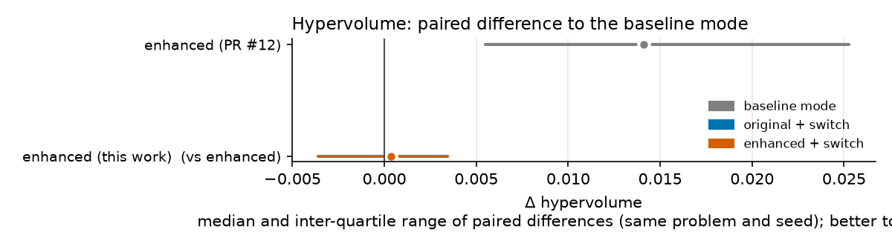
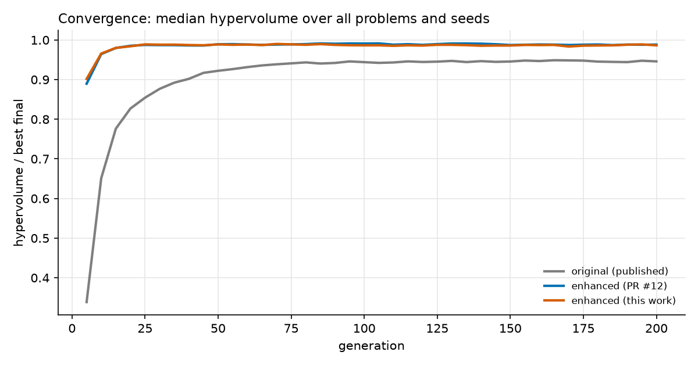
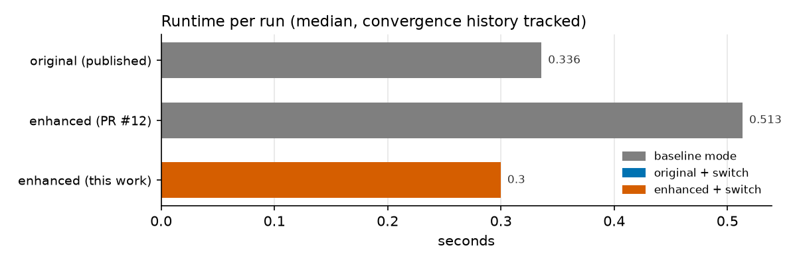

More charts: [IGD+](benchmarks/final_igd_plus_difference.png), [GD](benchmarks/final_gd_difference.png), [spread](benchmarks/final_spread_difference.png), [memory](benchmarks/final_memory.png).

#### Runtime without convergence history (the API's unsaved path)
Median of 7 seeds, ms per run:

| Problem | original | enhanced (PR #12) | enhanced (this work) |
|---|---|---|---|
| Salem Kharif | 285 | 342 | 297 |
| Erode Rabi | 305 | 506 | 295 |
| Coimbatore Summer | 373 | 618 | 295 |
| Erode Kharif, budget ₹230,000 | 394 | 491 | 407 |

The current enhanced engine costs 13–52 % less time than PR #12's. It is within ±4 % of the original engine, except where duplicates were frequent (Coimbatore Summer, 21 % faster). With history tracked, as in the study, the median over all 160 runs is faster than the original (0.300 vs 0.336 s).

### 3. Ablation: each switch on its own

#### 3.1 Against the original engine

| Variant | HV | GD | IGD | IGD+ | Spread | Spacing | Dup. rejected | Gen. to 99 % | Time (s) | Peak MB |
|---|---|---|---|---|---|---|---|---|---|---|
| original (published) | 0.4432 | 0.3282 | 0.0668 | 0.0406 | 0.547 | 0.093 | 738 | 55 | 0.401 | 1.17 |
| + LHS initialisation | 0.4434 | 0.3336 | 0.0650 | 0.0386 | 0.523 | 0.095 | 696 | 55 | 0.400 | 1.17 |
| + constraint-aware init. | 0.4433 | 0.3297 | 0.0671 | 0.0408 | 0.546 | 0.093 | 809 | 55 | 0.402 | 1.17 |
| + diversity crossover | 0.4403 | 0.3172 | 0.0667 | 0.0398 | 0.532 | 0.093 | 696 | 55 | 0.398 | 1.19 |
| + duplicate avoidance | 0.4453 | 0.3287 | 0.0663 | 0.0402 | 0.538 | 0.093 | **20** | 55 | **0.343** | 1.19 |
| + early stop (pymoo default) | 0.4432 | 0.3282 | 0.0668 | 0.0406 | 0.547 | 0.093 | 738 | 55 | 0.454 | 1.19 |
| + early stop (pymoo, ftol 0.05, xtol 0.005) | 0.4433 | 0.3280 | 0.0663 | 0.0410 | 0.545 | 0.093 | 719 | 55 | 0.460 | 1.16 |
| + parallel evaluation (4 threads) | 0.4432 | 0.3282 | 0.0668 | 0.0406 | 0.547 | 0.093 | 738 | 55 | 0.436 | 1.18 |

| Variant vs original | HV | GD | IGD+ | Spread | Time |
|---|---|---|---|---|---|
| + LHS initialisation | 84/76 (0.54) | 78/82 (0.93) | 82/78 (0.48) | 84/76 (0.61) | 93/67 (0.001) |
| + constraint-aware init. (acts on 40 budget runs only) | 19/21 (0.67) | 16/24 (0.15) | 23/17 (0.99) | 16/24 (0.33) | 86/74 (0.11) |
| + diversity crossover | 90/70 (0.22) | 92/68 (0.14) | 89/71 (0.18) | 79/81 (0.86) | 78/82 (0.69) |
| + duplicate avoidance | 91/69 (0.43) | 85/75 (0.72) | 77/83 (0.57) | 79/81 (0.55) | **153/7 (3e-23)** |
| + early stop (pymoo default): never triggered | 0/0 | 0/0 | 0/0 | 0/0 | 32/128 (3e-5) |
| + early stop (pymoo, loose): stopped early, changing the result, in 11 runs | 6/5 (0.53) | 7/4 (0.37) | 5/6 (0.86) | 7/4 (0.42) | 31/129 (4e-6) |
| + parallel evaluation: identical results | 0/0 | 0/0 | 0/0 | 0/0 | 37/123 (0.002) |

#### 3.2 Against the enhanced engine of PR #12

| Variant vs enhanced (PR #12) | HV | GD | IGD+ | Spread | Time |
|---|---|---|---|---|---|
| + LHS initialisation | 82/78 (0.48) | 92/64 (0.10) | 74/86 (0.98) | 77/83 (0.58) | 79/81 (0.76) |
| + constraint-aware init. | 24/16 (0.19) | 22/18 (0.55) | 20/20 (0.71) | 21/19 (0.46) | 96/64 (0.002) |
| + diversity crossover | 86/74 (0.33) | 85/75 (0.18) | 78/82 (0.65) | 88/72 (0.44) | 89/71 (0.014) |
| + duplicate avoidance | 80/80 (0.47) | 75/84 (0.63) | 69/91 (0.054) | **97/63 (0.001)** | **156/4 (1e-24)** |
| + early stop (pymoo, loose): changed the result in 22 runs | 10/12 (0.61) | 11/11 (0.94) | 14/8 (0.18) | 12/10 (0.78) | 35/125 (7e-6) |

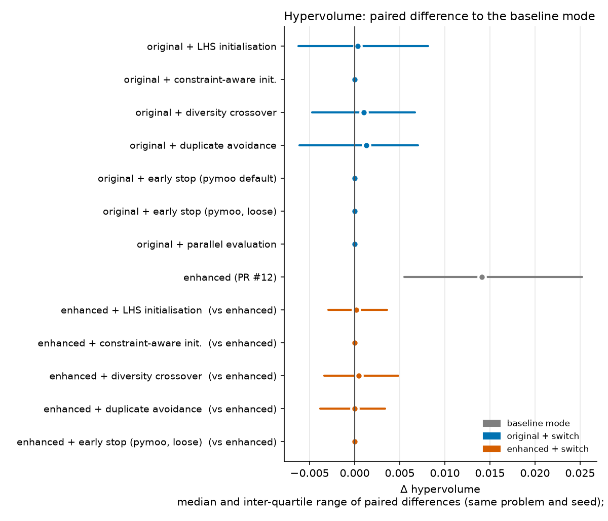

More charts: [IGD+](benchmarks/ablation_igd_plus_difference.png), [GD](benchmarks/ablation_gd_difference.png), [spread](benchmarks/ablation_spread_difference.png), [runtime](benchmarks/ablation_runtime.png), [memory](benchmarks/ablation_memory.png), [convergence](benchmarks/ablation_convergence.png).

### 4. Tight budgets: constraint-aware initialisation

The ablation budgets leave feasible plans in generation 1 of every run, so the constraint-aware switch has nothing to repair there. Here the budget is 5 % or 20 % above the cheapest possible plan, for the Kharif season of every district, 10 seeds (80 paired runs per engine).

| Engine | HV better/worse (p) | median ΔHV | IGD+ better/worse (p) | First feasible generation, off → on (median, max) |
|---|---|---|---|---|
| original | 48/32 (0.12) | +0.0026 | 49/31 (0.061) | 8, 19 → **1, 1** |
| enhanced (PR #12) | **57/23 (4e-5)** | +0.0060 | **49/31 (8e-4)** | 1, 1 → 1, 1 |

### 5. Profile (Salem Kharif and two contrasting problems, median of 5, no history)

| Phase (ms per run) | Salem Kharif original | Salem Kharif enhanced | Coimbatore Summer original | Coimbatore Summer enhanced | Erode Kharif budget original | Erode Kharif budget enhanced |
|---|---|---|---|---|---|---|
| Duplicate elimination | 46.5 | 45.2 | **94.3** | 39.1 | 49.0 | 43.6 |
| Evaluation | 38.2 | 37.8 | 37.9 | 37.4 | 37.8 | 38.4 |
| Monitoring (observation) | 34.1 | 40.2 | 33.3 | 38.7 | 34.4 | 40.7 |
| Mutation | 7.9 | 26.4 | 9.9 | 31.3 | 8.0 | 28.2 |
| Selection | 11.4 | 10.7 | 24.8 | 9.6 | 12.2 | 9.8 |
| **Optimisation total** | 307 | 327 | **420** | **320** | 406 | 420 |
| Mating rounds (calls) | 354 | 325 | 846 | 298 | 386 | 296 |
| Duplicates rejected | 317 of 16,408 | 188 of 16,276 | 7,191 of 23,260 | 134 of 16,204 | 503 of 16,590 | 150 of 16,222 |
| Over-budget evaluations | 0 | 0 | 0 | 0 | 993 | 605 |
| Front beaten by its lower-bound copy | 97.5 % | 58.8 % | 50.0 % | 41.3 % | 96.3 % | 42.5 % |

Other figures:
* CPU utilisation is 1.00 (single thread) in every case.
* No dominated solutions remain in the final population, because the whole population is the first front.
* Peak traced memory is 1.4–1.8 MB.
* Quality metrics take 0.7 ms per run, TOPSIS 0.6 ms and fuzzy inference under 0.1 ms (cached).

### 6. Exactness of the output-preserving changes

| Check | Result |
|---|---|
| 96-run fingerprint of the original engine (12 district-seasons × budget/none × 2 seeds × history on/off: population X and F, convergence history, plans) | `aa942cba79791d4f`, identical to `main` |
| Same fingerprint for PR #12's enhanced engine | `d0679ccd00e9aa59`, identical to `main` |
| 48 early-stopping runs, including an infeasible budget | identical to `main` |
| Golden digests of the original engine (tests) and of PR #12's enhanced engine recorded on `main` | identical |
| Parallel evaluation vs serial (1–7 workers, with and without a budget, both modes, population 300) | identical |
| Re-scored benchmark (shared metrics module vs the old inline functions) | identical HV, IGD+, spread, spacing on all runs |

<a id="doc-topsis-architecture"></a>

## TOPSIS Architecture

How the ranking stage turns NSGA-II's Pareto front into ranked plans: every function, its inputs and outputs, and who calls it. Section 1–4 describe the published ranking as it was before the dynamic engine; section 5 shows what the engine added around it. Weights: [TOPSIS_WEIGHT_ANALYSIS.md](#doc-topsis-weight-analysis). The engine: [TOPSIS_DYNAMIC_ENGINE.md](#doc-topsis-dynamic-engine).

### 1. Position in the pipeline

```
preprocessing ─► fuzzy assessment ─► NSGA-II (4 objectives) ─► feasible Pareto front (≤ population size plans)
                                                                      │
                                         ranking.filter_plans ◄───────┘   optional hard limits from the request
                                                                      │
                                         ranking.rank_plans  ◄────────┘   TOPSIS, sort, truncate to 50
                                                                      │
                                         RankedPlan list ─► API response, saved run, explanations, reports
```

TOPSIS never feeds back into the search. It only orders plans that NSGA-II already found, so the ranking stage can change without touching the optimiser, the objectives or the fuzzy outputs.

### 2. Criteria

The published ranking uses exactly the four NSGA-II objectives of each plan (`app/optimization/problem.py`):

| Criterion | Plan field | Type | Meaning |
|---|---|---|---|
| yield | `yield_tonnes` | benefit | expected yield after the fuzzy confidence adjustment, tonnes |
| cost | `cost_rs` | cost | fertiliser + pesticide + labour, ₹ |
| water | `water_liters` | cost | irrigation water net of effective rainfall, litres |
| env | `env_impact_score` | cost | √(nitrogen leaching proxy × carbon proxy) |

All four are totals for the farm, so they share the land size and scale together.

### 3. The TOPSIS computation (`app/decision/ranking.py`)

For plans i = 1…m and criteria j = 1…4:

| Step | Formula | Code |
|---|---|---|
| 1. Normalisation | n_ij = (x_ij − min_i x_ij) / (max_i x_ij − min_i x_ij); 0.5 for every plan when the column is constant | `_minmax_norm` |
| 2. Benefit/cost | cost criteria are flipped, g_ij = 1 − n_ij, so 1 is always the best value in the set | `_minmax_norm(higher_is_better=False)` |
| 3. Weighting | v_ij = w_j · g_ij | `np.column_stack(goodness) * w` |
| 4. Ideal best | A⁺_j = max_i v_ij (= w_j unless the column is constant) | `M.max(axis=0)` |
| 5. Ideal worst | A⁻_j = min_i v_ij (= 0 unless the column is constant) | `M.min(axis=0)` |
| 6. Distances | D⁺_i = √Σ_j (v_ij − A⁺_j)², D⁻_i = √Σ_j (v_ij − A⁻_j)² | Euclidean, `np.sqrt(((M - ideal) ** 2).sum(axis=1))` |
| 7. Relative closeness | C_i = D⁻_i / (D⁺_i + D⁻_i); 0.5 when both are 0 | `np.divide(..., where=denom > 1e-12)` |
| 8. Ranking | sort by C_i rounded to 4 places, descending (stable), keep the top `MAX_RETURNED_PLANS` = 50, number 1…n | `rank_plans` |

Differences from textbook TOPSIS (Hwang & Yoon 1981):

* **Min–max instead of vector normalisation.** Every criterion spans exactly [0, 1] within the plan set, so the ideal is w and the anti-ideal 0 on every criterion. With vector normalisation a criterion with a narrow relative range would carry less effective weight than its nominal weight. The cost is that the scores are relative to this plan set only.
* **Ranking on the rounded score.** Plans whose closeness agrees to 4 decimals keep NSGA-II's order. This keeps the API's `composite_score` and the order consistent.

### 4. Functions and call sites

| Function | Input → output | Called by |
|---|---|---|
| `filter_plans(plans, max_cost, max_water_liters, min_yield_tonnes, max_env_impact)` | FarmPlans → FarmPlans within the request's hard limits | `plan_service.run_pipeline` |
| `preference_weights(preference)` | name → [yield, cost, water, env] weights (unknown → balanced) | `rank_plans`, `plan_service` (meta), `explanation_service`, `district_service`, `topsis_service` |
| `normalise_weights(weights)` | 4 non-negative numbers → weights summing to 1 | `rank_plans` (simulation priority sliders), `plan_service`, `explanation_service` |
| `topsis_scores(yields, costs, waters, envs, w)` | four columns + weights → (closeness, goodness columns) | `rank_plans`, `explanation_service._rank_under_all_preferences`, `district_service` (goodness only), `simulation_service` (goodness only, equal weights) |
| `rank_plans(plans, crop_confidence_map, preference, max_plans, weights)` | FarmPlans → RankedPlans: rank, composite_score (C rounded to 4), `normalized_scores` (the goodness columns), `confidence_label`, `trade_off_summary`, rounded allocation | `plan_service`, `dashboard_service` (Analytics front, Comparison plans A/B/C), `explanation_service` (comparison context), benchmark and profiling scripts |
| `to_dict_list(ranked)` | RankedPlans → dicts | everything that returns plans |

Outputs per plan besides the score:

* `normalized_scores`: the four goodness values (1 = best in this set).
* `confidence_label`: land-weighted crop confidence, bucketed.
* `trade_off_summary`: raw (unflipped) min–max position of each objective, worded High/Moderate/Low.
* `allocation_percent`: largest-remainder rounding so shares sum to 100.00.

#### Where weights come from

| Source | Weights |
|---|---|
| `FarmPlanRequest.preference` (API, Run Optimization) | `_PREFERENCE_WEIGHTS[preference]` |
| Scenario Simulation priorities (0–100 sliders) | `normalise_weights([yield, cost, water, env])` via `PipelineAdjustments.topsis_weights` |
| Comparison page | balanced, max_yield and min_cost on one front (plans A, B, C) |
| Analytics, District Intelligence | balanced |

### 5. What the dynamic engine adds

```
                    ┌─────────────── app/decision/profiles.py ───────────────┐
request.profile ───►│ resolve(profile, custom_weights) → WeightSpec          │
                    └────────────────────────────────────────────────────────┘
                                         │ weights over 10 criteria
feasible front ──► app/decision/criteria.py plan_criteria() ──► raw criterion columns
                                         │
                   ranking.criteria_closeness() ──► closeness (same maths as §3)
                                         │
                   ranking.rank_plans(criteria_values, criteria_weights, criteria_directions)
                                         │
     app/decision/topsis_explain.py: breakdown · plan_terms · explain_pair · compare_profiles
                                         │
     app/services/topsis_service.py: rank_front · topsis_meta · profile_comparison · rerank_saved_run
```

* **`weighted_closeness(goodness, w)`** holds steps 3–7, unchanged. `topsis_scores` now calls it, and so does the new **`criteria_closeness(values, directions, weights)`**, which ranks over any criteria with a positive weight in the order given. With the four objectives and the balanced weights it returns exactly `topsis_scores`' array (tested bit for bit on real and random fronts).
* **`rank_plans`** gains `criteria_values`, `criteria_weights` and `criteria_directions`. Without them it runs the original code path. `normalized_scores` always report the four objectives.
* **Balanced is routed through the original path.** `topsis_service.rank_front` calls `rank_plans(preference="balanced")` for the Balanced profile, so its output is the published ranking by construction, not just by equivalence.
* **The ranked front is stored** with saved runs (`ranked_front`, not part of the API response), so a run can be re-ranked later over exactly the plans it was ranked from.

Every original call site in §4 is unchanged: Comparison, Analytics, District Intelligence and Scenario Simulation keep their preferences and slider weights.

<a id="doc-topsis-weight-analysis"></a>

## TOPSIS Weight Analysis

An audit of the weights the published ranking uses: why each exists, how it was chosen, whether it is hard-coded or configurable, and whether it is justified. Numbers come from `scripts/benchmark_topsis.py` (120 Pareto fronts: 4 districts × 3 seasons, with and without a budget, seeds 0–4, published NSGA-II settings) unless stated otherwise. Raw results: `benchmarks/topsis_benchmark.json`.

### 1. The weights

| Preference | yield | cost | water | env | Defined in |
|---|---|---|---|---|---|
| balanced (default) | 0.300 | 0.2333 | 0.2333 | 0.2333 | `ranking._PREFERENCE_WEIGHTS`, from `_YIELD_GROUP_WEIGHT = 0.30` |
| max_yield | 0.55 | 0.15 | 0.15 | 0.15 | same dict |
| min_cost | 0.15 | 0.55 | 0.15 | 0.15 | same dict |
| min_water | 0.15 | 0.15 | 0.55 | 0.15 | same dict |
| min_env_impact | 0.15 | 0.15 | 0.15 | 0.55 | same dict |
| Scenario Simulation priorities | user sliders 0–100, normalised | | | | `PrioritiesIn` → `normalise_weights` |

### 2. Findings per weight

#### 2.1 Balanced: yield 0.30, the others 0.70/3 each

**Why it exists.** Balanced is the default recommendation: one plan that is good on all four objectives, like the reference paper's "Plan #1 (Best)".

**How it was chosen.** By hand, against real Pareto fronts. The code comment and `notes/methodology_notes.md` give the reason: yield is strongly correlated with the other three objectives, so equal weights let the three "footprint" objectives outvote yield and push the #1 plan to a low-input corner.

**Is the reason right?** Yes. Median Spearman correlation across the 120 fronts:

| pair | ρ |
|---|---|
| yield ~ cost | +0.96 |
| yield ~ water | +0.90 |
| yield ~ env | +0.90 |
| water ~ env | +0.72 |

On a Pareto front more yield almost always means more of everything else, so the three cost-type objectives act largely as one criterion.

**Does 0.30 do what it claims?** Measured on 72 fronts (seeds 0–2), as the position of the #1 plan's yield within its front:

| yield weight | #1 plan's yield percentile (median) | #1 is a corner plan (≤ 5th or ≥ 95th percentile) |
|---|---|---|
| 0.25 (equal) | 25th | 11 % |
| **0.30 (balanced)** | **41st** | **6 %** |
| 0.40 | 91st | 40 % |

0.30 gives the most central pick and the fewest corner plans of the three. It does what it was tuned to do.

**How stable is it?** Not very, at the level of the single #1 plan. Moving the yield weight to 0.27 or 0.33 (±10 %) changes the #1 plan on 97 % of fronts. The replacement is close: its median rank under 0.30 is 4 (worst 37), and its closeness is 0.0028 lower (median). But it differs by up to 17.8 % (median) on at least one objective. The front is dense (80 plans along a near-continuous surface), so the closeness surface near the top is flat. This is a property of the problem, not of the weight. It is the main reason the dynamic engine shows the top plans, the reasoning between neighbours and a profile comparison, not a single answer.

**Is it scientifically justified?** Partly. The direction (more weight on yield than on any single footprint objective) is justified by the measured correlations and the centrality result above. The exact value 0.30 is a hand-tuned choice: there is no elicitation from farmers and no derivation from a weighting method.

For reference, two objective weighting methods applied to the same fronts' normalised objectives (median over fronts):

| method | yield | cost | water | env |
|---|---|---|---|---|
| entropy (Hwang & Yoon 1981) | 0.278 | 0.298 | 0.195 | 0.200 |
| CRITIC (Diakoulaki et al. 1995) | 0.457 | 0.182 | 0.188 | 0.172 |
| balanced | 0.300 | 0.233 | 0.233 | 0.233 |

CRITIC rewards criteria that conflict with the others; because yield conflicts with all three footprint objectives, it gives yield the largest weight. The balanced weights sit between the two methods, which supports giving yield more weight than equal shares without pinning down 0.30.

#### 2.2 Single-objective preferences: 0.55 / 0.15

**Why they exist.** Comparison plans B (max_yield) and C (min_cost), and the Run Optimization drop-down.

**How they were chosen.** Convention: one criterion gets a clear majority, and the rest keep enough weight to break ties. No tuning is documented.

**Justified?** As a tie-breaking convention, yes. With 0.55 the named objective dominates, but a plan that is marginally better on it and much worse elsewhere does not automatically win. The value itself is arbitrary.

#### 2.3 Hard-coded or configurable?

| Weight | Status before this work | Status now |
|---|---|---|
| balanced, preferences | hard-coded in `ranking.py`, not in `config.py`, not exposed through the API | unchanged (the published ranking) |
| Scenario Simulation priorities | user-configurable, 4 objectives | unchanged |
| any other criteria | did not exist | ranking profiles and custom weights over 10 criteria ([TOPSIS_PROFILE_GUIDE.md](#doc-topsis-profile-guide)) |

### 3. Problems found

1. **The weights could only express the optimiser's objectives.** A farmer could not ask for "profit" or "suits my soil". Price, rainfall dependency and soil status are in the dataset, but did not reach the ranking.
2. **No explanation of the weights' effect.** The explanation reported the weights and the closeness, but not how each criterion contributed or why one plan beat the next.
3. **The single #1 is sensitive** (§2.1). The interface presented it as *the* plan.
4. **Redundancy among the extra criteria** (measured for the new ones; see [TOPSIS_DYNAMIC_ENGINE.md](#doc-topsis-dynamic-engine) §3.3):
   * income ranks plans like yield (ρ = +1.00);
   * budget headroom ranks them exactly opposite to cost (ρ = −1.00);
   * soil suitability is close to the reverse of environmental impact (ρ = −0.86).

   Weight on two redundant criteria acts like extra weight on one.

### 4. What the dynamic engine does about it

* **Balanced is untouched.** It is still the default, and still the exact published ranking (120/120 fronts identical, bit for bit).
* **Profiles state their weights' origin.** Each profile is three importance tiers turned into weights with one published rule: rank-sum weights (Stillwell, Seaver & Edwards 1981). They are not tuned numbers.
* **Custom weights are validated.** Each must be between 0 and 1, and they must sum to 1.
* **Explanations show the effect of the weights:** weight → contribution → score, why each plan beats the next, and the rank under every profile.
* **The interface shows the top plans and the profile comparison,** so the sensitivity of the single #1 is visible rather than hidden.
* **Redundancy is documented** with each criterion's definition and kept out of the standard profiles where it would double-count. For example, Profit does not weight budget, and Low cost uses budget only as a deliberate emphasis on cost.

<a id="doc-topsis-dynamic-engine"></a>

## Dynamic TOPSIS Engine

The ranking stage, made user-adaptive. A farmer chooses what matters (a ranking profile or their own weights), and the same Pareto front is ranked with those weights, explained criterion by criterion, and compared across profiles. NSGA-II, its four objectives and the fuzzy assessment are inputs and are never changed. Balanced, the default, is the published ranking bit for bit.

Related documents:
* [TOPSIS_ARCHITECTURE.md](#doc-topsis-architecture): the ranking code before this work.
* [TOPSIS_WEIGHT_ANALYSIS.md](#doc-topsis-weight-analysis): audit of the published weights.
* [TOPSIS_PROFILE_GUIDE.md](#doc-topsis-profile-guide): the profiles and custom weights.
* [TOPSIS_EXPLAINABILITY.md](#doc-topsis-explainability): how rankings are explained.
* [TOPSIS_COMPARISON.md](#doc-topsis-comparison): comparison mode and benchmark.

### 1. Summary

| | Before | After |
|---|---|---|
| Criteria | yield, cost, water, environmental impact | the same four plus market price, income, budget, soil suitability, land use, rainfall exposure |
| Weights | 5 fixed preferences, or 4 simulation sliders | the same, plus 5 ranking profiles and custom weights over 10 criteria |
| Default | balanced preference | Balanced profile = the balanced preference, identical output |
| Explanation | weights and closeness | weight → normalised value → contribution → distances → closeness per criterion; why each plan beats the next; rank under every profile |
| Comparison | Comparison page: 3 preferences | any run under all 5 profiles: best plan, rank changes, Kendall's τ, top-5 overlap, weight differences |
| Re-ranking a saved run | not possible | `GET/POST /api/results/{run_id}/topsis`, exact, no NSGA-II re-run |

### 2. Architecture

```
app/decision/criteria.py        CRITERIA, CRITERIA_META, crop_attributes(), plan_criteria(), soil_fit()
app/decision/profiles.py        PROFILES, rank_sum_weights(), validate_custom_weights(), resolve() → WeightSpec, catalogue()
app/decision/ranking.py         weighted_closeness(), criteria_closeness(), rank_plans(criteria_*) — plus the unchanged original path
app/decision/topsis_explain.py  breakdown(), plan_terms(), explain_pair(), compare_profiles(), ranks_from_closeness()
app/services/topsis_service.py  rank_front(), topsis_meta(), profile_comparison(), ranking_explanation(), rerank_saved_run()
app/services/plan_service.py    request.profile / custom_weights / compare_profiles; meta.topsis; ranked_front
app/services/explanation_service.py  explanation.topsis section; profile-aware weights and wording
app/main.py                     GET /api/topsis/profiles; GET|POST /api/results/{run_id}/topsis
frontend/src/components/topsis/ ProfileSelector.jsx (selector + custom builder), TopsisPanel.jsx (ranking, reasoning, comparison)
frontend/src/utils/topsisView.js     validation and formatting
```

Data flow of a run with a profile:

1. NSGA-II returns the feasible front.
2. `filter_plans` applies the request's hard limits.
3. `resolve(profile, custom_weights)` gives a `WeightSpec` (weights over the 10 criteria, summing to 1).
4. If the spec weights any criterion beyond the four objectives, `crop_attributes(region_profile, fuzzy)` reads each candidate crop's price, N/P/K doses and rainfall dependency from the crop rows the run used. `plan_criteria` then computes the criterion columns.
5. `rank_plans` ranks over the criteria with a positive weight.
6. `meta.topsis` records the spec, and the filtered front is stored with the saved run as `ranked_front`.

Balanced skips steps 3–5 and calls the original `rank_plans(preference="balanced")`.

### 3. Criteria

#### 3.1 Definitions

For a plan with crop areas aᵢ (shares sᵢ = aᵢ/Σa), expected tonnes tᵢ = aᵢ · yieldᵢ · confidenceᵢ (exactly the NSGA-II yield, per crop), price pᵢ (dataset `MSP_Rs_Qtl`, ₹/quintal):

| Criterion | Direction | Value | Source |
|---|---|---|---|
| Yield | benefit | Σ tᵢ (t) | NSGA-II f1 |
| Production cost | cost | ₹ | NSGA-II f2 |
| Water | cost | irrigation litres | NSGA-II f3 |
| Environmental impact | cost | index | NSGA-II f4 |
| Market price | benefit | Σ tᵢ pᵢ / Σ tᵢ, the tonnage-weighted price (₹/qtl) | crop.csv `MSP_Rs_Qtl` |
| Income | benefit | 10 Σ tᵢ pᵢ − cost, indicative net income (₹) | as the explanation's indicative economics |
| Budget | benefit | budget − cost (₹); 0 for every plan without a budget | request |
| Soil suitability | benefit | Σ sᵢ · fitᵢ, fitᵢ = 1 − ⅓ Σ_{N,P,K} (doseᵢ / max dose) × deficit(status) | crop.csv doses, land.csv N/P/K status: Low 1, Medium 0.5, High 0 |
| Land use | benefit | Shannon evenness −Σ sᵢ ln sᵢ / ln n (0 = one crop, 1 = equal shares) | allocation |
| Rainfall exposure | cost | Σ sᵢ · RAINFALL_DEPENDENCY_FACTORᵢ (Very Low 0.1 … High 1.0) | crop.csv `Rainfall_Dependency`, config |

#### 3.2 Rationale and sources

* **Market price** captures which crops fetch more per quintal, independent of tonnage. **Income** combines tonnage and price minus cost. Both use the dataset's unvalidated price column; the explanation service already flags those prices (some crops have no notified MSP).
* **Budget headroom** lets a profile prefer plans well under the cap. Every ranked plan already satisfies the budget, because NSGA-II enforces it as a hard constraint.
* **Soil suitability** follows the FAO land-evaluation idea of matching crop requirements to land qualities (FAO 1976; Sys et al. 1993), with nutrient availability as the quality. It is a proxy built from the data the project has (no per-crop soil data exists), not a validated suitability class.
* **Land use** rewards crop diversification, which spreads production risk (Di Falco & Perrings 2005; Lin 2011).
* **Rainfall exposure** penalises land in rain-dependent crops. It is the same dependency factor the fuzzy layer uses for crop confidence.

#### 3.3 Correlations: read before weighting

Median Spearman ρ over 120 fronts (`benchmarks/topsis_benchmark.json`):

| pair | ρ | consequence |
|---|---|---|
| income ~ yield | +1.00 | on one front, income orders plans like yield |
| budget ~ cost | −1.00 | budget headroom orders plans exactly opposite to cost, i.e. it is extra cost weight |
| soil ~ env | −0.86 | soil-suited plans are the low-impact ones |
| rainfall ~ water | −0.74 | rain-fed crops need less irrigation, but are more exposed to rainfall shortfalls |
| income ~ market price | −0.39 | high-tonnage crops in this data are the cheaper ones per quintal |
| land ~ yield | −0.16 | diversification is nearly independent of yield |

Weighting two strongly correlated criteria acts like extra weight on one. Rainfall exposure deliberately pulls against water saving: a farmer can trade irrigation water against rainfall risk.

### 4. Mathematics

Identical to the published ranking (TOPSIS_ARCHITECTURE.md §3) over the criteria with wⱼ > 0:

```
gᵢⱼ  = (xᵢⱼ − minᵢ xᵢⱼ) / (maxᵢ xᵢⱼ − minᵢ xᵢⱼ)      flipped (1 − ·) for cost criteria; 0.5 if constant
vᵢⱼ  = wⱼ gᵢⱼ
A⁺ⱼ = maxᵢ vᵢⱼ,  A⁻ⱼ = minᵢ vᵢⱼ
D⁺ᵢ = √Σⱼ (vᵢⱼ − A⁺ⱼ)²,  D⁻ᵢ = √Σⱼ (vᵢⱼ − A⁻ⱼ)²
Cᵢ  = D⁻ᵢ / (D⁺ᵢ + D⁻ᵢ)
```

Properties the tests check:

* Zero-weight criteria do not enter the matrix.
* A constant criterion (for example budget without a budget) contributes nothing.
* Scaling all weights leaves C unchanged.
* C ∈ [0, 1], and identical plans score 0.5.
* A hand-computed three-plan example gives C = (0.25, 0.5, 0.75).

**Mathematical validation of Balanced.** `criteria_closeness` with the four objectives and the balanced weights returns `topsis_scores`' array bit for bit:

* on 5 preferences × a real front, and on 50 random sets (`tests/test_topsis_ranking.py`);
* on all 120 benchmark fronts.

The full API response of `profile=balanced` equals the default request's apart from wall-clock timings, and the 120 recorded ranking fingerprints of the default request match `main` exactly (all districts × seasons × preferences, with and without a budget).

### 5. API

| Endpoint | Change |
|---|---|
| `POST /api/farm-plans` | optional `profile` (balanced, profit, water, sustainability, low_cost, custom), `custom_weights` (criterion → weight, required for custom, must sum to 1), `compare_profiles`. A profile and a non-balanced `preference` cannot be combined (422). Response: `meta.topsis` always; `meta.profile_comparison` when requested |
| `GET /api/topsis/profiles` | new: profiles, weights, tiers, criteria definitions, custom-weight rules and defaults |
| `GET /api/results/{run_id}/topsis?profile=…&compare=…` | new: re-rank a saved run's front under a standard profile |
| `POST /api/results/{run_id}/topsis` | new: the same with `{"profile": "custom", "custom_weights": {...}}` |
| `GET /api/results/{run_id}/explanation`, `GET /api/comparison/{district}/explanation` | new optional `topsis` section |
| `GET /api/results`, `GET /api/history/{district}` | new optional `ranking` label |

Everything is additive: requests without the new fields get the same plans as before, and no field was removed or renamed. Reference: [API_REFERENCE.md](#doc-api-reference).

### 6. Before and after: an example

Salem Kharif 2024, 5 ha, budget ₹400,000, one NSGA-II run (80 Pareto-optimal plans), ranked under each profile. The plans are the same 80 in every row:

| Profile | #1 plan | TOPSIS score | its rank under Balanced |
|---|---|---|---|
| Balanced (before and after) | Tapioca 91 %, Groundnut 5 %, Maize 3 % | 0.6319 | 1 |
| Profit priority | Tapioca 96 %, Maize 3 % | 0.5613 | 8 |
| Water saving | Groundnut 89 %, Maize 11 % | 0.7522 | 34 |
| Sustainability | Groundnut 89 %, Maize 11 % | 0.6412 | 34 |
| Low cost | Groundnut 67 %, Maize 32 % | 0.7565 | 32 |

Profit picks the high-tonnage tapioca plan (13.6 t/ha, ₹39,895/ha). Water saving picks a groundnut-maize plan using a fraction of the water (1.4 t/ha, ₹33,492/ha). Both are on the same Pareto front: the profile only decides which trade-off comes first.

Across the 120 benchmark fronts ([TOPSIS_COMPARISON.md](#doc-topsis-comparison)), each profile moves the #1 plan in the direction it claims (paired against Balanced's #1):

| Profile | Moves the #1 plan towards | better / worse fronts |
|---|---|---|
| Profit | higher income | 112 / 0 |
| Water saving | less water | 110 / 4 |
| Sustainability | less water | 107 / 5 |
| Sustainability | lower impact | 93 / 19 |
| Sustainability | better soil fit | 68 / 21 |
| Low cost | lower cost | 94 / 7 |

### 7. Performance

Median per 80-plan front (benchmark, one laptop):

| Operation | Time |
|---|---|
| published ranking (`rank_plans`, balanced) | 0.48 ms |
| ranking with a 10-criterion profile | 0.59 ms |
| five-profile comparison | 1.36 ms |
| ranking explanation (top 10, pairs) | 0.76 ms |
| whole `POST /api/farm-plans` (unsaved, Salem Kharif) | ≈ 0.29 s with or without a profile or comparison (NSGA-II dominates) |

A saved run grows by the stored front: 134 KB → 207 KB for 80 plans.

### 8. Screenshots

| | |
|---|---|
| Profile selector with the custom weight builder | 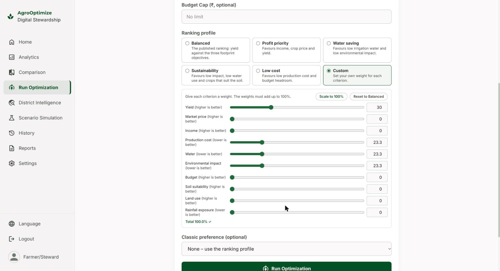 |
| Ranking: selected profile, weight distribution, TOPSIS scores | 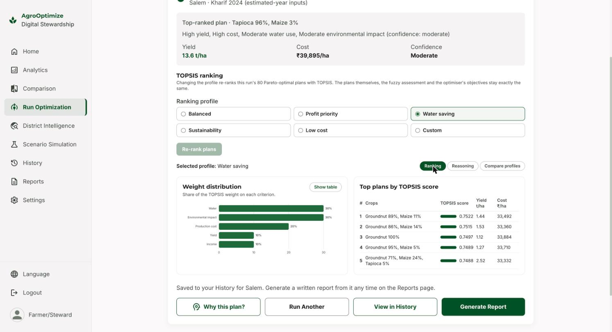 |
| Reasoning: why each plan beats the next; weight → contribution → score | 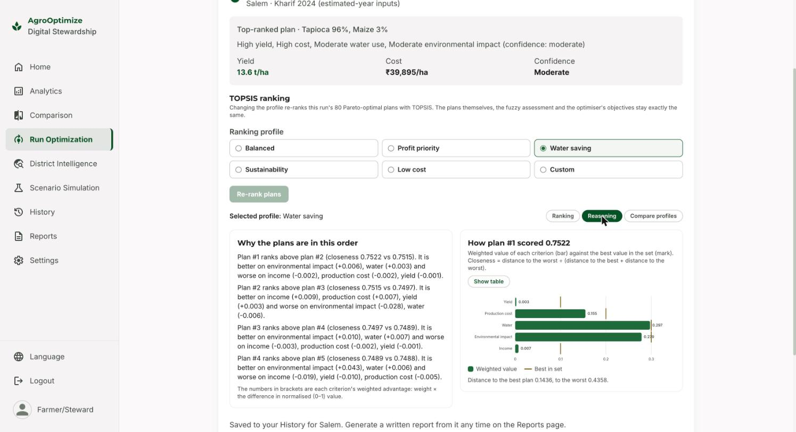 |
| Compare profiles: best plan per profile, ranking changes | 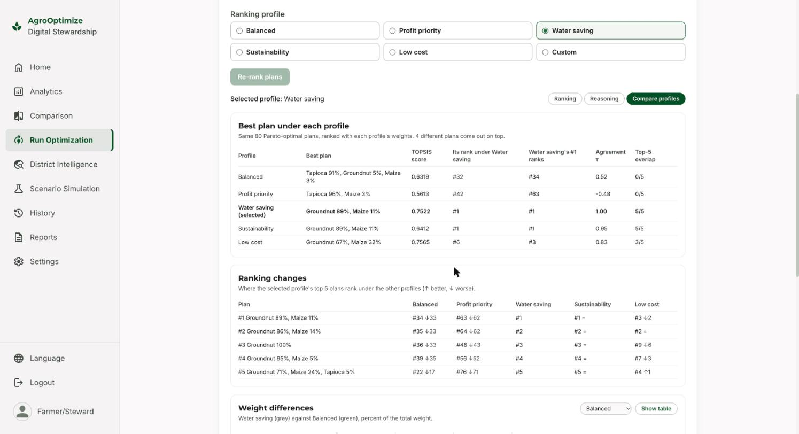 |
| Weight differences between profiles | 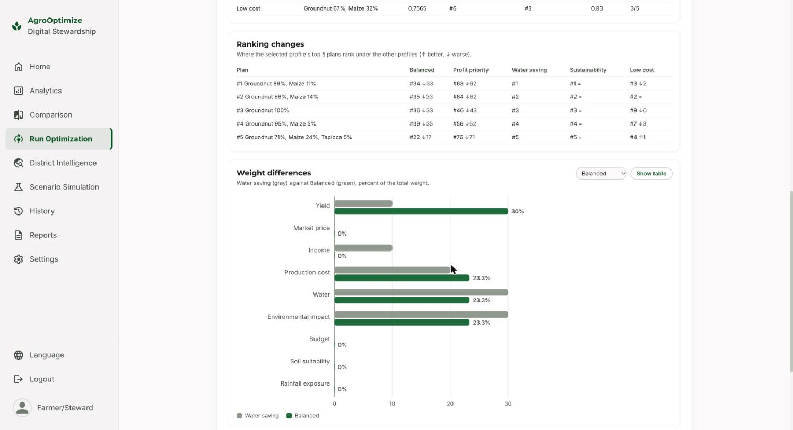 |
| "Why this plan?": TOPSIS score section | 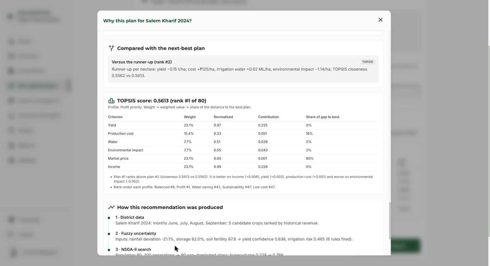 |

### 9. Testing

| Suite | Tests | Covers |
|---|---|---|
| `tests/test_topsis_ranking.py` | 16 | bit-identity with the published maths, hand-computed example, TOPSIS properties |
| `tests/test_topsis_criteria.py` | 19 | each criterion against its definition and against the pipeline's own numbers |
| `tests/test_topsis_profiles.py` | 30 | weights, tiers, the brief's priorities, custom weight validation, catalogue |
| `tests/test_topsis_engine.py` | 55 | Balanced unchanged; profile switching changes only the ranking; explanation maths; comparison; saved-run re-ranking; request validation; API; explanation section; speed |
| `frontend/src/utils/topsisView.test.js` | 14 | builder validation, fractions, rows |
| `frontend/src/components/topsis/topsis.test.jsx` | 7 | selector, builder, weight chart, contribution card, comparison, explanation section |

All earlier suites pass unchanged: 797 backend tests (677 before) and 89 frontend tests (68 before).

### 10. Limitations

* **Scores are relative to the plan set.** Min–max normalisation makes every score relative to the front being ranked, as before. A re-ranked older run without a stored front is ranked over its 50 returned plans and says so (`ranked_over: returned_plans`).
* **The #1 plan is sensitive to small weight changes** (TOPSIS_WEIGHT_ANALYSIS.md §2.1). The interface shows the top plans and the comparison for that reason.
* **Prices are unvalidated.** Market price and income use the dataset's price column, flagged elsewhere as unvalidated.
* **Soil suitability is a nutrient-demand proxy,** not a validated FAO suitability class.
* **Some criteria are redundant on one front** (§3.3). The standard profiles avoid double-counting, but a custom profile can still do it.
* **Profile weights come from importance tiers,** not from eliciting farmers' preferences.
* **Rank reversal.** TOPSIS can reverse ranks when plans are added or removed (García-Cascales & Lamata 2012), so the order depends on the filters applied before ranking.
* **Classic preferences are a separate path.** max_yield and the other classic preferences rank over the four objectives only, and cannot be combined with a profile.

### 11. Future improvements

1. Elicit weights from farmers with AHP or swing weighting, and store them per user.
2. A robust recommendation: the plan that stays in the top k under weight perturbations (stochastic multicriteria acceptability analysis, Lahdelma & Salminen 2001).
3. Validated prices (Agmarknet modal prices) for market price and income.
4. Crop-specific soil suitability from soil-survey data.
5. Show the profile comparison on the Comparison page as well, in place of the fixed plans A/B/C.
6. A rank-reversal-free variant (for example a fixed reference point) for comparisons across runs.

### References

* Barron, F. H. & Barrett, B. E. (1996). Decision quality using ranked attribute weights. *Management Science* 42(11).
* Di Falco, S. & Perrings, C. (2005). Crop biodiversity, risk management and the implications of agricultural assessments. *Ecological Economics* 55(4).
* Diakoulaki, D., Mavrotas, G. & Papayannakis, L. (1995). Determining objective weights in multiple criteria problems: the CRITIC method. *Computers & Operations Research* 22(7).
* FAO (1976). *A Framework for Land Evaluation.* FAO Soils Bulletin 32.
* García-Cascales, M. S. & Lamata, M. T. (2012). On rank reversal and TOPSIS method. *Mathematical and Computer Modelling* 56(5–6).
* Hwang, C.-L. & Yoon, K. (1981). *Multiple Attribute Decision Making: Methods and Applications.* Springer.
* Lahdelma, R. & Salminen, P. (2001). SMAA-2: stochastic multicriteria acceptability analysis for group decision making. *Operations Research* 49(3).
* Lin, B. B. (2011). Resilience in agriculture through crop diversification. *BioScience* 61(3).
* Stillwell, W. G., Seaver, D. A. & Edwards, W. (1981). A comparison of weight approximation techniques in multiattribute utility decision making. *Organizational Behavior and Human Performance* 28(1).
* Sys, C., Van Ranst, E., Debaveye, J. & Beernaert, F. (1993). *Land Evaluation, Part III: Crop Requirements.* General Administration for Development Cooperation, Brussels.

<a id="doc-topsis-profile-guide"></a>

## TOPSIS Profile Guide

Which ranking profile to choose, what each one weights, and how to build your own. Profiles change only the order of the Pareto-optimal plans: every profile ranks the same plans, found by the same NSGA-II run. Criterion definitions: [TOPSIS_DYNAMIC_ENGINE.md](#doc-topsis-dynamic-engine) §3.

### 1. Choosing a profile

| If you want… | Choose | What usually happens to the top plan (vs Balanced) |
|---|---|---|
| the published recommendation, a central trade-off | **Balanced** | — |
| the most income from the season | **Profit priority** | yield +37 %, income +78 %, but water +59 % and cost +21 % |
| to save irrigation water | **Water saving** | water −54 %, impact −31 %, yield −56 % |
| low impact, low water use and crops that suit your soil | **Sustainability** | water −40 %, impact −12 %, yield −41 % |
| to spend as little as possible | **Low cost** | cost −18 %, yield −71 % |
| your own priorities | **Custom** | whatever your weights imply |

Percentages compare the median #1 plan of each profile with Balanced's median #1 over the same 120 fronts (`benchmarks/topsis_benchmark.json`, chart `benchmarks/topsis_top_plan_objectives.png`). Sustainability's #1 also has a better soil fit (+8 %) at slightly higher rainfall exposure (+9 %).

### 2. Profile definitions

Each profile except Balanced lists criteria in three importance tiers. The weights follow from one rule, **rank-sum weights over the tiers**: high = 3 points, medium = 2, low = 1, divided by the total (Stillwell, Seaver & Edwards 1981). Unlisted criteria get 0.

| Profile | High | Medium | Low |
|---|---|---|---|
| Balanced | published weights: yield 0.30; cost, water, impact 0.70/3 each ([TOPSIS_WEIGHT_ANALYSIS.md](#doc-topsis-weight-analysis)) | | |
| Profit priority | income, market price, yield | production cost | water, environmental impact |
| Water saving | water, environmental impact | production cost | yield, income |
| Sustainability | environmental impact, water, soil suitability | yield, production cost, rainfall exposure | income |
| Low cost | production cost, budget | water, environmental impact | yield |

Design choices:

* **Every profile keeps all four optimiser objectives.** Production cost and the other footprint objectives always count for something, so no profile can pick a plan that is absurd on an objective the optimiser traded off.
* **Profit includes cost (medium).** Income already subtracts cost, but cost also stands for the money at risk before harvest.
* **Sustainability includes rainfall exposure (medium).** Saving irrigation water pushes towards rain-fed crops. Rainfall exposure keeps the cost of that, dependence on the monsoon, in view (ρ(rainfall, water) = −0.74).
* **Low cost includes budget (high).** On one front budget headroom ranks plans exactly like cost, so it doubles the emphasis on cost when a budget is set. Without a budget it is constant and neutral.

### 3. Weight table (percent)

| Criterion | Balanced | Profit | Water saving | Sustainability | Low cost |
|---|---|---|---|---|---|
| Yield | 30.0 | 23.1 | 10.0 | 12.5 | 9.1 |
| Market price | – | 23.1 | – | – | – |
| Income | – | 23.1 | 10.0 | 6.2 | – |
| Production cost | 23.3 | 15.4 | 20.0 | 12.5 | 27.3 |
| Water | 23.3 | 7.7 | 30.0 | 18.8 | 18.2 |
| Environmental impact | 23.3 | 7.7 | 30.0 | 18.8 | 18.2 |
| Budget | – | – | – | – | 27.3 |
| Soil suitability | – | – | – | 18.8 | – |
| Land use | – | – | – | – | – |
| Rainfall exposure | – | – | – | 12.5 | – |

Chart: `benchmarks/topsis_profile_weights.png`. Machine-readable: `GET /api/topsis/profiles`.

**Sensitivity to the weighting rule.** A different rule for the same tiers, rank-order-centroid weights (Barron & Barrett 1996), gives the same #1 plan on:

| Profile | same #1 | ROC's #1 under rank-sum (median rank) | closeness gap (median) | largest objective difference (median) |
|---|---|---|---|---|
| Profit | 76 % of fronts | 1 | 0.0000 | 0 % |
| Low cost | 45 % | 2 | 0.0002 | 1.3 % |
| Water saving | 22 % | 3 | 0.0019 | 12 % |
| Sustainability | 5 % | 6.5 | 0.0035 | 25 % |

The tiers decide the kind of plan, and the rule decides between close neighbours. For Sustainability, with seven weighted criteria, the rule matters most.

### 4. Custom weights

Give each of the ten criteria a weight.

| Rule | Detail |
|---|---|
| Range | each weight between 0 and 1 (0–100 % in the app) |
| Sum | the weights must sum to 1 (tolerance 10⁻⁶; the app requires 100.0 % ± 0.01) |
| Omitted criteria | weight 0 |
| Unknown criteria | rejected |
| Defaults | the Balanced weights (`custom.default_weights` in `GET /api/topsis/profiles`; "Reset to Balanced" in the app) |
| Errors | `422` with the reason, e.g. "Custom weights must sum to 1 (they sum to 0.9)" |

In the app, **Scale to 100%** rescales the sliders proportionally.

API:

```json
POST /api/farm-plans
{"location": "Salem", "season": "Kharif", "total_land_ha": 5,
 "profile": "custom", "custom_weights": {"yield": 0.3, "water": 0.3, "soil": 0.2, "rainfall": 0.2}}
```

Tips:

* **Avoid redundant pairs.** Weighting income and yield together, or budget and cost together, counts one thing twice (ρ = +1.00 and −1.00).
* **Expect large swings from one criterion.** A single criterion with a large weight usually picks a corner of the front: the best plan for that criterion, whatever the rest.
* **Land use is nearly independent of the other criteria** (ρ with yield −0.16). It is the criterion for "don't put everything in one crop".

### 5. Profiles and classic preferences

The five classic preferences (balanced, max yield, min cost, min water, min environmental impact) still work in the API and in the app's "Classic preference" drop-down. They weight the four objectives only (0.55 on the named one). A request may use a preference or a profile, not both. Balanced is the same in both.

<a id="doc-topsis-explainability"></a>

## TOPSIS Explainability

Every ranked plan can be explained from its weights to its score with numbers that reproduce the ranking exactly. This document defines what is reported, how it is computed (`app/decision/topsis_explain.py`), and where it appears.

### 1. What is explained

For every recommendation:

| Question | Answer given | Field |
|---|---|---|
| Which profile was used? | profile name and label (or the classic preference / custom priorities) | `meta.topsis.profile`, `.label` |
| Which weights were applied? | weight of every criterion, summing to 1 | `meta.topsis.weights`, `.criteria` |
| How did the weights affect this plan? | per criterion: weight → normalised value → weighted contribution → gap to the best and worst plan → share of the distance to the best plan | `plan.criteria[]` |
| What is the final score? | distances to the ideal and anti-ideal plan and the closeness | `plan.closeness`, `distance_to_ideal`, `distance_to_anti_ideal` |
| Why does plan A rank above plan B? | criteria sorted by weighted advantage, with a sentence | `pairs[]`, `versus_next`, `versus_previous` |
| Would another profile agree? | rank of the plan under every standard profile | `rank_by_profile` |

### 2. Weight → contribution → score

For plan i and criterion j with weight wⱼ and normalised value gᵢⱼ (1 = best in the set):

```
weighted value        vᵢⱼ = wⱼ · gᵢⱼ
gap to the ideal      √d⁺ᵢⱼ = A⁺ⱼ − vᵢⱼ        (A⁺ⱼ = best weighted value in the set)
gap to the anti-ideal √d⁻ᵢⱼ = vᵢⱼ − A⁻ⱼ        (A⁻ⱼ = worst weighted value in the set)
distances             D⁺ᵢ = √Σⱼ d⁺ᵢⱼ,  D⁻ᵢ = √Σⱼ d⁻ᵢⱼ
score                 Cᵢ = D⁻ᵢ / (D⁺ᵢ + D⁻ᵢ)
share of the distance to the ideal = d⁺ᵢⱼ / Σⱼ d⁺ᵢⱼ
```

The squared distances add up over criteria, so each criterion's share of D⁺ᵢ² says exactly how much of the plan's shortfall comes from it. The tests rebuild D⁺, D⁻ and C from the reported terms.

#### Worked example

Salem Kharif, 5 ha, budget ₹400,000, Profit priority, the #1 plan when the run is re-ranked (tapioca on all the land):

| Criterion | Weight | Value | Normalised | Weighted | Gap to best | Share of distance to best |
|---|---|---|---|---|---|---|
| Yield | 0.2308 | 69.81 t | 1.00 | 0.2308 | 0.0000 | 0 % |
| Production cost | 0.1538 | ₹201,301 | 0.21 | 0.0323 | 0.1215 | 20.9 % |
| Water | 0.0769 | 22.65 ML | 0.52 | 0.0397 | 0.0373 | 2.0 % |
| Environmental impact | 0.0769 | 198.8 | 0.52 | 0.0398 | 0.0371 | 1.9 % |
| Market price | 0.2308 | ₹721/qtl | 0.00 | 0.0000 | 0.2308 | 75.2 % |
| Income | 0.2308 | ₹302,174 | 1.00 | 0.2308 | 0.0000 | 0 % |

D⁺ = 0.2661, D⁻ = 0.3327, so C = 0.3327 / (0.2661 + 0.3327) = 0.5557.

Reading:
* The plan has the best yield and income in the set, which together carry 46 % of the weight.
* It has the lowest price per quintal (tapioca is cheap per quintal), which is three quarters of its distance from the ideal plan.
* Its cost accounts for the remaining fifth.

Why it ranks above #2, as the engine words it:

> Plan #1 ranks above plan #2 (closeness 0.5557 vs 0.5450). It is better on water (+0.040), environmental impact (+0.004), yield (+0.001) and worse on production cost (-0.001).

The number in brackets is the **weighted advantage** wⱼ(gₐⱼ − g_bⱼ). Both plans are measured against the same ideal and anti-ideal, so the plan with the larger weighted value is closer to the ideal and farther from the anti-ideal on that criterion. Criteria are listed by the size of the advantage. Advantages that round to 0.000 stay in the table but are left out of the sentence. The exact squared-distance terms of both plans are in `pairs[].criteria`.

### 3. Where it appears

| Place | Content |
|---|---|
| Run Optimization → TOPSIS ranking → **Ranking** | selected profile, weight distribution chart, top plans with TOPSIS scores |
| Run Optimization → **Reasoning** | why each of the top plans beats the next; the #1 plan's contribution chart (weighted value against the best in the set) with a table view |
| Run Optimization → **Compare profiles** | [TOPSIS_COMPARISON.md](#doc-topsis-comparison) |
| "Why this plan?" (saved runs and the Comparison page) | TOPSIS score section: weight, normalised value, contribution and share of the gap per criterion; the sentences against the previous and next plan; the rank under every profile |
| Reasons in every explanation | "Ranked #k of n plans under the '…' ranking profile …" for profile runs; unchanged wording for preference runs |
| API | `GET/POST /api/results/{run_id}/topsis` → `explanation` (top 10 plans and their pairs); `…/explanation` → `topsis` |

### 4. Guarantees

* **Exact.** The breakdown uses the ranking's own normalisation and distance code (`ranking.criteria_closeness`). Its closeness, rounded to 4 places, equals each ranked plan's `composite_score`, and its ranks equal the ranked order. This is tested for every profile.
* **Same plan set.** A saved run is explained over the front it was ranked from (`ranked_over: ranked_front`). Runs saved before the front was stored are explained over their returned plans and say so (`ranked_over: returned_plans`).
* **Nothing invented.** If the crop data a profile needs is missing, the section says it is unavailable instead of falling back to other numbers.
* **Older explanations unchanged.** Explanations of runs ranked by a preference are identical to before, apart from the new optional `topsis` section (checked against `main`).

### 5. Limits of the explanation

* **Relative scores.** "Normalised 1.00" means the best in this set, not good in absolute terms.
* **The weighted advantage is a per-criterion reading.** The ranking itself comes from the Euclidean distances, so a plan can lead on the sum of advantages and still rank lower when its distances are unbalanced. The reported closeness values always decide.
* **Neighbouring plans are often near-ties.** Close neighbours can differ by less than 0.001 in closeness. The sentence states the gap so the reader can see when the order is marginal.

<a id="doc-topsis-comparison"></a>

## TOPSIS Profile Comparison

Comparison mode ranks one Pareto front under all five profiles at once: Balanced, Profit priority, Water saving, Sustainability and Low cost (plus the custom profile when one is used). This document describes what it reports and the benchmark of the profiles over 120 fronts.

### 1. Comparison mode

Available as:
* `POST /api/farm-plans` with `compare_profiles: true` (`meta.profile_comparison`);
* `GET/POST /api/results/{run_id}/topsis` (`comparison`, on by default);
* the **Compare profiles** tab of the TOPSIS ranking panel on Run Optimization.

The **reference** is the profile the run (or re-rank) used.

| Output | Meaning |
|---|---|
| `profiles[].best_plan` | each profile's #1 plan: crop mix, objectives, TOPSIS score, and its rank under the reference |
| `profiles[].reference_top_plan_rank` | where the reference's #1 lands under this profile |
| `profiles[].kendall_tau_vs_reference` | Kendall's τ between this profile's order and the reference's over all plans (1 = same order, −1 = reversed) |
| `profiles[].top_n_overlap` | how many of the reference's top 5 are also in this profile's top 5 |
| `profiles[].top_plans` | this profile's top 5 with scores |
| `profiles[].weights`, `weight_differences` | the profile's weights and their difference from the reference's |
| `rank_changes` | the reference's top 5 plans with their rank and score under every profile |
| `distinct_best_plans` | how many different plans come out on top across the profiles |

In the app this is shown as three things:
* a "Best plan under each profile" table;
* a "Ranking changes" table with ↑/↓ markers;
* a "Weight differences" chart comparing the reference with any other profile (with a table view).

Screenshots: [TOPSIS_DYNAMIC_ENGINE.md](#doc-topsis-dynamic-engine) §8.

#### Example

Salem Kharif, 5 ha, budget ₹400,000, reference Water saving, 80 plans:

| Profile | Best plan | Score | Its rank under Water saving | Water saving's #1 ranks | τ | Top-5 overlap |
|---|---|---|---|---|---|---|
| Balanced | Tapioca 91 %, Groundnut 5 %, Maize 3 % | 0.6319 | 32 | 34 | 0.52 | 0/5 |
| Profit priority | Tapioca 96 %, Maize 3 % | 0.5613 | 42 | 63 | −0.48 | 0/5 |
| **Water saving** | Groundnut 89 %, Maize 11 % | 0.7522 | 1 | 1 | 1.00 | 5/5 |
| Sustainability | Groundnut 89 %, Maize 11 % | 0.6412 | 1 | 1 | 0.95 | 5/5 |
| Low cost | Groundnut 67 %, Maize 32 % | 0.7565 | 6 | 3 | 0.83 | 3/5 |

Four different plans come out on top. Water saving and Sustainability agree almost completely (τ 0.95). Profit orders the plans nearly in reverse (τ −0.48).

### 2. Benchmark

#### 2.1 Method

`python scripts/benchmark_topsis.py --seeds 5 --json … --charts docs/handbook/benchmarks`:

* **Fronts:** 120 Pareto fronts. That is 4 districts × 3 seasons, each without a budget and with a budget of 5 ha × the median single-crop cost, seeds 0–4. All fronts have 80 plans.
* **NSGA-II settings:** the published engine (population 80, 200 generations).
* **Ranking:** each front is ranked under each profile; NSGA-II runs once per front.
* **Statistics:** paired comparisons against Balanced's #1 on the same front with the Wilcoxon signed-rank test. There is no multiple-comparison correction; the effects below are far beyond any correction.

Results: `benchmarks/topsis_benchmark.json`. Charts:
* `benchmarks/topsis_profile_weights.png`
* `benchmarks/topsis_top_plan_changes.png`
* `benchmarks/topsis_top_plan_objectives.png`

#### 2.2 Balanced reproduces the published ranking

| Check | Result |
|---|---|
| Balanced profile vs `rank_plans(preference="balanced")` (plans, order, scores) | identical on 120/120 fronts |
| General criteria path with the balanced weights | identical on 120/120 fronts |
| `POST /api/farm-plans` without a profile vs `main` (12 district-seasons × 5 preferences × with/without budget) | 120/120 ranking fingerprints identical |

#### 2.3 How much each profile changes the ranking

| Profile | Fronts whose #1 differs from Balanced's | Kendall's τ with Balanced (median) | Top-5 overlap with Balanced (median) | Balanced's #1 ranks (median) |
|---|---|---|---|---|
| Profit priority | 93 % | −0.22 | 0 | 41 |
| Water saving | 95 % | 0.61 | 0 | 26 |
| Sustainability | 93 % | 0.75 | 0 | 17 |
| Low cost | 84 % | 0.67 | 0 | 19 |

Every profile picks a different plan from Balanced on most fronts, from a different part of the front (no overlap in the top 5). Profit runs opposite to the three footprint-oriented profiles, which agree with Balanced on the overall order more than on the top.

#### 2.4 Does each profile deliver what it promises?

Paired against Balanced's #1 on the same front. "better/worse" counts the fronts where the profile's #1 is better or worse on that criterion. Only criteria the profile weights are shown.

| Profile | Criterion | better/worse | p |
|---|---|---|---|
| Profit priority | income | **112/0** | 4 × 10⁻²⁰ |
| | yield | 112/0 | 4 × 10⁻²⁰ |
| | market price | 49/63 | 0.07 |
| | cost | 24/88 | 1 × 10⁻¹⁶ |
| | water | 0/112 | 4 × 10⁻²⁰ |
| | environmental impact | 18/94 | 3 × 10⁻¹⁶ |
| Water saving | water | **110/4** | 6 × 10⁻²⁰ |
| | environmental impact | 97/17 | 4 × 10⁻¹⁶ |
| | cost | 80/34 | 3 × 10⁻⁶ |
| | yield | 0/114 | 2 × 10⁻²⁰ |
| | income | 4/110 | 3 × 10⁻²⁰ |
| Sustainability | water | **107/5** | 3 × 10⁻¹⁸ |
| | environmental impact | **93/19** | 4 × 10⁻¹⁵ |
| | soil suitability | **68/21** | 7 × 10⁻¹² |
| | cost | 71/41 | 2 × 10⁻⁵ |
| | rainfall exposure | 29/62 | 0.005 |
| | yield | 1/111 | 1 × 10⁻¹⁹ |
| | income | 5/107 | 5 × 10⁻¹⁹ |
| Low cost | cost | **94/7** | 2 × 10⁻¹⁷ |
| | budget headroom | 49/0 (budget fronts) | 1 × 10⁻⁹ |
| | water | 91/10 | 6 × 10⁻¹⁷ |
| | environmental impact | 84/17 | 1 × 10⁻¹⁴ |
| | yield | 10/91 | 5 × 10⁻¹⁷ |

Each profile improves its high-tier criteria on the large majority of fronts and gives up its low-tier ones, as designed. Two results need saying explicitly:

* **Profit does not raise the market price.** Its #1 has a higher price per quintal on only 49 of 112 fronts, not significant. On these fronts income comes from tonnage, and the high-tonnage crops (tapioca, sugarcane) are cheap per quintal (ρ(income, price) = −0.39).
* **Sustainability increases rainfall exposure.** It worsens on 62 fronts against 29, even though the profile weights rainfall exposure (medium). Saving irrigation water favours rain-fed crops, and the high-tier water weight outweighs the medium-tier rainfall weight. A farmer who cares more about monsoon risk can raise rainfall exposure in a custom profile.

#### 2.5 Sensitivity of the weighting rule

Rank-sum weights (used) against rank-order-centroid weights (Barron & Barrett 1996) for the same tiers:

| Profile | Same #1 | ROC's #1 under rank-sum (median rank) | Closeness gap (median) | Largest objective difference (median) |
|---|---|---|---|---|
| Profit | 76 % | 1 | 0.0000 | 0 % |
| Low cost | 45 % | 2 | 0.0002 | 1.3 % |
| Water saving | 22 % | 3 | 0.0019 | 12 % |
| Sustainability | 5 % | 6.5 | 0.0035 | 25 % |

Balanced's #1 under a yield weight of 0.27 or 0.33 (±10 %):
* it is unchanged on 3 % of fronts;
* the new #1 ranks 4th under 0.30 (median; worst 37th), with a closeness gap of 0.0028;
* it differs by up to 17.8 % on one objective (median).

Conclusion: the tiers decide the region of the front a profile recommends. The exact weights decide between close neighbours there, as for the published Balanced weights. This is why the panel shows the top plans and their scores, not a single plan.

#### 2.6 Performance

Median per 80-plan front:

| Operation | Time |
|---|---|
| published ranking | 0.48 ms |
| profile ranking | 0.59 ms |
| five-profile comparison | 1.36 ms |
| ranking explanation | 0.76 ms |

A whole `POST /api/farm-plans` takes ≈ 0.29 s with or without a profile or the comparison; NSGA-II dominates.

<a id="doc-explainability"></a>

## Explainable Recommendation Engine

Every recommended plan can be explained: why it was chosen, how the four objectives were balanced, what was traded away, which constraints hold, benefits, risks, historical context, a decomposed confidence score and a trace of the pipeline. Code: `app/services/explanation_service.py`. UI: `frontend/src/components/ExplanationPanel.jsx`.

### 1. Where the recommendation is created (before this feature)

| Step | Input | Processing | Output | Code |
|---|---|---|---|---|
| Profile | location, season, year | CSV slice → soil, rainfall, water, candidate crops | `RegionSeasonProfile` | `app/data/preprocessing.py` |
| Fuzzy | rain deviation, storage, fertility | Mamdani FIS, 26 rules | yield confidence, irrigation risk | `app/fuzzy/engine.py` |
| Search | profile + fuzzy + land + budget | NSGA-II, 4 objectives | feasible Pareto set | `app/optimization/` |
| **Decision** | Pareto set + preference | **TOPSIS closeness → rank 1 = recommendation** | ranked plans | `app/decision/ranking.py::rank_plans` |
| Delivery | ranked plans | saved run / per-ha dashboard payloads | API responses | `plan_service.py`, `dashboard_service.py` |

The recommendation is TOPSIS rank 1 under the active preference: `POST /api/farm-plans` (user preference), Comparison Plan A/B/C (balanced / max_yield / min_cost).

### 2. Architecture

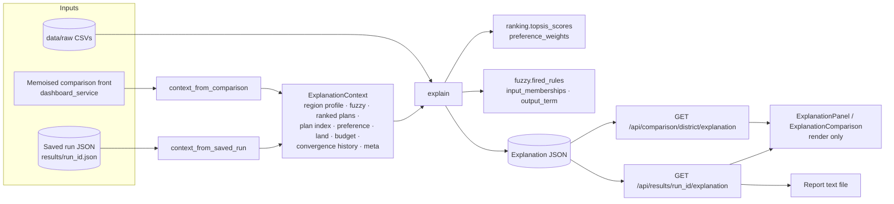

**Design decisions**

| Decision | Why |
|---|---|
| A backend service, not React logic | One source of truth for wording and numbers; reused by four pages and the report; testable |
| Dedicated endpoints instead of extending optimisation responses | Optimisation responses stay lean (~33 KB); explanations (~19 KB) are fetched only when asked for; saved runs explain retroactively, including runs saved before this feature |
| One `ExplanationContext` for saved runs and live comparison plans | Same analysis code path for both |
| Re-use, not re-implement | TOPSIS maths moved into `ranking.topsis_scores` and used by both `rank_plans` and the explainer (48 pipeline outputs verified identical to `main`); fuzzy helpers use the model's own sets and rules |
| Comparison explanations use the history-tracked front | Verified identical to the front the page shows (all 4 districts), so convergence evidence is available without describing a different plan |
| Saved runs now store `meta.total_land_ha`, `meta.budget_rs` | Needed for the budget check; older runs report "not recorded" rather than guessing |

### 3. Sources of every statement

Each item is `{id, title, detail, source, evidence, status?, severity?}`. `detail` is built from `evidence`; `source` is one of: `dataset`, `fuzzy`, `nsga2`, `topsis`, combinations of these, `constraint(s)`, `request`, `run metadata`, `model limitation`. In the UI, hovering any item shows its source and evidence.

| Section | Built from |
|---|---|
| Summary | ranked plan (rank, closeness, shares, area, objective totals), confidence, recommendation rule |
| Reasons | TOPSIS rank and margin; objectives with goodness ≥ 0.60; soil fuzzy set; land share of Low/Very-Low rainfall-dependency crops; budget headroom; historical top-3 share; ranks under other preferences |
| Objectives | stored `normalized_scores` (goodness), preference weights, per-ha values vs the set (best / median / worst), share of the TOPSIS gap to the ideal |
| Trade-offs | best plan in the set per objective vs this plan (per-ha deltas); least-squares slope and correlation of cost and water against yield across the set |
| Constraints | land allocation, budget (if recorded), rainfall (fuzzy set + rainfall coverage), soil (fuzzy set), irrigation risk (fuzzy output set), optimiser feasibility |
| Benefits | objectives better than the set median (percent difference) |
| Risks | irrigation-risk output set, rainfall deficit, rainfall coverage < 50 %, rain-dependent crops, concentration (HHI), perennial crops, weak objectives (goodness < 0.30), estimated data year, year-to-year rainfall variability, inputs at the model minimum |
| Historical context | observed (non-estimated) years in crop.csv and rainfall.csv for the district/season |
| Confidence | see §4 |
| Insights | trade-off position, diversification, main yield driver, rainfall reliance, rank under each preference |
| Alternatives | runner-up per-ha deltas and closeness |
| Timeline | data slice, fuzzy inputs/outputs + fired rules, NSGA-II settings and hypervolume, TOPSIS weights and rank, constraint summary |
| Crop breakdown + consistency | per-crop confidence, expected yield, net irrigation recomputed exactly as `FarmPlanProblem._evaluate`; recomputed totals vs reported totals |

### 4. Formulas

Notation: plan *p* in a ranked set *S* (all feasible plans for comparison explanations; the stored top 50 for saved runs), crops *i*, land share *sᵢ*, area *aᵢ*, multipliers *irrᵢ*, *fertᵢ*.

| Quantity | Formula |
|---|---|
| Per-hectare value | objective total ÷ Σ aᵢ (water in ML = L × 10⁻⁶) |
| Goodness gⱼ | stored TOPSIS min–max score (1 = best in the ranked front) |
| Better-than share | % of other plans in *S* that *p* is at least as good as, on objective *j* |
| Gap share | (wⱼ(1−gⱼ))² / Σₖ (wₖ(1−gₖ))² — objective's share of the squared distance to the TOPSIS ideal; the largest = "main compromise" |
| Strongest objective | argmax gⱼ (ties → larger weight) |
| Crop confidence | `crop_yield_confidence(yield_conf, irrigation_risk, dependency)` (engine) |
| Expected tonnes | aᵢ · Yieldᵢ/1000 · confᵢ |
| Net irrigation | max(WaterReqᵢ − effective rain, 0) · irrᵢ |
| Rainfall coverage | min(100, effective rain ÷ Σ sᵢ·WaterReqᵢ × 100) |
| Concentration | HHI = Σ sᵢ² (1 = one crop) |
| Marginal rate | least-squares slope of cost/ha (or water/ha) on yield/ha over *S*, with Pearson r |
| Historical top-N rate | land-weighted (years crop in district top-3 by Revenue_Rs_Lakh ÷ observed years) |
| Rainfall CV | std/mean of seasonal rainfall totals over observed years |
| Fired rule strength | min of its antecedent membership degrees (Mamdani AND) |
| Indicative revenue (reference only) | Σ tonnesᵢ × 10 × MSP_Rs_Qtlᵢ; profit = revenue − cost |

#### Confidence score
Unweighted mean of the components that can be computed (each 0–100); components that cannot be computed are excluded, not guessed.

| Component | Score | Source |
|---|---|---|
| Climate & soil suitability | 100 × land-weighted crop confidence | fuzzy |
| Data quality | 100 × (season months present ÷ expected, rainfall + water) × (0.5 if the year is estimated, else 1) | dataset |
| Optimisation convergence | 100 × (1 − hypervolume gain in the last 20 % of generations ÷ total gain); excluded without history | NSGA-II |
| Constraint satisfaction | 100 if no constraint is violated, else 0 | constraints |
| Historical consistency | 100 × historical top-N rate | dataset |
| Weather consistency | 100 × (1 − min(1, rainfall CV)) | dataset |
| Ranking robustness | 100 × (preferences under which the plan is within the top 10 % of *S*) ÷ 5 | TOPSIS |

Equal weights are a deliberate, untuned choice: no outcome data exists to calibrate weights, so any other split would be arbitrary.

#### Recommendation label
Highly recommended: rank 1 and confidence ≥ 75 %. Recommended: rank ≤ 5 and confidence ≥ 60 %. Otherwise: Use with caution. (The rule is returned in the payload and shown as a tooltip.)

#### Wording thresholds (constants at the top of the service)
`STRONG_GOODNESS 0.60`, `WEAK_GOODNESS 0.30`, `MIN_SHARE_PCT 1`, `DIVERSIFIED_SHARE_PCT 5`, `CONCENTRATION_HHI 0.50`, `PERENNIAL_DAYS 300`, `INPUT_FLOOR_TOLERANCE 0.02`, `HISTORICAL_TOP_N 3`, `HISTORICAL_HIT_RATE 0.75`, `ROBUST_TOP_FRACTION 0.10`, `CONSISTENCY_TOLERANCE 1 %`. They decide which facts are worth stating; they never alter a number.

#### Fuzzy rule attribution
`fuzzy_reasoning.inference` explains the fuzzy step rule by rule (decisive vs masked, share of each output, leave-one-out importance, limiting condition). Method and example: [FUZZY_EXPLAINABILITY.md](#doc-fuzzy-explainability).

### 5. What is deliberately *not* claimed

* **Profit.** The dataset's `MSP_Rs_Qtl` column is not validated (several crops have no government MSP; some values look implausibly high — e.g. sugarcane yields an indicative margin of roughly ₹9.6 lakh/ha for Salem Rabi). Profit is not an optimiser objective. It is therefore shown only in a collapsed "Indicative economics (unvalidated prices)" box, with `validated: false`, and is excluded from reasons, benefits, risks and confidence. A test enforces this.
* **Input advice.** When irrigation and fertiliser multipliers sit at the 0.7 floor, a risk item states that the yield model does not reward higher inputs, instead of presenting the floor as an optimised dose.
* **Budget for old runs.** Shown as "not recorded".
* **Convergence without history.** Excluded from confidence with an explanation.

### 6. API

| Endpoint | Parameters | Errors |
|---|---|---|
| `GET /api/results/{run_id}/explanation` | `rank` 1–500 (default 1) | 404 unknown run, 400 rank beyond the run's plans, 422 invalid rank |
| `GET /api/comparison/{district}/explanation` | `plan` A/B/C (default A), `total_land_ha` > 0, `budget_rs` > 0 | 404 unknown district, 422 invalid plan/land/budget |

Response model: `ExplanationOut` (`app/schemas.py`); JSDoc `Explanation` typedef in `frontend/src/services/api.js`.

### 7. Frontend

| Place | Entry point |
|---|---|
| Comparison | "Explain" on each plan row; "Why this plan?" on the plan detail card; "Compare explanations" (side-by-side A/B/C) |
| Run Optimization | "Why this plan?" on the saved result |
| History | "Explain top plan" in the run details dialog |
| Reports | "Why?" on each report card; the downloaded report includes Recommendation → Reasons → Trade-offs → Benefits → Risks → Confidence breakdown |

`ExplanationPanel` sections: summary (recommendation badge, confidence %, crop-mix bars, per-ha metrics), why recommended, objective balance (goodness bars, STRONGEST / MAIN COMPROMISE badges), trade-offs, constraint checks (status chips), benefits, risks (severity badges), confidence (component bars), historical context, insights, runner-up comparison, pipeline timeline, fired fuzzy rules (collapsible), indicative economics (collapsible, flagged), consistency note. `ExplanationModal` handles loading, errors and Escape-to-close; it is an ARIA dialog.

### 8. Worked example — Salem, Rabi 2024 (estimated year), Plan A (balanced)
Rank #1 of 100, closeness 0.6152, confidence 74.9 % → "Recommended". Sugarcane 53 % / Sunflower 47 %; 31.49 t/ha, ₹51,970/ha, 6.61 ML/ha, impact 68.49/ha. Strongest objective: environmental impact; main compromise: yield. Best-yield alternative: +26.69 t/ha but +41 % cost and +74 % water. Risks include rainfall −36.8 % (deficit), rainfall covering 18 % of crop water need, estimated input year, sugarcane as a 365-day crop in a one-season plan, and inputs at the model minimum. Confidence components: climate/soil 56.3, data quality 50 (estimated year), convergence 100, constraints 100, historical 100, weather 97.7, robustness 20. Recomputed yield and water match reported totals within 0.03 %.

### 9. Testing
`tests/test_explanation.py` (25 tests): structure and serialisation, determinism, summary ↔ plan traceability, recomputation consistency, goodness and weights from TOPSIS, gap shares sum to 100, fired rules equal the engine's, comparison Plan A equals the page's Plan A, confidence = mean of available components, missing history excluded, estimated year lowers data quality and adds a risk, budget reporting incl. old runs, unvalidated prices never used, endpoint success and errors. Full backend suite: 230 passing. Frontend: oxlint clean, build passes, every section server-rendered against real API payloads with no undefined/NaN.

### 10. Future improvements
1. Counterfactuals: "what would make Plan B the recommendation?" (minimal weight change, via `topsis_scores`).
2. Sensitivity of the recommendation to fuzzy inputs (± rainfall deviation) by re-running the memoised pipeline.
3. Calibrate confidence components against observed outcomes once farm results exist; replace equal weights.
4. Validated price data → promote economics from reference to a first-class objective and explanation.
5. Localised wording (English/Tamil) generated from the same evidence.
6. Store the explanation snapshot in the saved run for audit, alongside a version number of the explainer.

<a id="doc-scoring-and-ranking"></a>

## Scoring and Ranking

Every score, label and threshold the system produces, with its exact formula, code location, and an honesty rating: **Derived** (computed from data by a defensible formula), **Heuristic** (formula exists but constants are arbitrary), **Presentation** (a display convention with no analytical meaning).

### 1. Plan-level scores (`app/decision/ranking.py`)

| Output | Formula | Range | Type |
|---|---|---|---|
| `composite_score` | TOPSIS closeness C = d⁻/(d⁺+d⁻) over the weighted, min–max normalised objectives of the plan set (see [ALGORITHMS.md](#doc-algorithms) §5.2) | 0–1 | Derived (weights heuristic) |
| `rank` | order of `composite_score` descending, 1-based, after truncation to 50/100 | 1… | Derived |
| `normalized_scores.{yield,cost,water,env}` | per objective min–max within the returned set; flipped for cost/water/env so 1 = best | 0–1 | Derived, **relative to this run only** |
| `confidence_label` | Σ shareᵢ × crop_confidenceᵢ; ≥0.66 High, ≥0.33 Moderate, else Low (unknown crop → 0.7) | label | Heuristic; "Low" unreachable with current data |
| `trade_off_summary` | raw min–max position of each objective in the set → Low (<0.33) / Moderate / High (≥0.66) | text | Presentation (relative, not absolute) |
| `allocation_percent` | share × 100, largest-remainder rounding to 2 dp so the list sums to 100.00 | % | Derived |

Important: "High yield" means *high relative to the other plans in this run*, not high in agronomic terms.

### 2. Preference weights

| Preference | yield | cost | water | env | Source |
|---|---|---|---|---|---|
| balanced | 0.300 | 0.2333 | 0.2333 | 0.2333 | tuned by hand so rank-1 is mid-range (not a corner) |
| max_yield / min_cost / min_water / min_env_impact | 0.55 on the named objective, 0.15 on the others | | | | convention |

Unknown preference strings fall back to balanced (unreachable through the API because `Preference` is a `Literal`).

Ranking profiles (Balanced, Profit priority, Water saving, Sustainability, Low cost, custom) and their weights over ten criteria: [TOPSIS_PROFILE_GUIDE.md](#doc-topsis-profile-guide). Audit of the weights above: [TOPSIS_WEIGHT_ANALYSIS.md](#doc-topsis-weight-analysis).

### 3. Comparison page (`GET /api/comparison`, `ComparisonView.jsx`)

#### 3.1 Plan selection
One NSGA-II run (population 100) → three TOPSIS rankings of the same feasible front: **A** = balanced #1, **B** = max_yield #1, **C** = min_cost #1. The three can coincide (then the page shows the same plan three times).

#### 3.2 Headline metrics (per hectare, area = Σ area_ha)
`yield_val = yield_tonnes/area` (t/ha) · `cost = cost_rs/area` (₹/ha) · `env_impact = env_impact_score/area`.
`water` label: lowest of the three → "Efficient", highest → "High usage", else "Moderate" (relative only).

#### 3.3 Radar scores (0–100, `dashboard_service._radar_scores`)

| Axis | Formula | Type | Caveat |
|---|---|---|---|
| yield | 100 × (y − min)/(max − min) over A,B,C | Derived | With only 3 points, one plan always scores 0 and one 100 → exaggerated contrast |
| cost_eff | 100 × (1 − (c − min)/(max − min)) | Derived | same |
| water | same on water_liters | Derived | same |
| land | same on env_impact_score ("land impact" proxy) | Derived | label "Land" is loose – it is the fertiliser/pumping impact score |
| risk | 100 × (1 − irrigation_risk) | Heuristic | **identical for all three plans** (regional value) |
| market | 100 × (1 − mean RAINFALL_DEPENDENCY_FACTOR of crops with share > 1 %) | Heuristic | no market data exists; this is climate dependency relabelled |

If all three values are equal the axis is 50.

#### 3.4 "Adjust Weights" re-recommendation (frontend only)
`score = (w_y/100)·radar.yield + (w_c/100)·radar.cost_eff + (w_w/100)·radar.water`, default weights 50/50/50, highest score gets the "Rec" badge. This **is a second recommender** that can disagree with TOPSIS's Plan A (e.g. Coimbatore on 2026-09-29: TOPSIS recommends A, the default weights badge C). See UI_UX_REVIEW U-9.

#### 3.5 Table column "Env. Impact/ha"
Since 2026-09-29 shows the real `env_impact` per hectare (lower is better) with a bar relative to the largest of the three. Previously it showed `round(radar.land/5)/20` – a *goodness* score presented as impact (the gentlest plan showed "20/20").

### 4. Dashboard (`GET /api/dashboard`, `DashboardView.jsx`)

| Card / field | Formula | Type | Caveat |
|---|---|---|---|
| Estimated Yield (t/ha) | mean of `Yield_Kg_Ha` over **all crops and seasons** of the latest year ÷ 1000 | Presentation | Averages sugarcane (~95 t/ha) with cotton (1.5 t/ha): not a yield of any real farm |
| Yield trend | (mean latest − mean previous)/mean previous × 100 | Derived | 2024 is 2023 × 1.03 → always "+3.0 %" (estimation artefact, now flagged) |
| Active Plans | # saved runs for this district with this browser's `client_id` | Derived | |
| Soil Health % | round(fertility index) of latest-year, current-season land row | Heuristic | |
| Soil status | ≥70 Optimal, ≥45 Moderate, else Needs Attention (backend) | Heuristic | same thresholds duplicated in AnalyticsView |
| Water Utilization % | Σ Irrigation_Water_MCM / Σ Total_Demand_MCM × 100 over the latest year | Derived | It is irrigation's *share of demand*, not how well water is used |
| Water badge | ≥70 "Optimal", ≥40 "Moderate", else "Low" (frontend `waterLabel`) | Presentation | A higher irrigation share is not "optimal" in any agronomic sense |
| Recommended actions | Low N/P/K status → apply fertiliser action; mean latest-year storage < 40 % → irrigation action; otherwise "No urgent action" | Heuristic | Urgency windows ("Next 48 hours", "Next 5 days") are hard-coded text; "Schedule" buttons only toggle local state |
| Crop Allocation Overview | top-3 candidate crops by district revenue for the current season; pct = revenue share; ha = share × 10 ha reference | Presentation | A revenue share, not an optimised allocation |
| `data_year`, `data_year_estimated` | latest crop year and whether its rows are "Estimated" | Derived | new |

### 5. Analytics page (`AnalyticsView.jsx`)

| Element | Rule |
|---|---|
| Scatter points | every plan from `/api/plans` (cost/ha vs yield/ha); gold = TOPSIS balanced rank 1 |
| Slider bounds | min/max of the plotted values padded by 10 % |
| "Valid Plans" | plans with cost ≤ max-cost slider, yield ≥ min-yield slider, water ≤ max-water slider |
| "Best Compliant Plan" | **cheapest** valid plan (not TOPSIS) |
| Soil Suitability | `fertility_index × 100` → ≥70 Optimal, ≥45 Moderate, else Needs Attention |
| Convergence chart | `hypervolume_history` (run-relative normalised HV, y-axis from 0) |
| Fuzzy vs non-fuzzy table | `/api/compare-fuzzy` per-hectare best/min values |

### 6. History and Reports

| Field | Formula |
|---|---|
| `target_yield` | top-ranked plan's `yield_tonnes / Σ area_ha` → "x.xx t/ha" |
| `est_cost` | top plan `cost_rs / Σ area_ha` → "₹n/ha" |
| History "Yield confidence / irrigation risk %" | stored fuzzy assessment × 100 |
| Report file | top 3 plans of the saved run, totals and per-ha, plus region snapshot and fuzzy assessment (see [REPORT_PIPELINE.md](#doc-report-pipeline)) |

### 7. Recommendation logic – which "recommended" is which

| Where | "Recommended" means |
|---|---|
| `/api/farm-plans` rank 1 | TOPSIS #1 under the user's chosen preference |
| Analytics gold dot / `is_recommended` | TOPSIS balanced #1 of the dashboard front (pop 100) |
| Analytics "Best Compliant Plan" | cheapest plan passing the sliders |
| Comparison `recommended: true` | Plan A (TOPSIS balanced #1) |
| Comparison "Rec" badge | frontend weighted sum over three radar axes |
| Dashboard actions | rule-based soil/water checks |

Consolidating these (TODO T-11) would remove the most common source of examiner confusion.

<a id="doc-optimization-pipeline"></a>

## Optimization Pipeline

Step-by-step trace of `plan_service.generate_farm_plans` (used by `POST /api/farm-plans` and `run_demo.py`; stages 1–7 live in `run_pipeline`, which Scenario Simulation also calls with adjustments — see [SCENARIO_SIMULATION.md](#doc-scenario-simulation)), with a worked example: **Salem, Kharif, latest year (2024), 5 ha, no budget, balanced** – values captured from a real run on 2026-09-29.

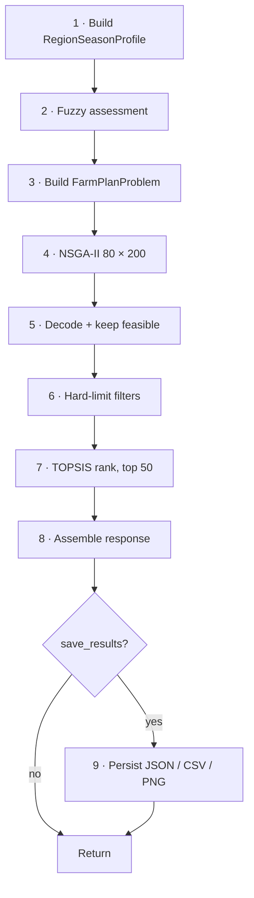

### Stage 1 – Profile (`preprocessing.get_region_season_profile`)
* Canonicalise `location`/`season` (case-insensitive). Resolve year → 2024.
* Land row (Salem, 2024, Kharif): Red Loam, pH 6.8, OC 0.58 %, N/P/K Medium/Medium/Medium → fertility index = 0.3·88 + 0.3·58 + 0.4·60 = **67.8**.
* Rainfall rows Jun–Sep 2024: mean 63.1 mm/month, mean deviation **−21.1 %**, effective rainfall 63.1 × 4 × 0.7 = **176.7 mm**.
* Water rows Jun–Sep: mean storage **62.0 %**, groundwater mode "Very High".
* Crops sorted by revenue: Paddy, Tapioca, Maize, Groundnut, Cotton (5 → chromosome length 15).
* `data_year_estimated = True`.

### Stage 2 – Fuzzy (`fuzzy.evaluate_uncertainty`)
Inputs (−21.1, 62.0, 67.8) → labels deficit / medium / medium → **yield_confidence 0.636, irrigation_risk 0.465**. Per crop: `0.636 × (1 − 0.465 × factor × 0.4)` → Paddy/Maize (Low, 0.3) ≈ 0.600; Tapioca/Groundnut (High, 1.0) ≈ 0.518; Cotton (Medium, 0.6) ≈ 0.565.

### Stage 3 – Problem
Bounds: shares [1e−4, 1], multipliers [0.7, 1.3]. Budget constraint absent (no budget).

### Stage 4 – NSGA-II
`run_nsga2(pop 80, gen 200, seed 42, track_history=save_results)` under the run lock, in the configured engine mode (`original` by default, which reproduces the published results; see [NSGAII_IMPROVEMENT_SUMMARY.md](#doc-nsgaii-improvement-summary)). ≈0.29 s with or without history. The run's mode, runtime profile and diversity statistics are saved as `meta.optimizer`.

### Stage 5 – Decode
80 non-dominated solutions (whole final population is non-dominated), all feasible.

### Stage 6 – Filters
None supplied → unchanged.

### Stage 7 – TOPSIS
Balanced weights (0.30, 0.233, 0.233, 0.233); keep top 50. Rank 1:

| Field | Value |
|---|---|
| Crop mix | Tapioca 91.33 %, Groundnut 5.39 %, Maize 3.26 %, Paddy 0.01 %, Cotton 0.01 % |
| Multipliers | irrigation 0.7 on 4 of 5 crops, fertiliser 0.7 on 4 of 5 (see ALGORITHMS §3.2) |
| Yield | 64.76 t (≈12.95 t/ha) |
| Cost | ₹1,97,948 (≈₹39,590/ha) |
| Water | 21.5 million L |
| Impact | 194.3 |
| Closeness | 0.632, confidence Moderate |
| Summary | "High yield, Moderate cost, Moderate water use, Moderate environmental impact" |

### Stage 8 – Response
Region profile (with crop objects and snapshot), fuzzy assessment, ranked plans, convergence history (if tracked), `meta` (algorithm, pop, gen, probabilities, preference, 80 found, 50 returned, seconds).

### Stage 9 – Persistence
See [DATA_FLOW.md](#doc-data-flow) §5. `run_id = salem_kharif_2024_<UTC timestamp>`; `saved_files` lists the four absolute paths.

### Parameters that change the outcome

| Knob | Effect |
|---|---|
| `year` | different land/rainfall/water/crop rows (2024 ≡ 2023 inputs except crop coefficients ×1.03) |
| `total_land_ha` | scales every objective linearly; plan shares unchanged in principle (differences only via RNG path) |
| `budget_rs` | adds constraint; too low → 0 plans |
| `preference` | only re-ranks the same front |
| filters | remove plans after optimisation |
| `max_candidate_crops` | only matters if < number of crops (≤5 in the data) |
| `pop_size`, `n_gen` | front density/convergence; same seed → reproducible |
| seed | different seeds give noticeably different top plans for the same inputs (Salem Kharif: yield 50–70 t over seeds 42, 1–4); Scenario Simulation therefore compares five paired seeds per side |
| scenario hooks | `rainfall_factor`, `storage_override_pct`, `fertilizer_price_factor`, explicit TOPSIS `weights` (all neutral by default) |

### Dashboard variant
`dashboard_service._run_dashboard_pareto_front`: identical Stages 1–5 with population 100, current calendar season, 5 ha default, no filters, memoised; ranking done by the caller (balanced for `/api/plans`; three preferences for `/api/comparison`).

<a id="doc-data-flow"></a>

## Data Flow

How a value travels from a CSV cell to a pixel. Companion to [ARCHITECTURE.md](#doc-architecture) (structure) and [OPTIMIZATION_PIPELINE.md](#doc-optimization-pipeline) (stage detail).

### 1. End-to-end

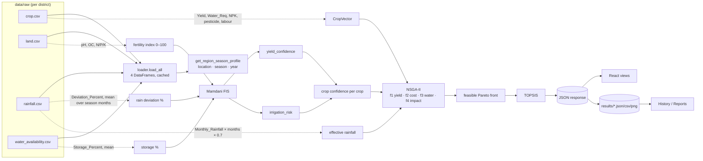

### 2. Field lineage (selected)

| UI value | API field | Computed in | From |
|---|---|---|---|
| Analytics point x (₹/ha) | `plans[].cost` | `get_plans` | f2 ÷ area ← fertiliser NPK × prices, pesticide, labour × wage |
| Analytics point y (t/ha) | `plans[].yield_val` | `get_plans` | f1 ÷ area ← Yield_Kg_Ha × crop confidence |
| Water slider (ML/ha) | `plans[].water_val` | `get_plans` | f3 ÷ area ÷ 10⁶ ← (Water_Req − effective rain) × 10 000 |
| Gold point | `plans[].is_recommended` | `rank_plans('balanced')` | TOPSIS rank 1 |
| Convergence curve | `hypervolume_history` | `extract_convergence_history` | pymoo history, run-normalised HV |
| Comparison radar "risk" | `radar_scores.risk` | `_radar_scores` | 1 − irrigation_risk ← FIS ← rainfall/water/soil |
| Comparison radar "market" | `radar_scores.market` | `_radar_scores` | 1 − mean(Rainfall_Dependency factor) |
| Dashboard Estimated Yield | `estimated_yield` | `get_dashboard` | mean Yield_Kg_Ha (latest year, all crops) |
| Dashboard Water Utilization | `water_utilization_pct` | `get_dashboard` | Σ Irrigation_Water_MCM / Σ Total_Demand_MCM |
| Dashboard Soil Health | `soil_health_pct` | `get_dashboard` | fertility index of current-season land row |
| Dashboard estimated banner | `data_year_estimated` | `is_estimated_year` | `data_source` column |
| History "Target Yield" | `target_yield` | `get_history` | saved run's plan #1 yield ÷ its area |
| Report "Env. impact" | `plans[0].env_impact_score` | saved run | f4 |
| Weather temp | `temp` | `_get_weather_live` | Open-Meteo `current.temperature_2m` (or CSV mean of Max/Min temp) |

### 3. Which parameters reach the optimiser, per entry point

| Entry point | Location | Season | Year | Land | Budget | Population | Preference | Saved |
|---|---|---|---|---|---|---|---|---|
| Run Optimization page → `POST /api/farm-plans` | user choice | user choice | user choice / latest | user choice | user choice | 80 | user choice | yes |
| Analytics → `/api/plans` | profile district | **current calendar season** | latest (2024, estimated) | **5 ha (fixed by frontend)** | none | 100 | balanced | no |
| Comparison → `/api/comparison` | profile district | current season | latest | 5 ha | none | 100 | balanced/max_yield/min_cost | no |
| Analytics → `/api/compare-fuzzy` | profile district | current season | latest | 5 ha | none | 100 ×2 | – | no |
| CLI `run_demo.py` | arg | arg | arg / latest | arg | arg | 80 or arg | arg | unless `--no-save` |

The user's saved `landSize` is used only on the Run Optimization page.

### 3b. District Intelligence flow
`GET /api/district-intelligence/{district}` → `district_service._build` (cached) → observed rows of all four CSVs → coverage, climate, soil, water, crop history → suitability (season profiles + fuzzy + `FarmPlanProblem.evaluate` on one-crop one-hectare plans + TOPSIS goodness) → market → insights → summary → `DistrictIntelligenceView` (filters in the browser). See [DISTRICT_INTELLIGENCE.md](#doc-district-intelligence).

### 3c. Scenario Simulation flow
`POST /api/simulations/run` → `simulation_service.resolve` (validate, map controls) → `plan_service.run_pipeline` × 5 seeds for the baseline and × 5 seeds for the scenario with `PipelineAdjustments` (rainfall factor and storage override in preprocessing, fertiliser price factor in the cost objective, explicit TOPSIS weights) → explanation engine on each side's seed-42 run (scenario price factor for profit) → paired analysis → response + token. Saving writes `results/simulations/<id>.json`. See [SCENARIO_SIMULATION.md](#doc-scenario-simulation).

### 4. Caching along the path

| Cache | Key | Invalidation |
|---|---|---|
| `loader.load_all` | – | process restart / `clear_cache()` |
| `fuzzy._build_system` | – | process restart |
| `dashboard_service._cached_pareto_front` (32 entries) | location, season, year, land, budget, track_history | process restart / `clear_pareto_cache()` |
| `results_store._SUMMARY_CACHE` | file path + (mtime, size) | automatic on file change |
| `district_service._build` (8 entries) | district | process restart / `clear_cache()` |
| Browser | none (every page visit refetches) | – |

### 5. Persistence flow

`POST /api/farm-plans` with `save_results: true` → `results_store.save_run_results` → reserve `<run_id>.json` → atomic write of the full response + `saved_at` + `client_id` + convergence history → `<run_id>_plans.csv` → `<run_id>_convergence.csv` + `.png`. Read paths: `/api/history` (summaries + plan #1), `/api/dashboard` (count), `/api/results/{id}` (full record, through `FarmPlanResponse`).

<a id="doc-user-flow"></a>

## User Flow

### 1. First visit

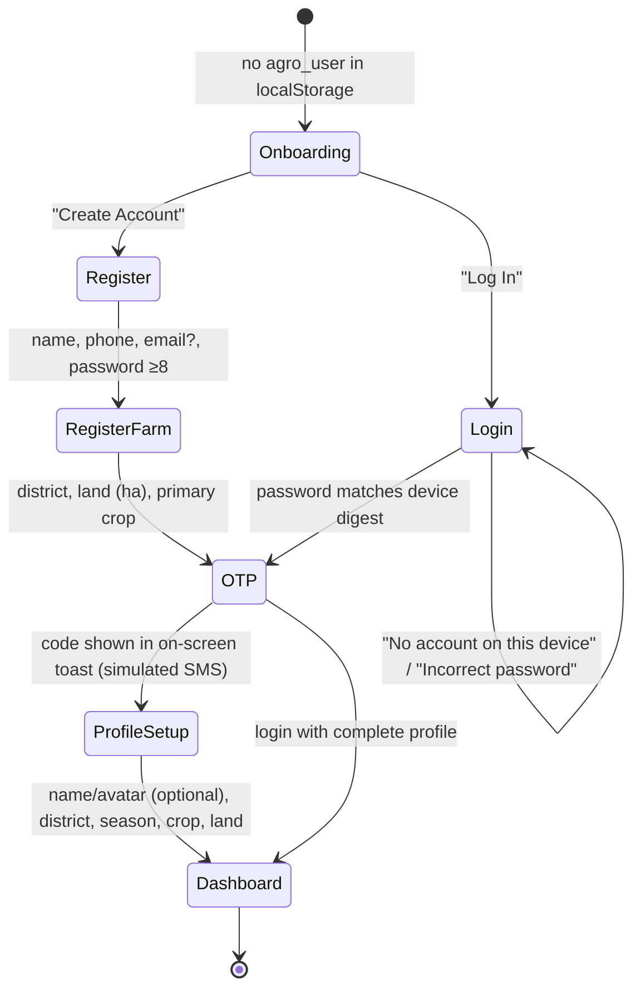

Notes: everything before the dashboard is client-side only. A user who registers already supplies a district, but `handleAuthSuccess(…, isLoginFlow=false)` still routes through ProfileSetup, so district/land/crop are asked twice (UI_UX_REVIEW U-3).

### 2. Main navigation (shell)

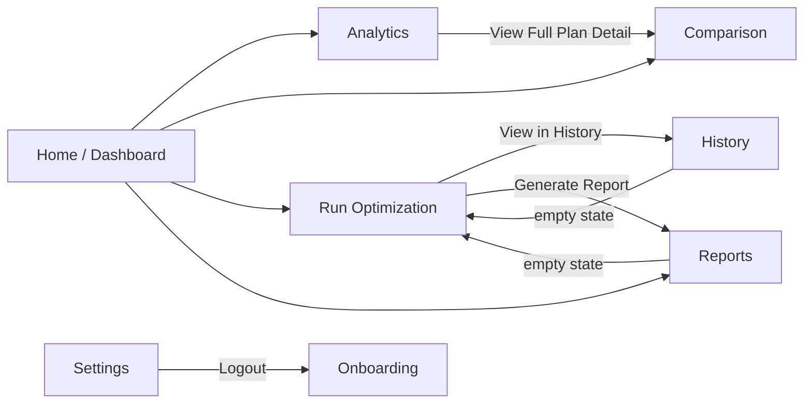

Every shell page is reachable from the sidebar/top bar/drawer: Home, Analytics, Comparison, Run Optimization, District Intelligence, Scenario Simulation, History, Reports, Settings.

### 3. Core task: get and keep a personalised plan

1. **Run Optimization** – pick district/season/year/land/budget/preference → *Run Optimization*.
2. Progress screen (~5.7 s animation; the backend finishes in ~0.3 s and is awaited).
3. Result card – top plan's crop mix, t/ha, ₹/ha, confidence, trade-off sentence; note if inputs are estimated.
4. **History** – the run appears (newest first) for that district and this browser only.
5. **Reports** – *Generate Report* on the run → card → *Download report* (.txt) or *Copy summary*.

### 4. Exploration tasks (generic, not saved)

| Page | What the user learns | Inputs used |
|---|---|---|
| Dashboard | district KPIs, soil/water actions, weather | profile district |
| Analytics | the whole Pareto front for the current season, filter by cost/yield/water, convergence, fuzzy effect | profile district, 5 ha |
| Comparison | three representative plans (balanced / max-yield / min-cost), radar, re-weighting | profile district, 5 ha |

`DataSourceNotice` on these pages states they are district-level and not saved.

### 4b. What-if planning (Scenario Simulation)
1. Set the original conditions (district, season, year, land, budget, preference) and change one or more scenario controls.
2. *Run simulation* (~4 s) → summary, both recommendations side by side, impact cards with verdicts, decision-impact statements, trade-offs, optimisation difference, crop effects, historical comparison.
3. *Save scenario* (named) → listed under Saved scenarios for this browser; reopen restores the form and result. *Export report* downloads an HTML report with charts (print to PDF from the browser); *Export JSON* downloads the raw result.

### 5. Returning visit

`agro_currentView` and `agro_user` restore the last page. Logout clears both but keeps the password digest and `client_id`, so History remains visible after logging back in on the same browser. Clearing site data loses the profile, the "account" and access to History (runs remain on the server, unreachable).

### 6. Failure paths

| Situation | What the user sees |
|---|---|
| Backend down | footer "Server unreachable — live data unavailable"; each section shows the unreachable message |
| No data for chosen year/season | Run page: "Can't run Salem / Rabi: No data for …" (backend detail) |
| Budget too tight | Run completes; result card without a plan section; History shows "--" |
| Weather API down | "Historical estimate" label with month-average values |
| Invalid inputs (e.g. land 0) | browser form validation; backend 422 detail if bypassed |

<a id="doc-report-pipeline"></a>

## Report Pipeline

There are two report artefacts: the **server-side run files** written for every saved run, and the **client-side decision report** a user downloads from the Reports page.

### 1. Server-side run files (`app/services/results_store.py`)

Written by `save_run_results` whenever `POST /api/farm-plans` (or the CLI) runs with `save_results=true`.

| File | Content | Producer |
|---|---|---|
| `<run_id>.json` | full response + `run_id`, `saved_at` (UTC ISO), `client_id`, `convergence_history` | `_atomic_write_text` (temp file + rename) |
| `<run_id>_plans.csv` | one row per ranked plan; list/dict columns JSON-encoded | pandas `to_csv` |
| `<run_id>_convergence.csv` | one row per generation: population, best/mean of 4 objectives, hypervolume | pandas |
| `<run_id>_convergence.png` | 11×4.2 in, 130 dpi: (left) hypervolume vs generation; (right) best yield and best cost vs generation on twin axes | matplotlib (Agg backend) |

`run_id = <location>_<season>_<year>_<YYYYMMDDTHHMMSSZ>`; since 2026-09-29 a `-2`, `-3`… suffix is added if two runs would get the same id in the same second. These files are not served to the browser (only the JSON via `GET /api/results/{run_id}`); the PNG is for the project report.

### 2. Client-side decision report (`src/views/ReportsView.jsx`)

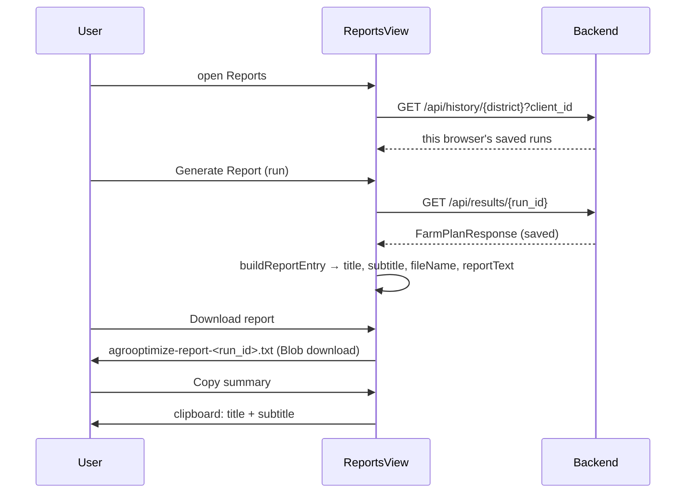

#### Report text structure (`buildReportText`; ~50 lines plus the explanation section)
1. Header – generated time, run id, district/season/year; NOTE line if `data_year_estimated`.
2. Region snapshot – soil type, pH, organic carbon, fertility index; rainfall mean, months, deviation; storage %, groundwater status.
3. Uncertainty assessment – yield confidence with labels; irrigation risk.
4. Optimisation – algorithm, population, generations, feasible plans found, preference.
5. Top 3 plans – TOPSIS closeness, crop mix (share and ha, ≥1 %), yield total and t/ha, cost total and ₹/ha (with the scope note "fertilizer, pesticide and labour only"), irrigation litres, impact score, confidence, trade-off sentence.
6. Why plan #1 was recommended – from `GET /api/results/{run_id}/explanation`: recommendation and rule, confidence, then Reasons → Trade-offs (+ marginal rates) → Benefits → Risks (with severity) → Confidence breakdown. If the explanation cannot be loaded the report says so.
7. Limitations – district-level averages and documented assumptions; decision support, not agronomic advice.

Every value comes from the saved record or its explanation; nothing is invented.

#### Card on screen
Title `"<District> <Season> <Year> -- <crop mix>"`, subtitle `"Yield x t/ha · Cost ₹y/ha · <confidence>"`, date, NEW tag. Cards live in component state only (disappear when leaving the page).

### 3. Gaps vs the paper
The paper promises "a printable one-page decision report … crop-by-plot assignment, irrigation schedules, fertilizer recommendations". Implemented: a plain-text report with crop areas and the modelled multipliers' consequences. Not implemented: PDF, plot assignment (no plot data), irrigation calendar, fertiliser product recommendations. Options: `window.print()` of a styled report view, or server-side PDF generation (e.g. WeasyPrint/ReportLab) – TODO T-15.

<a id="doc-history-pipeline"></a>

## History Pipeline

"History" = the list of optimisation runs **this browser** saved for a district. There are no user accounts; a random per-browser `client_id` is the only scoping key.

### 1. Identity

`src/services/api.js::getOrCreateClientId()` creates `crypto.randomUUID()` once and stores it in `localStorage.agro_client_id`. It is sent as:
* body field `client_id` on `POST /api/farm-plans` (stored in the run JSON),
* query `client_id` on `GET /api/history/{district}` and `GET /api/dashboard/{district}`.

### 2. Write path
Run Optimization → `POST /api/farm-plans {…, save_results: true, client_id}` → `results_store.save_run_results(response, history, client_id=…)` → `results/<run_id>.json` containing `client_id` and `saved_at`.

### 3. Read path (`dashboard_service.get_history`)

```mermaid
flowchart TB
    A[GET /api/history/salem?client_id=X] --> B[resolve_location → Salem]
    B --> C[results_store.list_saved_runs<br/>summaries, cached by mtime]
    C --> D{location == Salem<br/>and client_id == X?}
    D -- no --> skip[skip]
    D -- yes --> E[load_run run_id]
    E --> F[plan #1: yield_tonnes / Σarea_ha → "t/ha"<br/>cost_rs / Σarea_ha → "₹/ha"]
    F --> G[row: id, "Season Year", date, target_yield, est_cost,<br/>status "Completed", num_plans, preference, fuzzy_weights, is_estimated false]
    G --> H[sort by saved_at, newest first]
    H --> I["{history: [...]}"]
```

Rules:
* No `client_id`, or a mismatch, or a legacy run without `client_id` → excluded. A brand-new browser gets `[]` (product decision; no CSV "estimated" filler rows).
* Ordering was previously by the display string `"Kharif 2023"` (alphabetical by season name); fixed to newest save first.
* `is_estimated` is always `false` (kept for response compatibility with an earlier version that mixed in CSV rows).
* Runs with zero plans (e.g. an infeasible budget) appear with `"--"` yield and cost.

### 4. Consumers

| Consumer | Uses |
|---|---|
| HistoryView | timeline cards, search by season text, year filter, details modal (fuzzy confidence/risk %) |
| ReportsView | list of runs to build reports from; `id` → `GET /api/results/{id}` |
| Dashboard "Active Plans" | same filter, count only (`get_dashboard`) |

### 5. Limitations and risks
* **Not a security boundary.** Anyone who learns a `client_id` can read that browser's history. `GET /api/results` used to publish all `client_id`s; now redacted. Run ids are predictable (district_season_year_timestamp), and `GET /api/results/{run_id}` needs no `client_id`.
* **Device-bound.** Clearing site data or switching browsers loses access; runs stay on the server forever.
* **Cost O(#runs).** Each request scans every JSON in `results/` (summaries cached; each matching run is fully parsed again to read plan #1).
* **No deletion** endpoint or UI.

---

# Part 5 — Reviews

<a id="doc-project-review"></a>

## Project Review (senior engineering)

### 1. Scorecard

| Dimension | Rating | Comment |
|---|---|---|
| Architecture | Good | Clear layers (data → fuzzy → optimisation → decision → services → HTTP), acyclic imports, pure functions, single config module |
| Code quality | Good | Readable, heavily commented with rationale; some very long comments and one 750-line service module |
| Correctness | Fair → Good | Two real concurrency/integrity bugs found and fixed (RNG race, run-id collision); model-level defects remain (see RESEARCH_REVIEW) |
| Testing | Good backend / none frontend | 205 backend tests incl. invariants and concurrency; no golden-master; no UI tests |
| Documentation | Good but stale | Extensive team docs, several now out of date; this docs set supersedes them |
| Security | Acceptable for a demo | Key data-exposure bug fixed; no auth by design |
| Performance | Good | Sub-second optimisation; memoisation added |
| Operability | Fair | Health check, CI (now test-gated), Docker; no structured logging/metrics; unbounded storage |
| Repository hygiene | Fair | Frontend is versioned in the repo's `frontend/`, but a second, unversioned working copy (`stitch_agrooptimize_app/`) and a local checkout that had fallen 6 commits behind GitHub make it easy to edit the wrong copy; divergent dataset copy; zip snapshot |
| Data integrity | **Poor** | See DATA_VALIDATION |

### 2. Code review findings

#### Dead / unused
| Item | Where | Action |
|---|---|---|
| `ShaderBackground.jsx`, `src/assets/*`, `_to_delete/`, empty `src/data/` | frontend | **Removed** (backed up) |
| `is_fallback` UI branch | AnalyticsView | **Removed** (backend always false) |
| `weatherFailed` state, `selectedLanguage` prop in AuthView | frontend | **Removed** |
| `loader.available_locations/years/seasons` | backend | used only by tests – keep or move to tests |
| `WATER_COST_RS_PER_MM_PER_HA` | config | documented as intentionally unwired |
| `CropCandidate.msp_rs_qtl`, 26 CSV columns never read | data | keep; candidates for a profit objective |
| `_PLOT_LABELS` / `allocations[].plots` | dashboard_service | marked deprecated; UI no longer renders |
| `is_estimated` in history rows, `is_fallback` in plans | API | always false; kept for compatibility |
| `stitch_agrooptimize_app/` | local disk | duplicate working copy of the repo's `frontend/` – work only in the repo (TODO T-7) |
| `public/favicon.svg`, `public/icons.svg` | frontend | Vite scaffold, unused |

#### Duplication
* Pipeline wiring duplicated in `plan_service.generate_farm_plans` and `dashboard_service._cached_pareto_front` (profile → fuzzy → problem → run → feasible).
* Fertility-index call with the same five kwargs in 3 places; "current land row" logic in 2.
* `FALLBACK_CROPS` list copied into AuthView, ProfileSetupView, SettingsView; soil-status thresholds (70/45) in backend and AnalyticsView; `SEASONS` in api.js and ProfileSetupView; district dropdown markup in 3 views.
* Error banners/empty states repeated per view (now at least share one message constant).

#### Naming / clarity
* `env_impact_score` vs radar "land" vs UI "Land Impact" – three names for one thing.
* `estimated_yield` (dashboard) is a district average, not an estimate for the user.
* `water_utilization_pct` is irrigation's share of demand.
* `get_region_profile` in `main.py` vs `RegionProfileOut` schema not used as its response model.
* `FarmPlanRequest.save_results` also controls history tracking (documented but surprising).

#### Large units
* `dashboard_service.py` (≈770 lines) mixes weather, KPIs, history, optimisation caching, comparison and radar scoring → split into `weather.py`, `dashboard.py`, `history.py`, `analytics.py`.
* `AuthView.jsx` (≈700 lines) holds four sub-screens; `AnalyticsView.jsx` (≈600) mixes fetching, maths and SVG.

#### Magic numbers
Catalogued with provenance in [CONFIGURATION.md](#doc-configuration) §3. The worst offenders are UI-meaning thresholds that are duplicated (70/45 soil, 70/40 water) and the fixed 5 ha used by Analytics/Comparison.

#### Error handling
* `get_plans` wraps everything in `except Exception` → bad season/year becomes 503 instead of 400.
* Weather fallback swallows all exceptions (intentional, now logged via `logging`).
* No global exception handler / request-id logging.

### 3. Testing gaps
1. No golden-master test pinning numeric outputs – model changes can drift silently (the fingerprint script used in this audit is a template: TODO T-13).
2. Operators not unit-tested in isolation.
3. Weather tests depend on network availability (they pass either way, but the "live" branch isn't deterministic).
4. No frontend tests (Vitest + React Testing Library for `api.js`, `download.js`, and view rendering with mocked fetch).
5. No end-to-end test (Playwright: register → run → history → report).

### 4. Documentation gaps (now addressed by `/docs`)
Stale statements in team docs: 34 tests (now 205), 14 rules (26), fertiliser ₹6.5/27/17 and wage ₹400 (now 12.87/58.70/56.67 and 319), "frontend not built", "2020–2023 only", `docs/frontend_integration.md` referenced but missing, results tables from an older dataset.

### 5. Top 10 recommendations
1. Put `stitch_agrooptimize_app/` under git (same repo as the backend or a monorepo) and delete the stale `agrooptimize-backend/frontend/`.
2. Settle data provenance; default to the latest observed year.
3. Fix the inert multipliers with agronomic response functions.
4. Replace tonnage with a profit objective.
5. Add a golden-master regression test and multi-seed evaluation script.
6. Remove the RNG lock by threading pymoo's `random_state` through the operators.
7. Split `dashboard_service.py`; unify the two orchestration paths.
8. Add react-router, accessibility fixes, and pass user land size to Analytics/Comparison.
9. Rate-limit and add a retention policy for `results/`.
10. Refresh the team's viva/methodology notes against these docs.

<a id="doc-research-review"></a>

## Research Review (examiner's perspective)

Reviewed against the team's paper (`reference_docs/Reference_Paper_AgroOptimize.pdf`), the Phase-2 rubric, and the actual code and data. Every quantitative claim here was measured on 2026-09-29.

### 1. Overall assessment

The **engineering** is well above typical final-year level: a clean layered pipeline, a working full-stack deployment, 205 automated tests, reproducible seeded runs, convergence evidence, and unusually honest in-code documentation of assumptions. The **research** claims are weaker than the engineering: the optimisation model has a structural defect that makes two of its three decision-variable blocks inert, the fuzzy layer can only rescale yield, and the dataset shows clear signs of being synthetic while the paper describes it as government data. None of this is hidden by the code – an examiner who reads it will find it. The team should present these openly as limitations with a concrete fix plan rather than be surprised by them.

### 2. Rubric mapping (Phase 2, research-based)

| Rubric item | Evidence in repo | Risk |
|---|---|---|
| Problem statement & gap | `docs/problem_statement.md`, `docs/literature_survey.md` (5 verified papers) | Gap statement says "validated on real Tamil Nadu data" – not supportable today (§5) |
| Methodology (workflow, algorithms, maths, datasets, evaluation) | Methodology notes, this docs set | Evaluation strategy is thin: no baseline other than fuzzy on/off; no quantitative comparison against the paper's results |
| Implementation ≈60 % / 85–90 % | End-to-end backend + frontend + deployment + tests | Strong |
| Preliminary verification & results | Hypervolume convergence, saved runs, results write-ups | Write-ups are from an older dataset (not reproducible now); no statistical robustness (multiple seeds) |
| Technical knowledge / viva | viva_prep.md | Several prepared answers are now inaccurate (14 vs 26 rules, 34 tests, old prices, "real data") |

### 3. Paper vs implementation

| Paper claims | Implementation | Gap |
|---|---|---|
| Fuzzy MFs "triangular and trapezoidal"; soil moisture with 5 sets (Very Dry…Wet) | 5 variables × 3 triangular sets; no soil-moisture variable | Different model |
| Fuzzy + "probability theory"; outputs are "scenario probability weights" | Two crisp scalars; no probabilities or scenarios | Not implemented |
| Chromosome includes "type and amount of fertilizer" and "harvest timing schedule" | Amount multiplier only; no fertiliser type; no timing | Partially |
| "Allocation of crops per plot" | Land shares of one farm; no plots | Different granularity |
| "Numeric data scaled to [0,1] … between the optimization calculations" | Scaling only for display; optimiser uses natural units | Differs |
| NSGA-II, 200 generations, single-point crossover p=0.85, Gaussian mutation p=0.12 | Exactly as stated | ✔ |
| "Final set of 20 to 50 Pareto-optimal plans" | 80–100 non-dominated, 50/100 returned | Close |
| "Confidence interval of robustness" per plan; "Min/Max yield" columns in Table II | Categorical confidence label only; no yield range | Not implemented |
| Parallel-coordinates visual; printable one-page report with irrigation schedules | Scatter + radar; plain-text report; generic 2-step template | Partially |
| Results: 5-acre farm, ~2.2 crore L, Sugarcane + Wheat + Groundnut ≈40 t/ha, 100 plans | Current code/data produce different mixes (e.g. Salem Kharif: Tapioca-dominant, 12.95 t/ha) | Paper results not reproducible from this code/data |
| Reference [2]: Huang et al., *Sustainability* 17(7) 2829 | Repo's literature survey lists Huang et al. in *Scientific Reports* 15:34070 and gives *Sustainability* 17(7) 2829 to Erdoğdu et al. | Citation inconsistency – verify and correct |

### 4. Technical correctness of the model

| # | Issue | Evidence | Consequence | Fix |
|---|---|---|---|---|
| R-1 | Irrigation and fertiliser multipliers have no benefit | f1 has no multiplier term; f2–f4 increase with them | 74–99 % of fertiliser genes and 52–100 % of irrigation genes end at the 0.7 floor; two-thirds of the chromosome is effectively inert | Yield response: FAO-33 water-production function `1 − Ya/Ym = Ky (1 − ETa/ETm)` for irrigation; Mitscherlich or quadratic-plateau response for N |
| R-2 | Yield objective sums tonnes of different crops | sugarcane ≈95 t/ha vs cotton 1.5 t/ha | Optimiser favours heavy crops; "t/ha" of a mix is not meaningful to farmers | Maximise net return (yield × price − cost) – `MSP_Rs_Qtl` already exists – or calorie/protein output |
| R-3 | Fuzzy output only rescales yield per crop | compare-fuzzy: identical min-cost/min-water/min-impact in both arms | The "fuzzy vs non-fuzzy study" mostly shows yield multiplied by the crop confidence (≈0.44–0.88; Salem Kharif best yield 13.96 vs 26.96 t/ha) | Let uncertainty act on water need (irrigation_risk → effective rainfall) and on feasibility; or optimise expected value over rainfall scenarios |
| R-4 | 6 of 26 fuzzy rules have zero effect (13, 15, 19, 21, 25, 26); rules cannot "cap" outputs under max aggregation | rule-deletion experiment (ALGORITHMS §2.2) | Rule-count claims overstate the model; rule comments misdescribe behaviour | Remove or rewrite; state "20 effective rules" |
| R-5 | Seasonal deviation = mean of monthly percentages; Rabi spans two different seasons | DATA_VALIDATION D5–D6 | irrigation_risk shifts up to 0.21 | totals-based deviation; Oct(Y)–Mar(Y+1) |
| R-6 | Hypervolume normalised per run | ALGORITHMS §4.4 | HV values can't be compared across runs/variants | fixed global normalisation bounds; report HV of fuzzy vs non-fuzzy on the same scale |
| R-7 | Only one seed per result | – | No evidence of robustness | 20–30 seeds, report mean ± sd HV and front statistics |
| R-8 | 4 objectives with NSGA-II; no baseline algorithm | – | Examiners commonly ask "why not NSGA-III/MOEA-D?" | Add NSGA-III (pymoo) and an exact ε-constraint LP baseline for f1–f3. No comparison with other MOEAs (SPEA2, MOEA/D, MOPSO, ACOR) exists in the repository; `scripts/benchmark_nsga2.py` provides the multi-seed HV/IGD+/Wilcoxon harness for one (T-50). NSGA-II itself: [NSGAII_RESEARCH_REVIEW.md](#doc-nsgaii-research-review) |
| R-9 | Env. impact formula: √(N-leaching × carbon proxy) with arbitrary factors; carbon uses gross, not net, water | CONFIGURATION §2 | Units undefined | Report as index; or use IPCC EF1 for N₂O-CO₂e and pump energy for CO₂ |
| R-10 | Cost excludes water, energy, seed, machinery | f2 | Underestimates cost; the unwired water cost exists | include CACP cost-of-cultivation components |
| R-11 | Perennial crops (coconut, mango, banana, sugarcane) allocated as single-season options | DATASETS §2 | Agronomically invalid mixes | constrain perennials or model multi-season |

### 5. Dataset quality and scientific validity
See [DATA_VALIDATION.md](#doc-data-validation). The decisive points: 2024 is synthetic and the default; storage is identical every year; yields flat 2020–23; rainfall normals are season-flat; provenance is "course-provided". With inputs that barely vary year to year, the system cannot demonstrate *uncertainty handling* on real variability. **The paper and literature survey must not describe this as government or real observed data unless the source is confirmed.**

### 6. Reproducibility

| Aspect | Status |
|---|---|
| Deterministic runs (seed 42) | ✔, now also under concurrent requests |
| Environment | ✘ no lock file; Python 3.11 (Docker) vs 3.13 (dev) |
| Data versioning | ✘ two diverging dataset copies; reported results from an older version |
| Scripts to regenerate every figure/table | Partial (`run_demo.py`; no script regenerating the paper tables) |
| Tests | ✔ 205 |

### 7. Novelty
Combining a Mamdani FIS with NSGA-II and TOPSIS for crop planning is a known pattern (the survey itself cites Fuzzy-Expert-NSGA-II and fuzzy-GA work). Defensible novelty is **contextual and engineering**: a complete, open, tested decision-support web system for four Tamil Nadu locations with transparent assumptions. After fixing R-1–R-3, a genuinely interesting contribution would be showing *how* uncertainty changes the recommended crop mix (not just its yield number).

### 8. Limitations to state proactively
1. District-level aggregates, not farm-level data; one farm modelled as land shares.
2. Dataset provenance and synthetic 2024 year.
3. Input multipliers inert (R-1); tonnage objective (R-2).
4. Fuzzy rules hand-authored, not calibrated against outcomes.
5. Single-season, no rotation or perennial handling.
6. Economic constants from single-point price quotes; environmental impact is an index.
7. No validation against observed farm outcomes.

### 9. Future work (prioritised)
1. Confirm/replace data with IMD, CWC/India-WRIS, CGWB, DES APY, Soil Health Card sources.
2. Crop-water and nitrogen response functions (R-1), profit objective (R-2).
3. Scenario-based uncertainty (sample historic rainfall/storage) with expected-value or CVaR objectives; compare to fuzzy.
4. Baselines: NSGA-III, ε-constraint LP; multi-seed statistics with fixed-normalisation HV.
5. Multi-season rotation model with perennial constraints.
6. Field validation with farmers / KVK agronomists; elicit preference weights (AHP).

### 10. Viva readiness – questions an examiner is likely to ask

| Question | Honest answer grounded in the code |
|---|---|
| "Why do all your top plans use the minimum fertiliser and irrigation?" | Because the current yield model does not respond to inputs; any extra input only adds cost/water/impact, so it is dominated. Planned fix: FAO-33 / N-response functions. |
| "Is your data real?" | State exactly what is known: course-provided baseline 2020–23 of unconfirmed origin; 2024 estimated from 2023 and flagged in the UI/API. |
| "What does fuzzy logic change?" | It scales each crop's expected yield by a confidence derived from rainfall deviation, storage and soil; it does not change cost/water/impact, so the fuzzy/non-fuzzy fronts differ only in the yield axis and possibly crop ranking. |
| "How many rules?" | 26 written, 20 effective – 6 are subsumed under max aggregation (show the deletion experiment). |
| "How do you know it converged?" | Hypervolume rises from ≈0.26 to ≈0.81 and plateaus (Salem Kharif, pop 100); per-run normalised; multi-seed statistics are future work. |
| "Why NSGA-II for 4 objectives?" | Paper specification; NSGA-III/MOEA-D are better suited for ≥4 objectives – planned comparison. |
| "Why TOPSIS; how were weights chosen?" | Closeness to ideal favours balanced plans; 'balanced' yield weight 0.30 tuned by hand because the other three objectives correlate 0.85–1.0 with yield. |
| "Are results reproducible?" | Yes for a given seed and dataset version – including under concurrent requests (fixed and tested). |

<a id="doc-performance-review"></a>

## Performance Review

Measured 2026-09-29 on an Apple-Silicon laptop, Python 3.13, in-process (`TestClient`) unless stated. Production runs on 1 shared vCPU / 512 MB (Fly.io), so expect roughly 2–4× slower CPU-bound numbers there.

### 1. Baseline measurements

| Operation | Time | Notes |
|---|---|---|
| Load 16 CSVs | part of first request | cached for process life |
| First fuzzy call (build 26-rule system) | 66 ms (≈600 ms incl. first imports on `/api/region-profile`) | `lru_cache` afterwards |
| Warm fuzzy call | 3.7 ms | new `ControlSystemSimulation` each call |
| Build region profile | 22 ms | pandas boolean filtering on small frames |
| NSGA-II pop 80 × 200 gen, no history | ≈0.29 s | the `/api/farm-plans` default |
| NSGA-II pop 100 × 200 gen, with history | ≈0.8 s | `/api/plans`; retained **≈71 MB** until the request ended – **fixed**: pop 80 saved run 748 → 287 ms, 57.8 → 1.6 MB ([NSGAII_PROFILE.md](#doc-nsgaii-profile)) |
| `/api/comparison` cold / warm | 369 ms / 3 ms | warm = new memoisation |
| `/api/plans` cold / warm | 966 ms / 3 ms | |
| `/api/compare-fuzzy` | 746 ms | two runs, not memoised |
| Full test suite | 19 s → 14 s | after memoisation |

Responses: `/api/farm-plans` ≈33 KB (50 plans + 200-point history when saved), `/api/plans` ≈24 KB. Frontend bundle: 361 KB JS (94 KB gzip), 74 KB CSS (12 KB gzip).

**Verdict:** computation is not a bottleneck at the current scale. The real performance risks are the global run lock under concurrency, uncached third-party weather calls, unbounded result files, and simulated UI delays.

### 2. Findings

| ID | Finding | Impact | Status |
|---|---|---|---|
| P-1 | Every dashboard/comparison/plans page visit re-ran NSGA-II with identical inputs (deterministic seed) | 0.4–1 s per visit, CPU on a shared VM | **Fixed**: `lru_cache(32)` over plain-data results (warm 3 ms) |
| P-2 | Global-RNG operators forced serialisation (now an explicit lock) – requests queue behind each other; a `pop_size=300, n_gen=500` request (allowed by the schema) blocks everyone | Head-of-line blocking; DoS lever | Open – pass pymoo's `random_state` into operators (removes the lock), and cap pop×gen or rate-limit |
| P-3 | `list_saved_runs` parsed every run JSON (each embeds a 200-generation history) on every dashboard/history request | O(#runs × file size) per request | **Fixed**: mtime/size-keyed summary cache |
| P-4 | `get_history` re-parses each matching run in full to read plan #1 | O(#matching runs) | Open – store plan #1 metrics in the summary |
| P-5 | Weather: every dashboard load triggers 5 Open-Meteo requests (own district + 4 districts), no caching; each up to a 5 s timeout | Slow dashboard when Open-Meteo is slow; third-party load | Open – 10–15 min TTL cache per district |
| P-6 | `/api/compare-fuzzy` performs two fresh runs every time | 0.75 s per Analytics visit | Open – route both through the memoised front helper |
| P-7 | `track_history=True` deep-copies the population every generation (≈71 MB retained per run) | Memory spikes on 512 MB VM | Mitigated (cache keeps only derived data); consider recording only F per generation via a callback |
| P-8 | Analytics fires `/api/plans` and `/api/compare-fuzzy` simultaneously; with the lock they serialise (≈1.7 s cold) | Perceived latency | Improves with P-6 |
| P-9 | `evaluate_uncertainty` allocates a new `ControlSystemSimulation` per call | 3.7 ms – negligible | Accept |
| P-10 | Run Optimization shows a fixed ≈5.7 s animation although the run takes ≈0.3 s | UX latency ×19 | Open (UI) – drive progress from the real promise, keep a short minimum |
| P-11 | `results/` grows forever (4 files per run: JSON ≈130 KB, PNG ≈75–81 KB, two CSVs – ≈250 KB per saved run) | Disk exhaustion on a fixed volume | Open – retention policy / max runs per client |
| P-12 | Large avatar data-URLs stored in `localStorage` | 5 MB quota per origin; JSON.stringify on every user change | Open – downscale images before storing |
| P-13 | Frontend has no request de-duplication or caching; every navigation refetches | Extra calls (cheap now thanks to P-1) | Accept or add a small SWR-style cache |
| P-14 | Radar/scatter SVGs render ≤100 points | fine | – |

### 3. Scalability outlook

* **Vertical:** CPU-bound work is < 1 s per request; one machine comfortably serves a class-demo load.
* **Horizontal:** each Fly machine has its own lock and caches (fine) but a Fly volume attaches to one machine, so saved runs are not shared – moving results to object storage or a small database is the prerequisite for >1 machine.
* **Algorithmic:** chromosome length ≤ 15 (5 crops). Scaling to many crops or plots would benefit from the LP formulation noted in ALGORITHMS §4.5 rather than a bigger GA.

### 4. Parallelisation opportunities
* `get_fuzzy_comparison`'s two runs are independent (blocked today only by the global RNG).
* Weather for 4 districts could be fetched concurrently server-side in one endpoint instead of 4 browser round trips.
* Batch evaluation is already vectorised over the population; no Python per-individual loops except in crossover (`for k in range(n_matings)`, 40–50 iterations – negligible).

<a id="doc-security-review"></a>

## Security Review

Scope: backend API, frontend, deployment configuration. Threat model: a public demo deployment (Vercel + Fly.io) with no real user accounts and no sensitive agricultural data, but with user-typed personal data (name, phone, email) in browsers and per-browser run histories on the server.

### 1. Summary

| ID | Finding | Severity | Status |
|---|---|---|---|
| S-1 | `GET /api/results` published every run's `client_id`, the only key scoping History → any visitor could read any other visitor's history | **High** | **Fixed** (redacted, test added) |
| S-2 | `run_id` from the URL was joined into a filesystem path without validation | Medium (Starlette blocks `/`, so no traversal was demonstrated, but defence was missing) | **Fixed** (allow-list regex, test with `../`) |
| S-3 | Demo password stored in plaintext in `localStorage` | Medium | **Fixed** (SHA-256 digest, legacy migration) |
| S-4 | No authentication/authorisation anywhere; `client_id` is a bearer token in query strings (logged by proxies) | Medium (by design for a demo) | Open – document; real auth if ever deployed for real users |
| S-5 | `POST /api/farm-plans` is unauthenticated, writes 4 files per call, and can request pop 300 × 500 generations while holding the global run lock | Medium (DoS / disk fill) | Open – rate limit, lower caps, retention |
| S-6 | No rate limiting on any endpoint; each dashboard load proxies 5 calls to Open-Meteo | Low–Medium | Open |
| S-7 | `saved_files` in responses exposes absolute server paths | Low | Open – return relative names |
| S-8 | Same-second `run_id` collision overwrote another user's run files | Medium (integrity) | **Fixed** (exclusive reservation) |
| S-9 | Unbounded `client_id` persisted verbatim to disk | Low | **Fixed** (≤128 chars) |
| S-10 | Negative/zero land or budget accepted by dashboard query params (division by zero → 500/503) | Low | **Fixed** (422) |
| S-11 | CORS `allow_credentials=True` with `*` methods/headers although no cookies are used | Low | Open – set False |
| S-12 | Fake OTP displayed on screen; login does not check phone/email | Informational (demo) | Documented in UI |
| S-13 | Container runs as root; `gcc` in the runtime image; test tools installed | Low | Open |
| S-14 | CI action `superfly/flyctl-actions@master` unpinned (supply-chain) | Low | Open – pin SHA |
| S-15 | Frontend loads images/fonts from third-party hosts (googleusercontent, Google Fonts) → visitor IP disclosure, availability risk | Low | Open – self-host |
| S-16 | Personal data (name, phone, email, photo) kept in `localStorage` in plain JSON | Low (device-local) | Documented; clear on logout (currently only `agro_user` is removed – it is) |
| S-17 | CSV exports could carry spreadsheet formulas | Low | **Mitigated** (`toCsv` prefixes `= + - @` text cells) |
| S-18 | `GET /api/results/{run_id}` needs no `client_id`; run ids are predictable (district_season_year_timestamp) | Low–Medium | Open – require matching `client_id` or add a random suffix |

### 2. Checks with no findings

| Area | Result |
|---|---|
| Hard-coded secrets | None in code. `FLY_API_TOKEN` is a GitHub secret. `.vercel/project.json` contains only project/org ids (not secrets). `.env.production` contains only the public API URL |
| Injection | No SQL, no shell, no `eval`; pandas filters use equality on validated values; `Literal` for preference |
| Deserialisation | Only `json.loads` of files the server wrote |
| XSS | React escapes all rendered strings; no `dangerouslySetInnerHTML`; avatars are data-URLs rendered in `` |
| Input validation | Pydantic on POST body; `Query` bounds on dashboard params (added); location/season allow-listed |
| Error leakage | 503 detail includes the exception message (`live NSGA-II optimisation failed (…)`) – acceptable for a demo, remove for production |
| Dependency CVEs | Not audited here (no lock file); run `pip-audit` / `npm audit` in CI (TODO T-16) |

### 3. Recommendations if this ever serves real farmers
1. Real authentication (e.g. OTP via a provider, or OAuth) and server-side users; replace `client_id` scoping.
2. Rate limiting (e.g. `slowapi`) and a per-client quota on saved runs; retention policy.
3. Run as a non-root user; slim image; pinned dependencies with `pip-audit` in CI.
4. Remove `saved_files` absolute paths; add security headers on Vercel (CSP, `X-Content-Type-Options`, `Referrer-Policy`).
5. Privacy notice for phone/email even though they stay on-device.

<a id="doc-ui-ux-review"></a>

## UI / UX Review

Reviewed by reading every view and by driving the running app in Chrome (2026-09-29, backend on :8010, Vite dev server). "Fixed" items were changed in this pass; everything else is a recommendation.

### 1. What works well
* Coherent visual system (Material-3 colour roles, one type scale, consistent cards and skeletons).
* Honest data provenance: `DataSourceNotice` on Home/Analytics/Comparison distinguishes historical, live-generic and personalised results; explicit empty and error states everywhere; no fabricated fallback data.
* Clear primary task: Run Optimization is the single place that creates saved results, and History/Reports both route users there from their empty states.
* Responsive shell (sidebar, optional top bar, mobile drawer).

### 2. Findings by screen

| ID | Screen | Issue | Status |
|---|---|---|---|
| U-1 | Reports | "PDF" and "share" buttons only showed `alert()` messages claiming a download / copied link | **Fixed**: real .txt report download + clipboard copy with visual confirmation |
| U-2 | Analytics / Comparison | "Export" buttons were `alert()` stubs | **Fixed**: real CSV downloads |
| U-3 | Onboarding → Register → Profile | District, land and crop are asked in Register step 2 and again in Profile Setup | Open – skip Profile step 2 when already provided |
| U-4 | Comparison | "Land Impact n/20" displayed a goodness score as impact (gentlest plan showed the largest number) | **Fixed**: real per-ha impact, lower = better, tooltip |
| U-5 | Comparison | Allocation cards showed invented "Plots 1, 2, 4" labels | **Fixed**: removed; heading renamed "Crop Allocations" |
| U-6 | Comparison | "View Full Calendar" and "Select This Plan" produced alerts; the "Irrigation Schedule" looked computed | **Fixed**: alerts removed; section renamed "Getting Started" and labelled as a generic template |
| U-7 | Comparison | Cost cells turned red above an arbitrary ₹50,000/ha | **Fixed**: removed |
| U-8 | Comparison | Radar axes normalised over only three plans exaggerate differences (always a 0 and a 100) | Open – show absolute values in tooltips, or normalise against the whole front |
| U-9 | Comparison | Two recommendations can disagree: TOPSIS "recommended" Plan A vs the weight-slider "Rec" badge (default 50/50/50 picked Plan C for Coimbatore) | Open – initialise sliders to reproduce TOPSIS, or label the badge "Your weighting" |
| U-10 | Dashboard | "Good Morning" at any time | **Fixed** (time-of-day greeting) |
| U-11 | Dashboard | "+3.0 %" yield trend and all KPIs came from estimated 2024 data with no indication | **Fixed**: warning banner when `data_year_estimated` |
| U-12 | Dashboard | "Estimated Yield" averages all crops (sugarcane with cotton) → a number no farm achieves | Open – show yield for the user's primary crop, or per crop |
| U-13 | Dashboard | "Water Utilization … Optimal" when irrigation's share of demand ≥70 % – label implies a judgement the metric can't support | Open – rename "Irrigation share of water demand", drop the badge |
| U-14 | Dashboard | "Schedule" buttons only toggle a local flag; nothing is scheduled or persisted | Open – rename "Mark as planned" or persist |
| U-15 | Dashboard | Weather CSV fallback labels month averages as "Mon, Tue, …" | Open (backend) – label with month names when `source` is historical |
| U-16 | Analytics | KPI "Avg Yield Target" actually showed the min-yield slider value | **Fixed** ("Min Yield Target") |
| U-17 | Analytics / Comparison | Always optimised for 5 ha and the current calendar season – the user's land size and chosen season are ignored | Open – pass `user.landSize`; add a season selector |
| U-18 | Analytics | "Best Compliant Plan" is the cheapest compliant plan, while the gold dot is the TOPSIS pick – two notions of "best" | Open – rename "Cheapest plan meeting your limits" |
| U-19 | Analytics | Tooltip position uses `window.innerWidth` heuristics; can overflow on small screens | Open |
| U-20 | Run Optimization | Fixed ≈5.7 s staged animation regardless of the real ≈0.3 s run; stages don't reflect real progress | Open – tie to the request, 1 s minimum |
| U-21 | Run Optimization | Backend 400s (e.g. no data) were reported as "Couldn't reach the backend" | **Fixed**: shows the backend's reason |
| U-22 | All | Production users saw "Confirm uvicorn is running on port 8000" | **Fixed**: environment-aware message |
| U-23 | Footer | "Offline — showing cached data" (there is no cache) | **Fixed**: "Server unreachable — live data unavailable" |
| U-24 | Profile setup | "Verification completed … successfully verified" though nothing is verified | **Fixed**: "Profile complete" / "Save Profile" |
| U-25 | Settings | Blocking `alert()`s; "Google account linked successfully!" with no Google involvement | **Fixed**: inline status (aria-live), "Demo only" note |
| U-26 | Auth | On-screen "SMS" toast reveals the OTP; login ignores phone/email | Open – label "Demo code" clearly |
| U-27 | Global | Language switcher (English/हिन्दी/தமிழ்) changes nothing | Open – hide until translations exist, or implement i18n |
| U-28 | Global | No URL routing: Back button leaves the app, pages can't be bookmarked or shared | Open – react-router |
| U-29 | Reports | Generated reports vanish when leaving the page | Open – persist in `localStorage` or regenerate on demand |
| U-30 | History | Search matches only the season text; no sort control; no delete | Open |

### 3. Accessibility

| Issue | Where | Recommendation |
|---|---|---|
| Clickable `<div>` cards (KPI cards, avatar, profile card) not keyboard-focusable, no role | Dashboard, App shell | use `<button>` or add `role="button" tabIndex=0` + key handlers |
| Icon-only buttons without accessible names (menu, close, share) | App, modals | `aria-label` (added for the Reports copy button) |
| Material Symbols ligatures read aloud as words ("water_drop") | everywhere | `aria-hidden="true"` on decorative icons |
| Form labels not associated (`<label>` without `htmlFor`) | Auth, Run, Settings | pair with `id` |
| Modals lack focus trap, `role="dialog"`, Escape-to-close | Comparison weights, History detail, Country modal | adopt a dialog primitive |
| Charts are SVG without text alternatives | Analytics, Comparison | add `<title>`/`aria-label` and a data-table toggle (CSV export now exists) |
| Colour-only status (valid vs faded points, gold recommended) | Analytics | add shape/legend |
| Status messages | Settings | now `role="status" aria-live="polite"` |

### 4. Onboarding and empty states
Good: every empty state names the next action (Run Optimization). Improve: a first-run checklist on the dashboard ("1. Run your first optimisation · 2. Compare plans · 3. Download a report"), and explain terms (Pareto front, TOPSIS, hypervolume) via small info tooltips on Analytics.

### 5. Wording glossary suggestions

| Current | Suggested |
|---|---|
| Water Utilization | Irrigation share of water demand |
| Estimated Yield | Average crop yield in district (all crops) |
| Soil Health % | Soil fertility index |
| Land (radar) | Fertiliser & pumping impact |
| Market (radar) | Weather independence |
| Risk (radar) | Irrigation safety (district-wide) |

---

# Part 6 — Changes & Roadmap

<a id="doc-improvement-log"></a>

## Improvement Log

Why each change was made, how it was verified, and what was deliberately **not** changed. Code-level detail: [CHANGELOG.md](#doc-changelog).

### Principles applied
1. Do not change core model behaviour without a clear defect → every backend change was verified to leave the numeric outputs of 48 pipeline/endpoint calls bit-identical to the original code (fingerprint comparison against a `git archive HEAD` copy).
2. Prefer additive API changes (new fields default safely; deprecated fields kept).
3. Remove anything that presents non-existent functionality or data as real.
4. Back up before deleting (the local `stitch_agrooptimize_app/` working copy has no git history of its own).

### Implemented

| # | Improvement | Category | Evidence / verification |
|---|---|---|---|
| I-1 | Lock around NSGA-II runs | Correctness | New concurrency test; 20/40 → 0/40 mismatches |
| I-2 | Exclusive run-id reservation | Data integrity | `test_same_second_saves_get_distinct_run_ids` |
| I-3 | Redact `client_id` from `/api/results` | Security | `test_results_listing_never_exposes_client_ids` |
| I-4 | `run_id` allow-list, corrupt-file tolerance, atomic writes | Security / robustness | 16 tests in `test_hardening.py` |
| I-5 | Query/body validation | Validation | 11 parametrised 422 tests |
| I-6 | Case-insensitive location/season | Usability | tests; previously `"coimbatore"` → 400 on POST |
| I-7 | Estimated-year provenance flag + UI banner/notes | Scientific honesty | tests + browser check |
| I-8 | History ordering by save time | Bug fix | test |
| I-9 | Memoised dashboard fronts; cached run summaries | Performance | `/api/comparison` 369 → 3 ms warm; suite 19 → 14 s |
| I-10 | Logging instead of print | Operability | – |
| I-11 | CI runs tests before deploying | DevOps | workflow review |
| I-12 | Real CSV exports and text report instead of alerts | UX honesty | browser: 101-line plans CSV, A/B/C CSV, 50-line report without NaN/undefined |
| I-13 | Correct impact column, removed fake plot labels / calendar / threshold | UX honesty | browser |
| I-14 | Structured API errors, environment-aware messages | UX | build + browser |
| I-15 | Hashed demo password | Security | code review (SubtleCrypto; fallback for insecure contexts) |
| I-16 | Dead code removal, lint clean | Maintainability | `npm run lint` 0 warnings |
| I-17 | Accurate wording (greeting, footer, profile, settings, KPI labels) | UX | browser |
| I-18 | Documentation set | Knowledge transfer | this folder |
| I-19 | NSGA-II speed-ups (vectorised tournament/crossover, cached constants, monitor instead of `save_history`) | Performance | Saved run 748 → 287 ms, 57.8 → 1.6 MB; bit-identical on 96 runs + 3 recorded digests |
| I-20 | NSGA-II diversity monitoring and runtime profile | Observability | saved as `meta.optimizer`; does not change results (test) |
| I-21 | Enhanced NSGA-II mode (smart initialisation, adaptive mutation) | Optimisation quality | HV better in 147/160, IGD+ in 154/160 paired runs (p < 1e-25); opt-in |

### Considered but deliberately not implemented (need a team decision or change results)

| Candidate | Reason not done | Where tracked |
|---|---|---|
| Default to 2023 instead of estimated 2024 | Changes every default result and a test; the team chose to add 2024 | T-1 |
| Totals-based rainfall deviation, Rabi across year boundary | Shifts fuzzy outputs by up to 0.21 → all results change | T-3 |
| Yield response to irrigation/fertiliser | Needs sourced agronomic parameters; core model change | T-4 |
| Profit objective | Needs verified prices (current MSP column questionable) | T-10 |
| Remove inert fuzzy rules | No numeric effect, but changes the documented rule count – team should decide wording. Six rules (13, 15, 19, 21, 25, 26) are inert; explanations now mark them as masked/tied with zero importance | T-5 |
| Replace global RNG with pymoo `random_state` | Removes the lock but changes every seeded result | T-19 |
| Make the enhanced NSGA-II engine the default | Changes every result and the recommended plan; needs a team decision and re-run paper tables | T-48 |
| Adaptive crossover, tolerance duplicate removal, early stopping in the enhanced engine | No measurable benefit, or lower quality (NSGAII_PROFILE.md §5) | NSGAII_IMPROVEMENT_SUMMARY.md |
| Weather TTL cache | Would make the existing weather-fallback test order-dependent; needs a small test refactor | T-20 |
| Delete `agrooptimize-backend/frontend/` and `datasets/` | Tracked in git / possibly referenced by the team; decision first | T-7, T-8 |
| Wire `WATER_COST_RS_PER_MM_PER_HA` | Deliberately left unwired by the team; changes f2 | TD-17 |
| Replace arbitrary constants with official values | No constant could be *verified* in this environment beyond what the code already cites; recommendations and candidate sources are listed instead | CONFIGURATION.md, DATASETS.md §8 |

<a id="doc-changelog"></a>

## Changelog

All code modifications made during the 2026-09-29 audit. All changes are submitted together on one branch for review. Frontend changes were made in the local working copy `stitch_agrooptimize_app/` and applied to the repo's `frontend/` (whose source was identical before the changes); the pre-change state is also in `_backups/stitch_agrooptimize_app_before_audit_2026-09-29.tar.gz`.

Verification after all changes: backend **205/205 tests pass** (was 165/165); output fingerprint over 48 endpoint/pipeline results is **identical to HEAD** apart from the new additive provenance fields; frontend `oxlint` 0 warnings (was 3 in `src` + noise), `vite build` succeeds; UI flows exercised in Chrome with no console errors.

### [Unreleased] – Dynamic TOPSIS engine

#### Added
- Ranking criteria beyond the four objectives: market price, indicative income, budget headroom, soil suitability, land-use diversification, rainfall exposure (`app/decision/criteria.py`).
- Ranking profiles Balanced (published weights), Profit priority, Water saving, Sustainability, Low cost (rank-sum weights over importance tiers) and custom weights summing to 1 (`app/decision/profiles.py`).
- TOPSIS explanation and profile comparison (`app/decision/topsis_explain.py`, `app/services/topsis_service.py`); `explanation.topsis` section.
- `POST /api/farm-plans` `profile`, `custom_weights`, `compare_profiles`; `meta.topsis`, `meta.profile_comparison`; `GET /api/topsis/profiles`; `GET|POST /api/results/{run_id}/topsis`; `ranking` label on saved-run summaries and History.
- Run Optimization: profile selector with custom weight builder; TOPSIS ranking panel (weights, scores, reasoning, profile comparison, re-ranking the saved front); TOPSIS section in "Why this plan?".
- `scripts/benchmark_topsis.py`, `benchmarks/topsis_*`; `TOPSIS_ARCHITECTURE.md`, `TOPSIS_WEIGHT_ANALYSIS.md`, `TOPSIS_EXPLAINABILITY.md`, `TOPSIS_DYNAMIC_ENGINE.md`, `TOPSIS_PROFILE_GUIDE.md`, `TOPSIS_COMPARISON.md`; 120 backend and 21 frontend tests.

#### Changed
- Saved runs store the ranked front (`ranked_front`) for exact re-ranking (≈ +70 KB per 80-plan run).
- Rankings without a profile are unchanged: 120/120 ranking fingerprints identical to `main`; Balanced is bit-identical to the published ranking on 120 benchmark fronts. NSGA-II, objectives and fuzzy outputs are untouched.

### [Unreleased] – Render deployment

#### Added
- One-service deployment: FastAPI serves the built React app (`app/frontend.py`: `/assets` with a one-year cache, SPA fallback, API/docs paths keep JSON 404s); gzip for responses over 1 kB.
- Two-stage `Dockerfile` (Node build → Python 3.13 runtime, binary wheels only, non-root user, `$PORT`), `.dockerignore`, `render.yaml` Blueprint.
- `AGROOPTIMIZE_RESULTS_DIR` and `AGROOPTIMIZE_FRONTEND_DIST` settings; `requirements-dev.txt`.
- `scripts/smoke_test_deployment.py` (34 checks, 17 result fingerprints); `tests/test_deployment.py`; frontend tests for the API base and lazy loading.
- `DEPLOYMENT_GUIDE.md`, `DEPLOYMENT_REPORT.md`.

#### Changed
- `requirements.txt` pins exact versions and no longer contains test tools.
- Production frontend builds call the API on the page origin; `VITE_API_BASE` still overrides it.
- Each page is a lazily loaded chunk: initial JavaScript 476 → 211 kB (122 → 66 kB gzipped).
- Optimisation, fuzzy and ranking results are unchanged (identical fingerprints against `main`).

### [Unreleased] – NSGA-II optimisation engine (second round)

#### Added
- `app/optimization/metrics.py`: hypervolume, GD, IGD, IGD+, spread, spacing, reference fronts; `meta.quality_metrics` on every run (API, saved runs) and shown in Reports.
- Engine switches: `lhs_initialization`, `constraint_aware_initialization` (`BudgetAwareSampling`), `duplicate_avoidance`, `parallel_evaluation` (`app/optimization/parallel.py`); adaptive crossover `schedule="diversity"`; early-stopping `criterion="objective_space"`.
- `scripts/benchmark_tight_budget.py`, `scripts/report_nsga2_benchmark.py`; benchmark: GD/IGD, text parameters, comparisons against both modes, `--memory`; profiler: constraint violations, dominated solutions, monitoring time, `--switch`.
- `NSGAII_ARCHITECTURE.md`, `NSGAII_IMPROVEMENTS.md`, `NSGAII_BENCHMARK_RESULTS.md`, `benchmarks/` charts and summaries; `tests/test_nsga2_optimization.py` (51 tests), `frontend/src/utils/qualityMetrics.test.js`.

#### Changed
- Enhanced mode also enables constraint-aware initialisation and duplicate avoidance: same front quality as before, better spread, 13–52 % faster; better than the original on HV in 150/160 paired runs.
- Exact speed-ups (both modes): front hypervolume from cached arrays; parent X cached in duplicate checks.
- The original engine's results are unchanged (same 96-run fingerprint as `main`).

### [Unreleased] – NSGA-II engine optimisation

#### Added
- Engine modes: `original` (published, default, bit-identical results) and `enhanced` (experimental), selected by `config.NSGA2_ENGINE_MODE` or `AGROOPTIMIZE_NSGA2_MODE`; one switch per improvement (`app/optimization/engine_settings.py`).
- Enhanced features: smart initialisation (`SmartSampling`), adaptive mutation (`AdaptiveGaussianMutation` + `monitoring.adaptive_mutation_prob`), adaptive crossover, tolerance-based duplicate removal, early stopping (`FrontStagnationTermination`). Enhanced mode enables smart initialisation and adaptive mutation from p = 0.05; the other three are available but off (no benefit or lower quality).
- `app/optimization/monitoring.py` (`EngineMonitor`): diversity statistics, runtime profile, convergence history; every run carries `result.engine_report`, saved as `meta.optimizer` (not in the API response) and logged.
- `scripts/profile_nsga2.py`, `scripts/benchmark_nsga2.py`; `tests/test_nsga2_engine.py` (38).
- `NSGAII_ANALYSIS.md`, `NSGAII_PROFILE.md`, `NSGAII_RESEARCH_REVIEW.md`, `NSGAII_IMPROVEMENT_SUMMARY.md`.

#### Changed
- Vectorised single-point crossover and binary tournament (same random draws); per-crop constants of `FarmPlanProblem` computed once; convergence history recorded by the monitor instead of pymoo `save_history`. Saved runs 748 → 287 ms, peak memory 57.8 → 1.6 MB; results bit-identical on 96 fingerprinted runs.

### [Unreleased] – Fuzzy system optimisation

#### Added
- `fuzzy.engine.explain_inference`: exact rule-level attribution (status, limiting condition, area share, leave-one-out importance, ranking); included in plan explanations as `fuzzy_reasoning.inference` and shown in the explanation panel.
- `app/fuzzy/audit.py`, `GET /api/fuzzy/explain`, `GET /api/fuzzy/audit`, `scripts/benchmark_fuzzy.py`.
- `FUZZY_SYSTEM_ANALYSIS.md`, `FUZZY_EXPLAINABILITY.md`, `FUZZY_RESEARCH_REVIEW.md`, `FUZZY_IMPROVEMENT_SUMMARY.md`; `tests/test_fuzzy_audit.py` (170) and 2 frontend tests.

#### Changed
- Fuzzy inference memoised per clipped input; rule base read once into `rule_specs()`; membership functions and input bounds in single tables. Outputs bit-identical on 9,321 inputs; optimisation fingerprint identical.

#### Fixed (documentation)
- Six fuzzy rules are inert (13 was missed); effective rule count 20, not 21.

### [Unreleased] – Scenario Simulation & Decision Impact Analysis

#### Added
- `app/services/simulation_service.py`; `POST /api/simulations/run`, `POST/GET /api/simulations`, `GET/DELETE /api/simulations/{id}`; `SimulationRequest`, `SimulationOut` and saved-simulation schemas.
- Scenario Simulation page (sidebar, after District Intelligence): scenario controls, recommendation comparison, impact with paired-test verdicts, decision impact, trade-offs, optimisation difference, crop effects, historical comparison, saved scenarios, HTML report with charts, JSON export.
- `GroupedBarChart`, `DeltaBarChart`, `RadarChart`.
- `tests/test_simulation.py` (61) and 24 frontend tests; `SCENARIO_SIMULATION.md`.

#### Changed
- `plan_service.run_pipeline` (with `PipelineAdjustments`) now runs stages 1–7; `generate_farm_plans` calls it.
- Default-neutral hooks: rainfall factor and storage override (preprocessing), fertiliser price factor and `single_crop_metrics()` (problem), explicit weights (ranking), custom weights and price factor (explanations), `indicative_economics` extracted.
- `scipy` listed in requirements (already installed transitively).

#### Verified
- 387 backend tests and 55 frontend tests pass; 48 optimisation outputs identical to `main`; lint clean; build passes (main bundle +43 KB; report module loaded on demand).

### [Unreleased] – District Intelligence Center

#### Added
- `app/services/district_service.py` and `GET /api/district-intelligence/{district}` (`DistrictIntelligenceOut`).
- District Intelligence page with overview, coverage, climate, soil, water, crop history (filters), suitability ranking, historical prices, insights, summary and quick actions (run optimization preselected, compare, report, analytics, CSV/JSON export).
- Reusable `LineChart`, `BarChart`, `ChartCard`; `navigateTo(view, params)`; Run Optimization `initialDistrict`.
- Vitest with 31 frontend tests; `tests/test_district.py` (96 tests); `DISTRICT_INTELLIGENCE.md`.

#### Changed
- `preprocessing.observed_rows` and `explanation_service.make_item` are now shared helpers (no behaviour change).

#### Verified
- 326 backend tests and 31 frontend tests pass; 48 optimisation outputs identical to `main`; lint clean; build passes.

### [Unreleased] – Explainable recommendations

#### Added
- `app/services/explanation_service.py` and endpoints `GET /api/results/{run_id}/explanation`, `GET /api/comparison/{district}/explanation` (typed `ExplanationOut`).
- `ranking.topsis_scores` / `preference_weights` (shared TOPSIS maths), fuzzy `input_memberships` / `fired_rules` / `output_term`, `plan_service.region_profile_payload`.
- Saved runs record `meta.total_land_ha` and `meta.budget_rs`.
- Frontend `ExplanationPanel`, `ExplanationModal`, `ExplanationComparison`; explanation entry points on Comparison, Run Optimization, History and Reports; explanation section in downloaded reports.
- `tests/test_explanation.py` (25 tests); `docs/handbook/EXPLAINABILITY.md`.

#### Verified
- 230 backend tests pass; 48 optimisation outputs identical to `main`; frontend lint clean and build passes; all explanation sections render against real API payloads.

### [Unreleased] – 2026-09-29

#### Fixed
- **NSGA-II determinism under concurrent requests** (`app/optimization/nsga2_runner.py`). Runs now hold `_NSGA2_RUN_LOCK` while seeding and using NumPy's global RNG. Before: 20 of 40 concurrent runs returned a different Pareto front than the same seed run alone; after: 0 of 40.
- **Saved-run overwrite on same-second collisions** (`results_store._reserve_run_id`): the JSON filename is claimed with exclusive create; collisions get `-2`, `-3`… suffixes.
- **Client-id exposure**: `GET /api/results` now returns `client_id: null` for every run (`app/main.py`).
- **History ordering**: newest saved run first (was alphabetical by the "Season Year" string) (`dashboard_service.get_history`).
- **Unvalidated `run_id` path join**: allow-list regex in `results_store.is_valid_run_id`; invalid ids → 404.
- **Corrupt run files** no longer 500 the listing/loading (skipped / `None`).
- **Dashboard query parameters**: `total_land_ha` must be > 0 and ≤ 100,000, `budget_rs` > 0, `client_id` ≤ 128 chars (422 instead of 500/503 on division by zero).
- **POST body**: preference filters must be ≥ 0; `client_id` ≤ 128.
- Frontend **Comparison "Land Impact"** showed an inverted goodness score as impact → now the real per-hectare impact (lower is better).
- Frontend **Analytics KPI label** "Avg Yield Target" → "Min Yield Target" (it shows the slider minimum).
- Frontend **Run Optimization errors**: 400/422 now show the backend's reason instead of "couldn't reach the backend".
- `/api/weather` docstring claimed there was no live weather API (there is: Open-Meteo).
- `config.DEFAULT_MAX_CANDIDATE_CROPS` comment described a 3-crop limit that does not exist.

#### Added
- `data_year_estimated` on region profile (`/api/region-profile`, `/api/farm-plans`) and `data_year` + `data_year_estimated` on `/api/dashboard`; `preprocessing.is_estimated_year()`.
- Case-insensitive `location`/`season` for all endpoints (`preprocessing.canonical_choice`).
- Memoisation of the dashboard Pareto front (`dashboard_service._cached_pareto_front`, `clear_pareto_cache`).
- mtime-keyed run-summary cache and atomic JSON writes (`results_store`).
- `tests/test_hardening.py` (40 tests).
- CI: `test` job gating `deploy` in `final_year_project/.github/workflows/deploy-backend.yml`. That file lives outside the git repository, so it is **not** part of the repo changes and has never run on GitHub (TODO T-9).
- Frontend: `ApiError`, `describeApiError`, `BACKEND_UNREACHABLE_MSG` (`services/api.js`); `utils/download.js`; real CSV export (Analytics, Comparison); real text report download and clipboard copy (Reports); estimated-data banner (Dashboard); time-of-day greeting; inline status in Settings; trade-off sentence and estimated-year note on the Run Optimization result.
- Demo password stored as SHA-256 with migration of legacy plaintext (`AuthView.jsx`); `minLength=8` on registration password.
- `/docs` (27 documents).

#### Changed
- `print` → `logging` in `dashboard_service`.
- Magic `reference_land_ha = 10.0` → module constant `_REFERENCE_FARM_HA`.
- `_run_dashboard_pareto_front` now returns the convergence history instead of the pymoo result object (internal API).
- UI wording: footer offline text, profile "Verification completed" → "Profile complete", Settings Google section "Demo only", Comparison "Irrigation Schedule" → "Getting Started (generic template)", "Plot Crop Allocations" → "Crop Allocations", "Export Report" → "Export CSV".
- `.oxlintrc.json` ignores `dist/` and Stitch mock-up HTML.

#### Removed
- Frontend `alert()` stubs (7): PDF download, share link, CSV export ×2, plan activated, calendar, Google link/unlink/profile saved.
- Fabricated "Plots 1, 2, 4" labels from the UI (API field kept, marked deprecated).
- Arbitrary ₹50,000/ha red highlight.
- Dead code/files: `ShaderBackground.jsx`, `src/assets/{hero.png,react.svg,vite.svg}`, `_to_delete/`, empty `src/data/`, unused `weatherFailed` state, unused `selectedLanguage` prop, unused `isFallback` state and banner.

#### Files touched
Backend: `app/config.py`, `app/main.py`, `app/schemas.py`, `app/data/preprocessing.py`, `app/optimization/nsga2_runner.py`, `app/services/plan_service.py`, `app/services/results_store.py`, `app/services/dashboard_service.py`, `tests/test_hardening.py` (new).
Frontend: `src/App.jsx`, `src/services/api.js`, `src/utils/download.js` (new), `src/views/{Dashboard,Analytics,Comparison,Reports,RunOptimization,History,ProfileSetup,Settings,Auth}View.jsx`, `.oxlintrc.json`.
CI: `.github/workflows/deploy-backend.yml`.

<a id="doc-technical-debt"></a>

## Technical Debt Register

Interest = ongoing cost of not fixing. Effort: S (<½ day), M (1–3 days), L (>3 days).

| ID | Debt | Location | Interest | Effort |
|---|---|---|---|---|
| TD-1 | Custom GA operators use NumPy's global RNG → all optimisation serialised behind `_NSGA2_RUN_LOCK` | `optimization/operators.py`, `nsga2_runner.py` | Head-of-line blocking; hidden coupling | M (changes outputs → re-baseline results) |
| TD-2 | Two copies of the frontend (repo `frontend/` and local `stitch_agrooptimize_app/`) | `stitch_agrooptimize_app/`, `frontend/` | Edits made in the wrong copy are lost; risk of confusion about which UI is deployed | S |
| TD-3 | Two dataset copies with different content | `datasets/`, `data/raw/` | Wrong file edited; unreproducible results | S |
| TD-4 | Pipeline wiring duplicated (plan_service vs dashboard_service) | services | Divergent behaviour (pop 80 vs 100, filters, persistence) | M |
| TD-5 | `dashboard_service.py` is a 770-line grab-bag | services | Hard to test/change | M |
| TD-6 | No lock file for Python; test tools in production image | requirements.txt, Dockerfile | Non-reproducible builds, larger image | S |
| TD-7 | Eight endpoints return untyped dicts (no `response_model`) | main.py | No schema in OpenAPI; silent contract drift with the UI | M |
| TD-8 | State-machine navigation instead of a router | App.jsx | No deep links/back button; App grows with each page | M |
| TD-9 | Duplicated UI constants and thresholds (fallback crops, soil 70/45, water 70/40, seasons) | views | Inconsistent labels when one copy changes | S |
| TD-10 | Hard-coded 5 ha and current season for Analytics/Comparison | api.js callers, dashboard_service | Results not personalised | S |
| TD-11 | File-based persistence without retention, indexing or multi-machine support | results_store | Disk growth; O(n) scans; blocks horizontal scaling | L |
| TD-12 | Stale team documentation and notes | agrooptimize-backend/README.md, docs/, notes/ | Wrong answers in viva/report | S (point to /docs) |
| TD-13 | External runtime assets (logo, images, favicon, icon font) | index.html, views | Broken UI if URLs expire / fonts blocked | S |
| TD-14 | `.env.example` documents variables nothing reads | backend | Misleading operators | S |
| TD-15 | Simulated progress timing in RunOptimizationView | frontend | 5.7 s artificial wait | S |
| TD-16 | No frontend tests; no e2e tests | frontend | Regressions found manually | M |
| TD-17 | Model debt: inert multipliers, tonnage objective, yield-only fuzzy coupling, redundant rules | problem.py, engine.py | Research validity | L |
| TD-18 | Hypervolume normalised per run | nsga2_runner | Incomparable convergence numbers | S |
| TD-19 | Deprecated response fields kept for compatibility (`plots`, `is_fallback`, `is_estimated`) | dashboard_service | Payload noise | S (after a frontend release) |
| TD-20 | CI workflow path assumes a monorepo layout that does not match local repos | .github/workflows | Deploys may never trigger | S |

<a id="doc-todo"></a>

## TODO – Remaining Work

Ordered by priority. IDs are referenced from the other documents. "Decision" items need the team/guide, not code.

### P0 – before the next review / viva

| ID | Task | Why | Owner hint |
|---|---|---|---|
| T-1 | **Decision:** default to the latest *observed* year (2023) or delete the 2024 estimated rows | Every default result and the dashboard trend currently use synthetic 2024 data (flagged in UI now) | Team + guide |
| T-2 | **Decision:** establish and write down the provenance of the 2020–2023 baseline; align the paper, survey and viva answers with it | Paper says "government" data; repo says "course-provided"; data shows synthetic signatures | Team |
| T-7 | Work only in the repo's `frontend/`; retire the local `stitch_agrooptimize_app/` copy | Two copies drift; the backup tarball in `_backups/` is the only copy of the pre-audit state | Frontend owner |
| T-12 | Regenerate `agrooptimize-backend/docs/results/*.md` and API examples from the current data; update `README.md` (use `docs/README_UPDATED.md`) and `notes/viva_prep.md` (rule count, test count, prices, "real data" wording) | Reported numbers are not reproducible today | Docs owner |
| T-9 | Move `final_year_project/.github/workflows/deploy-backend.yml` into the repo as `.github/workflows/`, dropping the `agrooptimize-backend/` path prefix and `cd`, and add the `FLY_API_TOKEN` secret | The file sits outside the git repo, so GitHub has never run it | Backend owner |

### P1 – model and research quality

| ID | Task |
|---|---|
| T-4 | Add agronomic response: irrigation via FAO-33 `Ky`, nitrogen via Mitscherlich/quadratic-plateau, so multipliers can pay off (RESEARCH_REVIEW R-1) |
| T-10 | Replace the tonnage objective with net return using verified MSP/market prices (R-2) |
| T-3 | Seasonal rainfall deviation from totals; Rabi = Oct(Y)–Mar(Y+1) (DATA_VALIDATION D5–D6) |
| T-5 | Rewrite (rule weights or lower-term rules) fuzzy rules 13, 15, 19, 21, 25, 26 (no effect) and the capping rules 16/19/23; fix rule comments — see FUZZY_SYSTEM_ANALYSIS §8 |
| T-17 | Multi-seed evaluation script (≥20 seeds), fixed-bounds hypervolume, NSGA-III and ε-constraint LP baselines |
| T-18 | Let uncertainty affect water/feasibility (e.g. irrigation_risk scales effective rainfall) or add rainfall scenarios |

### P2 – engineering

| ID | Task |
|---|---|
| T-6 | Schema/range validation of CSVs at load time (pandera or explicit checks) |
| T-8 | Delete or archive `final_year_project/datasets/` |
| T-11 | Unify recommendation logic (TOPSIS vs Comparison weight badge vs "cheapest compliant") |
| T-13 | Golden-master regression test (fingerprint of key outputs, as used during the audit) |
| T-14 | Read `RESULTS_DIR`, seed, log level from env; drop unused `.env.example` keys |
| T-15 | Printable/PDF report (print stylesheet or server-side PDF) |
| T-16 | `pip-audit` and `npm audit` in CI; pin `flyctl-actions` to a SHA; non-root Docker user; split dev requirements |
| T-19 | Thread pymoo `random_state` through operators and remove the run lock (re-baseline results) |
| T-20 | TTL cache for Open-Meteo; memoise compare-fuzzy; store plan-#1 metrics in run summaries |
| T-21 | Rate limiting + per-client quota + retention policy for `results/`; require `client_id` on `GET /api/results/{id}` |
| T-22 | Return relative file names instead of absolute `saved_files` paths |
| T-23 | Split `dashboard_service.py`; typed response models for all endpoints |

### NSGA-II follow-ups ([NSGAII_IMPROVEMENT_SUMMARY.md](#doc-nsgaii-improvement-summary) §7)
| ID | Task |
|---|---|
| T-48 | Decide whether a future paper version uses the enhanced engine (re-run tables with `AGROOPTIMIZE_NSGA2_MODE=enhanced`) |
| T-49 | External ε-dominance archive of the best front found |
| T-50 | Algorithm baselines on the new benchmark: NSGA-III, MOEA/D, SPEA2 (pymoo) and an ε-constraint LP (with T-17) |
| T-51 | Per-request engine mode in the API, once an API change is acceptable |
| T-52 | Population 100–160 when run time allows |

### Fuzzy system follow-ups (change outputs – versioned model change)
| ID | Task |
|---|---|
| T-44 | IMD-aligned rainfall partition with ε-completeness ≥ 0.5 for all inputs (M-1) |
| T-45 | Extend the rainfall universe / add large deficit and excess sets (5 Pollachi Summer profiles clipped) |
| T-46 | Monotonicity regression test once the partitions are revised |
| T-47 | Global sensitivity analysis of the fuzzy layer; calibration when outcome data exist |

### Explainability follow-ups
| ID | Task |
|---|---|
| T-32 | Counterfactual explanations ("what would make Plan B win?") using `ranking.topsis_scores` |
| T-33 | Sensitivity of the recommendation to fuzzy inputs (± rainfall deviation) |
| T-34 | Calibrate confidence weights once observed outcomes exist |
| T-35 | Promote economics once prices are validated (see T-10) |

### Scenario Simulation follow-ups
| ID | Task |
|---|---|
| T-40 | Adaptive number of seed runs per side |
| T-41 | Optional water-availability constraint in `FarmPlanProblem` |
| T-42 | Month-level rainfall scenarios (onset delay, dry spells) |
| T-43 | Sensitivity sweeps with response curves; server-side PDF report |

### District Intelligence follow-ups
| ID | Task |
|---|---|
| T-36 | Cited agro-climatic zone and soil-to-crop suitability reference data |
| T-37 | Live market prices kept separate from historical values |
| T-38 | Move Analytics and Comparison charts onto the shared chart components |
| T-39 | Map of the four locations; server-side PDF district report |

### P3 – UX

| ID | Task |
|---|---|
| T-24 | react-router with per-page URLs |
| T-25 | Pass the user's land size (and a season selector) to Analytics/Comparison |
| T-26 | Accessibility pass (buttons not divs, aria-labels, dialog focus trap, `aria-hidden` icons, label association) |
| T-27 | Hide the language switcher or implement i18n (English/Tamil) |
| T-28 | Progress indicator tied to the real request |
| T-29 | Persist generated reports; history sort/delete |
| T-30 | Self-host logo, images and the icon font |
| T-31 | Frontend tests (Vitest + RTL) and a Playwright e2e flow |
