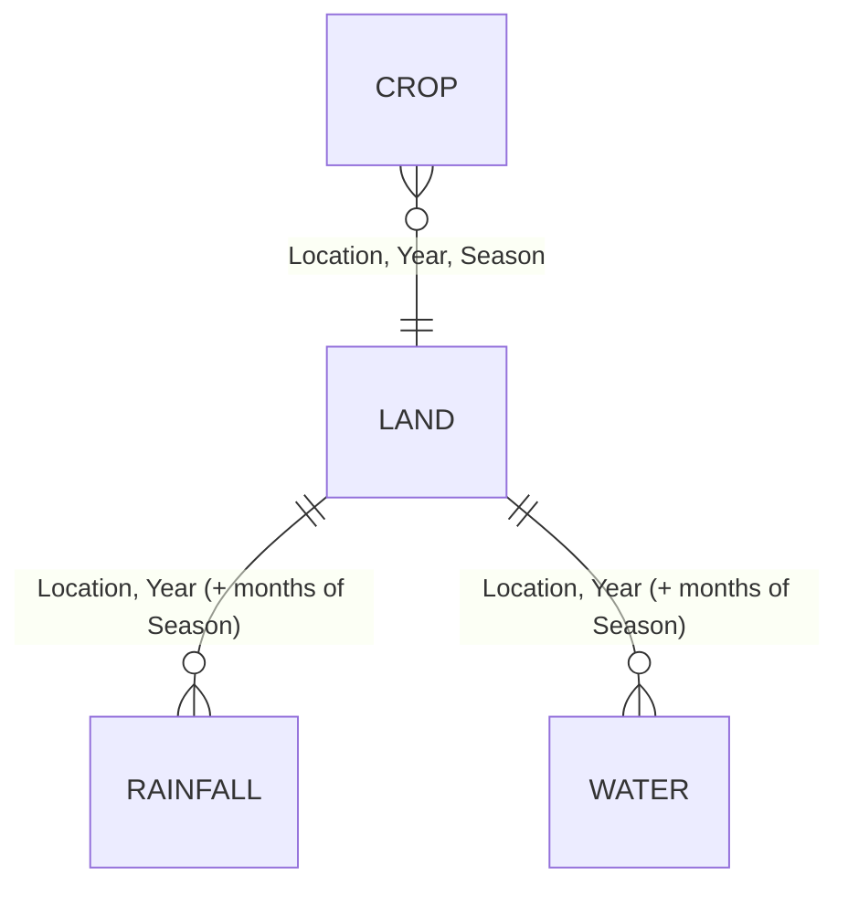

# Datasets

Authoritative copy: `agrooptimize-backend/data/raw/` (16 CSV files, 761 lines incl. headers). The top-level `final_year_project/datasets/` folder is an **older, unused** version (see §7).

All facts below were measured from the files on 2026-09-29 with pandas (`app.data.loader.load_all()`); quality findings are summarised here and analysed in depth in [DATA_VALIDATION.md](DATA_VALIDATION.md).

## 1. Overview

| Kind | File pattern | Grain | Rows (all 4 districts) | Years | Used by |
|---|---|---|---|---|---|
| Crop history | `<district>_crop.csv` | Location × Year × Season × Crop | 205 | 2020–2024 | Candidate crops, all 4 NSGA-II objectives, dashboard yield KPI, catalog |
| Land & soil | `<district>_land.csv` | Location × Year × Season | 60 | 2020–2024 | Soil fertility index → fuzzy input; dashboard soil KPI and actions; soil-profile endpoint |
| Rainfall & weather | `<district>_rainfall.csv` | Location × Year × Month | 240 | 2020–2024 | Fuzzy rainfall input, effective rainfall (water objective), weather fallback |
| Water availability | `<district>_water_availability.csv` | Location × Year × Month | 240 | 2020–2024 | Fuzzy water input, dashboard water KPI and irrigation action |

Districts: Coimbatore, Erode, Salem, Pollachi (`config.LOCATIONS`). Note: Pollachi is a taluk/town in Coimbatore district, not a separate revenue district – the "districts" label is an approximation.

**Relationships.** All four kinds join on `Location` + `Year`. Crop and land additionally join on the agricultural `Season` (Kharif/Rabi/Summer). Rainfall and water are monthly and carry a *meteorological* season label (Winter / Summer / Southwest Monsoon / Northeast Monsoon) that the code ignores; instead `config.SEASON_MONTH_MAP` selects months:

| Agricultural season | Months aggregated | Note |
|---|---|---|
| Kharif | Jun, Jul, Aug, Sep | |
| Rabi | Oct, Nov, Dec, Jan, Feb, Mar | Jan–Mar are taken from the **same calendar year**, not the following year |
| Summer | Feb, Mar, Apr, May | Feb–Mar overlap with Rabi |

**Provenance column.** Every file has `data_source`:

* `"Project baseline dataset (2020-2023, course-provided)"` – rows 2020–2023. Original source not documented anywhere in the repository.
* `"Estimated (2024) - live download attempted from data.gov.in API (403), CGWB gwdata portal (maintenance mode), … Value = 2023 actual x ~1.061 growth factor"` (crop), `"… 2023 actual carried forward unchanged"` (land), `"… 2023 actual monthly rainfall/weather repeated verbatim"` (rainfall), `"… 2023 actual monthly water-availability figures repeated verbatim"` (water). **All 2024 rows are synthetic.** Because the pipeline defaults to the latest year, every request without an explicit `year` uses 2024. Since 2026-09-29 the API reports this via `data_year_estimated` (see [API_REFERENCE.md](API_REFERENCE.md)).

Missing values: **none** in any file. Duplicate rows: **none**.

## 2. `<district>_crop.csv` (23 columns)

| Column | Unit / type | Range (all rows) | Used? | Where |
|---|---|---|---|---|
| Location | text | 4 values | ✔ | filters |
| Year | int | 2020–2024 | ✔ | filters, year resolution |
| Season | Kharif/Rabi/Summer | | ✔ | filters |
| Crop_Name | text | 15 crops | ✔ | candidate names |
| Crop_Type | Cereal, Commercial, Fiber, Fodder, Fruit, Horticulture, Oilseed, Plantation, Root Crop, Spice | | ✔ | response only |
| Area_Sown_Ha | ha | 6,420 – 45,773 | ✘ | – |
| Area_Harvested_Ha | ha | 6,400 – 45,547 | ✘ | – |
| Production_Tonnes | t | 18,660 – 4,396,686 | ✘ | – |
| Yield_Kg_Ha | kg/ha | 1,500 (cotton) – 98,449 (sugarcane) | ✔ | objective f1 (yield); dashboard "estimated yield" |
| MSP_Rs_Qtl | ₹ per quintal | 650 – 8,600 | loaded, **not used** in any objective | – |
| Revenue_Rs_Lakh | ₹ lakh (district total) | 6,739 – 1,381,219 | ✔ | ranks candidate crops (top-N); dashboard crop split |
| Water_Req_mm | mm per season | 350 – 1,854 | ✔ | objective f3 (net of effective rain), f4 carbon term |
| Fertilizer_N_Kg_Ha | kg N/ha | 25 – 257.5 | ✔ | f2 cost, f4 leaching + carbon |
| Fertilizer_P_Kg_Ha | kg P₂O₅/ha (assumed basis) | 30 – 82.4 | ✔ | f2, f4 carbon |
| Fertilizer_K_Kg_Ha | kg K₂O/ha (assumed basis) | 30 – 164.8 | ✔ | f2, f4 carbon |
| Pesticide_Cost_Rs_Ha | ₹/ha | 800 – 3,914 | ✔ | f2 |
| Labor_Days_Ha | person-days/ha | 50 – 185.4 | ✔ | f2 (× ₹319/day) |
| Crop_Duration_Days | days | 90 – 365 | ✔ | response only |
| Sowing_Month, Harvest_Month | month name or "Any" | | ✔ | response only |
| Irrigation_Type | Drip, Drip+Flood, Flood, Rainfed, Sprinkler | | ✔ | response only |
| Rainfall_Dependency | Very Low / Low / Medium / High | | ✔ | per-crop fuzzy penalty factor 0.1/0.3/0.6/1.0; Comparison "market" radar axis |
| data_source | text | 2 values | ✔ | `is_estimated_year()` |

Crops per location/season/year (identical every year):

| | Kharif | Rabi | Summer |
|---|---|---|---|
| Coimbatore | Sugarcane, Maize, Groundnut, Cotton, Sorghum | Paddy, Wheat, Turmeric, Sunflower | Vegetables, Banana |
| Erode | Sugarcane, Turmeric, Maize, Cotton, Groundnut | Paddy, Banana, Sunflower | Vegetables, Coconut |
| Salem | Paddy, Maize, Tapioca, Groundnut, Cotton | Sugarcane, Banana, Sunflower | Vegetables, Mango |
| Pollachi | Coconut, Paddy, Banana, Sugarcane, Vegetables | Paddy, Groundnut, Turmeric | Maize, Fodder Crops |

Because at most 5 crops exist per slice, `DEFAULT_MAX_CANDIDATE_CROPS = 6` never truncates; every Summer problem has only **2** crops.

**Internal consistency (verified):** `Production_Tonnes = Area_Harvested_Ha × Yield_Kg_Ha / 1000` (max relative error 0.06 %); `Revenue_Rs_Lakh = Production_Tonnes × 10 × MSP_Rs_Qtl / 10⁵` (max 0.22 %); `Area_Harvested ≤ Area_Sown` in all rows.

**Temporal behaviour:** the median year-over-year yield ratio 2020→21, 21→22, 22→23 is exactly **1.00**; 2024 = 2023 × 1.03 for every crop (area also ×1.03, hence production ×1.061 as the provenance string says).

## 3. `<district>_land.csv` (22 columns)

| Column | Unit | Range | Used? | Where |
|---|---|---|---|---|
| Total_Land_Ha, Agricultural_Land_Ha, Irrigated_Land_Ha, Rainfed_Land_Ha, Fallow/Forest/Urban/Wasteland/Horticulture/Plantation_Ha | ha | 7,420 – 583,052 | Agricultural and Irrigated only | `GET /api/soil-profile` |
| Irrigation_Percent | % of agricultural land | 49.8 – 68.7 | ✔ | profile (display) |
| Agricultural_Percent | % of total land | 44.3 – 61.9 | ✘ | |
| Soil_Type | Red Sandy Loam (Coimbatore), Red Laterite (Erode), Red Loam (Salem), Black Cotton Soil (Pollachi) | | ✔ | display |
| Avg_Soil_pH | pH | 6.5 – 7.5 | ✔ | fertility index |
| Organic_Carbon_Percent | % | 0.53 – 0.75 | ✔ | fertility index |
| N_Status, P_Status, K_Status | Low/Medium/High | K never Low | ✔ | fertility index; dashboard fertiliser actions |

Consistency: `Irrigated + Rainfed = Agricultural` exactly; `Irrigation_Percent = Irrigated/Agricultural×100` within 0.06.
Temporal behaviour: pH rises by exactly **+0.1/year** and organic carbon by **+0.01/year** in every district; Rabi/Summer OC are Kharif −0.01/−0.02.

## 4. `<district>_rainfall.csv` (16 columns)

| Column | Unit | Range | Used? | Where |
|---|---|---|---|---|
| Month | name | 12 per year | ✔ | season filter |
| Season | meteorological season | | ✘ | |
| Monthly_Rainfall_mm | mm | 2.8 – 158.4 | ✔ | effective rainfall; weather fallback |
| Rainy_Days, Max_Daily_Rainfall_mm | days, mm | | ✘ | |
| Min_Temp_C, Max_Temp_C | °C | 17.8 – 41.0 | ✔ | profile; weather fallback |
| Humidity_Percent | % | 50 – 87 | ✔ | profile; weather fallback |
| Rainfall_Type | Light/Monsoon/Pre-monsoon | | ✘ | |
| Normal_Rainfall_mm | mm | 23.3 – 105 | ✘ (implicitly via Deviation_Percent) | |
| Deviation_from_Normal_mm | mm | −59.4 – 97.7 | ✘ | |
| Deviation_Percent | % | **−93.0 – +339.5** | ✔ | **fuzzy input `rainfall_dev`** (seasonal mean) |
| Annual_Normal_mm | mm | 650 (Erode) / 700 (Coimbatore) / 750 (Pollachi) / 800 (Salem) | ✘ | |

`Normal_Rainfall_mm` is **constant within each meteorological season** (e.g. Coimbatore: 37.5 mm for Jan and Feb, 23.3 for Mar–May, 95 for Jun–Sep, 58.3 for Oct–Dec – together exactly the 700 mm annual normal). Real monthly normals are not flat, so monthly deviations are exaggerated (Coimbatore May 2020 = +193.6 %). Consistency: `Deviation_from_Normal_mm = Monthly − Normal` exactly; `Deviation_Percent` matches within 0.05.

Annual observed totals vs stated normal: Coimbatore 619–639 mm (normal 700), Erode 566–579 (650), Salem 676–706 (800), **Pollachi 1,016–1,055 (750)**.

## 5. `<district>_water_availability.csv` (18 columns)

| Column | Unit | Range | Used? | Where |
|---|---|---|---|---|
| River_Inflow_MCM | million m³ | 4.2 – 152.4 | ✘ | |
| Reservoir_Storage_MCM, Reservoir_Capacity_MCM | million m³ | 109.5–272.3 / 248.6–320.4 | ✘ | |
| Storage_Percent | % of capacity | 35 – 85 | ✔ | **fuzzy input `water_storage`**; dashboard "irrigation" action (<40 %) |
| Groundwater_Level_mbgl | m below ground | 15 – 34 | ✘ | |
| Groundwater_Status | Very Low … Very High (7 labels) | | ✔ | profile (mode over months) |
| Canal_Release_MCM | million m³ | 4.4 – 64.4 | ✘ | |
| Irrigation_Water_MCM, Drinking_Water_MCM, Industrial_Water_MCM | million m³ | | Irrigation only | dashboard "water utilisation" numerator |
| Total_Demand_MCM | million m³ | 4.4 – 64.4 | ✔ | dashboard denominator |
| Deficit_Surplus_MCM | million m³ | **always 0.0** | ✔ (profile) | carries no information |
| Primary_Source | Bhavani River, Pillur/Mettur/Bhavanisagar/Aliyar Dam, … | | ✘ | |

Consistency: `Storage% = Storage/Capacity` within 0.014; `Total_Demand = Irrigation + Drinking + Industrial` exactly; `Total_Demand = Canal_Release` exactly.
Temporal behaviour: **`Storage_Percent` is identical for every year** at each location-month (all 48 location-months); `Groundwater_Level_mbgl` also never changes across years. Seasonal storage means therefore differ only by district and season, never by year.

## 6. Transformations applied by the code

| Step | Code | Formula / rule |
|---|---|---|
| Load | `loader._read_kind` | concatenate the 4 district files per kind; cached for process lifetime |
| Year resolution | `preprocessing._resolve_year` | `year=None` → latest year for that location in crop.csv (2024) |
| Soil fertility index (0–100) | `compute_soil_fertility_index` | `0.3·clamp(100−40·|pH−6.5|) + 0.3·clamp(100·OC/1.0) + 0.4·mean(status→{Low 30, Med 60, High 90})` |
| Seasonal rainfall | `get_region_season_profile` | mean over the season's months of Monthly_Rainfall_mm, Deviation_Percent, Humidity, Max/Min temp |
| Effective rainfall | same | `mean_monthly_rain × n_months × 0.7` (mm per season) |
| Water profile | same | mean Storage_Percent, mode Groundwater_Status, mean Deficit_Surplus |
| Candidate crops | same | crop rows for (loc, year, season) sorted by Revenue_Rs_Lakh desc, top `max(N, 2)` |
| Display normalisation | `normalized_snapshot` | min–max against fixed ranges pH 4–9, OC 0–1.5 %, rain 0–150 mm, deviation −50…+50 %, storage 0–100 %. **Not used by the optimiser** |

Validation performed at load time: file existence only. There is no schema validation, range checking or type enforcement (see TODO T-6).

## 7. The stale `datasets/` folder

Same 16 file names, older content: no `data_source`/`Annual_Normal_mm` columns, no 2024 rows, and different rainfall normals (e.g. Coimbatore January `Normal_Rainfall_mm` 7.5 vs 37.5, deviation +9.3 % vs −78.1 %). The team's saved runs in `results/` and the numbers in `agrooptimize-backend/docs/results/*.md` and `docs/api_docs.md` (e.g. Coimbatore Kharif 2023 storage 94.7 %, yield confidence 0.775) come from an older dataset version; the current data gives storage 85.0 % and yield confidence 0.620 for the same slice.

## 8. Confidence, weaknesses and official replacements

| Dataset | Confidence | Main weaknesses | Candidate official source (verify current availability) |
|---|---|---|---|
| Crop | Low–medium | Origin undocumented; yields flat over 4 years; 2024 synthetic; "MSP" given for crops with no notified MSP (banana, coconut per quintal, mango, tapioca, vegetables, turmeric); wheat listed for Tamil Nadu Rabi; sugarcane listed under Kharif with January sowing | District-wise Area-Production-Yield from the Directorate of Economics & Statistics (Ministry of Agriculture) via data.gov.in / DES portal; MSP from CACP / PIB notifications; costs from the DES *Cost of Cultivation of Principal Crops* scheme; crop water requirement from FAO-56 or TNAU crop production guides |
| Land & soil | Low | Perfectly linear pH/OC trends; one soil type per district | Soil Health Card portal (soilhealth.dac.gov.in); DES Land Use Statistics |
| Rainfall | Medium-low | Season-flat normals inflate monthly deviations; 2024 repeated | IMD district-wise monthly rainfall and normals (IMD Customized Rainfall Information System) |
| Water | Low | Storage identical every year; Deficit_Surplus always 0; groundwater level constant | CWC reservoir bulletins / India-WRIS (reservoir storage); CGWB groundwater-level data via India-WRIS |

Recommended actions are in [DATA_VALIDATION.md](DATA_VALIDATION.md) §5 and [TODO.md](TODO.md).
