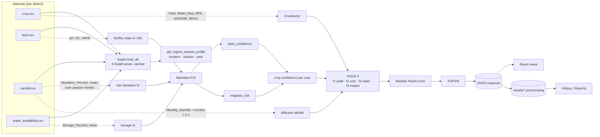

# Data Flow

How a value travels from a CSV cell to a pixel. Companion to [ARCHITECTURE.md](ARCHITECTURE.md) (structure) and [OPTIMIZATION_PIPELINE.md](OPTIMIZATION_PIPELINE.md) (stage detail).

## 1. End-to-end

## 2. Field lineage (selected)

| UI value | API field | Computed in | From |
|---|---|---|---|
| Analytics point x (₹/ha) | `plans[].cost` | `get_plans` | f2 ÷ area ← fertiliser NPK × prices, pesticide, labour × wage |
| Analytics point y (t/ha) | `plans[].yield_val` | `get_plans` | f1 ÷ area ← Yield_Kg_Ha × crop confidence |
| Water slider (ML/ha) | `plans[].water_val` | `get_plans` | f3 ÷ area ÷ 10⁶ ← (Water_Req − effective rain) × 10 000 |
| Gold point | `plans[].is_recommended` | `rank_plans('balanced')` | TOPSIS rank 1 |
| Convergence curve | `hypervolume_history` | `extract_convergence_history` | pymoo history, run-normalised HV |
| Comparison radar "risk" | `radar_scores.risk` | `_radar_scores` | 1 − irrigation_risk ← FIS ← rainfall/water/soil |
| Comparison radar "market" | `radar_scores.market` | `_radar_scores` | 1 − mean(Rainfall_Dependency factor) |
| Dashboard Estimated Yield | `estimated_yield` | `get_dashboard` | mean Yield_Kg_Ha (latest year, all crops) |
| Dashboard Water Utilization | `water_utilization_pct` | `get_dashboard` | Σ Irrigation_Water_MCM / Σ Total_Demand_MCM |
| Dashboard Soil Health | `soil_health_pct` | `get_dashboard` | fertility index of current-season land row |
| Dashboard estimated banner | `data_year_estimated` | `is_estimated_year` | `data_source` column |
| History "Target Yield" | `target_yield` | `get_history` | saved run's plan #1 yield ÷ its area |
| Report "Env. impact" | `plans[0].env_impact_score` | saved run | f4 |
| Weather temp | `temp` | `_get_weather_live` | Open-Meteo `current.temperature_2m` (or CSV mean of Max/Min temp) |

## 3. Which parameters reach the optimiser, per entry point

| Entry point | Location | Season | Year | Land | Budget | Population | Preference | Saved |
|---|---|---|---|---|---|---|---|---|
| Run Optimization page → `POST /api/farm-plans` | user choice | user choice | user choice / latest | user choice | user choice | 80 | user choice | yes |
| Analytics → `/api/plans` | profile district | **current calendar season** | latest (2024, estimated) | **5 ha (fixed by frontend)** | none | 100 | balanced | no |
| Comparison → `/api/comparison` | profile district | current season | latest | 5 ha | none | 100 | balanced/max_yield/min_cost | no |
| Analytics → `/api/compare-fuzzy` | profile district | current season | latest | 5 ha | none | 100 ×2 | – | no |
| CLI `run_demo.py` | arg | arg | arg / latest | arg | arg | 80 or arg | arg | unless `--no-save` |

The user's saved `landSize` is used only on the Run Optimization page.

## 3b. District Intelligence flow
`GET /api/district-intelligence/{district}` → `district_service._build` (cached) → observed rows of all four CSVs → coverage, climate, soil, water, crop history → suitability (season profiles + fuzzy + `FarmPlanProblem.evaluate` on one-crop one-hectare plans + TOPSIS goodness) → market → insights → summary → `DistrictIntelligenceView` (filters in the browser). See [DISTRICT_INTELLIGENCE.md](DISTRICT_INTELLIGENCE.md).

## 3c. Scenario Simulation flow
`POST /api/simulations/run` → `simulation_service.resolve` (validate, map controls) → `plan_service.run_pipeline` × 5 seeds for the baseline and × 5 seeds for the scenario with `PipelineAdjustments` (rainfall factor and storage override in preprocessing, fertiliser price factor in the cost objective, explicit TOPSIS weights) → explanation engine on each side's seed-42 run (scenario price factor for profit) → paired analysis → response + token. Saving writes `results/simulations/<id>.json`. See [SCENARIO_SIMULATION.md](SCENARIO_SIMULATION.md).

## 4. Caching along the path

| Cache | Key | Invalidation |
|---|---|---|
| `loader.load_all` | – | process restart / `clear_cache()` |
| `fuzzy._build_system` | – | process restart |
| `dashboard_service._cached_pareto_front` (32 entries) | location, season, year, land, budget, track_history | process restart / `clear_pareto_cache()` |
| `results_store._SUMMARY_CACHE` | file path + (mtime, size) | automatic on file change |
| `district_service._build` (8 entries) | district | process restart / `clear_cache()` |
| Browser | none (every page visit refetches) | – |

## 5. Persistence flow

`POST /api/farm-plans` with `save_results: true` → `results_store.save_run_results` → reserve `<run_id>.json` → atomic write of the full response + `saved_at` + `client_id` + convergence history → `<run_id>_plans.csv` → `<run_id>_convergence.csv` + `.png`. Read paths: `/api/history` (summaries + plan #1), `/api/dashboard` (count), `/api/results/{id}` (full record, through `FarmPlanResponse`).
