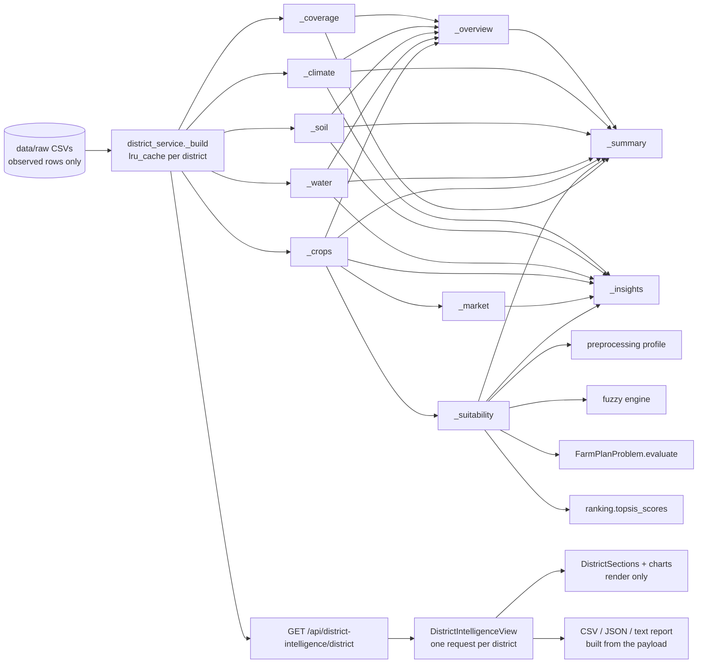

# District Intelligence Center

A single page that profiles a district before any optimisation is run: overview, data coverage, climate, soil, water, crop history, crop suitability, historical prices, generated insights and an executive summary. Backend: `app/services/district_service.py`. Frontend: `frontend/src/views/DistrictIntelligenceView.jsx` and `frontend/src/components/district/DistrictSections.jsx`.

## 1. Where district information lived before

| Information | Previously exposed by | Reused here |
|---|---|---|
| Soil fertility index | `preprocessing.compute_soil_fertility_index` (dashboard, profiles) | yes |
| Season profiles (rainfall deviation, storage, candidate crops) | `preprocessing.get_region_season_profile` | yes (suitability) |
| Fuzzy assessment / sets | `fuzzy.engine` | yes (`evaluate_uncertainty`, `input_memberships`, crop confidence) |
| Per-crop yield, cost, irrigation, impact | `FarmPlanProblem` objective function | yes – evaluated for one-crop, one-hectare plans |
| Min–max goodness | `ranking.topsis_scores` | yes (resource efficiency) |
| Observed vs estimated rows | `explanation_service._observed` | moved to `preprocessing.observed_rows`, shared |
| Statement format with evidence | `explanation_service._item` | made public as `make_item`, shared |
| Dashboard KPIs, weather, soil snapshot | `dashboard_service` | not duplicated; the dashboard stays the "today" view, this page is the historical profile |
| District names, coordinates, season months | `config` | yes |

## 2. Architecture and flow



* One aggregate endpoint instead of many small ones: the page needs everything at once, and the payload is ≈55 KB.
* The payload is a pure function of the CSVs → `lru_cache(maxsize=8)`; cold build 30–120 ms, cached ≈1 µs.
* Filtering (season, crop, year, metric) happens in the browser over the returned records; no extra requests.

## 3. Data rules
* **Observed rows only** feed every statistic and trend. Rows whose `data_source` starts with "Estimated" (2024) appear only in `coverage.estimated_years`, and the summary says they were excluded.
* **No estimates.** Fields the dataset lacks are `null` with a note (e.g. `agricultural_zone`), shown as "Data not available". Whole sections return `{"available": false, "note": "Data not available"}` when their rows are missing.
* **Data artefacts are stated, not hidden**: identical reservoir storage every year, constant groundwater depth with a varying status label, and deficit/surplus always 0.

## 4. Sections: content and sources

| Section | Content | Source |
|---|---|---|
| Overview | agricultural area, total area, irrigated %, soil types, mean annual rainfall vs stated normal, mean temperature and humidity, primary irrigation sources (share of monthly records), major crops (mean sown area), seasons and years, last dataset update (CSV modification date) | land, rainfall, water, crop CSVs; file metadata |
| Coverage | observed and estimated years, rows per file, monthly completeness, provenance strings | all CSVs |
| Climate | annual totals vs normals, monthly series, meteorological-season shares, agricultural-season totals, trends (rainfall, temperature, humidity, rainy days) | rainfall CSV |
| Soil | per-season records with fertility index, latest values and fuzzy soil set, trends, N/P/K characteristics, limitations (Low nutrient, OC < 1 %), crop categories grown | land CSV, fertility index, fuzzy sets |
| Water | yearly demand/inflow/storage/groundwater, storage by month and by season (with fuzzy water set and the 40 % action threshold), groundwater status distribution, irrigation dependency, stress indicators, glossary | water and land CSVs, fuzzy sets |
| Crop history | every observed record (area, share of season area, production, yield, price, revenue) and per crop-season trends | crop CSV |
| Suitability | ranked crops per season and overall (§5) | profile, fuzzy, optimiser objectives, crop CSV |
| Market | price by year, mean, trend, strongest/weakest growth; flagged historical, not live, unvalidated | crop CSV `MSP_Rs_Qtl` |
| Insights | generated statements with evidence (§6) | all of the above |
| Summary | 4–6 sentences assembled from the computed facts | all of the above |

## 5. Calculations

| Quantity | Formula |
|---|---|
| Trend | first vs last observed value: change % = (last − first)/|first| × 100; least-squares slope per year; CV = sample SD ÷ mean |
| Direction | `unchanged` if all values equal; `stable` if |change| < 5 %; otherwise increasing / decreasing |
| Variability | CV < 0.10 low, < 0.25 moderate, otherwise high |
| Annual rainfall / normal | Σ monthly rainfall / Σ monthly normal for the year; deviation % |
| Season share | Σ rainfall in a meteorological season ÷ Σ all rainfall (observed years) |
| Mean temperature | mean of (max + min)/2 over observed months |
| Irrigated % | Σ irrigated ha ÷ Σ agricultural ha (season records of a year) |
| Irrigation share of demand | Σ irrigation MCM ÷ Σ total demand MCM per year |
| Area share | crop sown area ÷ season's total sown area, per year |
| Storage fuzzy set | `fuzzy.input_memberships` on the seasonal mean storage |

### Crop suitability score
For each season, the latest observed year's profile is built (all crops), the fuzzy assessment is computed, and `FarmPlanProblem.evaluate` is called with one row per crop: the whole hectare on that crop, irrigation and fertiliser multipliers at 1.0. This returns the optimiser's own per-hectare yield (fuzzy-adjusted), cost, irrigation and impact. Five components (0–1), equal weights, score = mean × 100:

| Component | Definition |
|---|---|
| Climate & soil | fuzzy crop confidence for the season |
| Rainfall fit | min(1, effective rainfall ÷ crop water requirement) |
| Prominence | crop's mean share of the season's sown area ÷ the largest such share in the season |
| Yield stability | 1 − min(1, CV of observed yields) |
| Resource efficiency | mean min–max goodness of cost, irrigation and impact per hectare among the season's crops (`ranking.topsis_scores`) |

Tonnage is displayed but not scored: tonnes of sugarcane and of sunflower are not comparable. Equal weights are deliberate (no outcome data to calibrate against). With only two crops in Summer, min–max goodness is 0 or 1 for each; that is stated in the method text.

### Thresholds (constants in `district_service.py`)
`STABLE_CHANGE_PCT 5`, `LOW_CV 0.10`, `HIGH_CV 0.25`, `MAJOR_CROPS 5`, `LOW_STORAGE_PCT 40` (same as the dashboard's irrigation action), `CONCENTRATED_SHARE_PCT 50`.

## 6. Insights generated
Annual rainfall trend; rainfall against the stated normal; seasonal composition; temperature trend; fastest and slowest production growth with an area-vs-yield attribution; yield consistency (lowest/highest CV); "yields flat" when every series is stable; cropping pattern per season (largest share, concentrated vs diversified); irrigation-dependency trend; static reservoir records; static groundwater depth; soil fertility trend; largest historical price rise (flagged unvalidated); highest suitability score. Each insight is `{id, title, detail, source, evidence}`.

## 7. API

`GET /api/district-intelligence/{district}` – case-insensitive; 404 for unknown districts. Response model `DistrictIntelligenceOut` (`app/schemas.py`): `district, overview, coverage, climate, soil, water, crops, suitability, market, insights[], summary{sentences[], text}`. Abbreviated example (Salem):

```json
{"district": "Salem",
 "overview": {"agricultural_area_ha": 148513.0, "irrigated_pct": 57.9, "soil_types": ["Red Loam"],
              "average_annual_rainfall_mm": 692.7, "stated_annual_normal_mm": 800.0, "average_temperature_c": 29.0,
              "agricultural_zone": null, "agricultural_zone_note": "The dataset has no agro-climatic zone field.",
              "last_dataset_update": "2026-09-18"},
 "coverage": {"observed_years": [2020, 2021, 2022, 2023], "estimated_years": [2024]},
 "suitability": {"year_basis": 2023, "rankings": [{"rank": 1, "crop": "Sunflower", "season": "Rabi", "score": 73.4,
   "components": {"climate_soil": 0.531, "rainfall_fit": 0.594, "prominence": 0.543, "yield_stability": 1.0, "resource_efficiency": 1.0},
   "expected_yield_t_ha": 1.33, "cost_rs_ha": 28580.0, "water_req_mm": 350.0}]},
 "summary": {"text": "Salem grows 10 crops across 3 seasons; ..."}}
```

## 8. Frontend

| Piece | Role |
|---|---|
| `views/DistrictIntelligenceView.jsx` | district selector, loading skeleton, error state, summary, quick actions, compare panel, sections |
| `components/district/DistrictSections.jsx` | `OverviewSection`, `ClimateSection`, `SoilSection`, `WaterSection`, `CropPerformanceSection` (season/crop/year/metric filters), `SuitabilitySection`, `MarketSection`, `InsightsSection`, `StatTile` |
| `components/charts/LineChart.jsx`, `BarChart.jsx`, `ChartCard.jsx`, `chartTheme.js` | reusable charts: emphasis colouring, hover tooltips, reference lines, minimum y-span, chart/table toggle |
| `utils/districtView.js` | selection and formatting only: filters, series, distribution bars, CSV, text report, compare rows |
| `App.jsx` | nav item "District Intelligence" (after Run Optimization); `navigateTo(view, params)` lets Run Optimization open with the district preselected |

Chart design: the selected series is in the accent green `#1f6b3a`, others in gray `#8f998e` (validated: CVD ΔE 18.8, normal ΔE 22.1; gray contrast 2.95:1, hence the table view on every chart). One y-axis per chart. `minSpan` keeps near-constant series (temperature, fertility index, prices) from looking volatile.

Quick actions: Run optimization (preselects this district), Compare district (side-by-side table of nine indicators, loaded on demand), Generate report (text file from the payload), View analytics, Export data (crop records CSV), Export all (JSON).

## 9. Tests
* Backend `tests/test_district.py` (96, parametrised over the four districts): trend helper, structure and serialisation, nulls with notes, values checked against independent pandas calculations on the CSVs (annual rainfall, temperature, season shares, crop records, area shares, water demand, sources, storage flag), fertility formula reuse, suitability (contiguous ranks, score = mean of components, per-hectare cost/irrigation/yield recomputed directly from the CSV row and config prices), market trend, missing water/soil data, caching, endpoint.
* Frontend (Vitest, 31): charts, filters and series helpers, exports, compare rows, every section rendered against a real Salem payload, and "Data not available" for missing sections.

## 10. Limitations
* Four observed years (2020–2023): trends are descriptive first-to-last changes, not statistically significant trends.
* The dataset lacks an agro-climatic zone, live prices, and soil-to-crop suitability tables; these are reported as unavailable.
* Water storage and groundwater depth do not vary between years in the data; the page says so.
* Prices are the dataset's unvalidated MSP column.
* Suitability weights are equal by design; Summer has only two crops.

## 11. Future improvements
1. Replace rainfall/water with IMD and CWC/India-WRIS series to obtain real inter-annual variation.
2. Add an agro-climatic zone and soil-to-crop suitability reference table (e.g. from TNAU) as a separate, cited dataset.
3. Live market prices (e.g. from a mandi price feed) clearly separated from historical values.
4. Map view of the four locations using `DISTRICT_COORDINATES`.
5. Use the shared chart components on Analytics and Comparison to retire their inline SVG.
6. Server-side PDF district report.
