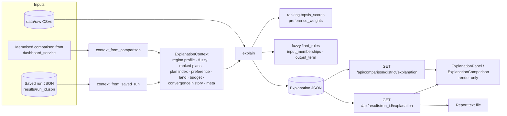

# Explainable Recommendation Engine

Every recommended plan can be explained: why it was chosen, how the four objectives were balanced, what was traded away, which constraints hold, benefits, risks, historical context, a decomposed confidence score and a trace of the pipeline. Code: `app/services/explanation_service.py`. UI: `frontend/src/components/ExplanationPanel.jsx`.

## 1. Where the recommendation is created (before this feature)

| Step | Input | Processing | Output | Code |
|---|---|---|---|---|
| Profile | location, season, year | CSV slice → soil, rainfall, water, candidate crops | `RegionSeasonProfile` | `app/data/preprocessing.py` |
| Fuzzy | rain deviation, storage, fertility | Mamdani FIS, 26 rules | yield confidence, irrigation risk | `app/fuzzy/engine.py` |
| Search | profile + fuzzy + land + budget | NSGA-II, 4 objectives | feasible Pareto set | `app/optimization/` |
| **Decision** | Pareto set + preference | **TOPSIS closeness → rank 1 = recommendation** | ranked plans | `app/decision/ranking.py::rank_plans` |
| Delivery | ranked plans | saved run / per-ha dashboard payloads | API responses | `plan_service.py`, `dashboard_service.py` |

The recommendation is TOPSIS rank 1 under the active preference: `POST /api/farm-plans` (user preference), Comparison Plan A/B/C (balanced / max_yield / min_cost).

## 2. Architecture

**Design decisions**

| Decision | Why |
|---|---|
| A backend service, not React logic | One source of truth for wording and numbers; reused by four pages and the report; testable |
| Dedicated endpoints instead of extending optimisation responses | Optimisation responses stay lean (~33 KB); explanations (~19 KB) are fetched only when asked for; saved runs explain retroactively, including runs saved before this feature |
| One `ExplanationContext` for saved runs and live comparison plans | Same analysis code path for both |
| Re-use, not re-implement | TOPSIS maths moved into `ranking.topsis_scores` and used by both `rank_plans` and the explainer (48 pipeline outputs verified identical to `main`); fuzzy helpers use the model's own sets and rules |
| Comparison explanations use the history-tracked front | Verified identical to the front the page shows (all 4 districts), so convergence evidence is available without describing a different plan |
| Saved runs now store `meta.total_land_ha`, `meta.budget_rs` | Needed for the budget check; older runs report "not recorded" rather than guessing |

## 3. Sources of every statement

Each item is `{id, title, detail, source, evidence, status?, severity?}`. `detail` is built from `evidence`; `source` is one of: `dataset`, `fuzzy`, `nsga2`, `topsis`, combinations of these, `constraint(s)`, `request`, `run metadata`, `model limitation`. In the UI, hovering any item shows its source and evidence.

| Section | Built from |
|---|---|
| Summary | ranked plan (rank, closeness, shares, area, objective totals), confidence, recommendation rule |
| Reasons | TOPSIS rank and margin; objectives with goodness ≥ 0.60; soil fuzzy set; land share of Low/Very-Low rainfall-dependency crops; budget headroom; historical top-3 share; ranks under other preferences |
| Objectives | stored `normalized_scores` (goodness), preference weights, per-ha values vs the set (best / median / worst), share of the TOPSIS gap to the ideal |
| Trade-offs | best plan in the set per objective vs this plan (per-ha deltas); least-squares slope and correlation of cost and water against yield across the set |
| Constraints | land allocation, budget (if recorded), rainfall (fuzzy set + rainfall coverage), soil (fuzzy set), irrigation risk (fuzzy output set), optimiser feasibility |
| Benefits | objectives better than the set median (percent difference) |
| Risks | irrigation-risk output set, rainfall deficit, rainfall coverage < 50 %, rain-dependent crops, concentration (HHI), perennial crops, weak objectives (goodness < 0.30), estimated data year, year-to-year rainfall variability, inputs at the model minimum |
| Historical context | observed (non-estimated) years in crop.csv and rainfall.csv for the district/season |
| Confidence | see §4 |
| Insights | trade-off position, diversification, main yield driver, rainfall reliance, rank under each preference |
| Alternatives | runner-up per-ha deltas and closeness |
| Timeline | data slice, fuzzy inputs/outputs + fired rules, NSGA-II settings and hypervolume, TOPSIS weights and rank, constraint summary |
| Crop breakdown + consistency | per-crop confidence, expected yield, net irrigation recomputed exactly as `FarmPlanProblem._evaluate`; recomputed totals vs reported totals |

## 4. Formulas

Notation: plan *p* in a ranked set *S* (all feasible plans for comparison explanations; the stored top 50 for saved runs), crops *i*, land share *sᵢ*, area *aᵢ*, multipliers *irrᵢ*, *fertᵢ*.

| Quantity | Formula |
|---|---|
| Per-hectare value | objective total ÷ Σ aᵢ (water in ML = L × 10⁻⁶) |
| Goodness gⱼ | stored TOPSIS min–max score (1 = best in the ranked front) |
| Better-than share | % of other plans in *S* that *p* is at least as good as, on objective *j* |
| Gap share | (wⱼ(1−gⱼ))² / Σₖ (wₖ(1−gₖ))² — objective's share of the squared distance to the TOPSIS ideal; the largest = "main compromise" |
| Strongest objective | argmax gⱼ (ties → larger weight) |
| Crop confidence | `crop_yield_confidence(yield_conf, irrigation_risk, dependency)` (engine) |
| Expected tonnes | aᵢ · Yieldᵢ/1000 · confᵢ |
| Net irrigation | max(WaterReqᵢ − effective rain, 0) · irrᵢ |
| Rainfall coverage | min(100, effective rain ÷ Σ sᵢ·WaterReqᵢ × 100) |
| Concentration | HHI = Σ sᵢ² (1 = one crop) |
| Marginal rate | least-squares slope of cost/ha (or water/ha) on yield/ha over *S*, with Pearson r |
| Historical top-N rate | land-weighted (years crop in district top-3 by Revenue_Rs_Lakh ÷ observed years) |
| Rainfall CV | std/mean of seasonal rainfall totals over observed years |
| Fired rule strength | min of its antecedent membership degrees (Mamdani AND) |
| Indicative revenue (reference only) | Σ tonnesᵢ × 10 × MSP_Rs_Qtlᵢ; profit = revenue − cost |

### Confidence score
Unweighted mean of the components that can be computed (each 0–100); components that cannot be computed are excluded, not guessed.

| Component | Score | Source |
|---|---|---|
| Climate & soil suitability | 100 × land-weighted crop confidence | fuzzy |
| Data quality | 100 × (season months present ÷ expected, rainfall + water) × (0.5 if the year is estimated, else 1) | dataset |
| Optimisation convergence | 100 × (1 − hypervolume gain in the last 20 % of generations ÷ total gain); excluded without history | NSGA-II |
| Constraint satisfaction | 100 if no constraint is violated, else 0 | constraints |
| Historical consistency | 100 × historical top-N rate | dataset |
| Weather consistency | 100 × (1 − min(1, rainfall CV)) | dataset |
| Ranking robustness | 100 × (preferences under which the plan is within the top 10 % of *S*) ÷ 5 | TOPSIS |

Equal weights are a deliberate, untuned choice: no outcome data exists to calibrate weights, so any other split would be arbitrary.

### Recommendation label
Highly recommended: rank 1 and confidence ≥ 75 %. Recommended: rank ≤ 5 and confidence ≥ 60 %. Otherwise: Use with caution. (The rule is returned in the payload and shown as a tooltip.)

### Wording thresholds (constants at the top of the service)
`STRONG_GOODNESS 0.60`, `WEAK_GOODNESS 0.30`, `MIN_SHARE_PCT 1`, `DIVERSIFIED_SHARE_PCT 5`, `CONCENTRATION_HHI 0.50`, `PERENNIAL_DAYS 300`, `INPUT_FLOOR_TOLERANCE 0.02`, `HISTORICAL_TOP_N 3`, `HISTORICAL_HIT_RATE 0.75`, `ROBUST_TOP_FRACTION 0.10`, `CONSISTENCY_TOLERANCE 1 %`. They decide which facts are worth stating; they never alter a number.

## 5. What is deliberately *not* claimed

* **Profit.** The dataset's `MSP_Rs_Qtl` column is not validated (several crops have no government MSP; some values look implausibly high — e.g. sugarcane yields an indicative margin of roughly ₹9.6 lakh/ha for Salem Rabi). Profit is not an optimiser objective. It is therefore shown only in a collapsed "Indicative economics (unvalidated prices)" box, with `validated: false`, and is excluded from reasons, benefits, risks and confidence. A test enforces this.
* **Input advice.** When irrigation and fertiliser multipliers sit at the 0.7 floor, a risk item states that the yield model does not reward higher inputs, instead of presenting the floor as an optimised dose.
* **Budget for old runs.** Shown as "not recorded".
* **Convergence without history.** Excluded from confidence with an explanation.

## 6. API

| Endpoint | Parameters | Errors |
|---|---|---|
| `GET /api/results/{run_id}/explanation` | `rank` 1–500 (default 1) | 404 unknown run, 400 rank beyond the run's plans, 422 invalid rank |
| `GET /api/comparison/{district}/explanation` | `plan` A/B/C (default A), `total_land_ha` > 0, `budget_rs` > 0 | 404 unknown district, 422 invalid plan/land/budget |

Response model: `ExplanationOut` (`app/schemas.py`); JSDoc `Explanation` typedef in `frontend/src/services/api.js`.

## 7. Frontend

| Place | Entry point |
|---|---|
| Comparison | "Explain" on each plan row; "Why this plan?" on the plan detail card; "Compare explanations" (side-by-side A/B/C) |
| Run Optimization | "Why this plan?" on the saved result |
| History | "Explain top plan" in the run details dialog |
| Reports | "Why?" on each report card; the downloaded report includes Recommendation → Reasons → Trade-offs → Benefits → Risks → Confidence breakdown |

`ExplanationPanel` sections: summary (recommendation badge, confidence %, crop-mix bars, per-ha metrics), why recommended, objective balance (goodness bars, STRONGEST / MAIN COMPROMISE badges), trade-offs, constraint checks (status chips), benefits, risks (severity badges), confidence (component bars), historical context, insights, runner-up comparison, pipeline timeline, fired fuzzy rules (collapsible), indicative economics (collapsible, flagged), consistency note. `ExplanationModal` handles loading, errors and Escape-to-close; it is an ARIA dialog.

## 8. Worked example — Salem, Rabi 2024 (estimated year), Plan A (balanced)
Rank #1 of 100, closeness 0.6152, confidence 74.9 % → "Recommended". Sugarcane 53 % / Sunflower 47 %; 31.49 t/ha, ₹51,970/ha, 6.61 ML/ha, impact 68.49/ha. Strongest objective: environmental impact; main compromise: yield. Best-yield alternative: +26.69 t/ha but +41 % cost and +74 % water. Risks include rainfall −36.8 % (deficit), rainfall covering 18 % of crop water need, estimated input year, sugarcane as a 365-day crop in a one-season plan, and inputs at the model minimum. Confidence components: climate/soil 56.3, data quality 50 (estimated year), convergence 100, constraints 100, historical 100, weather 97.7, robustness 20. Recomputed yield and water match reported totals within 0.03 %.

## 9. Testing
`tests/test_explanation.py` (25 tests): structure and serialisation, determinism, summary ↔ plan traceability, recomputation consistency, goodness and weights from TOPSIS, gap shares sum to 100, fired rules equal the engine's, comparison Plan A equals the page's Plan A, confidence = mean of available components, missing history excluded, estimated year lowers data quality and adds a risk, budget reporting incl. old runs, unvalidated prices never used, endpoint success and errors. Full backend suite: 230 passing. Frontend: oxlint clean, build passes, every section server-rendered against real API payloads with no undefined/NaN.

## 10. Future improvements
1. Counterfactuals: "what would make Plan B the recommendation?" (minimal weight change, via `topsis_scores`).
2. Sensitivity of the recommendation to fuzzy inputs (± rainfall deviation) by re-running the memoised pipeline.
3. Calibrate confidence components against observed outcomes once farm results exist; replace equal weights.
4. Validated price data → promote economics from reference to a first-class objective and explanation.
5. Localised wording (English/Tamil) generated from the same evidence.
6. Store the explanation snapshot in the saved run for audit, alongside a version number of the explainer.
