# Fuzzy Benchmark Results

Measured comparison of the fuzzy models of [FUZZY_MODEL_IMPROVEMENTS.md](FUZZY_MODEL_IMPROVEMENTS.md): the original (published) model, each improvement on its own, the cumulative chain and two screened candidates. Raw data: [benchmarks/fuzzy_models/fuzzy_models_benchmark.json](benchmarks/fuzzy_models/fuzzy_models_benchmark.json).

## 1. Method

| Item | Setting |
|---|---|
| Command | `python3 scripts/benchmark_fuzzy_models.py --json out.json`, then `python3 scripts/report_fuzzy_benchmark.py out.json` |
| Machine | arm64 Mac, Python 3.13, numpy 2.3.5, scikit-fuzzy 0.5.0, pymoo 0.6.2; nothing else running (timings from a dedicated run) |
| Models | `original`; I1 `strong_partition`; I2 `imd_rainfall`; I3 `pruned_rules`; chain I1+I2 and I1+I2+I3 (= `improved`); screened S1 product AND, S2 rules 16/19/23 as implicative upper bounds (fuzzy layer only; exact re-implementation, max difference to the engine on the original model 0.0) |
| Fuzzy inputs | 60 dataset profiles (4 districts × 3 seasons × 5 years); 21³ grid over the input universes; 11³ grid + profiles for leave-one-out |
| Noise | rainfall ±5 pp, storage ±2 pp, fertility ±2: all 8 corners around each profile (480 cases) |
| Pipeline | NSGA-II original engine, population 80, 200 generations, 4 districts × 3 seasons (default year) × seeds 0–4 = 60 runs per model; budget none, 5 ha |
| Quality indicators | HV, GD, IGD, IGD+, spread, spacing (`app/optimization/metrics.py`) against the non-dominated union of the model's own 60 runs per problem. Models change the objective functions, so **raw HV mixes front shape with convergence; the HV ratio (run HV ÷ reference HV) is the comparable measure** |
| Stability | TOPSIS: the seed-0 Pareto set re-scored under each noise corner, Kendall τ of the balanced closeness (96 cases). Recommendation: NSGA-II re-run (seed 0) under each noise corner; share of land moved in the top plan and whether its largest crop is kept |
| Statistics | Wilcoxon signed-rank (two-sided) on the same (problem, seed) runs or noise cases; exact binomial test on discordant pairs for the top crop |

Definitions: *effective rule* = removing it changes an output somewhere; *zero-influence fired* = fired with leave-one-out importance 0; *rule support* = strongest firing per profile; *single-term output* = only one output term has a positive cut (the centroid then ignores the firing strength); *signal-to-noise* = standard deviation across profiles ÷ mean change under noise; *first-order share* = variance of the grid mean along one input ÷ total variance.

## 2. Before vs after (Original → I1 → I1+I2 → Final)

| Measure | Original | I1 | I1+I2 | Final (I1+I2+I3) |
|---|---|---|---|---|
| Rules (effective) | 26 (20) | 26 (20) | 26 (20) | **20 (20)** |
| ε-completeness, weakest input | 0.143 | 0.143 | 0.5 | **0.5** |
| Largest monotonicity violation | 0.0653 | 0.0231 | 0.0231 | **0.0231** |
| Steps with drop > 0.01 (yield vs storage) | 7.3 % | 1.8 % | 2.8 % | **2.8 %** |
| IMD label agreement | 51/60 | 51/60 | 60/60 | **60/60** |
| Mean noise change yield / risk | 0.024 / 0.035 | 0.019 / 0.028 | 0.008 / 0.016 | **0.008 / 0.016** |
| Signal-to-noise yield / risk | 4.08 / 4.02 | 2.15 / 4.88 | 4.07 / 5.93 | **4.07 / 5.93** |
| Single-term outputs yield / risk (of 60) | 10 / 30 | 0 / 15 | 0 / 4 | **0 / 4** |
| Fired / zero-influence rules per profile | 5.38 / 3.20 | 7.20 / 4.73 | 9.33 / 6.82 | **7.17 / 4.48** |
| Inference / explanation (ms per call) | 3.08 / 3.83 | 3.05 / 4.11 | 3.10 / 3.98 | **2.28 / 3.12** |
| Peak memory (KB) | 2,877 | 2,899 | 2,770 | **2,087** |
| NSGA-II HV ratio | 0.9611 | 0.9609 | 0.9598 | **0.9598** (p = 0.54) |
| TOPSIS τ mean / min under noise | 0.9991 / 0.993 | 0.9992 / 0.989 | 0.9996 / 0.996 | **0.9996 / 0.996** (p < 0.001) |
| Top crop kept under noise | 67.7 % | 67.7 % | 74.0 % | **74.0 %** (p = 0.36) |

## 3. Full tables
### Fuzzy layer

| Model | Rules | Effective | ε (rain / storage / fert.) | Largest monotonicity drop | Steps > 0.01 (%) | IMD labels | Fired / profile | Zero-influence fired | Rule support |
| --- | --- | --- | --- | --- | --- | --- | --- | --- | --- |
| original | 26 | 20 | 0.143 / 0.231 / 0.231 | 0.0653 | 7.3 / 0.2 / 5.9 | 51/60 | 5.38 | 3.2 | 0.435 |
| I1 strong partition | 26 | 20 | 0.143 / 0.5 / 0.5 | 0.0231 | 1.8 / 0.0 / 1.5 | 51/60 | 7.2 | 4.73 | 0.525 |
| I2 IMD rainfall | 26 | 20 | 0.5 / 0.231 / 0.231 | 0.0653 | 11.7 / 0.5 / 10.4 | 60/60 | 6.97 | 5.03 | 0.576 |
| I3 pruned rules | 20 | 20 | 0.143 / 0.231 / 0.231 | 0.0653 | 7.3 / 0.2 / 5.9 | 51/60 | 4.13 | 1.65 | 0.435 |
| I1+I2 | 26 | 20 | 0.5 / 0.5 / 0.5 | 0.0231 | 2.8 / 0.0 / 3.8 | 60/60 | 9.33 | 6.82 | 0.677 |
| I1+I2+I3 (final) | 20 | 20 | 0.5 / 0.5 / 0.5 | 0.0231 | 2.8 / 0.0 / 3.8 | 60/60 | 7.17 | 4.48 | 0.677 |
| S1 product AND | 26 | 20 | 0.143 / 0.231 / 0.231 | 0.0657 | 16.6 / 2.9 / 3.3 | 51/60 | 5.38 | – | 0.369 |
| S2 implicative caps (16, 19, 23) | 26 | 21 | 0.143 / 0.231 / 0.231 | 0.1374 | 8.4 / 0.6 / 5.9 | 51/60 | 5.38 | – | 0.435 |

### Outputs, confidence and robustness

| Model | Mean yield conf. | Mean risk | Std yield / risk | Noise mean yield / risk | Noise max yield / risk | SNR yield / risk | Output-term membership yield / risk |
| --- | --- | --- | --- | --- | --- | --- | --- |
| original | 0.7071 | 0.2953 | 0.0979 / 0.1396 | 0.024 / 0.0347 | 0.1015 / 0.2078 | 4.08 / 4.02 | 0.511 / 0.618 |
| I1 strong partition | 0.6863 | 0.3117 | 0.0409 / 0.1358 | 0.019 / 0.0278 | 0.0719 / 0.2067 | 2.15 / 4.88 | 0.35 / 0.555 |
| I2 IMD rainfall | 0.7218 | 0.2903 | 0.0936 / 0.1197 | 0.0207 / 0.0228 | 0.0802 / 0.1098 | 4.51 / 5.25 | 0.475 / 0.527 |
| I3 pruned rules | 0.7071 | 0.2953 | 0.0979 / 0.1396 | 0.024 / 0.0347 | 0.1015 / 0.2078 | 4.08 / 4.02 | 0.511 / 0.618 |
| I1+I2 | 0.6722 | 0.3294 | 0.0322 / 0.0953 | 0.0079 / 0.0161 | 0.0372 / 0.0854 | 4.07 / 5.93 | 0.389 / 0.489 |
| I1+I2+I3 (final) | 0.6722 | 0.3294 | 0.0322 / 0.0953 | 0.0079 / 0.0161 | 0.0372 / 0.0854 | 4.07 / 5.93 | 0.389 / 0.489 |
| S1 product AND | 0.7443 | 0.2947 | 0.0942 / 0.146 | 0.0225 / 0.0328 | 0.1051 / 0.2313 | 4.18 / 4.46 | – / – |
| S2 implicative caps (16, 19, 23) | 0.7373 | 0.2953 | 0.1145 / 0.1396 | 0.0237 / 0.0347 | 0.1823 / 0.2078 | 4.83 / 4.02 | – / – |

### Runtime and memory

| Model | Inference (ms/call) | Explanation (ms/call) | Peak memory (KB) |
| --- | --- | --- | --- |
| original | 3.083 | 3.83 | 2876.6 |
| I1 strong partition | 3.051 | 4.11 | 2899.3 |
| I2 IMD rainfall | 3.096 | 3.94 | 2899.2 |
| I3 pruned rules | 2.237 | 3.01 | 2013.2 |
| I1+I2 | 3.095 | 3.98 | 2770.3 |
| I1+I2+I3 (final) | 2.284 | 3.12 | 2086.5 |

### Pipeline (NSGA-II original engine, TOPSIS balanced)

| Model | Runtime (s) | HV | HV ratio | GD | IGD | IGD+ | Spread | Spacing | Feasible pop. (%) | Front size | TOPSIS τ mean / min | Land moved (%) | Top crop kept (%) |
| --- | --- | --- | --- | --- | --- | --- | --- | --- | --- | --- | --- | --- | --- |
| original | 0.321 | 0.6735 | 0.9611 | 0.0039 | 0.0403 | 0.0125 | 0.5403 | 0.0551 | 100.0 | 80.0 | 0.999 / 0.993 | 9.5 | 67.7 |
| I1 strong partition | 0.324 | 0.6682 | 0.9609 | 0.0038 | 0.0396 | 0.0125 | 0.5472 | 0.0557 | 100.0 | 80.0 | 0.999 / 0.989 | 12.4 | 67.7 |
| I2 IMD rainfall | 0.324 | 0.6761 | 0.9623 | 0.0044 | 0.0421 | 0.0123 | 0.5499 | 0.0559 | 100.0 | 80.0 | 0.999 / 0.982 | 11.0 | 67.7 |
| I3 pruned rules | 0.335 | 0.6735 | 0.9611 | 0.0039 | 0.0403 | 0.0125 | 0.5403 | 0.0551 | 100.0 | 80.0 | 0.999 / 0.993 | 9.5 | 67.7 |
| I1+I2 | 0.332 | 0.6595 | 0.9598 | 0.0031 | 0.0413 | 0.0127 | 0.5494 | 0.0544 | 100.0 | 80.0 | 1.0 / 0.996 | 11.0 | 74.0 |
| I1+I2+I3 (final) | 0.344 | 0.6595 | 0.9598 | 0.0031 | 0.0413 | 0.0127 | 0.5494 | 0.0544 | 100.0 | 80.0 | 1.0 / 0.996 | 11.0 | 74.0 |

### Paired tests against the original

| Model | Metric | Original | Model | Change | p |
| --- | --- | --- | --- | --- | --- |
| I1 strong partition | seconds | 0.3205 | 0.3238 | +1.0 % | 0.153 |
| I1 strong partition | hypervolume | 0.6735 | 0.6682 | -0.8 % | 0.193 |
| I1 strong partition | hypervolume_ratio | 0.9611 | 0.9609 | -0.0 % | 0.752 |
| I1 strong partition | gd | 0.003899 | 0.003795 | -2.7 % | 0.592 |
| I1 strong partition | igd | 0.04025 | 0.0396 | -1.6 % | 0.213 |
| I1 strong partition | igd_plus | 0.01254 | 0.0125 | -0.4 % | 0.883 |
| I1 strong partition | spread | 0.5403 | 0.5472 | +1.3 % | 0.707 |
| I1 strong partition | spacing | 0.05512 | 0.05565 | +1.0 % | 0.889 |
| I1 strong partition | topsis_kendall_tau | 0.9991 | 0.9992 | +0.0 % | 0.0143 |
| I1 strong partition | top_plan_land_moved_pct | 9.489 | 12.43 | +31.0 % | 0.293 |
| I1 strong partition | top_crop_unchanged | 67.7 % | 67.7 % | 13 gained / 13 lost | 1 |
| I2 IMD rainfall | seconds | 0.3205 | 0.3242 | +1.1 % | 0.0014 |
| I2 IMD rainfall | hypervolume | 0.6735 | 0.6761 | +0.4 % | 0.0315 |
| I2 IMD rainfall | hypervolume_ratio | 0.9611 | 0.9623 | +0.1 % | 0.242 |
| I2 IMD rainfall | gd | 0.003899 | 0.00437 | +12.1 % | 0.452 |
| I2 IMD rainfall | igd | 0.04025 | 0.04206 | +4.5 % | 0.288 |
| I2 IMD rainfall | igd_plus | 0.01254 | 0.01233 | -1.7 % | 0.301 |
| I2 IMD rainfall | spread | 0.5403 | 0.5499 | +1.8 % | 0.707 |
| I2 IMD rainfall | spacing | 0.05512 | 0.05589 | +1.4 % | 0.957 |
| I2 IMD rainfall | topsis_kendall_tau | 0.9991 | 0.9989 | -0.0 % | 0.279 |
| I2 IMD rainfall | top_plan_land_moved_pct | 9.489 | 11.03 | +16.2 % | 0.388 |
| I2 IMD rainfall | top_crop_unchanged | 67.7 % | 67.7 % | 12 gained / 12 lost | 1 |
| I3 pruned rules | seconds | 0.3205 | 0.3353 | +4.6 % | 2.01e-10 |
| I3 pruned rules | hypervolume | 0.6735 | 0.6735 | +0.0 % | 1 |
| I3 pruned rules | hypervolume_ratio | 0.9611 | 0.9611 | +0.0 % | 1 |
| I3 pruned rules | gd | 0.003899 | 0.003899 | +0.0 % | 1 |
| I3 pruned rules | igd | 0.04025 | 0.04025 | +0.0 % | 1 |
| I3 pruned rules | igd_plus | 0.01254 | 0.01254 | +0.0 % | 1 |
| I3 pruned rules | spread | 0.5403 | 0.5403 | +0.0 % | 1 |
| I3 pruned rules | spacing | 0.05512 | 0.05512 | +0.0 % | 1 |
| I3 pruned rules | topsis_kendall_tau | 0.9991 | 0.9991 | +0.0 % | 1 |
| I3 pruned rules | top_plan_land_moved_pct | 9.489 | 9.489 | +0.0 % | 1 |
| I3 pruned rules | top_crop_unchanged | 67.7 % | 67.7 % | 0 gained / 0 lost | 1 |
| I1+I2 | seconds | 0.3205 | 0.3325 | +3.7 % | 2.26e-09 |
| I1+I2 | hypervolume | 0.6735 | 0.6595 | -2.1 % | 2.64e-06 |
| I1+I2 | hypervolume_ratio | 0.9611 | 0.9598 | -0.1 % | 0.541 |
| I1+I2 | gd | 0.003899 | 0.003142 | -19.4 % | 0.254 |
| I1+I2 | igd | 0.04025 | 0.04134 | +2.7 % | 0.808 |
| I1+I2 | igd_plus | 0.01254 | 0.0127 | +1.2 % | 1 |
| I1+I2 | spread | 0.5403 | 0.5494 | +1.7 % | 0.435 |
| I1+I2 | spacing | 0.05512 | 0.05444 | -1.2 % | 0.643 |
| I1+I2 | topsis_kendall_tau | 0.9991 | 0.9996 | +0.0 % | 0.000175 |
| I1+I2 | top_plan_land_moved_pct | 9.489 | 10.96 | +15.5 % | 0.234 |
| I1+I2 | top_crop_unchanged | 67.7 % | 74.0 % | 18 gained / 12 lost | 0.362 |
| I1+I2+I3 (final) | seconds | 0.3205 | 0.3435 | +7.2 % | 4.73e-10 |
| I1+I2+I3 (final) | hypervolume | 0.6735 | 0.6595 | -2.1 % | 2.64e-06 |
| I1+I2+I3 (final) | hypervolume_ratio | 0.9611 | 0.9598 | -0.1 % | 0.541 |
| I1+I2+I3 (final) | gd | 0.003899 | 0.003142 | -19.4 % | 0.254 |
| I1+I2+I3 (final) | igd | 0.04025 | 0.04134 | +2.7 % | 0.808 |
| I1+I2+I3 (final) | igd_plus | 0.01254 | 0.0127 | +1.2 % | 1 |
| I1+I2+I3 (final) | spread | 0.5403 | 0.5494 | +1.7 % | 0.435 |
| I1+I2+I3 (final) | spacing | 0.05512 | 0.05444 | -1.2 % | 0.643 |
| I1+I2+I3 (final) | topsis_kendall_tau | 0.9991 | 0.9996 | +0.0 % | 0.000175 |
| I1+I2+I3 (final) | top_plan_land_moved_pct | 9.489 | 10.96 | +15.5 % | 0.234 |
| I1+I2+I3 (final) | top_crop_unchanged | 67.7 % | 74.0 % | 18 gained / 12 lost | 0.362 |

Pipeline run times rise with the order in which the models were run (0.321 s for the first model, 0.344 s for the last), including for `pruned_rules`, whose optimisation is identical to the original: the differences in the `seconds` rows are machine drift, not a model effect (the fuzzy stage is ≈3 ms of a ≈0.33 s run).

## 4. Charts

| Measure | Chart |
|---|---|
| Monotonicity | 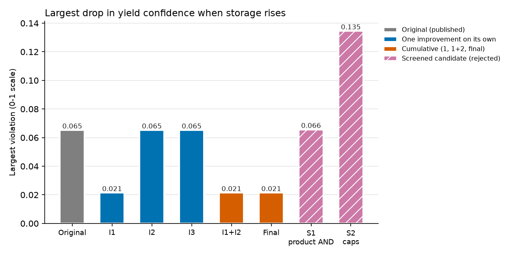 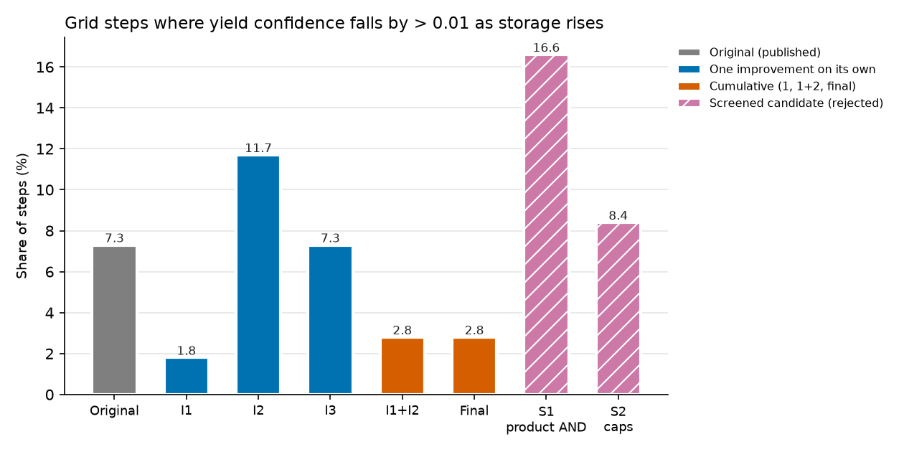 |
| Coverage and labels | 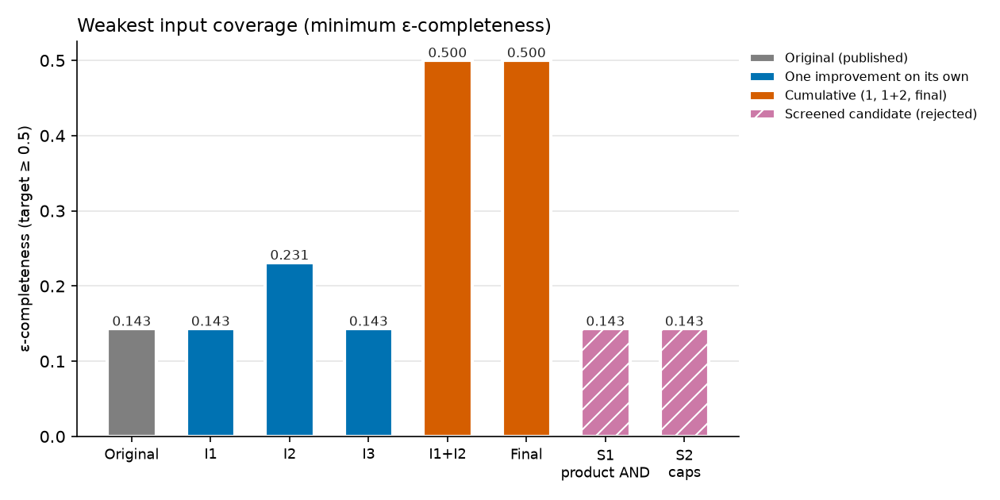 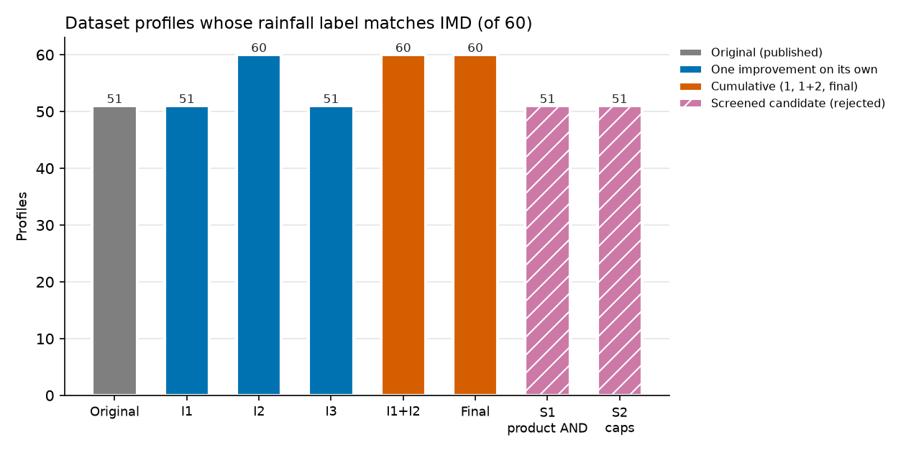 |
| Robustness | 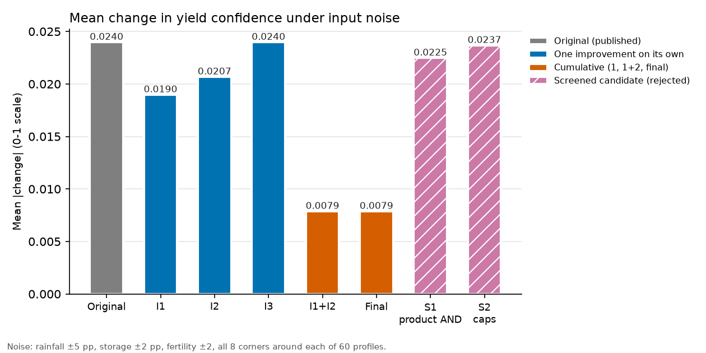 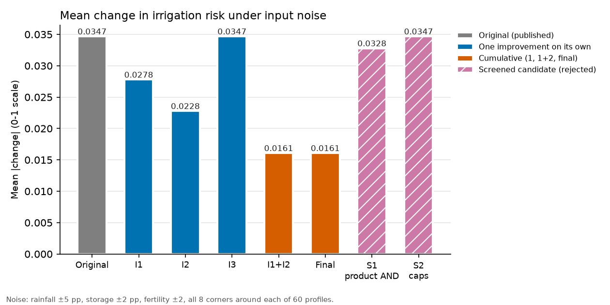 |
| Signal-to-noise | 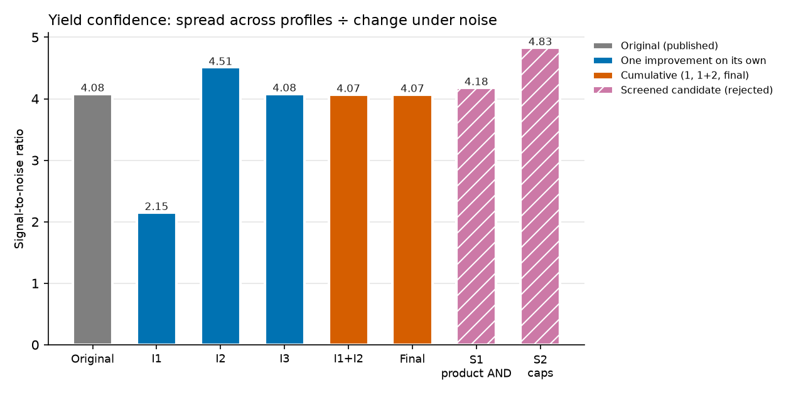 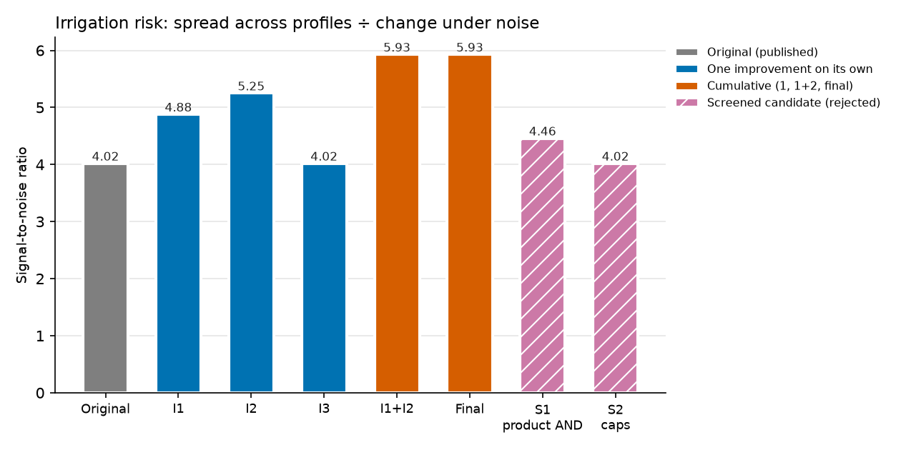 |
| Rules | 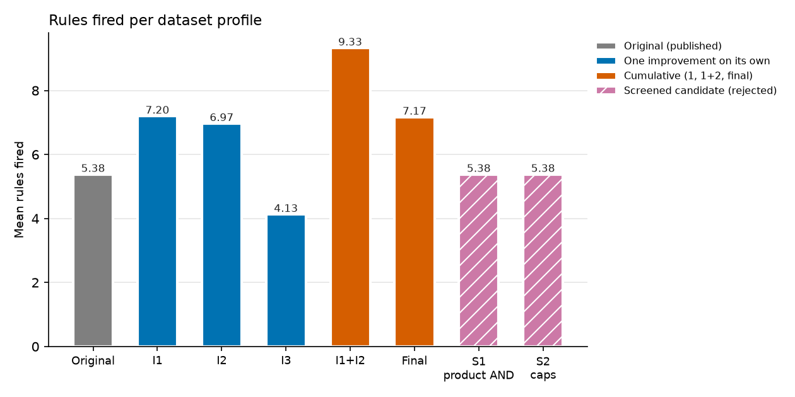 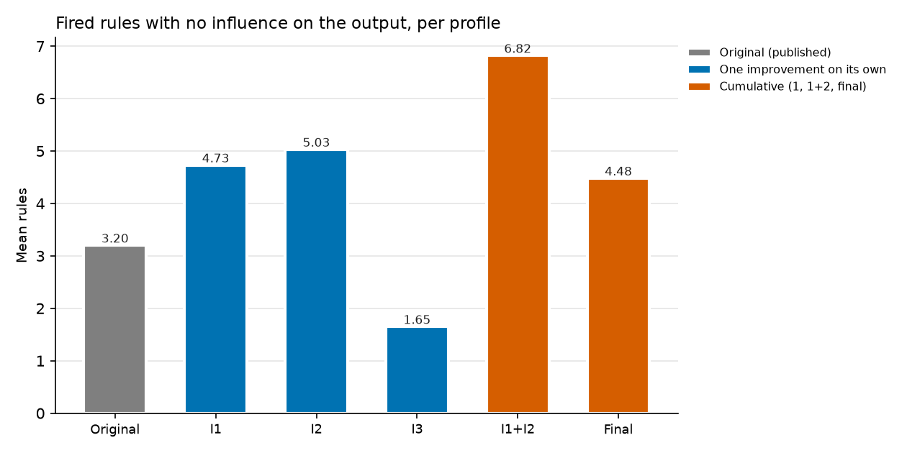 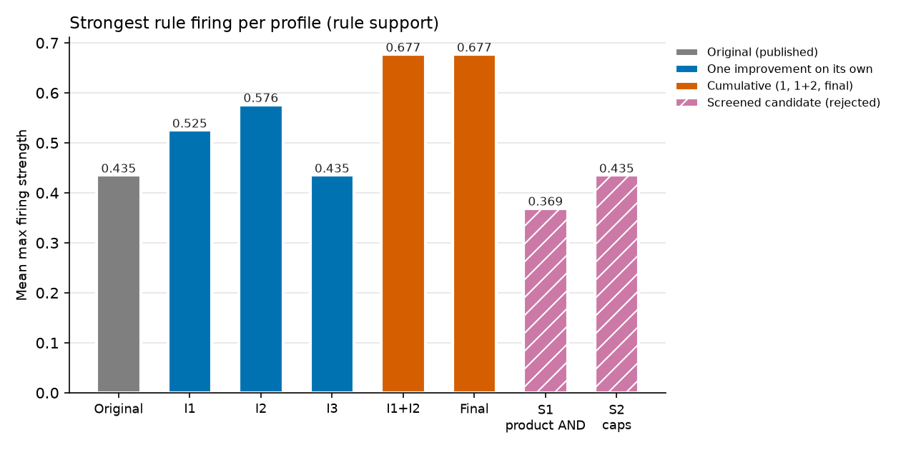 |
| Cost | 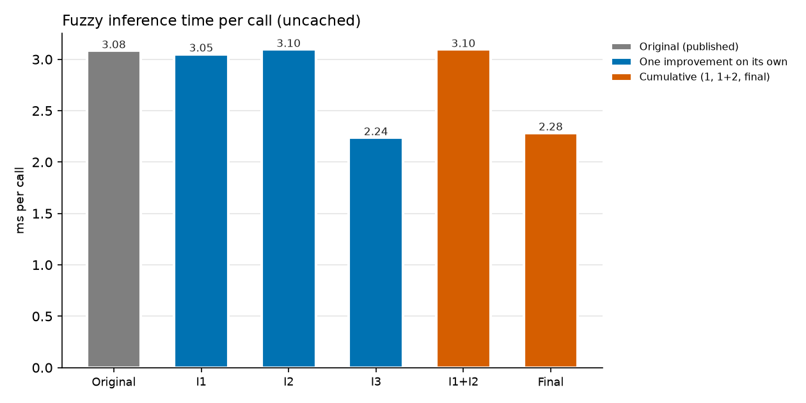  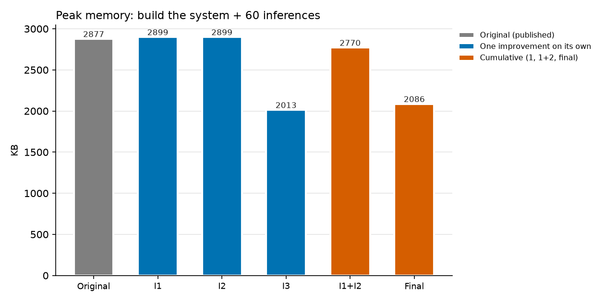 |
| Optimisation | 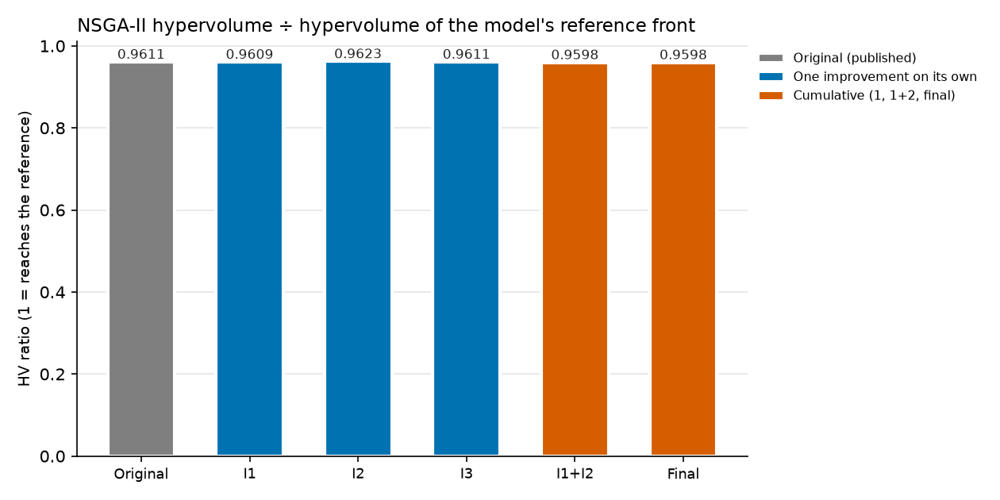 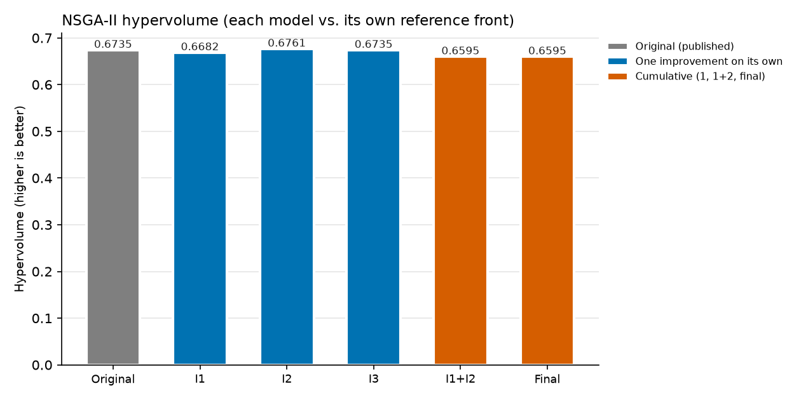 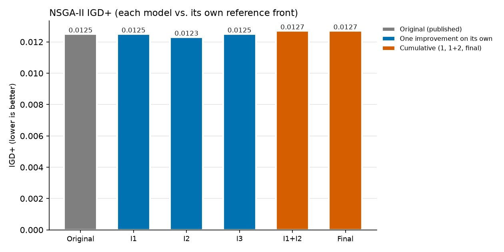 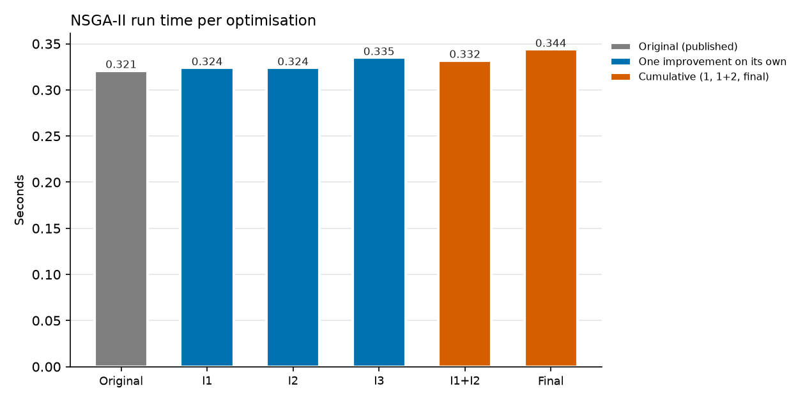 |
| Stability | 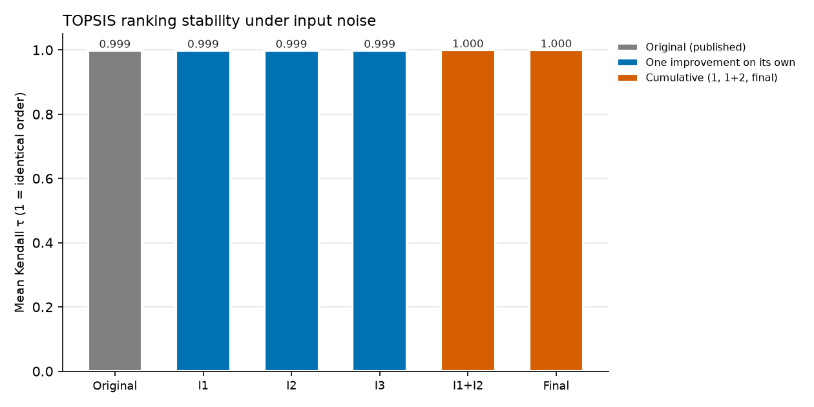 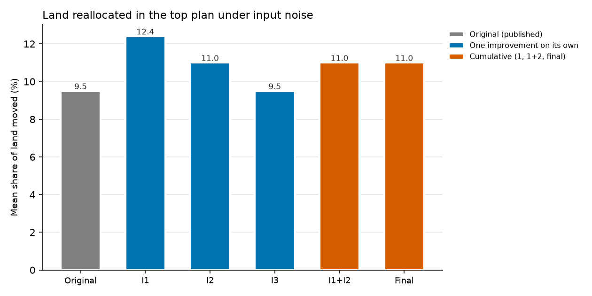 |

## 5. Observations

1. **Coverage is the root cause.** I1 alone removes two thirds of the largest monotonicity violation and every evidence-blind yield output; I2 alone fixes rainfall coverage and labels. Each alone also has a cost (I1 halves yield signal-to-noise; I2 adds small monotonicity violations); together the costs cancel and every robustness measure improves.
2. **The original's spread was partly artefact.** With weak overlaps, 10 yield and 30 risk outputs were produced by one weakly fired term; the final model has 0 and 4. Output spread across profiles is smaller, but yield signal-to-noise is unchanged and risk signal-to-noise rises 48 %.
3. **Pruning is free.** Outputs and pipeline metrics are identical to the model it prunes; inference and explanations are 20–27 % faster, memory 30 % lower, and explanations credit the rule that actually decides.
4. **The optimiser is unaffected.** HV ratio, GD, IGD, IGD+, spread and spacing do not differ significantly; raw HV is lower only because the front shape changes in the two problems whose fuzzy outputs changed most (Pollachi Summer, Erode Summer).
5. **Ranking stability improves slightly**, recommendation stability does not change significantly: τ rises (p < 0.001, small absolute change), the top crop is kept more often (74 % vs 68 %, n.s.), land moved is similar (11.0 % vs 9.5 %, n.s.).
6. **Screened candidates fail on monotonicity.** Implicative caps double the largest violation to 0.137 (rule 19 penalises better soil); product AND more than doubles violating steps and activates no inert rule.
7. **Not improved:** the share of rules that fire without influence rises with wider overlaps (more rules co-fire, max aggregation keeps one per term); output-label membership falls (output sets still cross at 0.231). Both are listed as deferred work.
