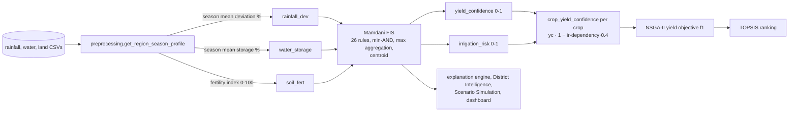

# Fuzzy System Analysis

Audit of the Mamdani fuzzy inference system in `app/fuzzy/engine.py`: architecture, data flow, membership functions, rule base, strengths, weaknesses and a prioritised improvement plan. Every figure below is produced by `app/fuzzy/audit.py` (also served by `GET /api/fuzzy/audit`) and checked in `tests/test_fuzzy_audit.py`. Explanation of individual inferences: [FUZZY_EXPLAINABILITY.md](FUZZY_EXPLAINABILITY.md). Literature comparison: [FUZZY_RESEARCH_REVIEW.md](FUZZY_RESEARCH_REVIEW.md). What was changed: [FUZZY_IMPROVEMENT_SUMMARY.md](FUZZY_IMPROVEMENT_SUMMARY.md).

## 1. Architecture and workflow

| Element | Implementation |
|---|---|
| Type | Mamdani (scikit-fuzzy 0.5.0 `ControlSystem`) |
| Inputs | `rainfall_dev` [−60, 60] % (deficit, normal, surplus); `water_storage` [0, 100] % (low, medium, high); `soil_fert` [0, 100] (poor, medium, good) |
| Outputs | `yield_conf` [0, 100] and `irrigation_risk` [0, 100] (low, medium, high), divided by 100 |
| Membership functions | 15 triangles (`MEMBERSHIP_FUNCTIONS`) |
| AND / implication / aggregation | min / min (clipping) / max |
| Defuzzification | centroid on the output universe (step 1) upsampled with each cut's crossing points |
| Rules | 26 (14 original + 12 named agro-climatic scenarios); effective 20 (§4) |
| Crisp outputs | rounded to 3 decimals |

**Interaction with the rest of the system.** The FIS runs once per region/season/year profile. Its only path into optimisation is `crop_yield_confidence`, which scales each crop's book yield in objective f1; cost, water and impact (f2–f4) do not use it. TOPSIS sees the effect only through the yield column, and the crop-level confidence also feeds the plan confidence label. The explanation engine, District Intelligence (suitability), Scenario Simulation (fuzzy changes) and the dashboard read the outputs, labels, memberships and fired rules.

Inputs that are **not** fuzzy variables: soil moisture (not in the data), crop history (used by District Intelligence and explanations, not the FIS), budget and land size (NSGA-II constraint and problem size). They are listed in the brief but have no membership functions to audit.

## 2. Data actually seen by the FIS

60 location/season/year profiles (48 observed, 12 estimated 2024 rows):

| Input | Observed range | Distinct values | Notes |
|---|---|---|---|
| rainfall_dev | −41.1 … +121.1 % | 47 | 5 Pollachi Summer profiles (+105 … +121 %) exceed the universe and are clipped to +60 |
| water_storage | 38.3 … 85.0 % | 12 | never below 35 %: the *low* set is never activated |
| soil_fert | 61.0 … 77.4 | 42 | never below 40: the *poor* set is never activated |

Observed outputs: yield_confidence 0.547–0.883, irrigation_risk 0.117–0.500.

## 3. Membership function audit (no changes made)

| Input | ε-completeness | Weakly covered (max membership < 0.5) | Crossing points | Profiles in weak band |
|---|---|---|---|---|
| rainfall_dev | **0.143** | [−32.5, −7.5] and [7.5, 32.5] — 41.6 % of the universe | deficit/normal at −12.86 (μ 0.143); normal/surplus at +12.86 | 35 / 60 |
| water_storage | 0.231 | [17.5, 35.0] and [62.5, 80.0] — 35 % | 26.9 (μ 0.231), 69.2 (μ 0.231) | 15 / 60 |
| soil_fert | 0.231 | [20.0, 37.5] and [62.5, 80.0] — 35 % | 30.8 (μ 0.231), 69.2 (μ 0.231) | 54 / 60 |

No gaps: every point has some membership (no zero-coverage region), and membership sums lie in [0.18, 1.0] (rainfall) and [0.375, 1.0] (others) — the partitions are not partitions of unity.

| Question | Finding |
|---|---|
| Ranges realistic? | Storage and fertility universes fit. The rainfall universe ±60 % clips 5 real profiles (IMD's own categories run to "large excess" ≥ +60 % and "large deficient" ≤ −60 %, so the clip itself is defensible, but the clipped values lose information). |
| Overlap correct? | Overlaps are narrow (8 points for rainfall, 13 for the others) and cross at low membership (0.14–0.23). The common design guideline is ε-completeness ≥ 0.5 (adjacent sets crossing at 0.5); all three inputs fall short. |
| Smooth transitions? | Piecewise linear; the narrow, low crossings produce the non-monotone output steps in §5. |
| Triangular vs Gaussian/bell? | Triangles are adequate and standard (Pedrycz 1994); Gaussians would remove kinks but not the coverage problem, and would change every output. The issue is placement, not shape. |
| Unused regions? | Water *low* and soil *poor* are never activated by the data; rules depending on them (11 of 26) never fire on real profiles. |
| Alignment with external standards | IMD classifies seasonal rainfall within ±19 % of the long-period average as **normal**. The FIS's *normal* set is only [−15, 15] with its crossing at ±12.9 %, so 9 profiles that IMD calls normal (e.g. −13.0 %, −18.2 %, +14.5 %, +19.0 %) get a dominant *deficit* or *surplus* label. |

**Recommendation M-1 (not implemented — changes outputs).** Re-place the rainfall sets so adjacent sets cross at μ = 0.5 at the IMD category boundaries (±19.5 %), which also gives ε-completeness 0.5; the exact triangles are a design decision for the team, not something this audit should invent. Do the same for storage and fertility using agreed reference thresholds (reservoir operating rules; Soil Health Card ratings). Expected benefit: linguistic labels agree with official classifications; ε-completeness ≥ 0.5; fewer non-monotone steps. Cost: every fuzzy output and therefore every optimisation result changes — requires a new results version and re-running the paper's tables.

## 4. Rule base audit (no rules changed)

### 4.1 Provably inert rules
With AND = min, a rule whose conditions are a superset of another rule's never fires more strongly; with max aggregation, if that other rule concludes the same term, the inert rule can never set the term's cut. Rules whose *every* consequent is subsumed this way cannot change any output.

| Rule | Conditions → conclusions | Subsumed by | Leave-one-out max change (11³ grid) |
|---|---|---|---|
| 13 | water high ∧ soil good → yield high | 10 (soil good → yield high) | 0 |
| 15 | deficit ∧ water low ∧ soil poor → yield low, risk high | 1, 14, 20 | 0 |
| 19 | deficit ∧ water medium ∧ soil good → yield medium | 2 | 0 |
| 21 | normal ∧ water high ∧ soil good → yield high, risk low | 6 (and 10, 13) | 0 |
| 25 | surplus ∧ water high ∧ soil good → yield high, risk low | 9 (and 10, 13) | 0 |
| 26 | deficit ∧ water medium ∧ soil poor → yield low, risk high | 20 (and 11) | 0 |

**Effective rule count: 20.** Partly subsumed (one consequent redundant, the other active): 14 (yield part ← 11), 20 (yield ← 11), 22 (yield ← 12), 24 (yield ← 3). This corrects the earlier statement in ALGORITHMS.md that five rules were inert: rule 13 is also inert.

On the 60 real profiles, the inert rules 13, 19, 21 and 25 do fire (35, 20, 10 and 10 times), but whenever they set a cut they are exactly tied with the rule that subsumes them, so their leave-one-out importance is 0 every time.

### 4.2 Rules that cannot do what their comments say
Rules 16, 19 and 23 are commented as *capping* yield confidence ("should NOT read as good news", "caps it at medium"). Mamdani max-aggregation cannot cap: a rule only adds its clipped consequent; it cannot remove another rule's *high* term.

| Rule | Intent | Measured effect on yield_confidence (grid) |
|---|---|---|
| 16 | cap yield under flood + poor soil | between −0.020 and **+0.042**: where the rest of the set leans low, adding *medium* raises the centroid |
| 19 | cap at medium for deficit + medium water + good soil | 0 (inert) |
| 23 | moderate the wet-zone transitional case | down to −0.197 (lowers 6.7 % of grid points) — works as a pull, not a cap |

### 4.3 Firing on the real data (60 profiles)

| | Value |
|---|---|
| Rules fired per profile | 2–11 (mean 5.4) |
| Decisive per profile (set at least one output cut) | 1–5 (mean 3.0); masked mean 2.4 |
| Never fire | 1, 4, 7, 11, 14, 15, 16, 17, 18, 20, 26 (all need water *low* or soil *poor*, or surplus with poor soil) |
| Most frequent | 10 (all 60), 13 (35), 8 (30), 3 and 24 (25) |
| Largest influence (max leave-one-out) | 8 (0.383), 3 (0.284), 22 (0.204), 23 (0.183) |
| Dominating rule | 10 (soil good → yield high) fires in every profile and sets the *high* yield cut in 41 (alone in 30, tied in 11) |

### 4.4 Other rule-base observations

| ID | Problem | Impact | Suggested improvement | Expected benefit |
|---|---|---|---|---|
| R-1 | 6 inert rules | Rule count overstates the model (26 vs 20 effective); explanations previously listed them as contributors | Keep (brief forbids reducing rules); mark them in explanations and docs as subsumed. Alternative for a future version: give the 3-way rules *weights* or use product AND so specificity matters | Honest rule count; future version could make the scenario rules active |
| R-2 | "Capping" rules cannot cap | Code comments promise behaviour the engine cannot deliver; rule 16 can raise yield | Rewrite as rules on a *lower* term with higher weight, or use a modifier/hedge; or document as "pull towards medium" | Behaviour matches stated agronomic intent |
| R-3 | Single-antecedent soil rules (10, 11) fire whenever their soil set is active | Rule 10 sets the yield *high* cut in 41/60 profiles regardless of water and rainfall; soil dominates yield confidence | Condition soil rules on water/rainfall or weight them below the 2-way grid | Yield confidence responds more to the season |
| R-4 | No conflicting rules in the strict sense (same conditions, opposite conclusions) | — | None | — |
| R-5 | Low-water / poor-soil rules never fire on the data | 11 rules untested by data; their behaviour is only checked synthetically | Keep (needed for drought scenarios, which Scenario Simulation now produces: water *very low* activates them) | Coverage for what-if analysis |
| R-6 | `irrigation_risk` ignores soil except via rules 14, 17, 18, 20, 22, 24 | Acceptable | None | — |

## 5. Inference quality (unchanged by this work)

| Check (11³ … 21³ grid) | Result |
|---|---|
| yield_conf non-decreasing in soil fertility | 0.7 % of steps violate, largest drop 0.011 |
| yield_conf non-decreasing in water storage | **14.4 %** of steps violate, largest drop 0.065 |
| irrigation_risk non-increasing in water storage | **12.0 %** of steps violate, largest rise 0.059 |
| Reachable range (centroid of a single fully fired extreme term) | yield_conf [0.150, 0.883]; irrigation_risk [0.117, 0.867] |

The monotonicity violations come from the weak crossings (§3): as storage moves from 62 to 70 %, *medium* falls faster than *high* rises, and different rules take over the cuts. Centroid defuzzification compresses outputs away from 0 and 1 (Van Leekwijck & Kerre 1999); the observed maximum yield confidence 0.883 is exactly the ceiling.

## 6. Strengths
* Faithful Mamdani implementation on a maintained library; deterministic; inputs clipped, never rejected.
* Linguistic, human-readable rules with named agro-climatic scenarios (15–26).
* A complete 3×3 rainfall × water grid guarantees an output for every input.
* Narrow coupling to optimisation (one scaling factor) keeps the fuzzy layer auditable and the optimiser's behaviour explainable.
* Now: exact rule-level attribution and a reproducible audit (this work).

## 7. Weaknesses
* Low ε-completeness and IMD-misaligned rainfall partition (§3).
* 6 inert rules; capping intent not achievable with max aggregation (§4).
* Non-monotone responses to water storage (§5).
* Output compression by centroid; outputs never reach the extremes.
* No calibration against outcome data (the dataset has no realised-yield-vs-forecast pairs), so "accuracy" cannot be measured directly — only consistency.

## 8. Implementation plan

| Priority | Improvement | Problem / reason | Expected benefit | Difficulty | Risk | Files | Outputs change? | Reproducibility |
|---|---|---|---|---|---|---|---|---|
| **Done – Critical** | Rule-level explanation (`explain_inference`) | Fired-rule list showed masked and inert rules as if they mattered | Exact attribution, ranking, limiting condition | M | Low | engine.py, explanation_service.py, ExplanationPanel.jsx | No | Unaffected |
| **Done – High** | Audit module + API (`audit.py`, `/api/fuzzy/audit`) | Claims about the rule base were hand-measured and partly wrong (5 vs 6 inert) | Reproducible, tested figures | M | Low | audit.py, main.py | No | Unaffected |
| **Done – High** | Memoised inference, cached rule specs | fired_rules re-walked scikit-fuzzy's rule-order generator every call | 140× faster fired rules, 780× faster repeated inference, explanations 1.7× faster | L | Low (bit-identical tested) | engine.py | No | Unaffected |
| **Done – Medium** | Single table for membership functions and bounds | Parameters duplicated inline | Maintainability; audit reads the same numbers | L | None | engine.py | No | Unaffected |
| **Done (opt-in model) – High** | M-1: IMD-aligned rainfall partition, ε ≥ 0.5 everywhere | §3 | Labels agree with IMD; fewer non-monotone steps | M | Medium | engine.py | **Yes**, only in the `imd_rainfall` / `improved` models | Default `original` unchanged — [FUZZY_MODEL_IMPROVEMENTS.md](FUZZY_MODEL_IMPROVEMENTS.md) I1, I2 |
| Screened, rejected | R-2: make capping rules effective (weights or lower-term rules) | §4.2 | Behaviour matches documented intent | M | Medium | engine.py | **Yes** | Read as implicative bounds, the rules make yield fall as fertility rises — FUZZY_MODEL_IMPROVEMENTS.md A-4 |
| Done (inert rules, opt-in) / rejected (product AND) / deferred (weights) | R-1/R-3: weights or product AND so 3-way rules and soil rules contribute proportionately | §4.1, §4.3 | 26 rules all active; season matters more | M | Medium | engine.py | Pruning: **no** | Inert rules removed in `pruned_rules` / `improved`; product AND activates none (A-5); weights need expert or outcome data |
| Rejected | Extend rainfall universe or add *large deficit/excess* sets (IMD categories) | 5 profiles clipped | No information loss | M | Medium | engine.py | **Yes** | No effect without new rules: deficit/surplus are already 1 at ±60 % |
| Low (proposed) | Monotonicity as a regression test with tolerance once M-1 is applied | §5 | Guards future edits | L | Low | tests | No | Unaffected |
| Low (proposed) | Calibrate against realised yields when available (ANFIS / tuning) | §7 | Measured accuracy | H | High | new | **Yes** | New model version |

Only output-preserving items were implemented, because previous optimisation results and the paper's tables must stay reproducible; every proposed item is quantified above so the team can decide on a versioned change.
