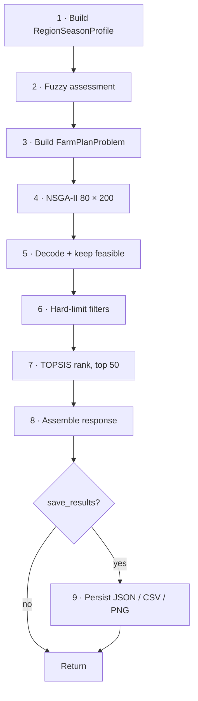

# Optimization Pipeline

Step-by-step trace of `plan_service.generate_farm_plans` (used by `POST /api/farm-plans` and `run_demo.py`; stages 1–7 live in `run_pipeline`, which Scenario Simulation also calls with adjustments — see [SCENARIO_SIMULATION.md](SCENARIO_SIMULATION.md)), with a worked example: **Salem, Kharif, latest year (2024), 5 ha, no budget, balanced** – values captured from a real run on 2026-09-29.

## Stage 1 – Profile (`preprocessing.get_region_season_profile`)
* Canonicalise `location`/`season` (case-insensitive). Resolve year → 2024.
* Land row (Salem, 2024, Kharif): Red Loam, pH 6.8, OC 0.58 %, N/P/K Medium/Medium/Medium → fertility index = 0.3·88 + 0.3·58 + 0.4·60 = **67.8**.
* Rainfall rows Jun–Sep 2024: mean 63.1 mm/month, mean deviation **−21.1 %**, effective rainfall 63.1 × 4 × 0.7 = **176.7 mm**.
* Water rows Jun–Sep: mean storage **62.0 %**, groundwater mode "Very High".
* Crops sorted by revenue: Paddy, Tapioca, Maize, Groundnut, Cotton (5 → chromosome length 15).
* `data_year_estimated = True`.

## Stage 2 – Fuzzy (`fuzzy.evaluate_uncertainty`)
Inputs (−21.1, 62.0, 67.8) → labels deficit / medium / medium → **yield_confidence 0.636, irrigation_risk 0.465**. Per crop: `0.636 × (1 − 0.465 × factor × 0.4)` → Paddy/Maize (Low, 0.3) ≈ 0.600; Tapioca/Groundnut (High, 1.0) ≈ 0.518; Cotton (Medium, 0.6) ≈ 0.565.

## Stage 3 – Problem
Bounds: shares [1e−4, 1], multipliers [0.7, 1.3]. Budget constraint absent (no budget).

## Stage 4 – NSGA-II
`run_nsga2(pop 80, gen 200, seed 42, track_history=save_results)` under the run lock, in the configured engine mode (`original` by default, which reproduces the published results; see [NSGAII_IMPROVEMENT_SUMMARY.md](NSGAII_IMPROVEMENT_SUMMARY.md)). ≈0.29 s with or without history. The run's mode, runtime profile and diversity statistics are saved as `meta.optimizer`.

## Stage 5 – Decode
80 non-dominated solutions (whole final population is non-dominated), all feasible.

## Stage 6 – Filters
None supplied → unchanged.

## Stage 7 – TOPSIS
Balanced weights (0.30, 0.233, 0.233, 0.233); keep top 50. Rank 1:

| Field | Value |
|---|---|
| Crop mix | Tapioca 91.33 %, Groundnut 5.39 %, Maize 3.26 %, Paddy 0.01 %, Cotton 0.01 % |
| Multipliers | irrigation 0.7 on 4 of 5 crops, fertiliser 0.7 on 4 of 5 (see ALGORITHMS §3.2) |
| Yield | 64.76 t (≈12.95 t/ha) |
| Cost | ₹1,97,948 (≈₹39,590/ha) |
| Water | 21.5 million L |
| Impact | 194.3 |
| Closeness | 0.632, confidence Moderate |
| Summary | "High yield, Moderate cost, Moderate water use, Moderate environmental impact" |

## Stage 8 – Response
Region profile (with crop objects and snapshot), fuzzy assessment, ranked plans, convergence history (if tracked), `meta` (algorithm, pop, gen, probabilities, preference, 80 found, 50 returned, seconds).

## Stage 9 – Persistence
See [DATA_FLOW.md](DATA_FLOW.md) §5. `run_id = salem_kharif_2024_<UTC timestamp>`; `saved_files` lists the four absolute paths.

## Parameters that change the outcome

| Knob | Effect |
|---|---|
| `year` | different land/rainfall/water/crop rows (2024 ≡ 2023 inputs except crop coefficients ×1.03) |
| `total_land_ha` | scales every objective linearly; plan shares unchanged in principle (differences only via RNG path) |
| `budget_rs` | adds constraint; too low → 0 plans |
| `preference` | only re-ranks the same front |
| filters | remove plans after optimisation |
| `max_candidate_crops` | only matters if < number of crops (≤5 in the data) |
| `pop_size`, `n_gen` | front density/convergence; same seed → reproducible |
| seed | different seeds give noticeably different top plans for the same inputs (Salem Kharif: yield 50–70 t over seeds 42, 1–4); Scenario Simulation therefore compares five paired seeds per side |
| scenario hooks | `rainfall_factor`, `storage_override_pct`, `fertilizer_price_factor`, explicit TOPSIS `weights` (all neutral by default) |

## Dashboard variant
`dashboard_service._run_dashboard_pareto_front`: identical Stages 1–5 with population 100, current calendar season, 5 ha default, no filters, memoised; ranking done by the caller (balanced for `/api/plans`; three preferences for `/api/comparison`).
