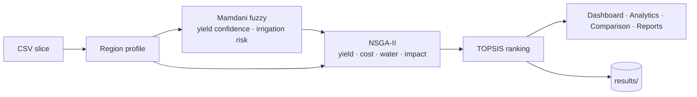

# AgroOptimize

**A fuzzy-evolutionary decision-support system for crop planning under uncertainty** – four Tamil Nadu locations (Coimbatore, Erode, Salem, Pollachi), a Mamdani fuzzy model of rainfall/water/soil conditions, NSGA-II multi-objective optimisation of land allocation and input intensity (yield, cost, water, environmental impact), and TOPSIS ranking of the resulting Pareto-optimal plans – delivered as a FastAPI backend and a React web app.

Team 52, Amrita Vishwa Vidyapeetham (23CSE498 Project Phase II) · Guide: Dr. G. Jeyakumar
VVS Vamsi · Vennela Harshini · Garudammagari Sreenithya · Gaddam Jahnavi

> **Data notice.** The 2020–2023 dataset is a course-provided baseline whose original sources are not documented in this repository; the 2024 rows are estimates derived from 2023 and are flagged as such by the API (`data_year_estimated`) and the UI. See [docs/DATASETS.md](DATASETS.md).

## Features
- Region profile per location/season/year: soil fertility index, seasonal rainfall deviation, reservoir storage, candidate crops.
- Mamdani fuzzy inference (3 inputs, 2 outputs, 26 rules) → yield confidence and irrigation risk, applied per crop by rainfall dependency.
- NSGA-II (pymoo) with the paper's single-point crossover (p = 0.85) and Gaussian mutation (p = 0.12), 200 generations, optional budget constraint, hypervolume convergence tracking; deterministic for a given seed.
- TOPSIS ranking under five preferences; plain-language trade-off summaries; hard-limit filters.
- Web app: dashboard (KPIs, weather via Open-Meteo), Pareto-front analytics with live filters and CSV export, three-plan comparison with radar chart, personalised runs with history and downloadable reports.
- Every saved run persisted as JSON + CSV + convergence chart.
- District Intelligence Center: one page per district with climate, soil, water, crop history, crop suitability, historical prices and generated insights ([DISTRICT_INTELLIGENCE.md](DISTRICT_INTELLIGENCE.md)).
- Explainable recommendations: why a plan was chosen, trade-offs, constraint checks, risks, historical context and a decomposed confidence score – all derived from the pipeline's own numbers ([EXPLAINABILITY.md](EXPLAINABILITY.md)).

## Repository layout
```
final_year_project/
├── agrooptimize-backend/     FastAPI + pipeline (git repo)
│   ├── app/                  config, schemas, main, data/, fuzzy/, optimization/, decision/, services/
│   ├── data/raw/             16 CSVs (4 locations × crop/land/rainfall/water)
│   ├── tests/                205 pytest tests
│   └── run_demo.py           CLI demo
├── stitch_agrooptimize_app/  React 19 + Vite 8 + Tailwind 4 frontend
├── docs/                     full documentation (start with PROJECT_KNOWLEDGE.md)
└── .github/workflows/        test + deploy backend to Fly.io
```

## Quick start

Backend
```bash
cd agrooptimize-backend
python3 -m pip install -r requirements.txt
uvicorn app.main:app --reload --port 8000        # API docs: http://localhost:8000/docs
python3 run_demo.py --location Salem --season Kharif --year 2023 --land 5 --budget 250000
python3 -m pytest -q
```

Frontend tests: `cd frontend && npm test`.

Frontend
```bash
cd stitch_agrooptimize_app
npm install
npm run dev                                      # http://localhost:5173 (expects the API on :8000)
# another API: VITE_API_BASE=http://localhost:8010 npm run dev
npm run lint && npm run build
```

## How it works

Details: [ALGORITHMS.md](ALGORITHMS.md), [OPTIMIZATION_PIPELINE.md](OPTIMIZATION_PIPELINE.md).

## API at a glance
`GET /health` · `GET /api/catalog` · `GET /api/region-profile` · `POST /api/farm-plans` · `GET /api/results` · `GET /api/results/{run_id}` · `GET /api/weather|dashboard|history|soil-profile|plans|comparison|compare-fuzzy/{district}` – see [API_REFERENCE.md](API_REFERENCE.md).

## Deployment
Frontend on Vercel (`vercel.json`, `VITE_API_BASE` in `.env.production`); backend on Fly.io (`fly.toml`, Docker, volume for `results/`); GitHub Actions runs the tests, then deploys. See [ARCHITECTURE.md](ARCHITECTURE.md) §6.

## Known limitations
Irrigation/fertiliser multipliers currently have no yield benefit (optimiser keeps them at the minimum); the yield objective sums tonnes across crops; fuzzy output affects only expected yield; district-level data, single season; demo-only client-side authentication. Full list and roadmap: [RESEARCH_REVIEW.md](RESEARCH_REVIEW.md), [TODO.md](TODO.md).

## Documentation index
[PROJECT_KNOWLEDGE](PROJECT_KNOWLEDGE.md) · [ARCHITECTURE](ARCHITECTURE.md) · [FOLDER_STRUCTURE](FOLDER_STRUCTURE.md) · [FRONTEND](FRONTEND.md) · [BACKEND](BACKEND.md) · [DATASETS](DATASETS.md) · [ALGORITHMS](ALGORITHMS.md) · [API_REFERENCE](API_REFERENCE.md) · [DATA_FLOW](DATA_FLOW.md) · [USER_FLOW](USER_FLOW.md) · [OPTIMIZATION_PIPELINE](OPTIMIZATION_PIPELINE.md) · [REPORT_PIPELINE](REPORT_PIPELINE.md) · [HISTORY_PIPELINE](HISTORY_PIPELINE.md) · [SCORING_AND_RANKING](SCORING_AND_RANKING.md) · [CONFIGURATION](CONFIGURATION.md) · [DEPENDENCIES](DEPENDENCIES.md) · [PROJECT_REVIEW](PROJECT_REVIEW.md) · [DATA_VALIDATION](DATA_VALIDATION.md) · [PERFORMANCE_REVIEW](PERFORMANCE_REVIEW.md) · [SECURITY_REVIEW](SECURITY_REVIEW.md) · [UI_UX_REVIEW](UI_UX_REVIEW.md) · [RESEARCH_REVIEW](RESEARCH_REVIEW.md) · [TECHNICAL_DEBT](TECHNICAL_DEBT.md) · [IMPROVEMENT_LOG](IMPROVEMENT_LOG.md) · [CHANGELOG](CHANGELOG.md) · [TODO](TODO.md) · [EXPLAINABILITY](EXPLAINABILITY.md) · [DISTRICT_INTELLIGENCE](DISTRICT_INTELLIGENCE.md)
