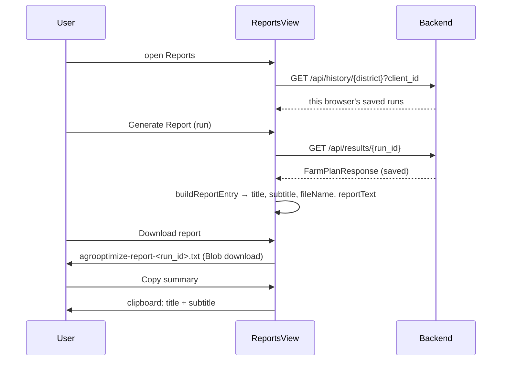

# Report Pipeline

There are two report artefacts: the **server-side run files** written for every saved run, and the **client-side decision report** a user downloads from the Reports page.

## 1. Server-side run files (`app/services/results_store.py`)

Written by `save_run_results` whenever `POST /api/farm-plans` (or the CLI) runs with `save_results=true`.

| File | Content | Producer |
|---|---|---|
| `<run_id>.json` | full response + `run_id`, `saved_at` (UTC ISO), `client_id`, `convergence_history` | `_atomic_write_text` (temp file + rename) |
| `<run_id>_plans.csv` | one row per ranked plan; list/dict columns JSON-encoded | pandas `to_csv` |
| `<run_id>_convergence.csv` | one row per generation: population, best/mean of 4 objectives, hypervolume | pandas |
| `<run_id>_convergence.png` | 11×4.2 in, 130 dpi: (left) hypervolume vs generation; (right) best yield and best cost vs generation on twin axes | matplotlib (Agg backend) |

`run_id = <location>_<season>_<year>_<YYYYMMDDTHHMMSSZ>`; since 2026-09-29 a `-2`, `-3`… suffix is added if two runs would get the same id in the same second. These files are not served to the browser (only the JSON via `GET /api/results/{run_id}`); the PNG is for the project report.

## 2. Client-side decision report (`src/views/ReportsView.jsx`)

### Report text structure (`buildReportText`; ~50 lines plus the explanation section)
1. Header – generated time, run id, district/season/year; NOTE line if `data_year_estimated`.
2. Region snapshot – soil type, pH, organic carbon, fertility index; rainfall mean, months, deviation; storage %, groundwater status.
3. Uncertainty assessment – yield confidence with labels; irrigation risk.
4. Optimisation – algorithm, population, generations, feasible plans found, preference.
5. Top 3 plans – TOPSIS closeness, crop mix (share and ha, ≥1 %), yield total and t/ha, cost total and ₹/ha (with the scope note "fertilizer, pesticide and labour only"), irrigation litres, impact score, confidence, trade-off sentence.
6. Why plan #1 was recommended – from `GET /api/results/{run_id}/explanation`: recommendation and rule, confidence, then Reasons → Trade-offs (+ marginal rates) → Benefits → Risks (with severity) → Confidence breakdown. If the explanation cannot be loaded the report says so.
7. Limitations – district-level averages and documented assumptions; decision support, not agronomic advice.

Every value comes from the saved record or its explanation; nothing is invented.

### Card on screen
Title `"<District> <Season> <Year> -- <crop mix>"`, subtitle `"Yield x t/ha · Cost ₹y/ha · <confidence>"`, date, NEW tag. Cards live in component state only (disappear when leaving the page).

## 3. Gaps vs the paper
The paper promises "a printable one-page decision report … crop-by-plot assignment, irrigation schedules, fertilizer recommendations". Implemented: a plain-text report with crop areas and the modelled multipliers' consequences. Not implemented: PDF, plot assignment (no plot data), irrigation calendar, fertiliser product recommendations. Options: `window.print()` of a styled report view, or server-side PDF generation (e.g. WeasyPrint/ReportLab) – TODO T-15.
