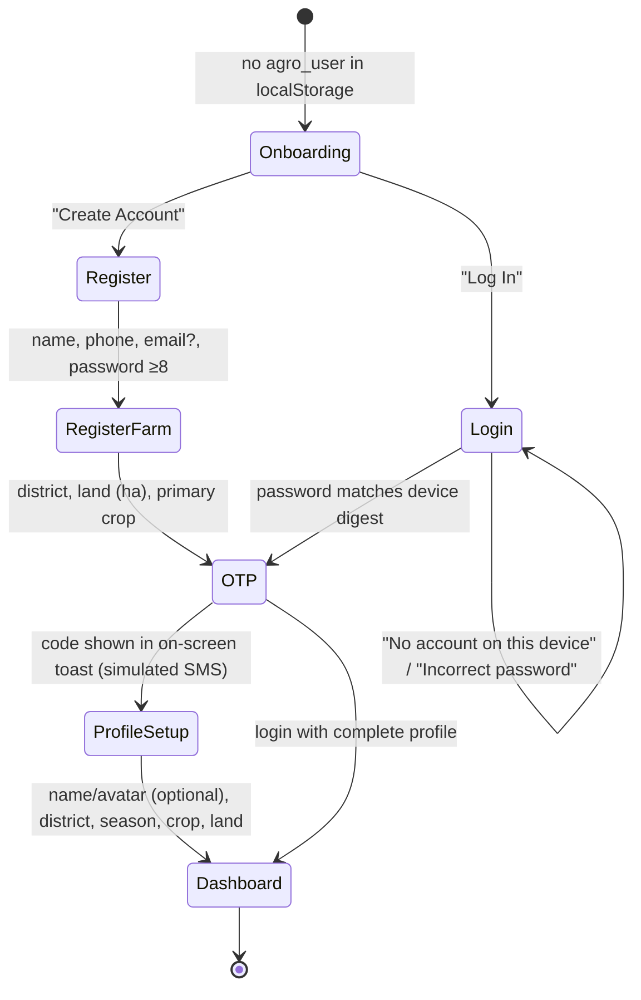
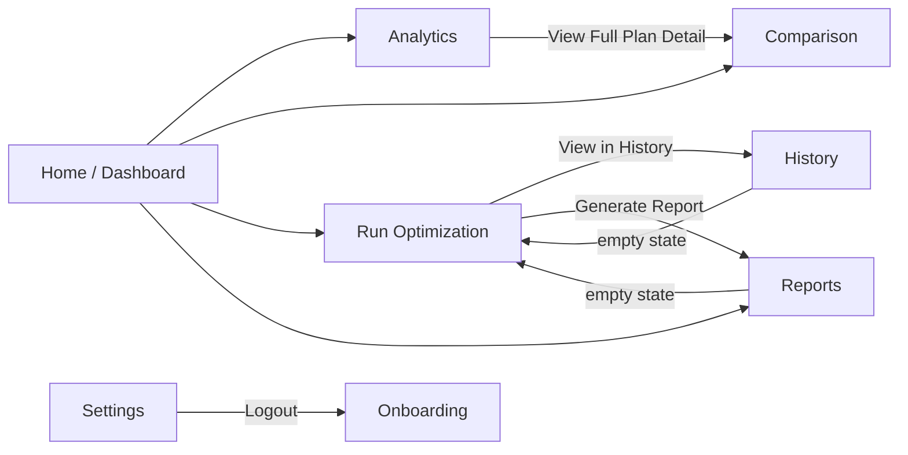

# User Flow

## 1. First visit

Notes: everything before the dashboard is client-side only. A user who registers already supplies a district, but `handleAuthSuccess(…, isLoginFlow=false)` still routes through ProfileSetup, so district/land/crop are asked twice (UI_UX_REVIEW U-3).

## 2. Main navigation (shell)

Every shell page is reachable from the sidebar/top bar/drawer: Home, Analytics, Comparison, Run Optimization, District Intelligence, Scenario Simulation, History, Reports, Settings.

## 3. Core task: get and keep a personalised plan

1. **Run Optimization** – pick district/season/year/land/budget/preference → *Run Optimization*.
2. Progress screen (~5.7 s animation; the backend finishes in ~0.3 s and is awaited).
3. Result card – top plan's crop mix, t/ha, ₹/ha, confidence, trade-off sentence; note if inputs are estimated.
4. **History** – the run appears (newest first) for that district and this browser only.
5. **Reports** – *Generate Report* on the run → card → *Download report* (.txt) or *Copy summary*.

## 4. Exploration tasks (generic, not saved)

| Page | What the user learns | Inputs used |
|---|---|---|
| Dashboard | district KPIs, soil/water actions, weather | profile district |
| Analytics | the whole Pareto front for the current season, filter by cost/yield/water, convergence, fuzzy effect | profile district, 5 ha |
| Comparison | three representative plans (balanced / max-yield / min-cost), radar, re-weighting | profile district, 5 ha |

`DataSourceNotice` on these pages states they are district-level and not saved.

## 4b. What-if planning (Scenario Simulation)
1. Set the original conditions (district, season, year, land, budget, preference) and change one or more scenario controls.
2. *Run simulation* (~4 s) → summary, both recommendations side by side, impact cards with verdicts, decision-impact statements, trade-offs, optimisation difference, crop effects, historical comparison.
3. *Save scenario* (named) → listed under Saved scenarios for this browser; reopen restores the form and result. *Export report* downloads an HTML report with charts (print to PDF from the browser); *Export JSON* downloads the raw result.

## 5. Returning visit

`agro_currentView` and `agro_user` restore the last page. Logout clears both but keeps the password digest and `client_id`, so History remains visible after logging back in on the same browser. Clearing site data loses the profile, the "account" and access to History (runs remain on the server, unreachable).

## 6. Failure paths

| Situation | What the user sees |
|---|---|
| Backend down | footer "Server unreachable — live data unavailable"; each section shows the unreachable message |
| No data for chosen year/season | Run page: "Can't run Salem / Rabi: No data for …" (backend detail) |
| Budget too tight | Run completes; result card without a plan section; History shows "--" |
| Weather API down | "Historical estimate" label with month-average values |
| Invalid inputs (e.g. land 0) | browser form validation; backend 422 detail if bypassed |
